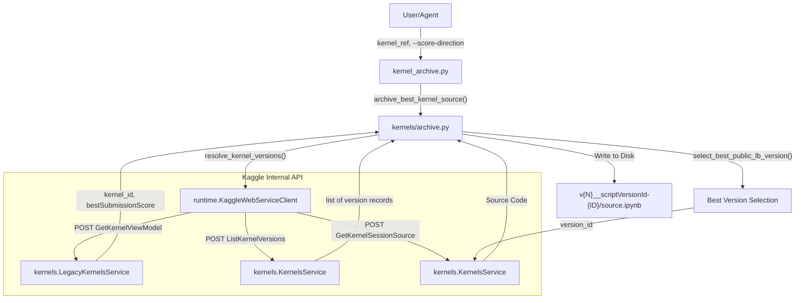
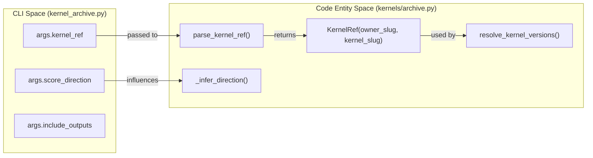

<!-- source: DeepWiki mcp.deepwiki.com · repo NVIDIA/nvidia-kaggle · extra page Kernel Archiving & Best-Version Selection · fetched 2026-10-26 -->

# Kernel Archiving & Best-Version Selection

Relevant source files

The following files were used as context for generating this wiki page:

- [skills/nvidia-kaggle-skill/scripts/kernel_archive.py](skills/nvidia-kaggle-skill/scripts/kernel_archive.py)
- [skills/nvidia-kaggle-skill/scripts/kernels/archive.py](skills/nvidia-kaggle-skill/scripts/kernels/archive.py)

The Kernel Archiving system provides the capability to retrieve and store specific historical versions of Kaggle kernels. While the official Kaggle API primarily exposes the latest version of a kernel, this module leverages Kaggle's internal web services to inspect the full version history, evaluate leaderboard performance for each version, and download the source code for the optimal version.

## Overview

The archiving process is handled by the `kernel_archive.py` CLI script and the underlying `kernels/archive.py` library. The system implements a sophisticated version selection logic that can automatically determine whether a competition's metric should be minimized or maximized based on historical submission data.

### Key Capabilities
- **Version Resolution**: Fetches every historical version of a kernel, including internal IDs and metadata [[skills/nvidia-kaggle-skill/scripts/kernels/archive.py:115-118]]().
- **Score Inference**: Automatically detects the optimization direction (minimize vs. maximize) by comparing version scores against the kernel's reported "best score" [[skills/nvidia-kaggle-skill/scripts/kernels/archive.py:160-177]]().
- **Source Retrieval**: Downloads the full notebook source (JSON) or script via internal endpoints [[skills/nvidia-kaggle-skill/scripts/kernels/archive.py:251-260]]().
- **Directory Convention**: Organizes archives using a specific naming convention: `v{version_number}__scriptVersionId-{id}` [[skills/nvidia-kaggle-skill/scripts/kernels/archive.py:231-233]]().

## System Architecture & Data Flow

The following diagram illustrates the flow from a user request to the final archived file on disk, highlighting the interaction with Kaggle's internal `LegacyKernelsService` and `KernelsService`.

### Kernel Archiving Flow

Sources: [[skills/nvidia-kaggle-skill/scripts/kernel_archive.py:19-71]](), [[skills/nvidia-kaggle-skill/scripts/kernels/archive.py:115-157]](), [[skills/nvidia-kaggle-skill/scripts/kernels/archive.py:214-239]]()

## Implementation Details

### Version Resolution & Scoring
The system calls `resolve_kernel_versions` to build a complete history of the kernel. It maps internal Kaggle entities to a unified record format.

| Field | Description | Source |
| :--- | :--- | :--- |
| `version_number` | The user-facing version index (1, 2, 3...) | [[skills/nvidia-kaggle-skill/scripts/kernels/archive.py:100]]() |
| `kernel_session_id` | Internal ID used to fetch source code | [[skills/nvidia-kaggle-skill/scripts/kernels/archive.py:101]]() |
| `public_lb_numeric` | Parsed float value of the leaderboard score | [[skills/nvidia-kaggle-skill/scripts/kernels/archive.py:152]]() |
| `best_submission_score_for_kernel` | The overall best score Kaggle associates with this kernel | [[skills/nvidia-kaggle-skill/scripts/kernels/archive.py:153]]() |

Sources: [[skills/nvidia-kaggle-skill/scripts/kernels/archive.py:97-112]](), [[skills/nvidia-kaggle-skill/scripts/kernels/archive.py:139-156]]()

### Best-Version Selection Logic
The `select_best_public_lb_version` function determines which version to download. If `score_direction` is set to `"auto"`, the system uses `_infer_direction` [[skills/nvidia-kaggle-skill/scripts/kernels/archive.py:180-182]]().

**Inference Logic (`_infer_direction`):**
1. It extracts all numeric scores from the version history [[skills/nvidia-kaggle-skill/scripts/kernels/archive.py:161]]().
2. It retrieves the kernel's global `best_score` from the metadata [[skills/nvidia-kaggle-skill/scripts/kernels/archive.py:168]]().
3. If the `best_score` matches the minimum value found in history, it sets direction to `minimize` [[skills/nvidia-kaggle-skill/scripts/kernels/archive.py:173-174]]().
4. If it matches the maximum, it sets direction to `maximize` [[skills/nvidia-kaggle-skill/scripts/kernels/archive.py:175-176]]().

Sources: [[skills/nvidia-kaggle-skill/scripts/kernels/archive.py:160-177]](), [[skills/nvidia-kaggle-skill/scripts/kernels/archive.py:180-212]]()

### Source Download & Storage
Once a version is selected, `archive_kernel_version` handles the retrieval. It uses the `GetKernelSessionSource` endpoint [[skills/nvidia-kaggle-skill/scripts/kernels/archive.py:25]]().

The source is saved into a directory following the convention:
`{output_dir}/v{version_number}__scriptVersionId-{version_id}/` [[skills/nvidia-kaggle-skill/scripts/kernels/archive.py:231-233]]().

The downloaded file is named `source.ipynb` (for notebooks) or `source.py`/`source.R` (for scripts) based on the kernel language [[skills/nvidia-kaggle-skill/scripts/kernels/archive.py:234-238]]().

Sources: [[skills/nvidia-kaggle-skill/scripts/kernels/archive.py:214-245]](), [[skills/nvidia-kaggle-skill/scripts/kernels/archive.py:248-266]]()

## CLI Usage

The `kernel_archive.py` script provides a command-line interface for these operations.

| Argument | Description |
| :--- | :--- |
| `kernel_ref` | `owner/slug` or a Kaggle URL [[skills/nvidia-kaggle-skill/scripts/kernel_archive.py:23]]() |
| `--version` | Skip "best" logic and download a specific version number [[skills/nvidia-kaggle-skill/scripts/kernel_archive.py:26-29]]() |
| `--score-direction` | Force `minimize` or `maximize` for "best" selection [[skills/nvidia-kaggle-skill/scripts/kernel_archive.py:30-35]]() |
| `--list` | Output all version scores as JSON and exit without downloading [[skills/nvidia-kaggle-skill/scripts/kernel_archive.py:39-44]]() |
| `--include-outputs` | Include cell outputs in the notebook JSON [[skills/nvidia-kaggle-skill/scripts/kernel_archive.py:36]]() |

### Example Entity Mapping
The following diagram maps CLI concepts to the internal `KernelRef` and `KaggleWebServiceClient` entities.

Sources: [[skills/nvidia-kaggle-skill/scripts/kernel_archive.py:23-45]](), [[skills/nvidia-kaggle-skill/scripts/kernels/archive.py:33-36]](), [[skills/nvidia-kaggle-skill/scripts/kernels/archive.py:38-57]](), [[skills/nvidia-kaggle-skill/scripts/kernels/archive.py:115-120]]()

---

