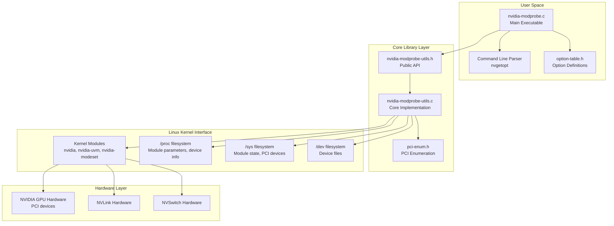
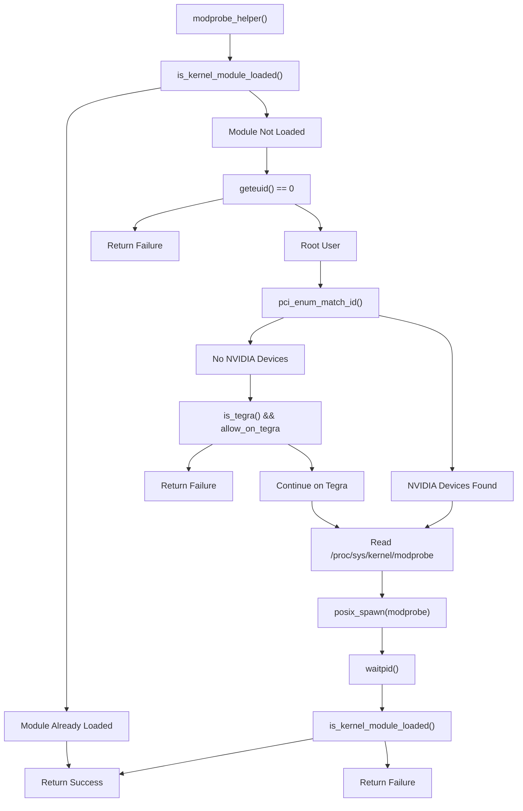
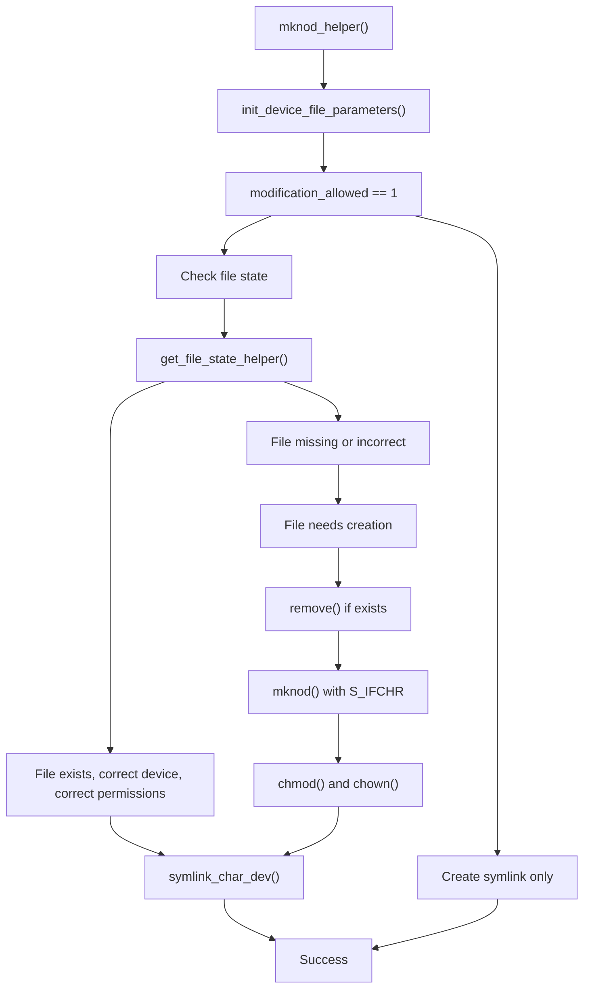

<!-- source: DeepWiki mcp.deepwiki.com · repo NVIDIA/nvidia-modprobe · page 2 nvidia-modprobe System · fetched 2026-10-26 -->

# nvidia-modprobe System

Relevant source files

The following files were used as context for generating this wiki page:

- [modprobe-utils/nvidia-modprobe-utils.c](modprobe-utils/nvidia-modprobe-utils.c)
- [modprobe-utils/nvidia-modprobe-utils.h](modprobe-utils/nvidia-modprobe-utils.h)
- [nvidia-modprobe.c](nvidia-modprobe.c)

## Purpose and Scope

The nvidia-modprobe system is a setuid utility that provides distribution-independent loading of NVIDIA kernel modules and creation of NVIDIA device files on Linux systems. This system enables NVIDIA driver components running with limited privileges to access GPU hardware by ensuring the necessary kernel modules are loaded and device files are properly created.

This document covers the core system architecture, main components, and integration mechanisms. For detailed information about the command-line interface and option processing, see [Command Line Interface](#2.4). For PCI hardware detection and enumeration details, see [PCI Hardware Integration](#2.5).

## System Architecture Overview

The nvidia-modprobe system follows a layered architecture with the main executable orchestrating operations through a core library that interfaces with the Linux kernel and hardware subsystems.

Sources: [nvidia-modprobe.c:89-289](), [modprobe-utils/nvidia-modprobe-utils.c:1-1167](), [modprobe-utils/nvidia-modprobe-utils.h:1-145]()

## Core Components

The system consists of three primary components that work together to provide module loading and device file creation functionality:

### Main Executable (`nvidia-modprobe.c`)

The main executable serves as the entry point and command-line interface, parsing user arguments and orchestrating the appropriate operations. Key functions include:

- `main()` - Primary entry point with argument processing
- Command-line option parsing using `nvgetopt()`
- Operation selection based on flags (`uvm_modprobe`, `modeset`, `nvswitch`, `nvlink`)

### Core Library (`nvidia-modprobe-utils.c`)

The core library implements the actual module loading and device file creation logic. Major function categories include:

| Function Category | Key Functions | Purpose |
|------------------|---------------|---------|
| Module Loading | `nvidia_modprobe()`, `nvidia_uvm_modprobe()`, `nvidia_modeset_modprobe()` | Load kernel modules using `posix_spawn()` and `modprobe` |
| Device Creation | `nvidia_mknod()`, `nvidia_uvm_mknod()`, `nvidia_nvlink_mknod()` | Create device files with proper permissions |
| Hardware Detection | `modprobe_helper()`, `pci_enum_match_id()` | Enumerate PCI devices and validate hardware presence |
| File State Management | `nvidia_get_file_state()`, `get_file_state_helper()` | Check device file existence and permissions |

### Public API (`nvidia-modprobe-utils.h`)

The header file defines the public interface with constants, data structures, and function declarations. Key definitions include:

- Device file path constants (`NV_DEVICE_FILE_PATH`, `NV_CTRL_DEVICE_FILE_PATH`)
- Module name constants (`NV_UVM_MODULE_NAME`, `NV_MODESET_MODULE_NAME`)
- File state enumeration (`NvDeviceFileState`)
- Device file utility functions (`assign_device_file_name()`)

Sources: [nvidia-modprobe.c:89-289](), [modprobe-utils/nvidia-modprobe-utils.c:354-358](), [modprobe-utils/nvidia-modprobe-utils.h:28-145]()

## Module Loading Process

The system implements a sophisticated module loading process that validates hardware presence before attempting to load kernel modules:

The process includes several validation steps:
- Hardware presence validation using PCI enumeration
- Special handling for Tegra SoC platforms
- Process isolation using `posix_spawn()` with output redirection
- Module state verification through `/sys/module/*/initstate`

Sources: [modprobe-utils/nvidia-modprobe-utils.c:179-348](), [modprobe-utils/nvidia-modprobe-utils.c:99-122](), [modprobe-utils/nvidia-modprobe-utils.c:234-252]()

## Device File Management

Device file creation follows a comprehensive process that handles permissions, ownership, and symbolic link management:

The system manages multiple types of device files:

| Device Type | Major Number | Device Path | Module |
|-------------|--------------|-------------|---------|
| Main GPU devices | 195 | `/dev/nvidia*` | `nvidia` |
| Control device | 195 | `/dev/nvidiactl` | `nvidia` |
| UVM devices | Dynamic | `/dev/nvidia-uvm*` | `nvidia-uvm` |
| Modeset device | 195 | `/dev/nvidia-modeset` | `nvidia-modeset` |
| NVLink device | Dynamic | `/dev/nvidia-nvlink` | `nvidia-nvlink` |
| NVSwitch devices | Dynamic | `/dev/nvidia-nvswitch*` | `nvidia-nvswitch` |

Sources: [modprobe-utils/nvidia-modprobe-utils.c:549-636](), [modprobe-utils/nvidia-modprobe-utils.c:478-541](), [modprobe-utils/nvidia-modprobe-utils.c:367-414]()

## Hardware Integration

The system integrates with hardware through PCI device enumeration and platform-specific detection mechanisms. Hardware validation occurs before module loading to prevent unnecessary error messages and ensure appropriate hardware is present.

Key hardware integration components:
- PCI vendor ID matching (`NV_PCI_VENDOR_ID = 0x10DE`)
- Display controller class detection (`PCI_BASE_CLASS_DISPLAY = 0x0300`)
- Tegra SoC platform detection via `/sys/devices/soc0/family`
- Dynamic major number resolution through `/proc/devices`

The system supports multiple NVIDIA hardware types including discrete GPUs, integrated Tegra graphics, NVLink interconnects, and NVSwitch fabric devices.

Sources: [modprobe-utils/nvidia-modprobe-utils.c:90-91](), [modprobe-utils/nvidia-modprobe-utils.c:195-203](), [modprobe-utils/nvidia-modprobe-utils.c:146-169](), [modprobe-utils/nvidia-modprobe-utils.c:657-724]()

---

