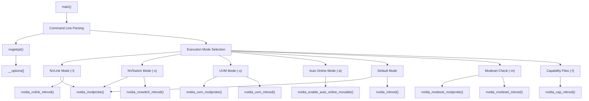
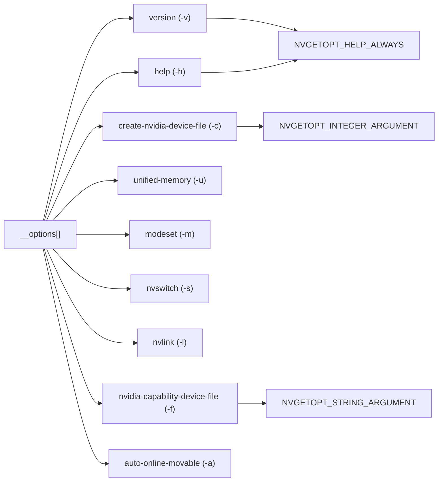
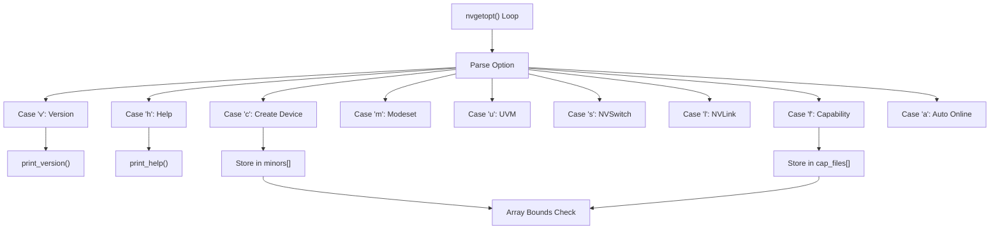
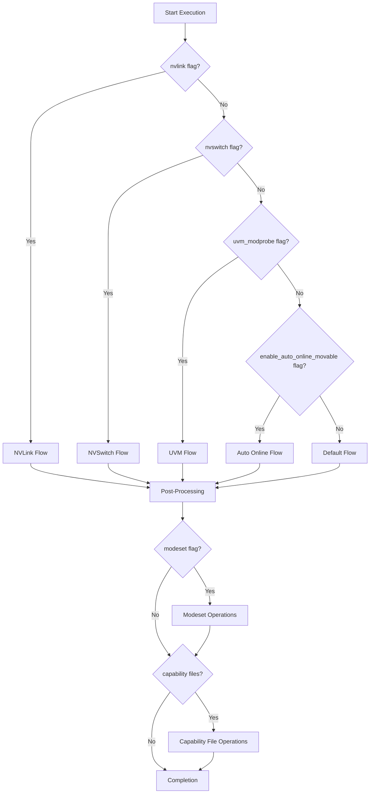
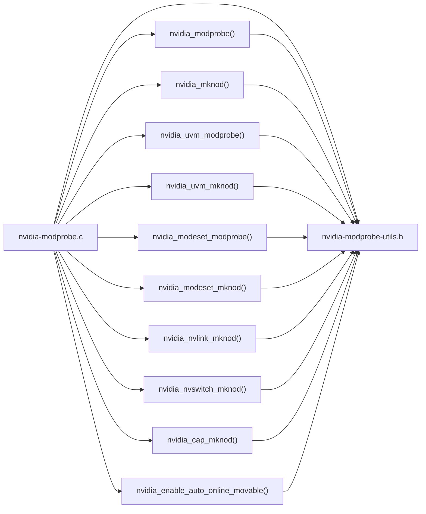
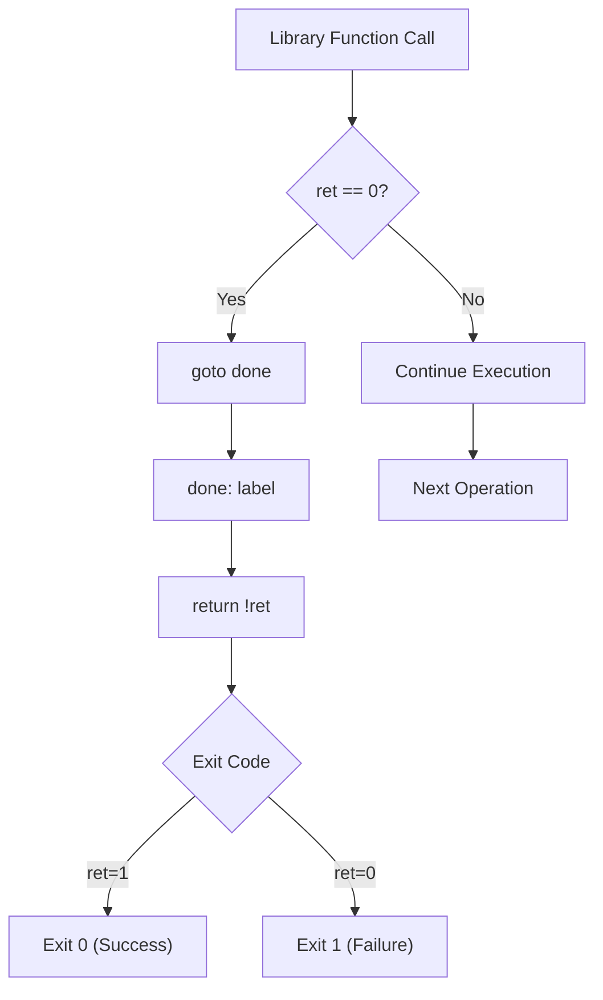

<!-- source: DeepWiki mcp.deepwiki.com · repo NVIDIA/nvidia-modprobe · page 2.1 Main Executable · fetched 2026-10-26 -->

# Main Executable

Relevant source files

The following files were used as context for generating this wiki page:

- [nvidia-modprobe.c](nvidia-modprobe.c)
- [option-table.h](option-table.h)

This document covers the main executable program `nvidia-modprobe.c`, which serves as the entry point and command-line interface for the nvidia-modprobe system. The executable is a setuid utility that processes command-line arguments and orchestrates kernel module loading and device file creation operations.

For information about the underlying implementation functions that this executable calls, see [Core Library Implementation](#2.2). For details about the public API definitions, see [Library API](#2.3).

## Purpose and Architecture

The main executable in [nvidia-modprobe.c:1-290]() is a distribution-independent setuid utility designed to load NVIDIA kernel modules and create device files on behalf of user-space components that lack sufficient privileges. The program serves as a command-line wrapper around the core functionality implemented in the nvidia-modprobe-utils library.

### Program Structure Overview

Sources: [nvidia-modprobe.c:89-290]()

## Command-Line Processing System

The executable uses a sophisticated command-line parsing system based on the `nvgetopt` library. The available options are defined in a static table structure.

### Option Definition Structure

Sources: [option-table.h:19-84]()

### Argument Processing Flow

The main parsing loop in [nvidia-modprobe.c:103-169]() processes arguments using `nvgetopt()` and maintains several data structures:

| Data Structure | Purpose | Maximum Size |
|---|---|---|
| `minors[]` | Device minor numbers for `-c` option | 64 entries |
| `cap_files[]` | Capability file paths for `-f` option | 256 entries |
| Boolean flags | Mode selection (`uvm_modprobe`, `modeset`, `nvswitch`, etc.) | N/A |

Sources: [nvidia-modprobe.c:103-169]()

## Operational Modes and Execution Flow

The executable supports multiple operational modes, each targeting different NVIDIA subsystems. The execution flow is determined by the command-line flags provided.

### Mode Selection Logic

Sources: [nvidia-modprobe.c:171-285]()

### Core Operation Functions

Each operational mode calls specific functions from the nvidia-modprobe-utils library:

| Mode | Module Loading Function | Device Creation Function |
|---|---|---|
| Default | `nvidia_modprobe(0)` | `nvidia_mknod(minor)` |
| UVM | `nvidia_uvm_modprobe()` | `nvidia_uvm_mknod(minor)` |
| NVLink | `nvidia_modprobe(0)` | `nvidia_nvlink_mknod()` |
| NVSwitch | `nvidia_modprobe(0)` | `nvidia_nvswitch_mknod(minor)` |
| Modeset | `nvidia_modeset_modprobe()` | `nvidia_modeset_mknod()` |
| Capability | N/A | `nvidia_cap_mknod(path, &unused)` |
| Auto Online | `nvidia_enable_auto_online_movable(0)` | N/A |

Sources: [nvidia-modprobe.c:171-285]()

## Integration with Core Library

The main executable acts as a thin wrapper around the core library functionality. It handles argument parsing, mode selection, and error handling, while delegating all actual work to the nvidia-modprobe-utils library.

### Function Call Patterns

Sources: [nvidia-modprobe.c:40](), [nvidia-modprobe.c:176](), [nvidia-modprobe.c:193](), [nvidia-modprobe.c:212](), [nvidia-modprobe.c:232](), [nvidia-modprobe.c:242](), [nvidia-modprobe.c:252](), [nvidia-modprobe.c:264](), [nvidia-modprobe.c:270](), [nvidia-modprobe.c:279]()

## Error Handling and Return Values

The program implements a consistent error handling pattern where all library functions return success/failure status, and the main executable converts this to appropriate exit codes.

### Error Handling Flow

Sources: [nvidia-modprobe.c:177-180](), [nvidia-modprobe.c:194-197](), [nvidia-modprobe.c:213-216](), [nvidia-modprobe.c:233-236](), [nvidia-modprobe.c:243-246](), [nvidia-modprobe.c:253-256](), [nvidia-modprobe.c:265-268](), [nvidia-modprobe.c:271-274](), [nvidia-modprobe.c:280-283](), [nvidia-modprobe.c:286-289]()

The executable follows a consistent pattern where successful operations return `1` from library functions, and the main program returns `!ret` to convert this to standard Unix exit codes (0 for success, 1 for failure).

Sources: [nvidia-modprobe.c:1-290](), [option-table.h:1-85]()

---

