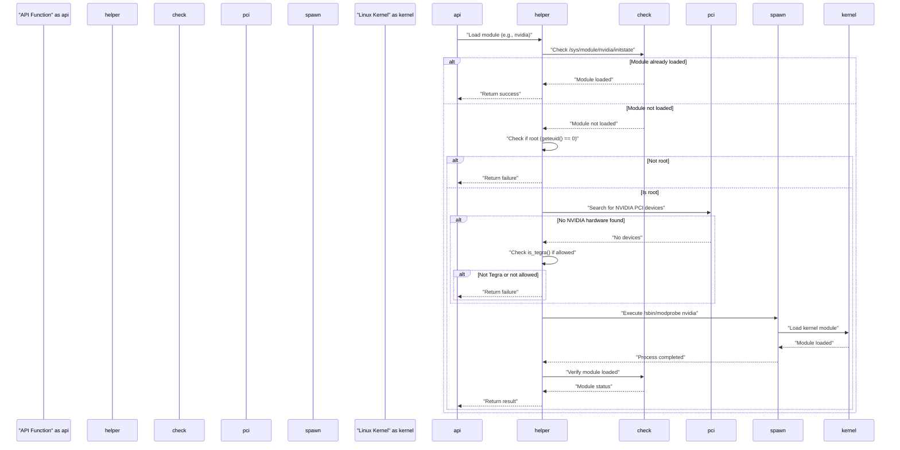

<!-- source: DeepWiki mcp.deepwiki.com · repo NVIDIA/nvidia-modprobe · page 2.2 Core Library Implementation · fetched 2026-10-26 -->

# Core Library Implementation

<details>
<summary>Relevant source files</summary>

The following files were used as context for generating this wiki page:

- [modprobe-utils/nvidia-modprobe-utils.c](modprobe-utils/nvidia-modprobe-utils.c)
- [modprobe-utils/nvidia-modprobe-utils.h](modprobe-utils/nvidia-modprobe-utils.h)

</details>


This document covers the core library implementation of the nvidia-modprobe system, specifically the `nvidia-modprobe-utils.c` file and its public API defined in `nvidia-modprobe-utils.h`. This library provides the fundamental functionality for loading NVIDIA kernel modules and creating device files on Linux systems.

For information about the command-line interface that uses this library, see [Main Executable](#2.1). For details about the public API functions, see [Library API](#2.3).

## Purpose and Scope

The core library serves as the heart of the nvidia-modprobe system, implementing two primary responsibilities:

1. **Kernel Module Loading**: Safely loading NVIDIA kernel modules (`nvidia`, `nvidia-uvm`, `nvidia-modeset`, etc.) with proper hardware detection and permission checks
2. **Device File Management**: Creating and managing character device files in `/dev/` with correct permissions, ownership, and symbolic links

The library is designed to be used by setuid root programs that need to perform privileged operations on behalf of unprivileged users.

## Architecture Overview

The core library follows a layered architecture with helper functions providing common functionality for module-specific operations:

```mermaid
graph TD
    subgraph "Public API Layer"
        nvidia_modprobe["nvidia_modprobe()"]
        nvidia_mknod["nvidia_mknod()"]
        nvidia_uvm_modprobe["nvidia_uvm_modprobe()"]
        nvidia_uvm_mknod["nvidia_uvm_mknod()"]
        nvidia_modeset_modprobe["nvidia_modeset_modprobe()"]
        nvidia_modeset_mknod["nvidia_modeset_mknod()"]
        nvidia_nvlink_mknod["nvidia_nvlink_mknod()"]
        nvidia_nvswitch_mknod["nvidia_nvswitch_mknod()"]
        nvidia_cap_mknod["nvidia_cap_mknod()"]
    end
    
    subgraph "Core Helper Functions"
        modprobe_helper["modprobe_helper()"]
        mknod_helper["mknod_helper()"]
        get_file_state_helper["get_file_state_helper()"]
        init_device_file_parameters["init_device_file_parameters()"]
    end
    
    subgraph "System Integration"
        is_kernel_module_loaded["is_kernel_module_loaded()"]
        nvidia_get_chardev_major["nvidia_get_chardev_major()"]
        symlink_char_dev["symlink_char_dev()"]
        silence_process_actions["silence_process_actions()"]
    end
    
    subgraph "Hardware Detection"
        pci_enum_match_id["pci_enum_match_id()"]
        is_tegra["is_tegra()"]
    end
    
    subgraph "Linux Kernel Interface"
        posix_spawn["posix_spawn()"]
        mknod_syscall["mknod()"]
        stat_syscall["stat()"]
        access_syscall["access()"]
    end
    
    nvidia_modprobe --> modprobe_helper
    nvidia_mknod --> mknod_helper
    nvidia_uvm_modprobe --> modprobe_helper
    nvidia_uvm_mknod --> mknod_helper
    nvidia_modeset_modprobe --> modprobe_helper
    nvidia_modeset_mknod --> mknod_helper
    nvidia_nvlink_mknod --> mknod_helper
    nvidia_nvswitch_mknod --> mknod_helper
    nvidia_cap_mknod --> mknod_helper
    
    modprobe_helper --> is_kernel_module_loaded
    modprobe_helper --> pci_enum_match_id
    modprobe_helper --> is_tegra
    modprobe_helper --> silence_process_actions
    
    mknod_helper --> get_file_state_helper
    mknod_helper --> init_device_file_parameters
    mknod_helper --> symlink_char_dev
    mknod_helper --> nvidia_get_chardev_major
    
    modprobe_helper --> posix_spawn
    mknod_helper --> mknod_syscall
    get_file_state_helper --> stat_syscall
    is_kernel_module_loaded --> access_syscall
```



**Sources**: [modprobe-utils/nvidia-modprobe-utils.c:1-1167](), [modprobe-utils/nvidia-modprobe-utils.h:1-145]()

## Module Loading System

The module loading system is built around the `modprobe_helper()` function, which implements a robust workflow for loading kernel modules:

### Core Module Loading Flow



**Sources**: [modprobe-utils/nvidia-modprobe-utils.c:179-348]()

### Key Constants and Definitions

The system uses several important constants and paths:

| Constant | Value | Purpose |
|----------|-------|---------|
| `NV_NVIDIA_MODULE_NAME` | `"nvidia"` | Main GPU driver module |
| `NV_UVM_MODULE_NAME` | `"nvidia-uvm"` | Unified Virtual Memory module |
| `NV_MODESET_MODULE_NAME` | `"nvidia-modeset"` | Display/modesetting module |
| `NV_NVLINK_MODULE_NAME` | `"nvidia-nvlink"` | NVLink interconnect module |
| `NV_NVSWITCH_MODULE_NAME` | `"nvidia-nvswitch"` | NVSwitch fabric module |
| `NV_PROC_MODPROBE_PATH` | `"/proc/sys/kernel/modprobe"` | System modprobe path |
| `NV_PROC_DEVICES_PATH` | `"/proc/devices"` | Character device registry |

**Sources**: [modprobe-utils/nvidia-modprobe-utils.c:56-78]()

### Hardware Detection Integration

The module loading system integrates with hardware detection to prevent unnecessary module loading:

```mermaid
graph LR
    subgraph "Hardware Detection"
        pci_match["`pci_id_match`<br/>Vendor: 0x10DE<br/>Class: 0x0300<br/>Mask: PCI_BASE_CLASS_MASK"]
        pci_enum["pci_enum_match_id()"]
        tegra_check["is_tegra()"]
        soc_family["`/sys/devices/soc0/family`<br/>Check for 'Tegra'"]
    end
    
    subgraph "Decision Logic"
        has_nvidia_gpu["NVIDIA GPU Present?"]
        is_tegra_platform["Tegra Platform?"]
        allow_tegra["Module allows Tegra?"]
    end
    
    pci_match --> pci_enum
    pci_enum --> has_nvidia_gpu
    
    has_nvidia_gpu -->|No| is_tegra_platform
    has_nvidia_gpu -->|Yes| proceed["Proceed with modprobe"]
    
    is_tegra_platform --> tegra_check
    tegra_check --> soc_family
    soc_family --> allow_tegra
    
    allow_tegra -->|Yes| proceed
    allow_tegra -->|No| abort["Abort: No NVIDIA devices"]
```

**Sources**: [modprobe-utils/nvidia-modprobe-utils.c:195-252](), [modprobe-utils/nvidia-modprobe-utils.c:146-169]()

## Device File Management

The device file management system handles creating character device files with proper permissions, ownership, and symbolic links:

### Device File Creation Flow

```mermaid
graph TD
    subgraph "Device File Creation Process"
        start["`mknod_helper()`<br/>Entry Point"]
        init_params["`init_device_file_parameters()`<br/>Read /proc permissions"]
        check_modify["Check modification_allowed"]
        get_state["`get_file_state_helper()`<br/>Check existing file"]
        
        subgraph "File State Checks"
            exists["FileExists?"]
            chrdev_ok["ChrDevOk?"]
            perms_ok["PermissionsOk?"]
        end
        
        subgraph "File Operations"
            remove_file["remove() old file"]
            create_mknod["mknod() new file"]
            set_perms["chmod() & chown()"]
            create_symlink["`symlink_char_dev()`<br/>Create /dev/char/major:minor"]
        end
    end
    
    start --> init_params
    init_params --> check_modify
    
    check_modify -->|Not allowed| create_symlink
    check_modify -->|Allowed| get_state
    
    get_state --> exists
    get_state --> chrdev_ok
    get_state --> perms_ok
    
    exists -->|No| create_mknod
    chrdev_ok -->|No| remove_file
    perms_ok -->|No| set_perms
    
    exists -->|Yes| chrdev_ok
    chrdev_ok -->|Yes| perms_ok
    perms_ok -->|Yes| create_symlink
    
    remove_file --> create_mknod
    create_mknod --> set_perms
    set_perms --> create_symlink
```

**Sources**: [modprobe-utils/nvidia-modprobe-utils.c:549-636]()

### Device File State Management

The system tracks device file state using a bitmask approach:

```mermaid
graph LR
    subgraph "NvDeviceFileState Enum"
        file_exists["NvDeviceFileStateFileExists = 0"]
        chrdev_ok["NvDeviceFileStateChrDevOk = 1"]
        perms_ok["NvDeviceFileStatePermissionsOk = 2"]
    end
    
    subgraph "State Functions"
        update_state["`nvidia_update_file_state()`<br/>Set bit in state mask"]
        test_state["`nvidia_test_file_state()`<br/>Test bit in state mask"]
    end
    
    subgraph "State Checks"
        stat_check["`stat()` system call<br/>Check file existence & type"]
        dev_check["Compare st_rdev with expected dev_t"]
        perm_check["Check mode, uid, gid"]
    end
    
    stat_check --> file_exists
    dev_check --> chrdev_ok
    perm_check --> perms_ok
    
    file_exists --> update_state
    chrdev_ok --> update_state
    perms_ok --> update_state
    
    update_state --> test_state
```

**Sources**: [modprobe-utils/nvidia-modprobe-utils.h:59-76](), [modprobe-utils/nvidia-modprobe-utils.c:419-452]()

## Character Device Integration

The system integrates with the Linux character device subsystem through several key mechanisms:

### Major Number Discovery

```mermaid
graph LR
    subgraph "Character Device Discovery"
        proc_devices["`/proc/devices`<br/>Character devices registry"]
        get_major["`nvidia_get_chardev_major()`<br/>Parse device list"]
        
        subgraph "Search Process"
            find_char_section["Find 'Character devices:' section"]
            search_name["Search for module name"]
            extract_major["Extract major number"]
        end
    end
    
    subgraph "Module-Specific Lookups"
        nvidia_major["nvidia → 195 (fixed)"]
        uvm_major["nvidia-uvm → dynamic"]
        nvlink_major["nvidia-nvlink → dynamic"]
        nvswitch_major["nvidia-nvswitch → dynamic"]
        caps_major["nvidia-caps → dynamic"]
    end
    
    proc_devices --> get_major
    get_major --> find_char_section
    find_char_section --> search_name
    search_name --> extract_major
    
    extract_major --> nvidia_major
    extract_major --> uvm_major
    extract_major --> nvlink_major
    extract_major --> nvswitch_major
    extract_major --> caps_major
```

**Sources**: [modprobe-utils/nvidia-modprobe-utils.c:657-724]()

### Symbolic Link Management

The system creates symbolic links in `/dev/char/` to maintain compatibility with udev:

```mermaid
graph TD
    subgraph "Symbolic Link Creation"
        symlink_char_dev["`symlink_char_dev()`<br/>Create /dev/char/major:minor"]
        
        subgraph "Path Construction"
            build_symlink["Build /dev/char/195:0 path"]
            build_target["Build ../nvidia0 target"]
            verify_target["Verify target exists"]
        end
        
        subgraph "Link Operations"
            remove_old["remove() existing link"]
            create_symlink["symlink() new link"]
            verify_link["Verify link points to target"]
        end
    end
    
    symlink_char_dev --> build_symlink
    symlink_char_dev --> build_target
    build_target --> verify_target
    
    verify_target --> remove_old
    remove_old --> create_symlink
    create_symlink --> verify_link
```

**Sources**: [modprobe-utils/nvidia-modprobe-utils.c:478-541]()

## Module-Specific Implementations

The library provides specialized implementations for different NVIDIA modules:

### Standard GPU Devices

| Function | Module | Device Path | Major | Minor |
|----------|--------|-------------|-------|-------|
| `nvidia_mknod()` | nvidia | `/dev/nvidia0` | 195 | 0-254 |
| `nvidia_mknod()` | nvidia | `/dev/nvidiactl` | 195 | 255 |
| `nvidia_modeset_mknod()` | nvidia-modeset | `/dev/nvidia-modeset` | 195 | 254 |

### Unified Virtual Memory (UVM)

```mermaid
graph LR
    subgraph "UVM Device Creation"
        uvm_mknod["`nvidia_uvm_mknod()`<br/>Create UVM devices"]
        
        subgraph "Device Files"
            uvm_device["`/dev/nvidia-uvm`<br/>Minor: base_minor"]
            uvm_tools["`/dev/nvidia-uvm-tools`<br/>Minor: base_minor + 1"]
        end
        
        subgraph "Operations"
            get_uvm_major["`nvidia_get_chardev_major()`<br/>Get nvidia-uvm major"]
            create_both["Create both device files"]
        end
    end
    
    uvm_mknod --> get_uvm_major
    get_uvm_major --> create_both
    create_both --> uvm_device
    create_both --> uvm_tools
```

**Sources**: [modprobe-utils/nvidia-modprobe-utils.c:803-814]()

### Capability Devices

The capability device system provides fine-grained access control:

```mermaid
graph TD
    subgraph "Capability Device System"
        cap_mknod["`nvidia_cap_mknod()`<br/>Create capability device"]
        
        subgraph "Path Validation"
            validate_path["Validate /proc/driver/nvidia/ prefix"]
            check_access["Check R_OK access permission"]
            prevent_traversal["Prevent './' path traversal"]
        end
        
        subgraph "Device Creation"
            read_attrs["`nvidia_cap_get_device_file_attrs()`<br/>Read DeviceFileMinor"]
            create_dir["mkdir /dev/nvidia-caps/"]
            create_device["Create /dev/nvidia-caps/nvidia-cap%d"]
        end
    end
    
    cap_mknod --> validate_path
    validate_path --> check_access
    check_access --> prevent_traversal
    prevent_traversal --> read_attrs
    read_attrs --> create_dir
    create_dir --> create_device
```

**Sources**: [modprobe-utils/nvidia-modprobe-utils.c:993-1034]()

## System Integration Features

### Auto-Online Memory Management

The library provides functionality to enable automatic memory onlining:

```mermaid
graph LR
    subgraph "Memory Management"
        auto_online["`nvidia_enable_auto_online_movable()`<br/>Enable auto-online movable"]
        
        subgraph "System Interface"
            sysfs_path["`/sys/devices/system/memory/auto_online_blocks`<br/>Kernel memory management"]
            write_mode["Write 'online_movable' setting"]
        end
        
        subgraph "Error Handling"
            check_open["Check file open permissions"]
            check_write["Verify write operation"]
            error_reporting["Report errors if print_errors set"]
        end
    end
    
    auto_online --> sysfs_path
    sysfs_path --> write_mode
    write_mode --> check_open
    check_open --> check_write
    check_write --> error_reporting
```

**Sources**: [modprobe-utils/nvidia-modprobe-utils.c:1128-1164]()

### Process Output Silencing

The system includes functionality to silence modprobe output:

```mermaid
graph LR
    subgraph "Output Silencing"
        silence_actions["`silence_process_actions()`<br/>Create posix_spawn actions"]
        
        subgraph "File Actions"
            open_devnull["addopen(STDOUT, /dev/null, O_RDWR)"]
            dup_stderr["adddup2(STDOUT, STDERR)"]
        end
        
        subgraph "Spawn Control"
            file_actions["posix_spawn_file_actions_t"]
            apply_spawn["Apply to posix_spawn()"]
        end
    end
    
    silence_actions --> file_actions
    file_actions --> open_devnull
    file_actions --> dup_stderr
    open_devnull --> apply_spawn
    dup_stderr --> apply_spawn
```

**Sources**: [modprobe-utils/nvidia-modprobe-utils.c:130-144]()

---

