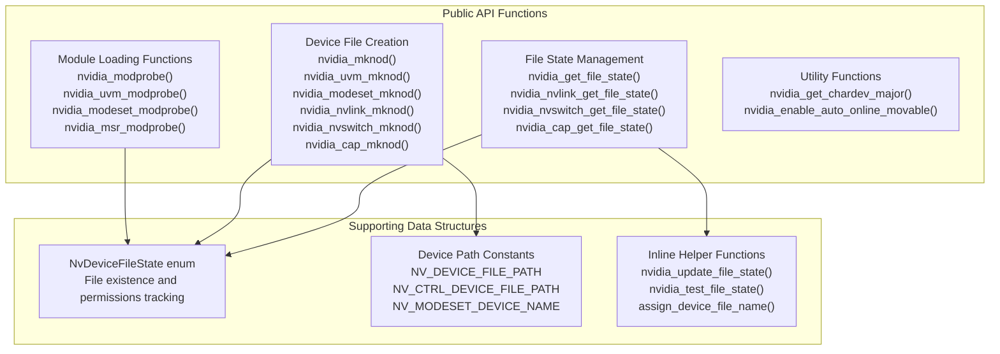
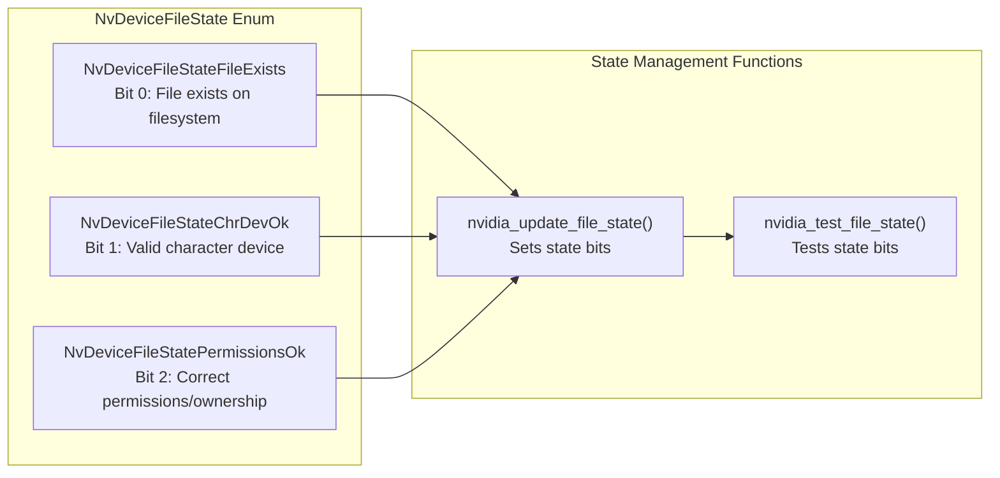
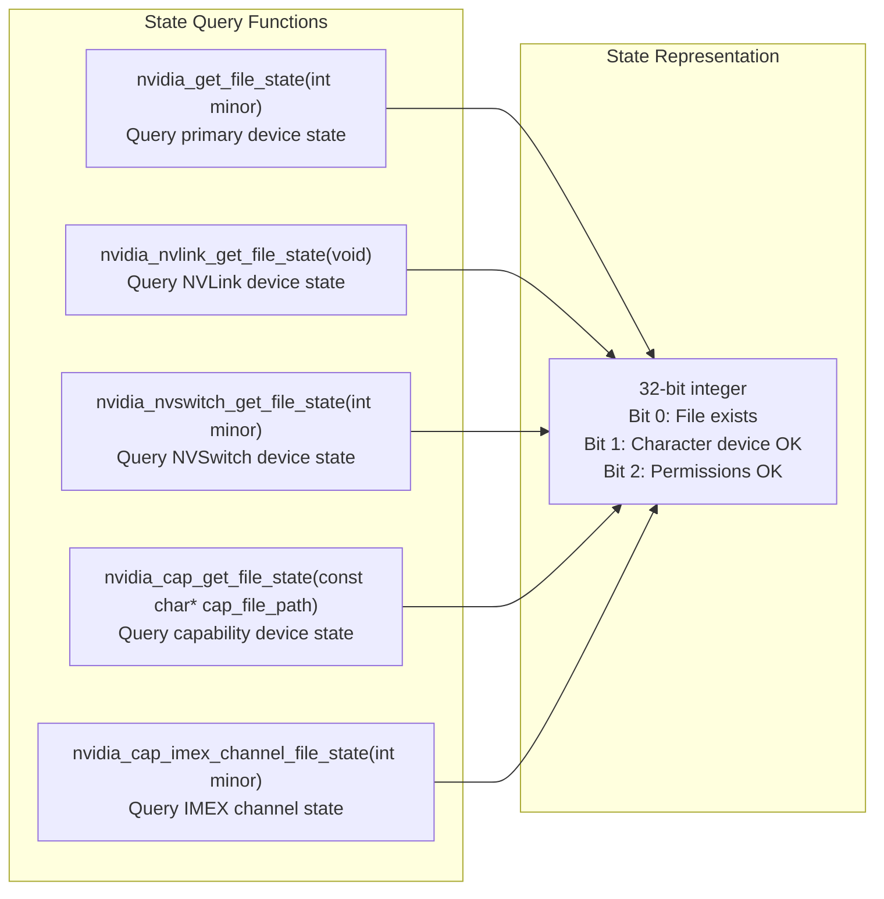
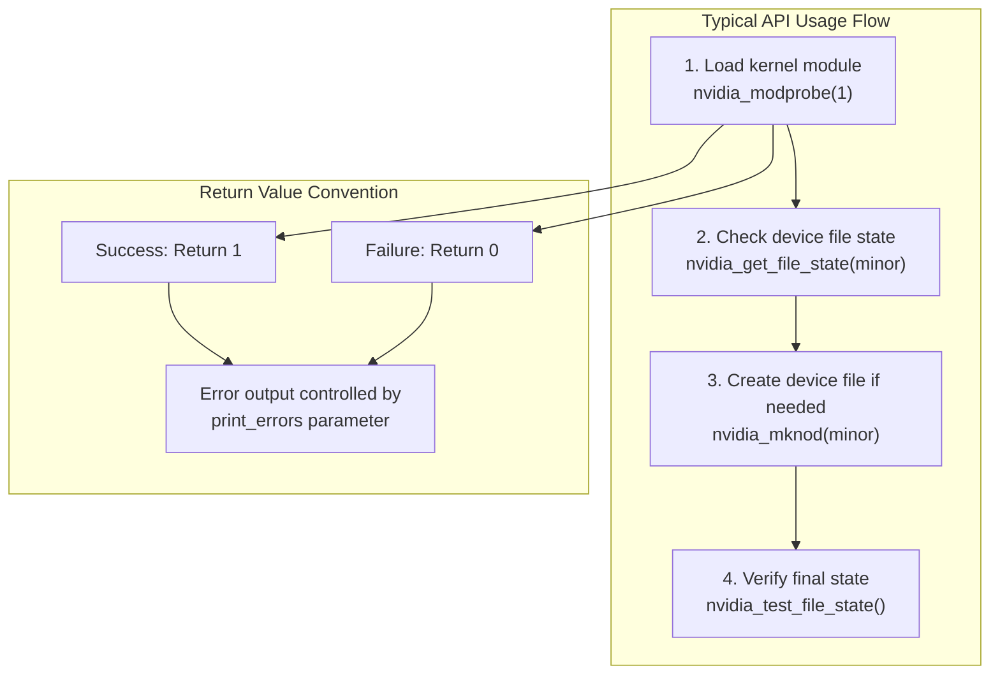

<!-- source: DeepWiki mcp.deepwiki.com · repo NVIDIA/nvidia-modprobe · page 2.3 Library API · fetched 2026-10-26 -->

# Library API

<details>
<summary>Relevant source files</summary>

The following files were used as context for generating this wiki page:

- [modprobe-utils/nvidia-modprobe-utils.c](modprobe-utils/nvidia-modprobe-utils.c)
- [modprobe-utils/nvidia-modprobe-utils.h](modprobe-utils/nvidia-modprobe-utils.h)

</details>


This document covers the public API defined in `nvidia-modprobe-utils.h`, which provides the core programming interface for loading NVIDIA kernel modules and creating device files. This library serves as the foundation for the nvidia-modprobe system and can be used by other applications requiring NVIDIA hardware initialization.

For information about the underlying implementation details, see [Core Library Implementation](#2.2). For command-line interface specifics, see [Command Line Interface](#2.4).

## API Overview

The nvidia-modprobe library API is organized around three primary functional areas: module loading, device file creation, and system state management. The API follows a consistent pattern where functions return integers indicating success (1) or failure (0).



Sources: [modprobe-utils/nvidia-modprobe-utils.h:1-144]()

## Core Data Structures

The API defines several key data structures and constants that form the foundation of the system:

### Device File State Management



The `NvDeviceFileState` enum provides a bitmask system for tracking device file states:

| State | Value | Description |
|-------|-------|-------------|
| `NvDeviceFileStateFileExists` | 0 | File exists on filesystem |
| `NvDeviceFileStateChrDevOk` | 1 | Valid character device with correct major/minor |
| `NvDeviceFileStatePermissionsOk` | 2 | Correct permissions and ownership |

Sources: [modprobe-utils/nvidia-modprobe-utils.h:59-76]()

### Device Path Constants

The API defines standardized device file paths and minor device numbers:

| Constant | Value | Purpose |
|----------|-------|---------|
| `NV_MAX_CHARACTER_DEVICE_FILE_STRLEN` | 128 | Maximum device file path length |
| `NV_CTL_DEVICE_NUM` | 255 | Control device minor number |
| `NV_MODESET_MINOR_DEVICE_NUM` | 254 | Mode setting device minor number |
| `NV_NVSWITCH_CTL_MINOR` | 255 | NVSwitch control device minor |
| `NV_DEVICE_FILE_PATH` | "/dev/nvidia%d" | Standard GPU device path template |
| `NV_CTRL_DEVICE_FILE_PATH` | "/dev/nvidiactl" | Control device path |

Sources: [modprobe-utils/nvidia-modprobe-utils.h:33-56]()

## Module Loading Functions

The API provides dedicated functions for loading different NVIDIA kernel modules:

### Core Module Loading

```c
int nvidia_modprobe(const int print_errors)
```

Loads the main NVIDIA kernel module. The `print_errors` parameter controls whether error messages are printed to stderr. Returns 1 on success, 0 on failure.

### Specialized Module Loading

```c
int nvidia_uvm_modprobe(void)
int nvidia_modeset_modprobe(void)
int nvidia_msr_modprobe(void)
```

These functions load specific NVIDIA kernel modules:
- `nvidia_uvm_modprobe()`: Loads the Unified Virtual Memory module
- `nvidia_modeset_modprobe()`: Loads the mode setting module (allowed on Tegra platforms)
- `nvidia_msr_modprobe()`: Loads the MSR (Model Specific Register) module

Sources: [modprobe-utils/nvidia-modprobe-utils.h:79-96]()

## Device File Creation Functions

The API provides functions for creating various types of NVIDIA device files:

```mermaid
graph TB
    subgraph "Device File Creation API"
        nvidia_mknod["nvidia_mknod(int minor)<br/>Create /dev/nvidia{minor} or /dev/nvidiactl"]
        uvm_mknod["nvidia_uvm_mknod(int base_minor)<br/>Create UVM device files"]
        modeset_mknod["nvidia_modeset_mknod(void)<br/>Create mode setting device"]
        nvlink_mknod["nvidia_nvlink_mknod(void)<br/>Create NVLink device"]
        nvswitch_mknod["nvidia_nvswitch_mknod(int minor)<br/>Create NVSwitch devices"]
        cap_mknod["nvidia_cap_mknod(const char* cap_file_path, int *minor)<br/>Create capability devices"]
        vgpu_mknod["nvidia_vgpu_vfio_mknod(int minor_num)<br/>Create vGPU VFIO devices"]
        imex_mknod["nvidia_cap_imex_channel_mknod(int minor)<br/>Create IMEX channel devices"]
    end
    
    subgraph "Device Types"
        gpu_devices["/dev/nvidia{0-N}<br/>/dev/nvidiactl"]
        uvm_devices["/dev/nvidia-uvm<br/>/dev/nvidia-uvm-tools"]
        modeset_device["/dev/nvidia-modeset"]
        nvlink_device["/dev/nvidia-nvlink"]
        nvswitch_devices["/dev/nvidia-nvswitch{0-N}<br/>/dev/nvidia-nvswitchctl"]
        cap_devices["/dev/nvidia-caps/nvidia-cap{0-N}"]
        vgpu_devices["/dev/nvidia-vgpu{0-N}<br/>/dev/nvidia-vgpuctl"]
        imex_devices["/dev/nvidia-caps-imex-channels/channel{0-N}"]
    end
    
    nvidia_mknod --> gpu_devices
    uvm_mknod --> uvm_devices
    modeset_mknod --> modeset_device
    nvlink_mknod --> nvlink_device
    nvswitch_mknod --> nvswitch_devices
    cap_mknod --> cap_devices
    vgpu_mknod --> vgpu_devices
    imex_mknod --> imex_devices
```



### Primary Device Creation

```c
int nvidia_mknod(int minor)
```

Creates the primary NVIDIA device files. If `minor` equals `NV_CTL_DEVICE_NUM` (255), creates `/dev/nvidiactl`. Otherwise, creates `/dev/nvidia{minor}`.

### Specialized Device Creation

```c
int nvidia_uvm_mknod(int base_minor)
int nvidia_modeset_mknod(void)
int nvidia_nvlink_mknod(void)
int nvidia_nvswitch_mknod(int minor)
int nvidia_cap_mknod(const char* cap_file_path, int *minor)
```

Each function creates specific device files for different NVIDIA subsystems, following the device naming conventions defined in the constants.

Sources: [modprobe-utils/nvidia-modprobe-utils.h:80-93]()

## File State Management

The API provides functions to query the state of device files without modifying them:



These functions return an integer where each bit represents a different aspect of the file state, as defined by the `NvDeviceFileState` enum.

Sources: [modprobe-utils/nvidia-modprobe-utils.h:78-94]()

## Utility Functions

The API includes several utility functions for system integration:

### Character Device Major Number Query

```c
int nvidia_get_chardev_major(const char *name)
```

Scans `/proc/devices` to find the major number for a given character device name. Returns the major number on success, or -1 on failure.

### Device File Name Assignment

```c
static __inline__ void assign_device_file_name(
    char name[NV_MAX_CHARACTER_DEVICE_FILE_STRLEN],
    int minor
)
```

Inline utility function that constructs device file names based on minor numbers. Handles the special case where `minor == NV_CTL_DEVICE_NUM` to generate the control device path.

### Memory Auto-Onlining

```c
int nvidia_enable_auto_online_movable(const int print_errors)
```

Enables automatic memory onlining in movable mode by writing to `/sys/devices/system/memory/auto_online_blocks`. Used for memory management optimization.

Sources: [modprobe-utils/nvidia-modprobe-utils.h:94-142]()

## API Usage Patterns

The library follows consistent patterns for error handling and return values:



All functions return integers where 1 indicates success and 0 indicates failure. Functions that can produce diagnostic output accept a `print_errors` parameter to control stderr output.

Sources: [modprobe-utils/nvidia-modprobe-utils.h:66-96](), [modprobe-utils/nvidia-modprobe-utils.c:354-357]()

---

