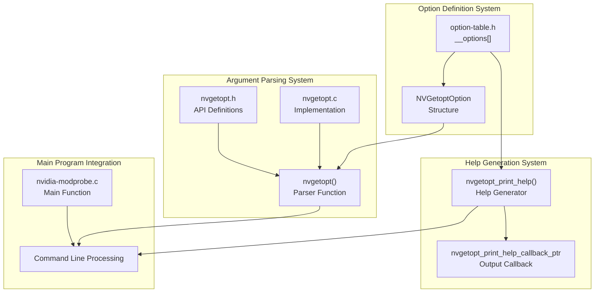
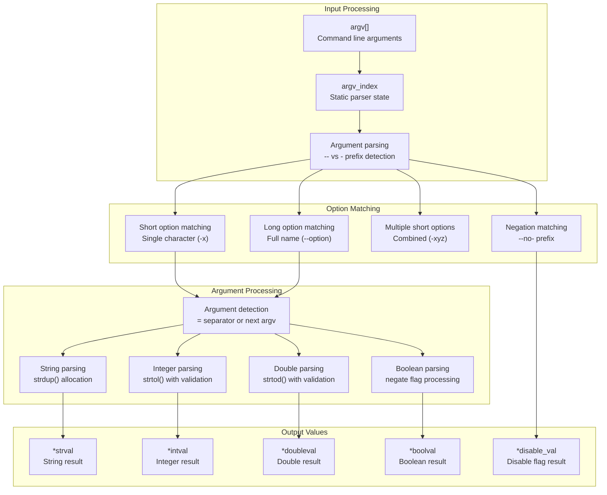
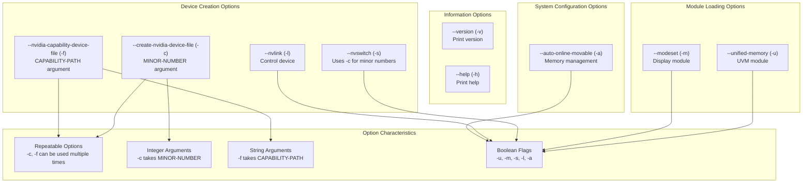
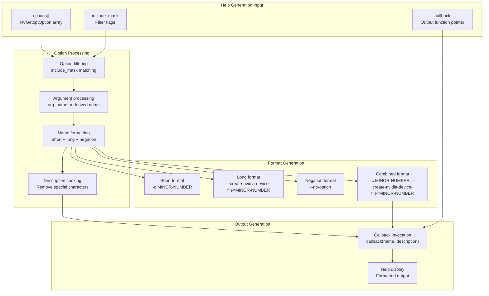

<!-- source: DeepWiki mcp.deepwiki.com · repo NVIDIA/nvidia-modprobe · page 2.4 Command Line Interface · fetched 2026-10-26 -->

# Command Line Interface

Relevant source files

The following files were used as context for generating this wiki page:

- [common-utils/nvgetopt.c](common-utils/nvgetopt.c)
- [common-utils/nvgetopt.h](common-utils/nvgetopt.h)
- [option-table.h](option-table.h)

This document covers the command-line interface system for nvidia-modprobe, including option definitions, argument parsing, and help generation. The system provides a comprehensive CLI for controlling module loading and device file creation operations.

For information about how CLI options are processed by the main executable, see [Main Executable](#2.1). For details on the core functionality triggered by these options, see [Core Library Implementation](#2.2).

## CLI Architecture Overview

The command-line interface consists of two main components: option definitions and argument parsing. The system uses a custom `nvgetopt` implementation that provides enhanced functionality beyond standard `getopt_long()`.

### CLI System Architecture

Sources: [option-table.h:19-84](), [common-utils/nvgetopt.h:135-178](), [common-utils/nvgetopt.c:37-44]()

## Option Definition System

The CLI options are defined in a static table using the `NVGetoptOption` structure. Each option specifies its name, short character, behavior flags, argument requirements, and description.

### Option Table Structure

```mermaid
graph TB
    subgraph "NVGetoptOption Structure"
        name["name<br/>Long option name"]
        val["val<br/>Short option character"]
        flags["flags<br/>Behavior flags"]
        arg_name["arg_name<br/>Argument name for help"]
        description["description<br/>Help text"]
    end
    
    subgraph "Option Flags"
        help_always["NVGETOPT_HELP_ALWAYS<br/>Always show in help"]
        int_arg["NVGETOPT_INTEGER_ARGUMENT<br/>Takes integer argument"]
        str_arg["NVGETOPT_STRING_ARGUMENT<br/>Takes string argument"]
        bool_opt["NVGETOPT_IS_BOOLEAN<br/>Boolean option"]
        allow_disable["NVGETOPT_ALLOW_DISABLE<br/>Can be disabled with --no-"]
        arg_optional["NVGETOPT_ARGUMENT_IS_OPTIONAL<br/>Optional argument"]
    end
    
    subgraph "Defined Options"
        version_opt["version (-v)<br/>Print version"]
        help_opt["help (-h)<br/>Print help"]
        create_dev["create-nvidia-device-file (-c)<br/>Create device file"]
        unified_mem["unified-memory (-u)<br/>Load UVM module"]
        modeset_opt["modeset (-m)<br/>Load modeset module"]
        nvswitch_opt["nvswitch (-s)<br/>Create NVSwitch devices"]
        nvlink_opt["nvlink (-l)<br/>Create NVLink device"]
        cap_dev["nvidia-capability-device-file (-f)<br/>Create capability device"]
        auto_online["auto-online-movable (-a)<br/>Enable auto onlining"]
    end
    
    flags --> help_always
    flags --> int_arg
    flags --> str_arg
    flags --> bool_opt
    flags --> allow_disable
    flags --> arg_optional
    
    name --> version_opt
    name --> help_opt
    name --> create_dev
    name --> unified_mem
    name --> modeset_opt
    name --> nvswitch_opt
    name --> nvlink_opt
    name --> cap_dev
    name --> auto_online
```

Sources: [option-table.h:19-84](), [common-utils/nvgetopt.h:135-141]()

## Command Line Parsing System

The `nvgetopt` system provides robust argument parsing with support for multiple option formats and advanced features not available in standard `getopt_long()`.

### Parsing Flow

Sources: [common-utils/nvgetopt.c:37-366](), [common-utils/nvgetopt.c:110-116](), [common-utils/nvgetopt.c:117-146]()

## Available Command Line Options

The nvidia-modprobe utility supports nine primary command-line options, each designed for specific hardware management tasks.

| Option | Short | Argument | Description |
|--------|-------|----------|-------------|
| `--version` | `-v` | None | Print utility version and exit |
| `--help` | `-h` | None | Print usage information and exit |
| `--create-nvidia-device-file` | `-c` | `MINOR-NUMBER` | Create NVIDIA device file with specified minor number |
| `--unified-memory` | `-u` | None | Load NVIDIA Unified Memory kernel module |
| `--modeset` | `-m` | None | Load NVIDIA modeset kernel module |
| `--nvswitch` | `-s` | None | Create NVSwitch device files for specified minor numbers |
| `--nvlink` | `-l` | None | Create NVLink control device file |
| `--nvidia-capability-device-file` | `-f` | `CAPABILITY-PATH` | Create capability device files from /proc path |
| `--auto-online-movable` | `-a` | None | Enable auto onlining for GPU memory on Grace Hopper |

Sources: [option-table.h:21-82]()

### Option Categories

Sources: [option-table.h:33-82]()

## Help Generation System

The system includes sophisticated help generation capabilities that automatically format option descriptions and handle different output requirements.

### Help Processing Flow

Sources: [common-utils/nvgetopt.c:405-490](), [common-utils/nvgetopt.c:376-402]()

## Advanced Parsing Features

The `nvgetopt` system supports several advanced features that enhance usability and flexibility.

### Advanced Feature Support

```mermaid
graph TB
    subgraph "Multiple Option Formats"
        combined_short["Combined short options<br/>-abc = -a -b -c"]
        embedded_args["Embedded arguments<br/>-c5 = -c 5"]
        equals_syntax["Equals syntax<br/>--option=value"]
        space_syntax["Space syntax<br/>--option value"]
    end
    
    subgraph "Negation Support"
        no_prefix["--no- prefix<br/>--no-option"]
        disable_flag["NVGETOPT_ALLOW_DISABLE<br/>Enable negation"]
        boolean_negate["Boolean negation<br/>NVGETOPT_IS_BOOLEAN"]
    end
    
    subgraph "Argument Validation"
        int_validation["Integer validation<br/>strtol() with endptr check"]
        double_validation["Double validation<br/>strtod() with endptr check"]
        optional_args["Optional arguments<br/>NVGETOPT_ARGUMENT_IS_OPTIONAL"]
        arg_detection["Argument detection<br/>Next argv starts with -"]
    end
    
    subgraph "Error Handling"
        invalid_option["Invalid option<br/>unrecognized option error"]
        missing_arg["Missing argument<br/>requires argument error"]
        invalid_arg["Invalid argument<br/>not valid argument error"]
        unexpected_arg["Unexpected argument<br/>does not take argument error"]
    end
    
    combined_short --> embedded_args
    no_prefix --> disable_flag
    disable_flag --> boolean_negate
    int_validation --> optional_args
    double_validation --> optional_args
    optional_args --> arg_detection
    
    invalid_option --> missing_arg
    missing_arg --> invalid_arg
    invalid_arg --> unexpected_arg
```

Sources: [common-utils/nvgetopt.c:153-206](), [common-utils/nvgetopt.c:213-241](), [common-utils/nvgetopt.c:264-266](), [common-utils/nvgetopt.c:308-340]()

---

