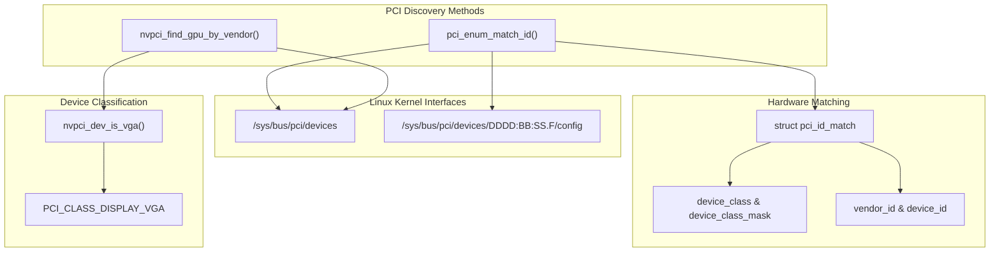
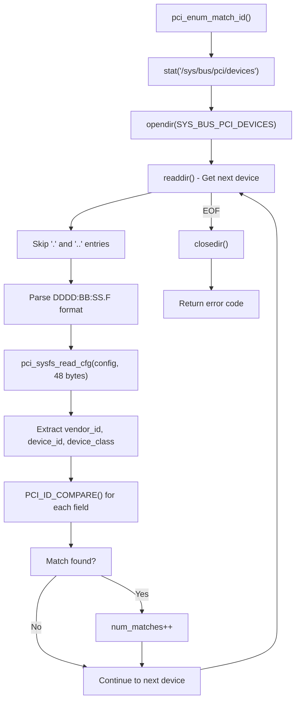
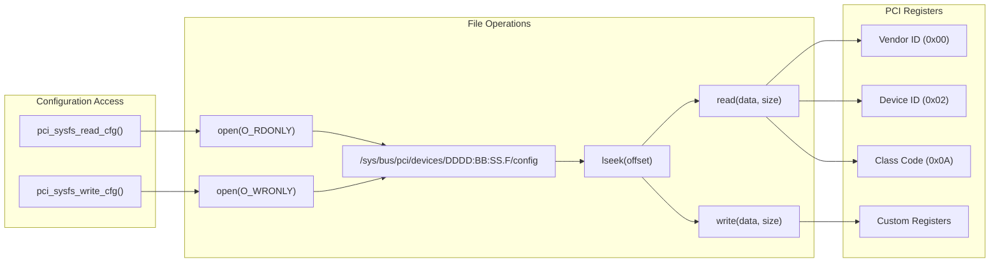
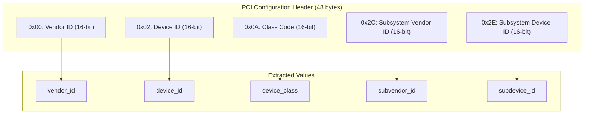
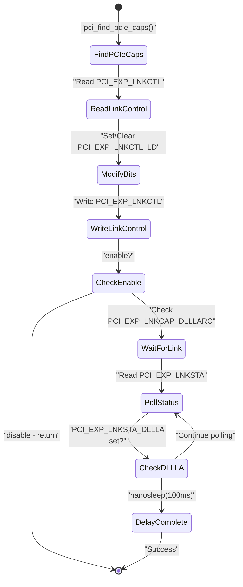
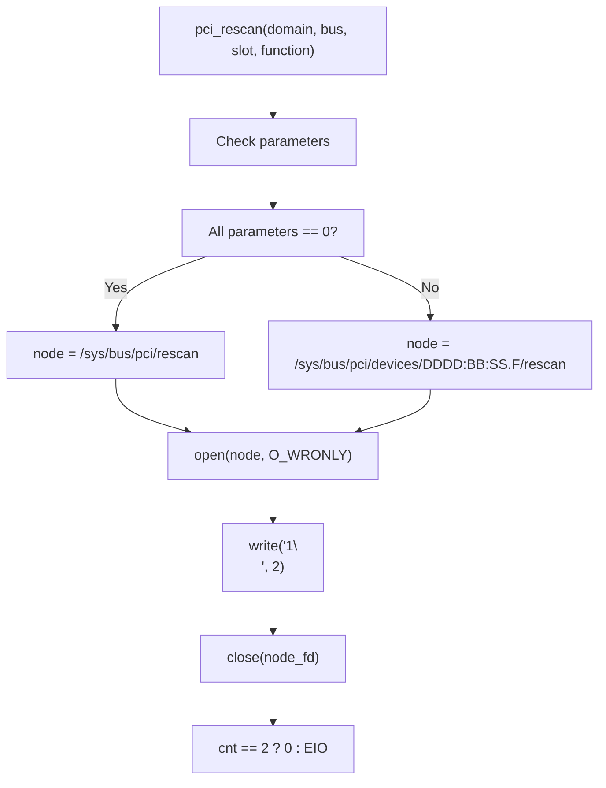
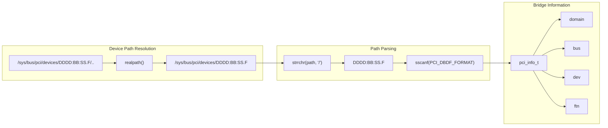
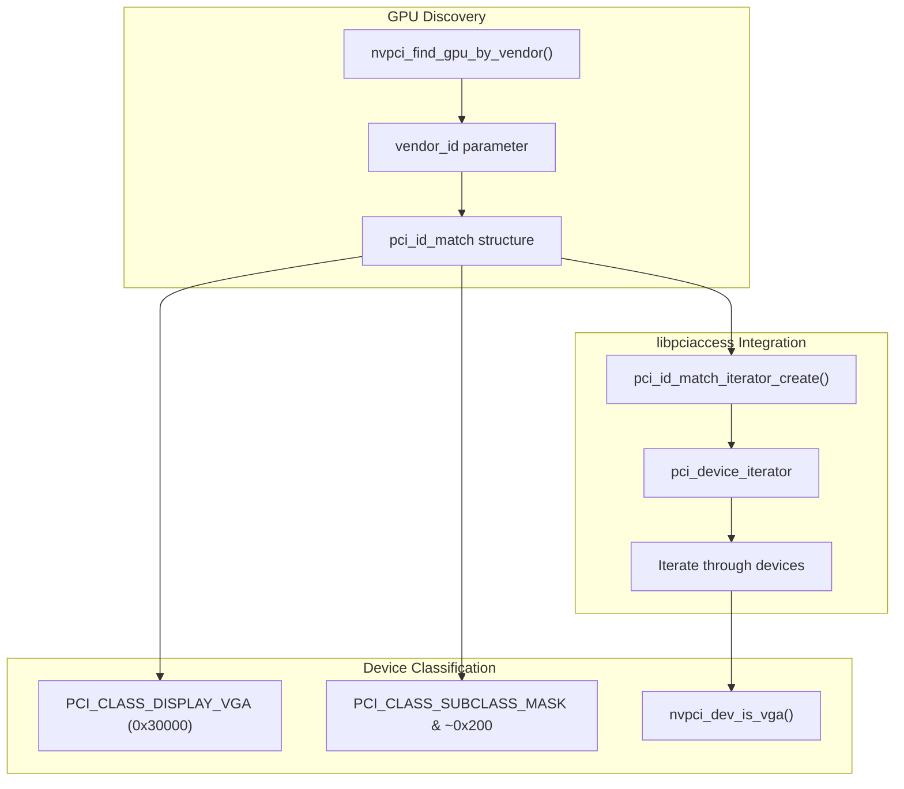

<!-- source: DeepWiki mcp.deepwiki.com · repo NVIDIA/nvidia-modprobe · page 2.5 PCI Hardware Integration · fetched 2026-10-26 -->

# PCI Hardware Integration

<details>
<summary>Relevant source files</summary>

The following files were used as context for generating this wiki page:

- [common-utils/nvpci-utils.c](common-utils/nvpci-utils.c)
- [common-utils/nvpci-utils.h](common-utils/nvpci-utils.h)
- [modprobe-utils/pci-enum.h](modprobe-utils/pci-enum.h)
- [modprobe-utils/pci-sysfs.c](modprobe-utils/pci-sysfs.c)
- [modprobe-utils/pci-sysfs.h](modprobe-utils/pci-sysfs.h)
- [nvidia-modprobe.1.m4](nvidia-modprobe.1.m4)

</details>


This page documents the PCI hardware integration capabilities of the nvidia-modprobe system. These components provide low-level access to PCI devices through Linux's sysfs interface, enabling device enumeration, configuration access, and PCIe link management for NVIDIA hardware.

For information about the higher-level device management APIs that use these PCI utilities, see [Library API](#2.3). For details about the common utility functions that support PCI operations, see [PCI Utilities](#4.4).

## Overview

The PCI hardware integration system consists of two main components:
- **sysfs PCI Interface**: Direct access to PCI devices through Linux's `/sys/bus/pci/devices` filesystem
- **libpciaccess Integration**: Higher-level PCI device discovery using the libpciaccess library

The system supports device enumeration, configuration space access, PCIe link control, and GPU-specific operations required for NVIDIA driver initialization.

## PCI Device Enumeration

### Device Discovery Architecture



Sources: [modprobe-utils/pci-sysfs.c:89-111](), [modprobe-utils/pci-enum.h:76-110](), [common-utils/nvpci-utils.c:39-55]()

### Device Enumeration Process

The `pci_enum_match_id()` function implements the core device enumeration algorithm:

1. **Directory Scanning**: Reads `/sys/bus/pci/devices` to find all PCI devices
2. **Configuration Reading**: Accesses each device's config file to read PCI header
3. **Criteria Matching**: Compares device attributes against search criteria
4. **Match Counting**: Returns the number of devices that match the criteria



Sources: [modprobe-utils/pci-sysfs.c:120-184](), [modprobe-utils/pci-enum.h:71-72]()

## PCI Configuration Space Access

### Configuration Space Operations

The system provides both read and write access to PCI configuration space through dedicated functions:

| Function | Purpose | Access Mode |
|----------|---------|-------------|
| `pci_sysfs_read_cfg()` | Read configuration registers | Read-only |
| `pci_sysfs_write_cfg()` | Write configuration registers | Write-only |

Both functions support:
- **Arbitrary Offsets**: Access any configuration space offset
- **Variable Sizes**: Read/write 1, 2, 4, or more bytes
- **Partial Operations**: Handle incomplete reads/writes gracefully



Sources: [modprobe-utils/pci-sysfs.c:187-251](), [modprobe-utils/pci-sysfs.c:253-321]()

### Configuration Space Data Structures

The system uses standard PCI configuration space layout for device identification:



Sources: [modprobe-utils/pci-sysfs.c:152-159]()

## PCIe Link Management

### Bridge Link Control

The `pci_bridge_link_set_enable()` function provides PCIe link enable/disable functionality for power management and hot-plug operations:



Sources: [modprobe-utils/pci-sysfs.c:439-527]()

### PCIe Capability Detection

The system locates PCIe capabilities through the PCI capability list:

```mermaid
flowchart TD
    start["pci_find_pcie_caps()"] --> init_offset["offset = PCI_CAPABILITY_LIST"]
    init_offset --> read_next["pci_sysfs_read_cfg(offset)"]
    read_next --> check_valid["offset >= 0x40 && offset != 0xff?"]
    
    check_valid -->|No| not_found["return ENXIO"]
    check_valid -->|Yes| mask_bits["offset &= ~3"]
    mask_bits --> read_cap_id["pci_sysfs_read_cfg(PCI_CAP_LIST_ID)"]
    
    read_cap_id --> check_pcie["cap_id == PCI_CAP_ID_EXP?"]
    check_pcie -->|Yes| found["return capability offset"]
    check_pcie -->|No| next_cap["offset += PCI_CAP_LIST_NEXT"]
    next_cap --> read_next
    
    found --> [*]
    not_found --> [*]
```

Sources: [modprobe-utils/pci-sysfs.c:393-436]()

## PCI Bus Management

### Bus Rescanning

The `pci_rescan()` function triggers PCI bus rescanning to detect hot-plugged devices:

| Rescan Scope | Target Path | Description |
|-------------|-------------|-------------|
| System-wide | `/sys/bus/pci/rescan` | Rescan entire PCI hierarchy |
| Bridge-specific | `/sys/bus/pci/devices/DDDD:BB:SS.F/rescan` | Rescan specific bridge |



Sources: [modprobe-utils/pci-sysfs.c:323-355]()

### Bridge Discovery

The `pci_find_parent_bridge()` function locates the parent bridge of a PCI device:



Sources: [modprobe-utils/pci-sysfs.c:357-390]()

## GPU-Specific PCI Operations

### NVIDIA GPU Detection

The system provides specialized functions for NVIDIA GPU detection through libpciaccess:



Sources: [common-utils/nvpci-utils.c:39-55](), [common-utils/nvpci-utils.c:61-65]()

### Device Class Filtering

The GPU detection system distinguishes between different display device types:

| Device Class | Value | Description |
|-------------|-------|-------------|
| `PCI_CLASS_DISPLAY_VGA` | 0x30000 | VGA controller |
| `PCI_CLASS_DISPLAY_3D` | 0x30200 | 3D controller |
| `PCI_CLASS_SUBCLASS_MASK` | 0xffff00 | Class and subclass mask |

The system accepts both VGA and 3D controllers by using a mask that ignores bit 1 of the subclass field.

Sources: [common-utils/nvpci-utils.c:30-51]()

## Integration with nvidia-modprobe

The PCI hardware integration components are used throughout the nvidia-modprobe system for:

- **Device Enumeration**: Finding NVIDIA GPUs before loading kernel modules
- **Hardware Validation**: Verifying PCI device presence and configuration
- **Power Management**: Controlling PCIe link states during initialization
- **Hot-Plug Support**: Rescanning PCI buses after device insertion

These low-level PCI operations form the foundation for the higher-level device management functions documented in [Core Library Implementation](#2.2).

Sources: [modprobe-utils/pci-sysfs.c:1-530](), [modprobe-utils/pci-sysfs.h:1-87](), [common-utils/nvpci-utils.c:1-66]()

---

