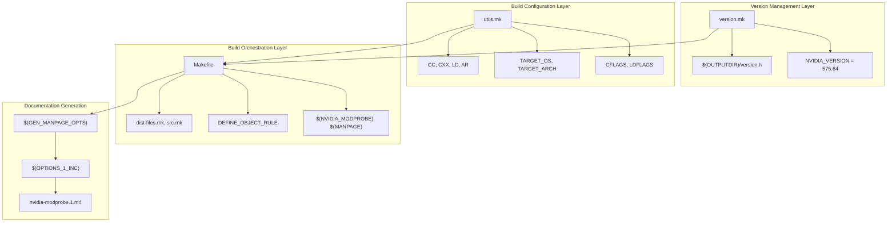
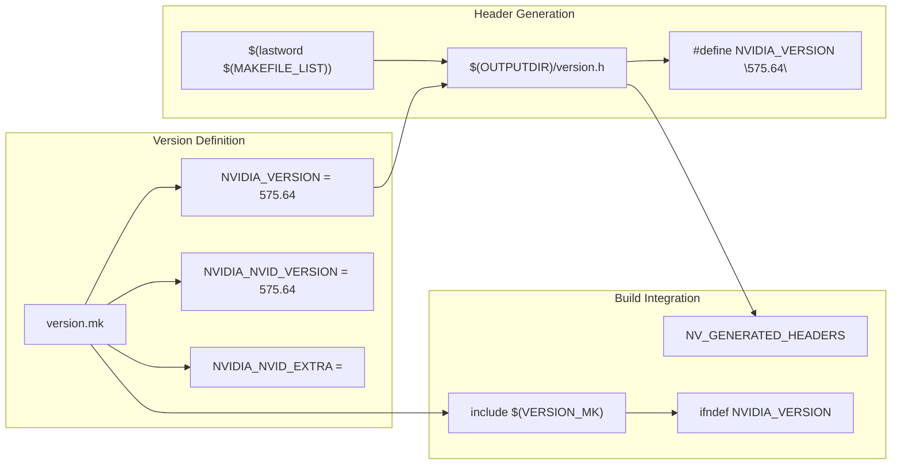
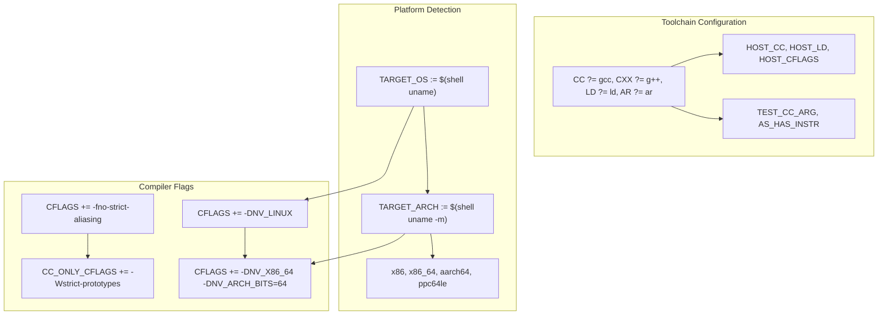
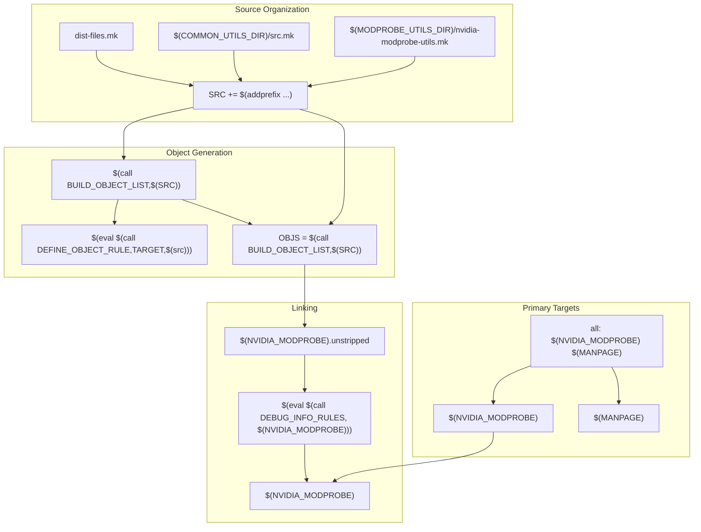
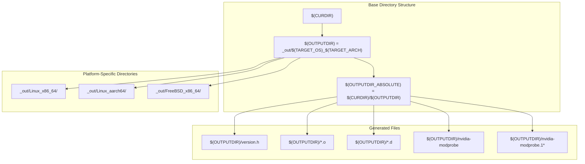

<!-- source: DeepWiki mcp.deepwiki.com · repo NVIDIA/nvidia-modprobe · page 3 Build System · fetched 2026-10-26 -->

# Build System

<details>
<summary>Relevant source files</summary>

The following files were used as context for generating this wiki page:

- [Makefile](Makefile)
- [utils.mk](utils.mk)
- [version.mk](version.mk)

</details>


The Build System is the foundation that manages compilation, linking, documentation generation, and distribution of the nvidia-modprobe utility. It provides cross-platform build capabilities, version management, and automated documentation generation. This system coordinates the compilation of the main executable, core libraries, and supporting utilities across different operating systems and architectures.

For information about the nvidia-modprobe runtime components, see [nvidia-modprobe System](#2). For details about the documentation generation process, see [Documentation System](#5).

## Architecture Overview

The build system follows a hierarchical structure with three primary components: version management, build configuration, and build orchestration. The system is designed to handle cross-platform compilation while maintaining consistent version information throughout the build process.

### Build System Component Hierarchy



Sources: [version.mk:1-12](), [utils.mk:1-619](), [Makefile:1-163]()

## Version Management System

The version management system is the most critical component of the build system, responsible for maintaining consistent version information across all build artifacts. It centers around the `version.mk` file and automated header generation.

### Version Management Flow



The version system operates through several key mechanisms:

| Component | Purpose | Location |
|-----------|---------|----------|
| `NVIDIA_VERSION` | Primary version string | [version.mk:1]() |
| `NVIDIA_NVID_VERSION` | NVID-specific version | [version.mk:2]() |
| `NVIDIA_NVID_EXTRA` | Additional version info | [version.mk:3]() |
| `$(OUTPUTDIR)/version.h` | Generated header file | [version.mk:7-9]() |
| `NV_GENERATED_HEADERS` | Build dependency list | [version.mk:11]() |

The version header generation rule ensures that any changes to `version.mk` trigger regeneration of the version header, maintaining build consistency.

Sources: [version.mk:1-12](), [utils.mk:278-284]()

## Build Configuration System

The `utils.mk` file provides comprehensive cross-platform build configuration, toolchain detection, and compiler flag management. It serves as the foundation for all compilation operations across different operating systems and architectures.

### Toolchain and Platform Detection



The build configuration system handles multiple aspects:

**Platform-Specific Definitions:**
- Linux: `CFLAGS += -DNV_LINUX` [utils.mk:129-131]()
- FreeBSD: `CFLAGS += -DNV_BSD` [utils.mk:133-135]()
- SunOS: `CFLAGS += -DNV_SUNOS` [utils.mk:137-139]()

**Architecture-Specific Flags:**
- x86: `CFLAGS += -DNV_X86 -DNV_ARCH_BITS=32` [utils.mk:154-156]()
- x86_64: `CFLAGS += -DNV_X86_64 -DNV_ARCH_BITS=64` [utils.mk:158-160]()
- aarch64: `CFLAGS += -DNV_AARCH64 -DNV_ARCH_BITS=64` [utils.mk:166-168]()

**Build Mode Configuration:**
- Debug: `CFLAGS += -O0 -g -DDEBUG=1` [utils.mk:77-84]()
- Release: `CFLAGS += -O2` [utils.mk:83]()
- Development: `CFLAGS += -DDEVELOP=1` [utils.mk:86-90]()

Sources: [utils.mk:35-196](), [utils.mk:125-196]()

## Build Orchestration

The main `Makefile` coordinates the entire build process, integrating version management, build configuration, and source compilation into a cohesive build system.

### Build Target Dependencies



The build orchestration follows these key patterns:

**Source File Integration:**
- Main sources: `include dist-files.mk` [Makefile:73]()
- Common utilities: `SRC += $(addprefix $(COMMON_UTILS_DIR)/,$(COMMON_UTILS_SRC))` [Makefile:75-76]()
- Modprobe utilities: `SRC += $(addprefix $(MODPROBE_UTILS_DIR)/,$(MODPROBE_UTILS_SRC))` [Makefile:78-79]()

**Object File Generation:**
- Object list: `OBJS = $(call BUILD_OBJECT_LIST,$(SRC))` [Makefile:81]()
- Build rules: `$(foreach src,$(SRC),$(eval $(call DEFINE_OBJECT_RULE,TARGET,$(src))))` [Makefile:121]()

**Linking Process:**
- Unstripped binary: `$(NVIDIA_MODPROBE).unstripped: $(OBJS)` [Makefile:116]()
- Debug info processing: `$(eval $(call DEBUG_INFO_RULES, $(NVIDIA_MODPROBE)))` [Makefile:115]()

Sources: [Makefile:29-121](), [utils.mk:406-499]()

## Documentation Generation System

The build system includes a sophisticated documentation generation mechanism that creates man pages from command-line option definitions, ensuring synchronization between code and documentation.

### Documentation Build Flow

```mermaid
graph LR
    subgraph "Option Processing"
        gen_manpage_opts_src["gen-manpage-opts.c"]
        gen_manpage_opts_helper["gen-manpage-opts-helper.c"]
        gen_manpage_opts_binary["$(GEN_MANPAGE_OPTS)"]
        
        gen_manpage_opts_src --> gen_manpage_opts_binary
        gen_manpage_opts_helper --> gen_manpage_opts_binary
    end
    
    subgraph "Option Extraction"
        options_1_inc["$(OPTIONS_1_INC)"]
        gen_manpage_opts_execution["$< > $@"]
        
        gen_manpage_opts_binary --> options_1_inc
        gen_manpage_opts_binary --> gen_manpage_opts_execution
    end
    
    subgraph "Man Page Generation"
        nvidia_modprobe_1_m4["nvidia-modprobe.1.m4"]
        m4_processing["$(M4) -D__HEADER__ -D__VERSION__ -D__DATE__"]
        manpage_not_gzipped["$(MANPAGE_not_gzipped)"]
        
        options_1_inc --> nvidia_modprobe_1_m4
        nvidia_modprobe_1_m4 --> m4_processing
        m4_processing --> manpage_not_gzipped
    end
    
    subgraph "Final Processing"
        manpage_gzipped["$(MANPAGE_gzipped)"]
        gzip_compression["$(GZIP_CMD) -9nf"]
        
        manpage_not_gzipped --> gzip_compression
        gzip_compression --> manpage_gzipped
    end
```



The documentation generation system operates through these components:

**Option Extraction Tools:**
- Source generator: `GEN_MANPAGE_OPTS_SRC = gen-manpage-opts.c` [Makefile:139]()
- Helper functions: `GEN_MANPAGE_OPTS_SRC += $(COMMON_UTILS_DIR)/gen-manpage-opts-helper.c` [Makefile:140]()
- Binary target: `GEN_MANPAGE_OPTS = $(OUTPUTDIR_ABSOLUTE)/gen-manpage-opts` [Makefile:45]()

**M4 Template Processing:**
- Version substitution: `-D__VERSION__=$(NVIDIA_VERSION)` [Makefile:156]()
- Date substitution: `-D__DATE__="`$(DATE) +%F`"` [Makefile:157]()
- Build OS: `-D__BUILD_OS__=$(TARGET_OS)` [Makefile:158]()

**Compression Handling:**
- Conditional compression: `ifeq ($(MANPAGE_GZIP),1)` [Makefile:40-44]()
- Gzip processing: `$(GZIP_CMD) -9nf < $< > $@` [Makefile:162]()

Sources: [Makefile:134-163](), [utils.mk:103-117]()

## Build Utility Functions

The build system provides several utility functions and macros that handle complex build operations, dependency tracking, and cross-platform compilation.

### Object Rule Generation System

```mermaid
graph TB
    subgraph "Rule Definition Functions"
        define_object_rule["DEFINE_OBJECT_RULE"]
        define_object_rule_with_dir["DEFINE_OBJECT_RULE_WITH_DIR"]
        define_object_rule_with_object_name["DEFINE_OBJECT_RULE_WITH_OBJECT_NAME"]
        
        define_object_rule --> define_object_rule_with_dir
        define_object_rule_with_dir --> define_object_rule_with_object_name
    end
    
    subgraph "Dependency Tracking"
        auto_dep_suffix["AUTO_DEP_SUFFIX"]
        mmd_flag["-MMD -MF $(@:.o=.d.to_be_processed)"]
        mp_flag["-MP -MT $@"]
        sed_processing["$(SED) -e \"1,3s| $< | |\""]
        
        auto_dep_suffix --> mmd_flag
        auto_dep_suffix --> mp_flag
        auto_dep_suffix --> sed_processing
    end
    
    subgraph "Source Type Detection"
        nv_get_source_type["NV_GET_SOURCE_TYPE"]
        c_files["$(filter %.c, $(1))"]
        cpp_files["$(filter %.cpp, $(1))"]
        
        nv_get_source_type --> c_files
        nv_get_source_type --> cpp_files
    end
    
    subgraph "Build List Generation"
        build_object_list["BUILD_OBJECT_LIST"]
        build_dependency_list["BUILD_DEPENDENCY_LIST"]
        addprefix_outputdir["$(addprefix $(OUTPUTDIR)/,$(notdir ...))"]
        
        build_object_list --> addprefix_outputdir
        build_dependency_list --> addprefix_outputdir
    end
```

**Key Build Functions:**

| Function | Purpose | Usage |
|----------|---------|-------|
| `BUILD_OBJECT_LIST` | Generate object file list | [utils.mk:409-410]() |
| `DEFINE_OBJECT_RULE` | Create compilation rules | [utils.mk:497-499]() |
| `TEST_CC_ARG` | Test compiler arguments | [utils.mk:230-232]() |
| `DEBUG_INFO_RULES` | Handle debug information | [utils.mk:511-526]() |

**Dependency Tracking:**
- Automatic dependency generation: `AUTO_DEP_SUFFIX = -MMD -MF $(@:.o=.d.to_be_processed)` [utils.mk:338-342]()
- Dependency file processing: `$(SED) -e "1,3s| $< | |"` [utils.mk:339]()
- Include dependency files: `-include $(call BUILD_DEPENDENCY_LIST_WITH_DIR,$(3),$(4))` [utils.mk:477]()

**Cross-Platform Support:**
- Host vs. target compilation: `host_target = $(patsubst HOST,HOST_,$(patsubst TARGET,,$(1)))` [utils.mk:309]()
- Source type detection: `NV_GET_SOURCE_TYPE = $(strip $(if $(filter %.c, $(1)),CC, $(if $(filter %.cpp, $(1)),CXX, $(error ...))))` [utils.mk:292-295]()

Sources: [utils.mk:292-499](), [utils.mk:511-526]()

## Output Directory Structure

The build system uses a structured output directory layout that separates build artifacts by target platform and maintains organization across different build configurations.

### Output Directory Organization



The output directory structure provides:

**Platform Separation:**
- Linux x86_64: `_out/Linux_x86_64/` [utils.mk:197]()
- Linux aarch64: `_out/Linux_aarch64/` [utils.mk:197]()
- FreeBSD x86_64: `_out/FreeBSD_x86_64/` [utils.mk:197]()

**Generated Artifacts:**
- Version header: `$(OUTPUTDIR)/version.h` [version.mk:7]()
- Object files: `$(OUTPUTDIR)/*.o` [utils.mk:406-410]()
- Dependency files: `$(OUTPUTDIR)/*.d` [utils.mk:422-426]()
- Final binary: `$(OUTPUTDIR)/nvidia-modprobe` [Makefile:29]()

**Build Tool Outputs:**
- Option generator: `$(OUTPUTDIR_ABSOLUTE)/gen-manpage-opts` [Makefile:45]()
- Option includes: `$(OUTPUTDIR)/options.1.inc` [Makefile:46]()
- Manual pages: `$(OUTPUTDIR)/nvidia-modprobe.1[.gz]` [Makefile:37-38]()

Sources: [utils.mk:197-198](), [version.mk:7-11](), [Makefile:29-46]()

---

