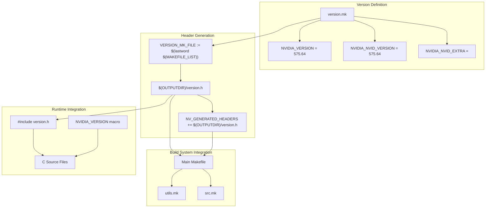

<!-- source: DeepWiki mcp.deepwiki.com · repo NVIDIA/nvidia-modprobe · page 3.1 Version Management · fetched 2026-10-26 -->

# Version Management

<details>
<summary>Relevant source files</summary>

The following files were used as context for generating this wiki page:

- [version.mk](version.mk)

</details>


## Purpose and Scope

The Version Management system is the foundational component of the nvidia-modprobe build system, responsible for defining and propagating version information throughout the entire codebase. This system ensures consistent version numbering across all build artifacts, generated headers, and runtime components.

This document covers the `version.mk` build system, header generation process, and integration with the broader build infrastructure. For information about the overall build configuration and cross-platform utilities, see [Build Configuration](#3.2). For details about source file organization and build rules, see [Source Organization](#3.3).

## Version System Architecture

The version management system centers around the `version.mk` file, which defines canonical version information and orchestrates the generation of version headers used throughout the codebase.



**Sources:** [version.mk:1-12]()

## Version Constants

The version system defines three primary version constants that serve different purposes within the build system:

| Constant | Value | Purpose |
|----------|-------|---------|
| `NVIDIA_VERSION` | 575.64 | Primary version identifier used throughout the system |
| `NVIDIA_NVID_VERSION` | 575.64 | NVID-specific version identifier |
| `NVIDIA_NVID_EXTRA` | (empty) | Additional version suffix for custom builds |

These constants are defined at [version.mk:1-3]() and serve as the single source of truth for version information across the entire build system.

**Sources:** [version.mk:1-3]()

## Header Generation Process

The version management system implements an automated header generation process that converts Make variables into C preprocessor definitions. This process ensures that version information is available to runtime code.

```mermaid
graph TB
    subgraph "Dependency Tracking"
        version_mk_file["VERSION_MK_FILE := $(lastword $(MAKEFILE_LIST))"]
        version_mk["version.mk"]
        makefile_list["$(MAKEFILE_LIST)"]
        
        makefile_list --> version_mk_file
        version_mk --> version_mk_file
    end
    
    subgraph "Build Rule"
        target_rule["$(OUTPUTDIR)/version.h: $(VERSION_MK_FILE)"]
        mkdir_cmd["@$(MKDIR) $(OUTPUTDIR)"]
        echo_cmd["@$(ECHO) '#define NVIDIA_VERSION \"$(NVIDIA_VERSION)\"' > $@"]
        
        target_rule --> mkdir_cmd
        mkdir_cmd --> echo_cmd
    end
    
    subgraph "Generated Output"
        version_h["$(OUTPUTDIR)/version.h"]
        define_macro["#define NVIDIA_VERSION \"575.64\""]
        
        echo_cmd --> version_h
        version_h --> define_macro
    end
    
    subgraph "Build System Registration"
        nv_generated_headers["NV_GENERATED_HEADERS += $(OUTPUTDIR)/version.h"]
        
        version_h --> nv_generated_headers
    end
```

The header generation process involves several key steps:

1. **Dependency Tracking**: The `VERSION_MK_FILE` variable captures the path to `version.mk` using `$(lastword $(MAKEFILE_LIST))` [version.mk:6]()
2. **Build Rule**: A Make rule generates `$(OUTPUTDIR)/version.h` when `version.mk` changes [version.mk:7]()
3. **Directory Creation**: The output directory is created if it doesn't exist [version.mk:8]()
4. **Header Generation**: The version constant is written as a C preprocessor define [version.mk:9]()
5. **Registration**: The generated header is added to `NV_GENERATED_HEADERS` [version.mk:11]()

**Sources:** [version.mk:6-11]()

## Build System Integration

The version management system integrates seamlessly with the broader build infrastructure through the `NV_GENERATED_HEADERS` mechanism. This ensures that version headers are properly tracked and included in dependency calculations.

The generated `version.h` header contains C preprocessor definitions that can be included in source files:

```c
#define NVIDIA_VERSION "575.64"
```

This header is automatically regenerated whenever `version.mk` is modified, ensuring that version changes are immediately reflected in all build artifacts.

**Sources:** [version.mk:9-11]()

## Self-Dependency Tracking

The version management system implements sophisticated self-dependency tracking to ensure that version headers are regenerated whenever the version definition file changes. This is accomplished through the `VERSION_MK_FILE` variable, which uses Make's `$(lastword $(MAKEFILE_LIST))` function to capture the path to the current makefile.

This mechanism ensures that any modification to version constants will trigger a rebuild of the version header, maintaining consistency across the build system.

**Sources:** [version.mk:6-7]()

---

