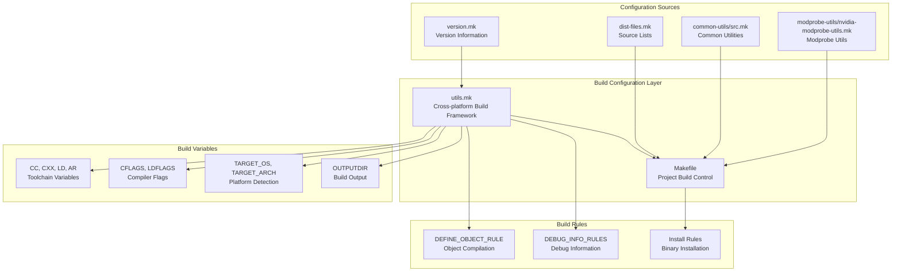
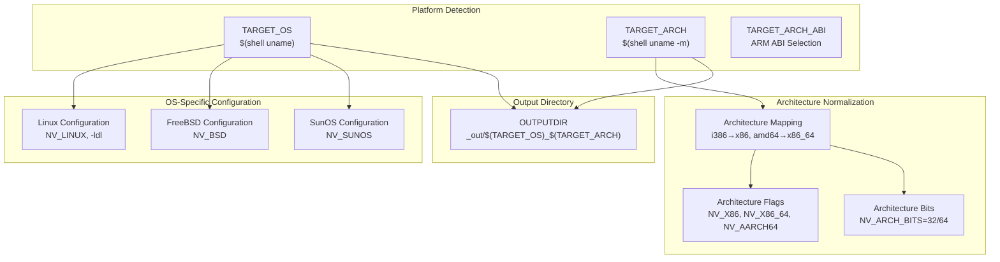
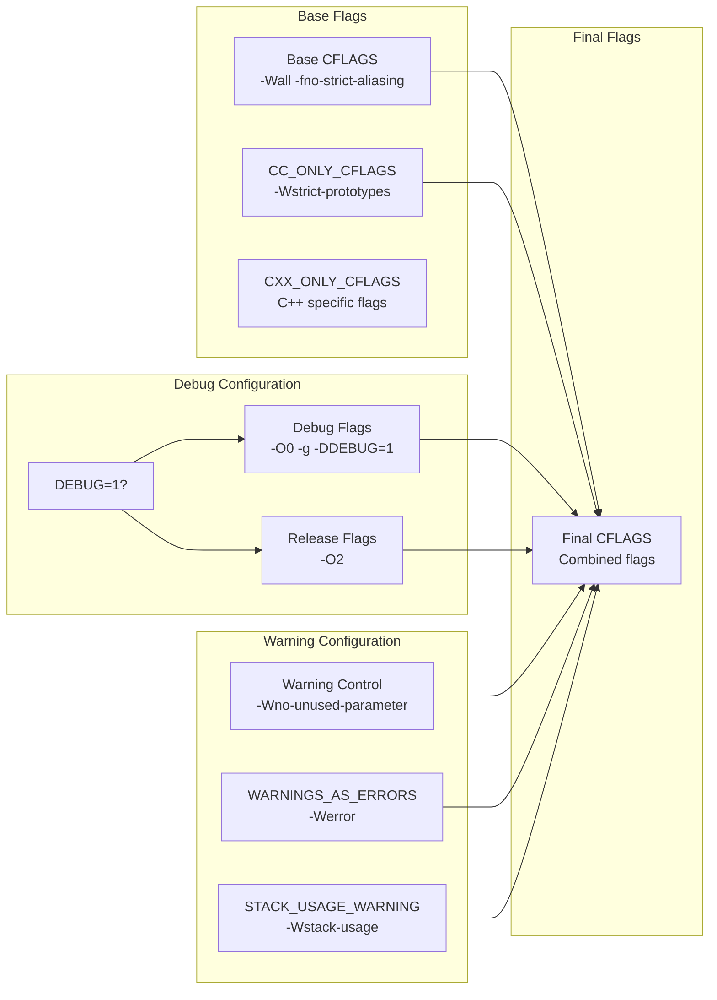
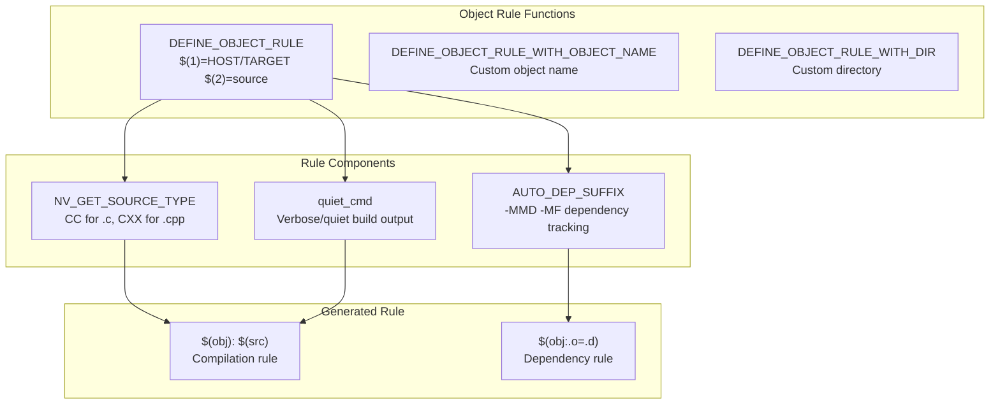
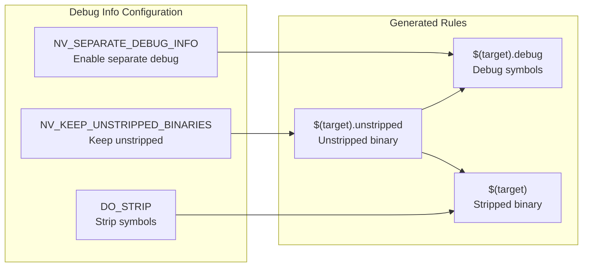
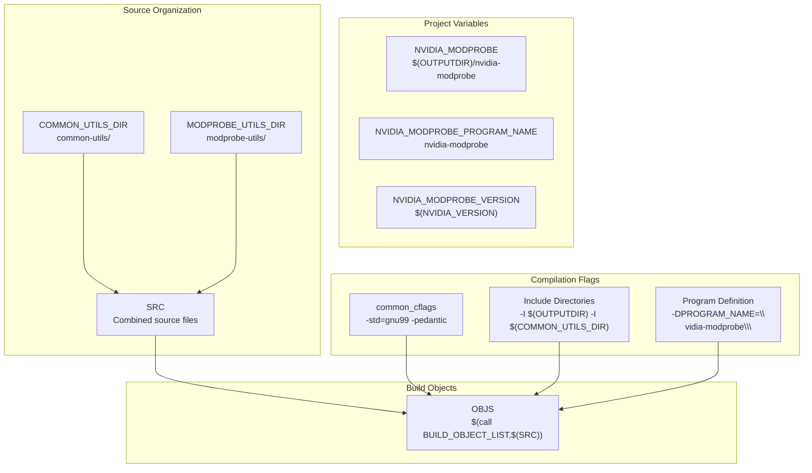
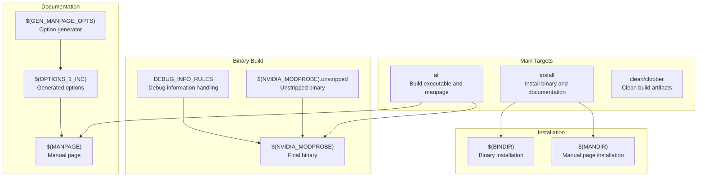

<!-- source: DeepWiki mcp.deepwiki.com · repo NVIDIA/nvidia-modprobe · page 3.2 Build Configuration · fetched 2026-10-26 -->

# Build Configuration

Relevant source files

The following files were used as context for generating this wiki page:

- [Makefile](Makefile)
- [utils.mk](utils.mk)

This document covers the cross-platform build configuration system for nvidia-modprobe, including toolchain detection, compiler flags management, and build rule definitions. The build configuration is primarily implemented through the `utils.mk` utility framework and the project-specific `Makefile`. For version management specifics, see [Version Management](#3.1). For source file organization, see [Source Organization](#3.3).

## Build System Architecture

The build configuration system consists of two main components that work together to provide cross-platform compilation capabilities:

### Build Configuration Architecture

Sources: [utils.mk:1-619](), [Makefile:1-163]()

## Cross-Platform Configuration

The `utils.mk` framework provides comprehensive cross-platform build support through automatic platform detection and configuration:

### Platform Detection Flow

The platform detection system automatically configures build settings based on the detected operating system and architecture. Architecture names are normalized [utils.mk:147-152]() to canonical forms, and appropriate preprocessor flags are set [utils.mk:154-172]().

Sources: [utils.mk:125-198]()

## Toolchain Configuration

The build system provides flexible toolchain configuration with sensible defaults:

| Variable | Default | Purpose |
|----------|---------|---------|
| `CC` | `gcc` | C compiler |
| `CXX` | `g++` | C++ compiler |
| `LD` | `ld` | Linker |
| `AR` | `ar` | Archive tool |
| `HOST_CC` | `$(CC)` | Host C compiler |
| `STRIP_CMD` | `strip` | Symbol stripping |
| `INSTALL` | `install` | Installation utility |

### Compiler Flags Management

The compiler flags are built up incrementally, with base flags [utils.mk:40-42](), debug/release configuration [utils.mk:77-84](), and warning controls [utils.mk:64-72]().

Sources: [utils.mk:35-96]()

## Build Rules and Functions

The `utils.mk` framework provides several key build rule generation functions:

### Object Rule Generation
The `DEFINE_OBJECT_RULE` function generates compilation rules for source files:

The object rule system [utils.mk:464-499]() automatically handles source type detection, dependency generation, and supports both host and target compilation.

### Debug Information Rules
The `DEBUG_INFO_RULES` function generates rules for separate debug information:

Sources: [utils.mk:292-295](), [utils.mk:337-342](), [utils.mk:464-499](), [utils.mk:511-526]()

## Project-Specific Configuration

The main `Makefile` builds upon the `utils.mk` framework with project-specific configuration:

### Project Build Configuration

The project configuration [Makefile:29-93]() sets up source directories, compilation flags, and defines the main executable target.

Sources: [Makefile:29-93]()

## Build Targets and Installation

The build system defines several key targets for building and installing the software:

### Build and Install Targets

The build targets [Makefile:99-128]() handle the complete build process from source compilation to final installation. The installation system uses standard Unix directory variables [utils.mk:253-257]() for flexible deployment.

Sources: [Makefile:99-128](), [utils.mk:253-257]()

## Build Utilities and Helper Functions

The `utils.mk` framework provides several utility functions for advanced build operations:

| Function | Purpose |
|----------|---------|
| `TEST_CC_ARG` | Test compiler argument support |
| `AS_HAS_INSTR` | Test assembler instruction support |
| `BUILD_OBJECT_LIST` | Generate object file lists |
| `BUILD_DEPENDENCY_LIST` | Generate dependency file lists |
| `READ_ONLY_OBJECT_FROM_FILE_RULE` | Embed files as objects |
| `GENERATE_NVIDSTRING` | Generate build identification |

These utilities [utils.mk:230-232](), [utils.mk:243-245](), [utils.mk:406-426](), [utils.mk:599-609](), [utils.mk:547-559]() enable advanced build features like compiler capability detection, file embedding, and build identification.

Sources: [utils.mk:230-232](), [utils.mk:243-245](), [utils.mk:406-426](), [utils.mk:599-609](), [utils.mk:547-559]()

---

