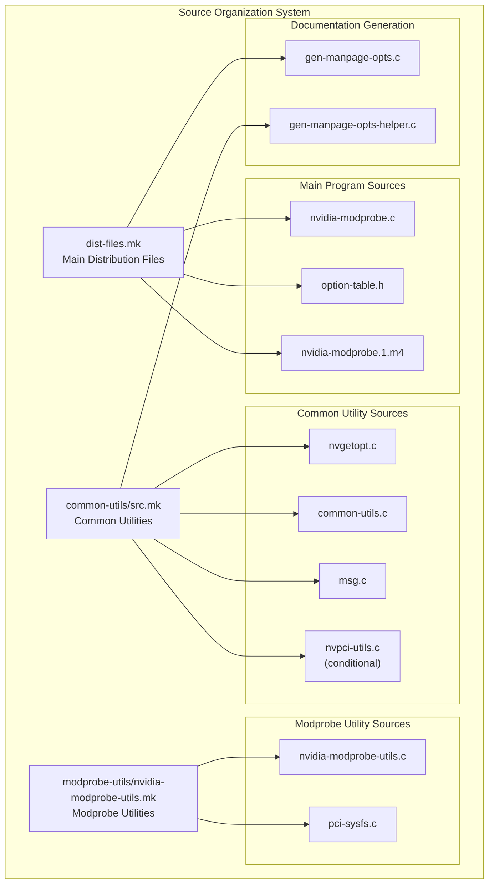
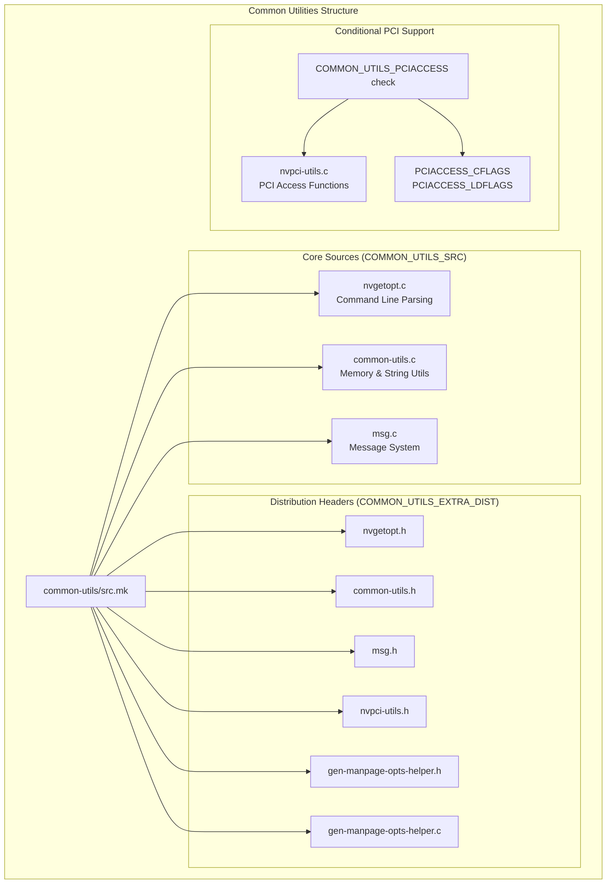
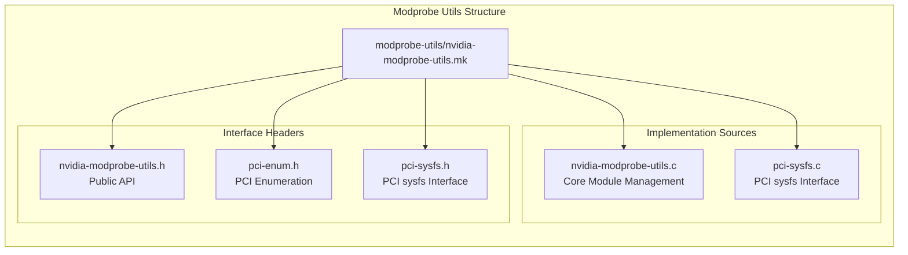
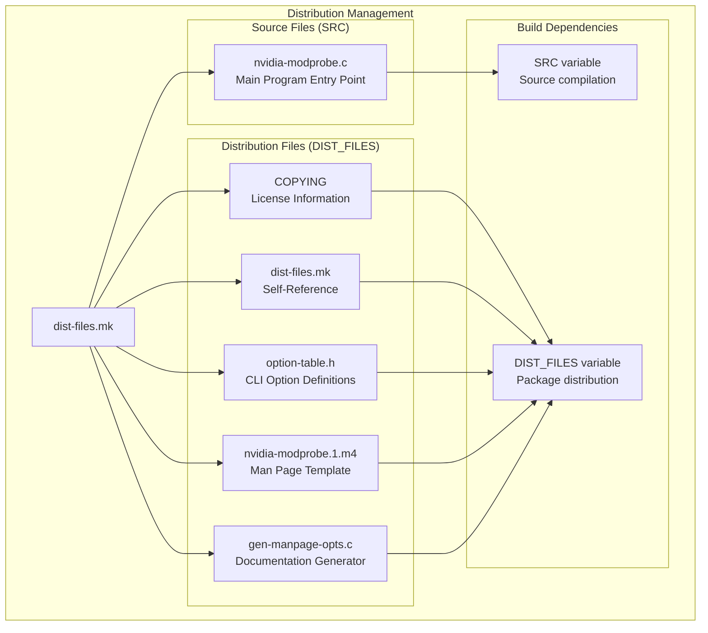
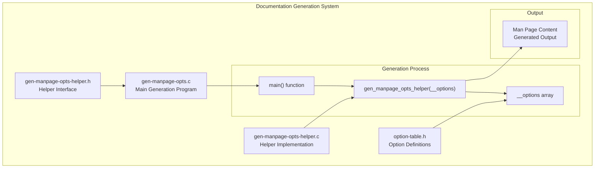

<!-- source: DeepWiki mcp.deepwiki.com · repo NVIDIA/nvidia-modprobe · page 3.3 Source Organization · fetched 2026-10-26 -->

# Source Organization

Relevant source files

The following files were used as context for generating this wiki page:

- [COPYING](COPYING)
- [common-utils/gen-manpage-opts-helper.h](common-utils/gen-manpage-opts-helper.h)
- [common-utils/src.mk](common-utils/src.mk)
- [dist-files.mk](dist-files.mk)
- [gen-manpage-opts.c](gen-manpage-opts.c)
- [modprobe-utils/nvidia-modprobe-utils.mk](modprobe-utils/nvidia-modprobe-utils.mk)

The Source Organization system manages how source files are structured, categorized, and included across the nvidia-modprobe build system. This system provides a modular approach to organizing code into logical groups and handling conditional compilation based on feature requirements.

For information about the overall build configuration and toolchain management, see [Build Configuration](#3.2). For details about the version management system, see [Version Management](#3.1).

## Source File Structure

The nvidia-modprobe project organizes source files into distinct categories using makefile fragments that define source lists and distribution requirements. This modular approach allows for flexible compilation and packaging while maintaining clear separation of concerns.

Sources: [dist-files.mk:1-9](), [common-utils/src.mk:1-41](), [modprobe-utils/nvidia-modprobe-utils.mk:1-7]()

## Common Utilities Organization

The common utilities system provides shared functionality across multiple NVIDIA projects. The source organization uses conditional compilation to include only necessary components based on feature requirements.

The common utilities system uses the `COMMON_UTILS_PCIACCESS` variable to conditionally include PCI access functionality. When this variable is set, the system includes `nvpci-utils.c` in the source list and configures the appropriate compiler and linker flags using `pkg-config`.

| Variable | Purpose | Files Affected |
|----------|---------|----------------|
| `COMMON_UTILS_SRC` | Core source files | `nvgetopt.c`, `common-utils.c`, `msg.c` |
| `COMMON_UTILS_EXTRA_DIST` | Distribution headers | All `.h` files and helper sources |
| `COMMON_UTILS_PCIACCESS` | PCI access toggle | `nvpci-utils.c` inclusion |

Sources: [common-utils/src.mk:6-8](), [common-utils/src.mk:10-13](), [common-utils/src.mk:18-32]()

## Modprobe Utilities Organization

The modprobe utilities provide the core functionality for NVIDIA kernel module management and PCI device interaction. This subsystem is organized as a self-contained module with its own source management.

The modprobe utilities organization separates implementation files (added to `MODPROBE_UTILS_SRC`) from interface headers and the makefile itself (added to `MODPROBE_UTILS_EXTRA_DIST`). This structure supports both building the functionality and packaging it for distribution.

Sources: [modprobe-utils/nvidia-modprobe-utils.mk:1-7]()

## Distribution File Management

The distribution file management system defines which files are included in source packages and how the main program sources are organized. This system ensures complete source distribution while maintaining build dependencies.

The distribution system uses two key variables: `SRC` for files that need compilation and `DIST_FILES` for the complete set of files included in source distributions. The `DIST_FILES` variable includes all source files plus essential build and documentation files.

Sources: [dist-files.mk:1-9]()

## Documentation Generation Organization

The documentation generation system provides automated man page creation from command-line option definitions. This system bridges the gap between code and documentation through programmatic generation.

The documentation generation system uses a simple but effective approach: the `gen-manpage-opts.c` program includes the actual option table definitions and calls a helper function to generate formatted man page content. This ensures that documentation stays synchronized with the actual command-line options.

Sources: [gen-manpage-opts.c:24-28](), [common-utils/gen-manpage-opts-helper.h:26-30]()

## Conditional Compilation Handling

The source organization system implements sophisticated conditional compilation to include only necessary components based on feature requirements. This approach optimizes build times and reduces dependencies for projects that don't need all functionality.

| Compilation Condition | Affected Files | Purpose |
|----------------------|----------------|---------|
| `COMMON_UTILS_PCIACCESS` set | `nvpci-utils.c` | Include PCI access functionality |
| `COMMON_UTILS_PCIACCESS` unset | `nvpci-utils.c` | Package in distribution only |
| Always included | `nvgetopt.c`, `common-utils.c`, `msg.c` | Core utilities |
| Always distributed | All `.h` files | Interface definitions |

The conditional compilation system uses makefile conditionals to check for the `COMMON_UTILS_PCIACCESS` variable. When set, it includes the PCI utilities in the source list and configures the appropriate compiler flags using `pkg-config` to link against `libpciaccess`.

Sources: [common-utils/src.mk:18-32]()

---

