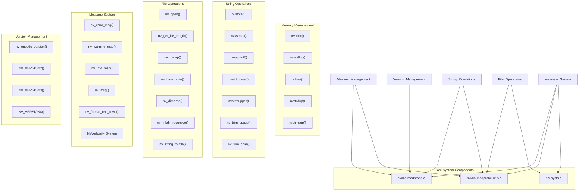
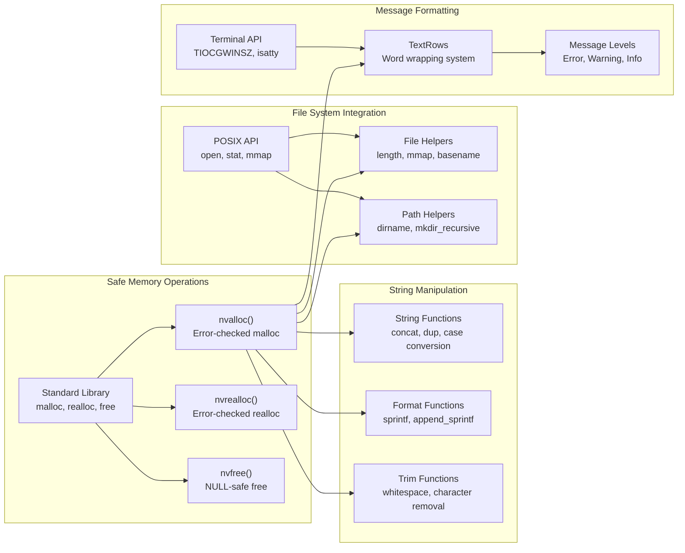
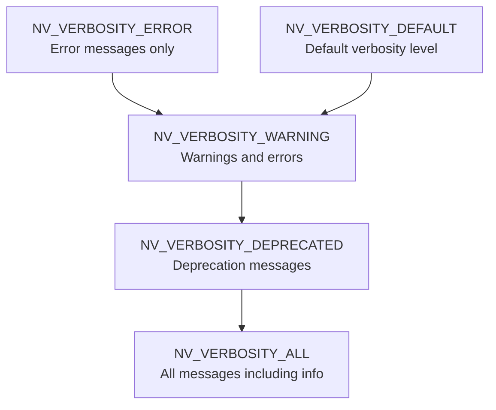
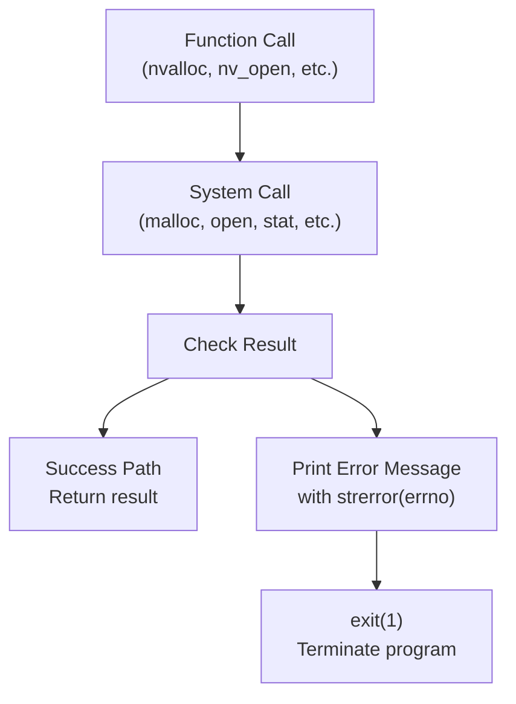

<!-- source: DeepWiki mcp.deepwiki.com · repo NVIDIA/nvidia-modprobe · page 4 Common Utilities · fetched 2026-10-26 -->

# Common Utilities

Relevant source files

The following files were used as context for generating this wiki page:

- [common-utils/common-utils.c](common-utils/common-utils.c)
- [common-utils/common-utils.h](common-utils/common-utils.h)
- [common-utils/msg.c](common-utils/msg.c)

The Common Utilities subsystem provides foundational support functions used throughout the nvidia-modprobe system. This includes memory management, string manipulation, file operations, message handling, and version management utilities. These utilities form the base layer that enables safe and consistent operations across all components of the system.

For information about the main nvidia-modprobe implementation that uses these utilities, see [nvidia-modprobe System](#2). For details about the build system configuration, see [Build System](#3).

## Architecture Overview

The Common Utilities system is organized into several functional domains that provide essential services to the core nvidia-modprobe components:

Sources: [common-utils/common-utils.h:1-143](), [common-utils/common-utils.c:1-839](), [common-utils/msg.c:1-429]()

## Utility Function Categories

The common utilities are organized into distinct functional categories, each serving specific operational needs:

Sources: [common-utils/common-utils.c:52-291](), [common-utils/msg.c:62-427]()

## Core Data Structures

The common utilities define several key data structures that support system operations:

| Structure | Definition | Purpose |
|-----------|------------|---------|
| `NvVerbosity` | Enumeration in msg.c | Controls message output levels |
| `NVOptionalBool` | Enum with DEFAULT/FALSE/TRUE | Three-state boolean values |
| `TextRows` | Structure for text formatting | Word-wrapped text display |
| Version encoding | 64-bit integer format | Version comparison and storage |

### NvVerbosity Levels

Sources: [common-utils/msg.c:45-55](), [common-utils/common-utils.h:135-139]()

## Error Handling Strategy

The common utilities implement a consistent error handling strategy across all functions:

This approach ensures that memory allocation failures, file system errors, and other system-level problems are immediately detected and reported with clear error messages before terminating the program.

Sources: [common-utils/common-utils.c:52-63](), [common-utils/common-utils.c:455-465](), [common-utils/common-utils.c:476-488]()

## Integration with Main System

The common utilities are extensively used throughout the nvidia-modprobe system:

```mermaid
graph TB
    subgraph "nvidia-modprobe.c"
        main_memory["Memory allocation<br/>nvalloc, nvfree"]
        main_strings["String operations<br/>nvstrcat, nvasprintf"]
        main_messages["Message output<br/>nv_error_msg, nv_info_msg"]
    end
    
    subgraph "nvidia-modprobe-utils.c"
        utils_memory["Memory management<br/>nvalloc, nvstrdup"]
        utils_files["File operations<br/>nv_open, nv_string_to_file"]
        utils_paths["Path manipulation<br/>nv_basename, nv_dirname"]
    end
    
    subgraph "pci-sysfs.c"
        pci_files["File access<br/>nv_open, nv_get_file_length"]
        pci_strings["String processing<br/>nv_trim_space, nvstrcat"]
        pci_memory["Memory allocation<br/>nvalloc, nvfree"]
    end
    
    subgraph "Common Utilities"
        memory_mgmt["Memory Management"]
        string_ops["String Operations"]
        file_ops["File Operations"]
        msg_system["Message System"]
    end
    
    memory_mgmt --> main_memory
    string_ops --> main_strings
    msg_system --> main_messages
    
    memory_mgmt --> utils_memory
    file_ops --> utils_files
    string_ops --> utils_paths
    
    file_ops --> pci_files
    string_ops --> pci_strings
    memory_mgmt --> pci_memory
```

Sources: [common-utils/common-utils.h:54-82](), [common-utils/msg.c:126-222]()

## Subsystem Components

The Common Utilities system is detailed in the following subsections:

- **[Utility Functions](#4.1)**: Core memory management, string manipulation, and file system utilities
- **[Message System](#4.2)**: Formatted output, logging, and verbosity control system  
- **[Command Line Parsing](#4.3)**: Portable command-line argument processing utilities
- **[PCI Utilities](#4.4)**: Hardware discovery and PCI device management functions

Each subsection provides detailed documentation of the specific utility functions, their parameters, return values, and usage patterns within the broader nvidia-modprobe system.

Sources: [common-utils/common-utils.h:1-143](), [common-utils/common-utils.c:1-839](), [common-utils/msg.c:1-429]()

---

