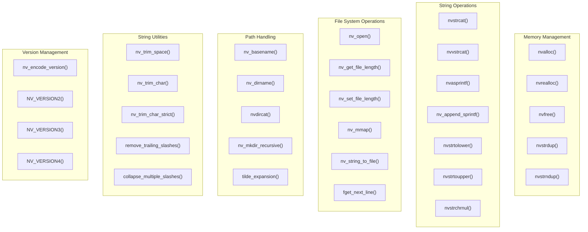
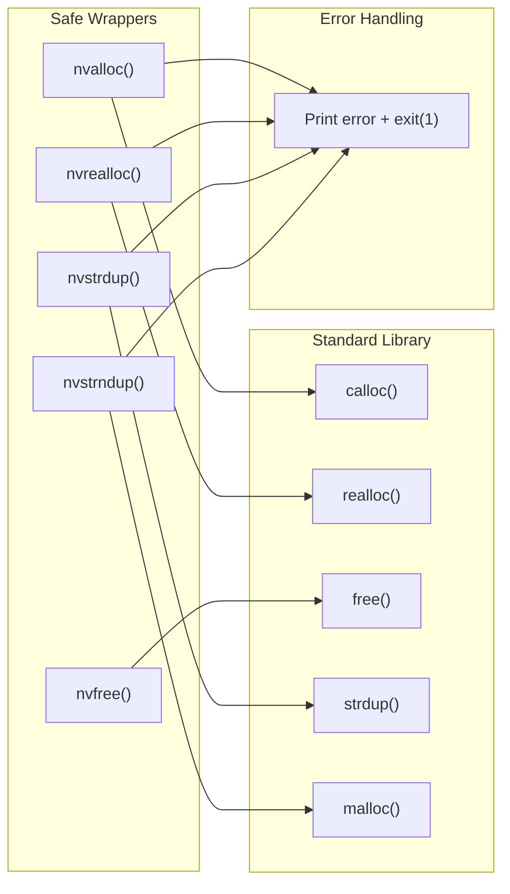
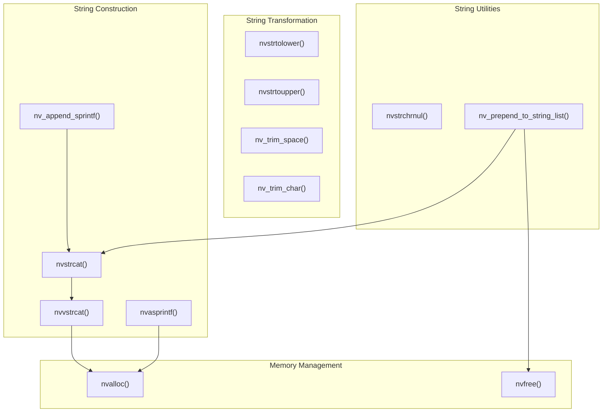
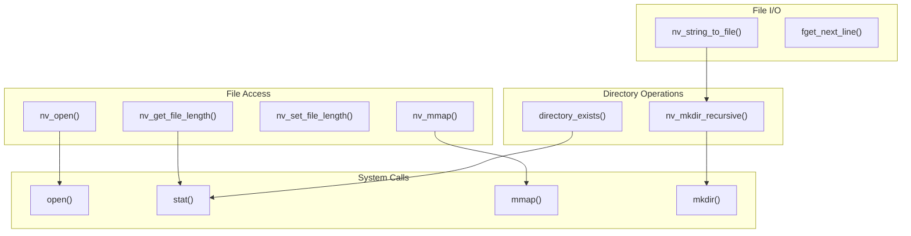
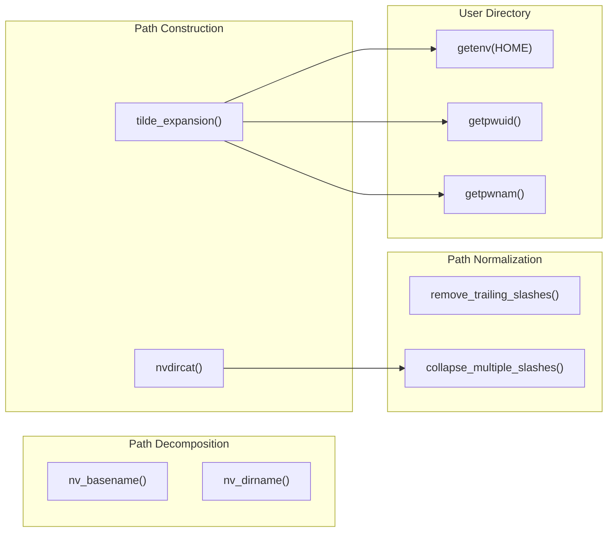
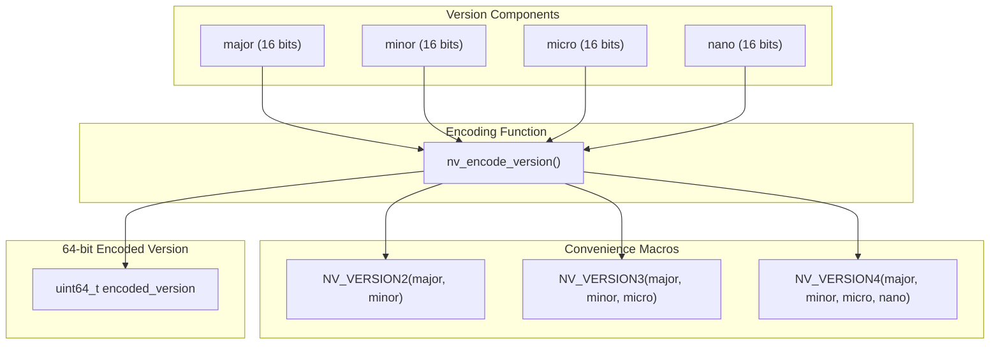

<!-- source: DeepWiki mcp.deepwiki.com · repo NVIDIA/nvidia-modprobe · page 4.1 Utility Functions · fetched 2026-10-26 -->

# Utility Functions

Relevant source files

The following files were used as context for generating this wiki page:

- [common-utils/common-utils.c](common-utils/common-utils.c)
- [common-utils/common-utils.h](common-utils/common-utils.h)

## Purpose and Scope

The utility functions system provides a comprehensive set of shared functionality used throughout the nvidia-modprobe codebase. This system implements safe memory management, string manipulation, file operations, and path handling utilities that abstract away platform-specific behaviors and provide consistent error handling across all components.

The utilities are organized into the `common-utils` module and serve as the foundation layer for higher-level operations. For message handling and logging functionality, see [Message System](#4.2). For command-line argument parsing, see [Command Line Parsing](#4.3).

## System Architecture

The utility functions are organized into several functional categories, each providing robust implementations with comprehensive error checking:

Sources: [common-utils/common-utils.h:54-143](), [common-utils/common-utils.c:43-838]()

## Memory Management System

The memory management system provides safe wrappers around standard library functions with automatic error handling:

### Core Memory Functions

| Function | Purpose | Error Handling |
|----------|---------|----------------|
| `nvalloc()` | Allocate zero-initialized memory | Exit on failure |
| `nvrealloc()` | Resize memory block | Exit on failure |
| `nvfree()` | Safe free with NULL check | No-op on NULL |
| `nvstrdup()` | Duplicate string with error checking | Exit on failure |
| `nvstrndup()` | Duplicate string with length limit | Exit on failure |

The memory functions automatically handle error conditions by printing detailed error messages and calling `exit(1)`, ensuring that memory allocation failures are never silently ignored.

Sources: [common-utils/common-utils.c:52-199](), [common-utils/common-utils.h:54-65]()

## String Manipulation System

The string manipulation system provides advanced string operations with automatic memory management:

### String Construction Functions

The `nvstrcat()` function [common-utils/common-utils.c:112-122]() provides variadic string concatenation with automatic memory allocation. It uses `nvvstrcat()` internally, which performs two passes over the arguments - first to calculate the total length, then to concatenate the strings.

The `nvasprintf()` function [common-utils/common-utils.c:249-257]() provides formatted string creation with automatic memory allocation, while `nv_append_sprintf()` [common-utils/common-utils.c:266-280]() allows appending formatted strings to existing buffers.

Sources: [common-utils/common-utils.c:72-281](), [common-utils/common-utils.h:55-64]()

## File System Operations

The file system operations provide safe wrappers around system calls with comprehensive error handling:

### File Operation Functions

| Function | Purpose | System Call |
|----------|---------|-------------|
| `nv_open()` | Open file with error handling | `open()` |
| `nv_get_file_length()` | Get file size via stat | `stat()` |
| `nv_set_file_length()` | Set file size via lseek/write | `lseek()`, `write()` |
| `nv_mmap()` | Memory map file | `mmap()` |
| `nv_string_to_file()` | Write string to file | `fopen()`, `fwrite()` |

The `nv_mkdir_recursive()` function [common-utils/common-utils.c:553-607]() creates directory hierarchies, tracking created directories and providing detailed error reporting.

Sources: [common-utils/common-utils.c:455-689](), [common-utils/common-utils.h:72-81]()

## Path Handling System

The path handling system provides cross-platform path manipulation with proper separator handling:

### Path Manipulation Functions

The `nv_basename()` and `nv_dirname()` functions [common-utils/common-utils.c:537-652]() provide alternatives to the standard library functions that avoid implementation-specific behaviors and always return heap-allocated strings.

The `tilde_expansion()` function [common-utils/common-utils.c:311-362]() handles both `~` (current user) and `~user` (specific user) expansions by consulting environment variables and the password database.

Sources: [common-utils/common-utils.c:311-652](), [common-utils/common-utils.h:67-80]()

## Version Management System

The version management system provides utilities for encoding and comparing version numbers:

The `nv_encode_version()` function [common-utils/common-utils.h:103-112]() packs four 16-bit version components into a 64-bit integer, allowing direct comparison of version numbers. The encoding places the major version in the most significant bits, enabling natural ordering.

Sources: [common-utils/common-utils.h:103-123]()

## Helper Macros and Constants

The utility system defines several important macros and constants used throughout the codebase:

| Macro/Constant | Purpose | Definition |
|----------------|---------|------------|
| `TRUE`/`FALSE` | Boolean values | `1`/`0` |
| `ARRAY_LEN()` | Array length calculation | `sizeof(arr)/sizeof(arr[0])` |
| `NV_MIN()`/`NV_MAX()` | Min/max comparison | Conditional expressions |
| `TAB`/`BIGTAB` | Indentation strings | `"  "`/`"      "` |
| `NV_INLINE` | Inline function attribute | `__inline__` on GCC |
| `NV_ID_STRING` | Program identification | Program name + version |

The `NVOptionalBool` enum [common-utils/common-utils.h:135-139]() provides a three-state boolean system with `NV_OPTIONAL_BOOL_DEFAULT`, `NV_OPTIONAL_BOOL_FALSE`, and `NV_OPTIONAL_BOOL_TRUE` values.

Sources: [common-utils/common-utils.h:34-142]()

---

