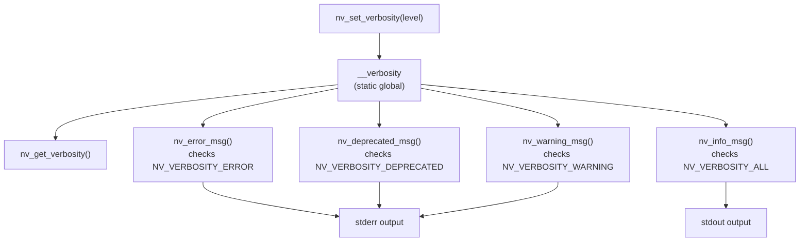
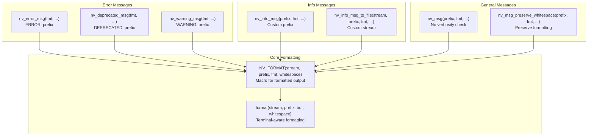
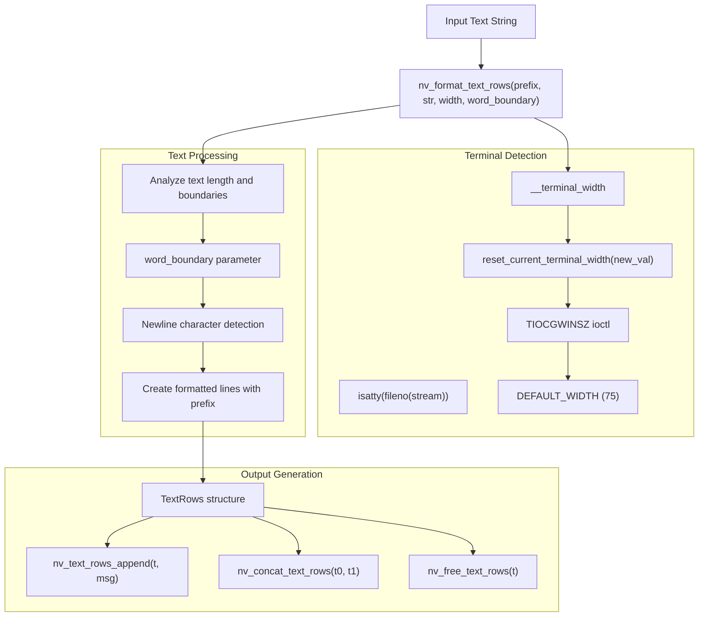
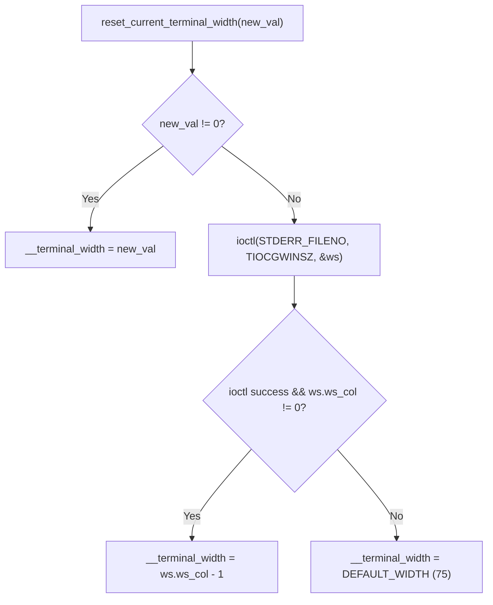

<!-- source: DeepWiki mcp.deepwiki.com · repo NVIDIA/nvidia-modprobe · page 4.2 Message System · fetched 2026-10-26 -->

# Message System

<details>
<summary>Relevant source files</summary>

The following files were used as context for generating this wiki page:

- [common-utils/msg.c](common-utils/msg.c)
- [common-utils/msg.h](common-utils/msg.h)

</details>


## Purpose and Scope

The Message System provides centralized logging, output formatting, and verbosity control for the nvidia-modprobe utility. It handles all user-facing messages including errors, warnings, deprecation notices, and informational output with intelligent terminal width detection and text wrapping capabilities.

For command-line argument parsing, see [4.3](#4.3). For general utility functions, see [4.1](#4.1).

## Verbosity Control System

The message system implements a hierarchical verbosity control mechanism that determines which messages are displayed based on the current verbosity level.

### Verbosity Levels

The system defines five verbosity levels in the `NvVerbosity` enumeration:

| Level | Value | Description |
|-------|-------|-------------|
| `NV_VERBOSITY_NONE` | 0 | No output |
| `NV_VERBOSITY_ERROR` | 1 | Errors only |
| `NV_VERBOSITY_DEPRECATED` | 2 | Errors and deprecation messages |
| `NV_VERBOSITY_WARNING` | 3 | Errors and all warnings |
| `NV_VERBOSITY_ALL` | 4 | All messages including info |



Sources: [common-utils/msg.h:94-101](), [common-utils/msg.c:45-55]()

## Message Types and Functions

The system provides specialized functions for different message types, each with specific formatting and output behavior.

### Core Message Functions



Sources: [common-utils/msg.c:126-133](), [common-utils/msg.c:143-150](), [common-utils/msg.c:160-167](), [common-utils/msg.c:177-182](), [common-utils/msg.c:191-196](), [common-utils/msg.c:207-210](), [common-utils/msg.c:219-222]()

### Message Function Characteristics

| Function | Output Stream | Verbosity Check | Prefix | Whitespace Handling |
|----------|---------------|-----------------|--------|-------------------|
| `nv_error_msg` | stderr | `NV_VERBOSITY_ERROR` | "ERROR: " | Normalized |
| `nv_deprecated_msg` | stderr | `NV_VERBOSITY_DEPRECATED` | "DEPRECATED: " | Normalized |
| `nv_warning_msg` | stderr | `NV_VERBOSITY_WARNING` | "WARNING: " | Normalized |
| `nv_info_msg` | stdout | `NV_VERBOSITY_ALL` | Custom | Normalized |
| `nv_info_msg_to_file` | Custom | `NV_VERBOSITY_ALL` | Custom | Normalized |
| `nv_msg` | stdout | None | Custom | Normalized |
| `nv_msg_preserve_whitespace` | stdout | None | Custom | Preserved |

Sources: [common-utils/msg.h:113-123]()

## Text Formatting System

The message system includes a sophisticated text formatting engine built around the `TextRows` structure that provides terminal-aware text wrapping and formatting.

### TextRows Structure

The `TextRows` structure manages formatted text output:

```c
typedef struct {
    char **t; /* the text rows */
    int n;    /* number of rows */
    int m;    /* maximum row length */
} TextRows;
```

Sources: [common-utils/msg.h:130-134]()

### Text Formatting Pipeline



Sources: [common-utils/msg.c:252-366](), [common-utils/msg.c:73-87](), [common-utils/msg.c:373-388](), [common-utils/msg.c:395-410](), [common-utils/msg.c:418-427]()

### Word Boundary Processing

The text formatting system implements intelligent word boundary detection for natural text wrapping:

1. **Line Length Calculation**: Adjusts available width based on prefix length
2. **Boundary Detection**: Searches backwards from line end for whitespace
3. **Fallback Handling**: Falls back to hard break if no word boundary found
4. **Newline Preservation**: Respects explicit newline characters in input

Sources: [common-utils/msg.c:292-360]()

## Terminal Integration

The message system integrates with terminal capabilities to provide optimal output formatting across different terminal environments.

### Terminal Width Detection



Sources: [common-utils/msg.c:73-87](), [common-utils/msg.c:62]()

### TTY-Aware Formatting

The `format()` function adapts its behavior based on whether the output stream is connected to a terminal:

- **TTY Output**: Uses `nv_format_text_rows()` for intelligent wrapping
- **Non-TTY Output**: Outputs raw text with prefix concatenation

Sources: [common-utils/msg.c:90-107]()

## Memory Management

The message system implements careful memory management for dynamic text formatting and buffer allocation.

### Dynamic Buffer Allocation

The `NV_VSNPRINTF` macro handles variable-length string formatting with automatic buffer resizing:

```c
#define NV_VSNPRINTF(buf, fmt)                                  \
do {                                                            \
    if (!fmt) {                                                 \
        (buf) = NULL;                                           \
    } else {                                                    \
        va_list ap;                                             \
        int len, current_len = NV_FMT_BUF_LEN;                  \
        /* Buffer allocation loop with size adaptation */       \
    }                                                           \
} while (0)
```

The macro starts with a default buffer size of 256 bytes (`NV_FMT_BUF_LEN`) and dynamically resizes based on `vsnprintf()` return values to handle different glibc semantics.

Sources: [common-utils/msg.h:58-86]()

### TextRows Memory Management

The system provides complete lifecycle management for `TextRows` structures:

- **Creation**: `nv_format_text_rows()` allocates initial structure
- **Modification**: `nv_text_rows_append()` and `nv_concat_text_rows()` manage dynamic growth
- **Cleanup**: `nv_free_text_rows()` ensures complete memory deallocation

Sources: [common-utils/msg.c:252-366](), [common-utils/msg.c:373-388](), [common-utils/msg.c:395-410](), [common-utils/msg.c:418-427]()

---

