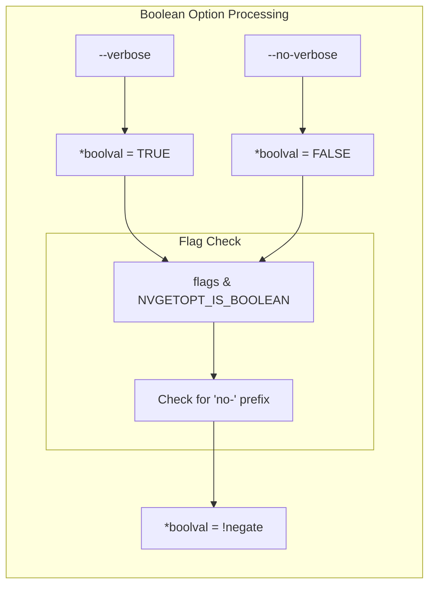

<!-- source: DeepWiki mcp.deepwiki.com · repo NVIDIA/nvidia-modprobe · page 4.3 Command Line Parsing · fetched 2026-10-26 -->

# Command Line Parsing

<details>
<summary>Relevant source files</summary>

The following files were used as context for generating this wiki page:

- [common-utils/nvgetopt.c](common-utils/nvgetopt.c)
- [common-utils/nvgetopt.h](common-utils/nvgetopt.h)

</details>


The nvgetopt system provides a portable, feature-enhanced replacement for the standard `getopt_long()` function. This system handles command line argument parsing for nvidia-modprobe and related utilities, offering extended functionality including boolean options, argument validation, and automatic help generation.

For information about how the main executable uses this command line parsing system, see [Command Line Interface](#2.4). For details about the message system used for error reporting, see [Message System](#4.2).

## System Architecture

The nvgetopt system consists of two main components: the core parsing engine and the help generation subsystem. The system is designed to be self-contained and portable across different platforms.

```mermaid
graph TB
    subgraph "nvgetopt System Architecture"
        options["`NVGetoptOption[]`<br/>Option Definitions"]
        parser["`nvgetopt()`<br/>Core Parser"]
        help["`nvgetopt_print_help()`<br/>Help Generator"]
        
        options --> parser
        options --> help
        
        subgraph "Input Processing"
            argv["`argv[]`<br/>Command Line Args"]
            flags["`Option Flags`<br/>Parsing Control"]
        end
        
        subgraph "Output Values"
            strval["`char **strval`<br/>String Arguments"]
            intval["`int *intval`<br/>Integer Arguments"]
            boolval["`int *boolval`<br/>Boolean Values"]
            doubleval["`double *doubleval`<br/>Double Arguments"]
            disable_val["`int *disable_val`<br/>Disable States"]
        end
        
        argv --> parser
        flags --> parser
        parser --> strval
        parser --> intval
        parser --> boolval
        parser --> doubleval
        parser --> disable_val
        
        help --> callback["`nvgetopt_print_help_callback_ptr`<br/>Format Callback"]
    end
```

Sources: [common-utils/nvgetopt.h:135-204](), [common-utils/nvgetopt.c:37-367]()

## Core Data Structures

The nvgetopt system is built around the `NVGetoptOption` structure, which defines each command line option's characteristics and behavior.

### NVGetoptOption Structure

The `NVGetoptOption` structure encapsulates all information needed to define a command line option:

| Field | Type | Purpose |
|-------|------|---------|
| `name` | `const char *` | Long option name (e.g., "help", "version") |
| `val` | `int` | Short option character or return value |
| `flags` | `unsigned int` | Bitfield controlling option behavior |
| `arg_name` | `const char *` | Argument name for help text (not used by parser) |
| `description` | `const char *` | Help description (not used by parser) |

```mermaid
graph LR
    subgraph "Option Flag Categories"
        subgraph "Argument Types"
            bool["`NVGETOPT_IS_BOOLEAN`<br/>0x0001"]
            string["`NVGETOPT_STRING_ARGUMENT`<br/>0x0002"]
            integer["`NVGETOPT_INTEGER_ARGUMENT`<br/>0x0004"]
            double["`NVGETOPT_DOUBLE_ARGUMENT`<br/>0x0008"]
        end
        
        subgraph "Behavioral Modifiers"
            disable["`NVGETOPT_ALLOW_DISABLE`<br/>0x0010"]
            optional["`NVGETOPT_ARGUMENT_IS_OPTIONAL`<br/>0x0020"]
            always_help["`NVGETOPT_HELP_ALWAYS`<br/>0x0040"]
            deprecated["`NVGETOPT_IS_DEPRECATED`<br/>0x0080"]
        end
        
        subgraph "Validation Flags"
            disable_invalid["`NVGETOPT_DISABLE_IS_INVALID`<br/>0x0100"]
            enable_invalid["`NVGETOPT_ENABLE_IS_INVALID`<br/>0x0200"]
        end
    end
```

Sources: [common-utils/nvgetopt.h:135-141](), [common-utils/nvgetopt.h:46-133]()

## Core Parsing Function

The `nvgetopt()` function implements the main parsing logic, processing command line arguments according to the option definitions.

### Function Signature

```c
int nvgetopt(int argc, char *argv[], const NVGetoptOption *options,
             char **strval, int *boolval, int *intval, 
             double *doubleval, int *disable_val)
```

### Parsing Flow

```mermaid
graph TB
    start["`Start nvgetopt()`"]
    check_args["`Check argv_index < argc`"]
    get_arg["`Get argv[argv_index]`"]
    parse_prefix["`Parse -- or - prefix`"]
    find_equals["`Look for = in argument`"]
    
    subgraph "Option Matching"
        short_match["`Try Short Option Match`<br/>Single character"]
        long_match["`Try Long Option Match`<br/>Full name comparison"]
        multi_short["`Try Multi-Short Options`<br/>Combined flags"]
        concat_arg["`Try Concatenated Argument`<br/>-j8 style"]
    end
    
    subgraph "Argument Processing"
        has_arg["`Option has argument?`"]
        get_next_arg["`Get next argv entry`"]
        parse_arg["`Parse argument by type`"]
        validate["`Validate argument`"]
    end
    
    subgraph "Output Assignment"
        set_bool["`Set *boolval`"]
        set_str["`Set *strval`"]
        set_int["`Set *intval`"]
        set_double["`Set *doubleval`"]
        set_disable["`Set *disable_val`"]
    end
    
    start --> check_args
    check_args -->|"More args"| get_arg
    check_args -->|"No more args"| return_end["`Return -1`"]
    
    get_arg --> parse_prefix
    parse_prefix --> find_equals
    find_equals --> short_match
    short_match -->|"No match"| long_match
    long_match -->|"No match"| multi_short
    multi_short -->|"No match"| concat_arg
    concat_arg -->|"No match"| error["`Print error, return 0`"]
    
    short_match -->|"Match found"| has_arg
    long_match -->|"Match found"| has_arg
    multi_short -->|"Match found"| has_arg
    concat_arg -->|"Match found"| has_arg
    
    has_arg -->|"Yes"| get_next_arg
    has_arg -->|"No"| set_bool
    get_next_arg --> parse_arg
    parse_arg --> validate
    validate --> set_str
    validate --> set_int
    validate --> set_double
    
    set_bool --> return_val["`Return option.val`"]
    set_str --> return_val
    set_int --> return_val
    set_double --> return_val
    set_disable --> return_val
```

Sources: [common-utils/nvgetopt.c:37-367]()

## Option Types and Processing

The nvgetopt system supports multiple argument types with sophisticated processing rules.

### Boolean Options

Boolean options can be specified in multiple ways:
- `--option` sets the value to TRUE
- `--no-option` sets the value to FALSE
- Boolean state is returned through the `boolval` parameter



Sources: [common-utils/nvgetopt.c:251-255]()

### Argument Parsing

The system handles different argument types with validation:

| Type | Flag | Validation | Output |
|------|------|------------|---------|
| String | `NVGETOPT_STRING_ARGUMENT` | None | `*strval = strdup(argument)` |
| Integer | `NVGETOPT_INTEGER_ARGUMENT` | `strtol()` with endptr check | `*intval = (int)strtol(...)` |
| Double | `NVGETOPT_DOUBLE_ARGUMENT` | `strtod()` with endptr check | `*doubleval = (double)strtod(...)` |

Sources: [common-utils/nvgetopt.c:309-340]()

### Special Processing Features

The nvgetopt system includes several advanced features:

1. **Concatenated Short Options**: Multiple boolean short options can be combined (e.g., `-abc` for `-a -b -c`)
2. **Concatenated Arguments**: Integer arguments can be attached to short options (e.g., `-j8`)
3. **Optional Arguments**: Arguments can be marked as optional with `NVGETOPT_ARGUMENT_IS_OPTIONAL`
4. **Disable Support**: Options can be disabled with `--no-` prefix when `NVGETOPT_ALLOW_DISABLE` is set

Sources: [common-utils/nvgetopt.c:153-205](), [common-utils/nvgetopt.c:213-241](), [common-utils/nvgetopt.c:291-295]()

## Help Generation System

The nvgetopt system includes a sophisticated help generation mechanism that automatically creates formatted help text from option definitions.

### Help Generation Flow

```mermaid
graph TB
    subgraph "Help Generation Process"
        options_array["`NVGetoptOption[]`<br/>Option Definitions"]
        include_mask["`include_mask`<br/>Filter Options"]
        callback["`nvgetopt_print_help_callback_ptr`<br/>Format Function"]
        
        options_array --> filter["`Filter by include_mask`"]
        include_mask --> filter
        filter --> process["`Process Each Option`"]
        
        subgraph "Option Processing"
            get_arg_name["`Get Argument Name`"]
            build_long["`Build Long Form`<br/>--option=ARG"]
            build_short["`Build Short Form`<br/>-o ARG"]
            build_negated["`Build Negated Form`<br/>--no-option"]
            cook_desc["`cook_description()`<br/>Remove markup"]
        end
        
        process --> get_arg_name
        get_arg_name --> build_long
        build_long --> build_short
        build_short --> build_negated
        build_negated --> cook_desc
        cook_desc --> callback
        
        callback --> output["`Formatted Help Text`"]
    end
```

Sources: [common-utils/nvgetopt.c:405-490]()

### Help Text Format

The help generation system creates comprehensive help text that includes:

1. **Short Form**: Single character option with argument (e.g., `-v`, `-f FILE`)
2. **Long Form**: Full option name with argument (e.g., `--verbose`, `--file=FILE`)
3. **Negated Form**: Boolean negation for applicable options (e.g., `--no-verbose`)
4. **Description**: Processed description text with markup removed

The `cook_description()` function removes special markup characters (`&` and `^`) used by the manpage generator to produce clean help text.

Sources: [common-utils/nvgetopt.c:376-402](), [common-utils/nvgetopt.c:444-478]()

## Integration with nvidia-modprobe

The nvgetopt system integrates seamlessly with the nvidia-modprobe main executable and other utilities in the system. The parsing results are used to configure program behavior and validate user input.

```mermaid
graph TB
    subgraph "nvgetopt Integration"
        main["`nvidia-modprobe.c`<br/>Main Executable"]
        option_table["`option-table.h`<br/>Option Definitions"]
        nvgetopt_sys["`nvgetopt()`<br/>Parser"]
        
        main --> option_table
        option_table --> nvgetopt_sys
        nvgetopt_sys --> main
        
        subgraph "Output Handling"
            config["`Program Configuration`"]
            validation["`Input Validation`"]
            help_text["`Help Generation`"]
        end
        
        main --> config
        main --> validation
        main --> help_text
    end
```

Sources: [common-utils/nvgetopt.h:1-205](), [common-utils/nvgetopt.c:1-491]()

---

