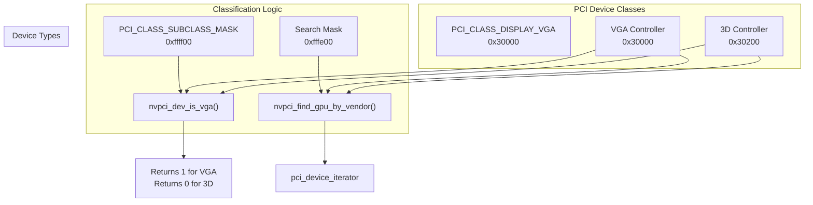
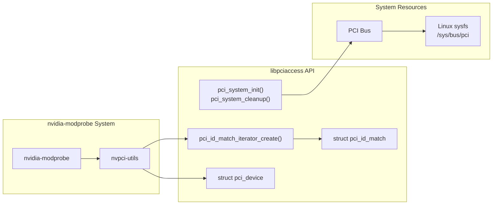

<!-- source: DeepWiki mcp.deepwiki.com · repo NVIDIA/nvidia-modprobe · page 4.4 PCI Utilities · fetched 2026-10-26 -->

# PCI Utilities

<details>
<summary>Relevant source files</summary>

The following files were used as context for generating this wiki page:

- [common-utils/nvpci-utils.c](common-utils/nvpci-utils.c)
- [common-utils/nvpci-utils.h](common-utils/nvpci-utils.h)

</details>


## Purpose and Scope

The PCI Utilities system provides a simplified interface for GPU device discovery and classification using the libpciaccess library. This system enables the nvidia-modprobe utility to locate NVIDIA graphics hardware and determine device characteristics needed for proper module loading and device file creation.

For broader hardware integration capabilities, see [PCI Hardware Integration](#2.5). For system-level PCI device management, see [Core Library Implementation](#2.2).

## Overview

The PCI Utilities system consists of two main components that wrap libpciaccess functionality:

| Component | Purpose |
|-----------|---------|
| `nvpci_find_gpu_by_vendor()` | Locates GPU devices by vendor ID using PCI device enumeration |
| `nvpci_dev_is_vga()` | Determines if a discovered device is a VGA controller (vs 3D controller) |

The system defines NVIDIA's vendor ID and PCI device class constants, providing a focused API for GPU hardware discovery.

**Sources:** [common-utils/nvpci-utils.h:1-33](), [common-utils/nvpci-utils.c:1-66]()

## Core Functions

### GPU Discovery by Vendor

The `nvpci_find_gpu_by_vendor()` function creates a PCI device iterator that matches display devices from a specified vendor:

```c
struct pci_device_iterator *nvpci_find_gpu_by_vendor(uint32_t vendor_id);
```

This function constructs a `pci_id_match` structure that:
- Matches the specified vendor ID (typically `NV_PCI_VENDOR_ID` for NVIDIA)
- Accepts any device, subvendor, and subdevice IDs
- Filters for display class devices (`PCI_CLASS_DISPLAY_VGA`)
- Includes both VGA controllers (0x30000) and 3D controllers (0x30200) using a mask

**Sources:** [common-utils/nvpci-utils.c:39-55]()

### VGA Controller Classification

The `nvpci_dev_is_vga()` function determines whether a PCI device is specifically a VGA controller:

```c
int nvpci_dev_is_vga(struct pci_device *dev);
```

This function distinguishes between:
- VGA controllers (class 0x0300) - returns non-zero
- 3D controllers (class 0x0302) - returns zero

**Sources:** [common-utils/nvpci-utils.c:61-65]()

## PCI Device Classification System



**Sources:** [common-utils/nvpci-utils.c:26-31](), [common-utils/nvpci-utils.c:46-51]()

## Constants and Vendor Information

### NVIDIA Vendor Identification

```c
#define NV_PCI_VENDOR_ID 0x10de
```

This constant defines NVIDIA's official PCI vendor ID, used throughout the system for device identification.

### PCI Class Constants

| Constant | Value | Purpose |
|----------|-------|---------|
| `PCI_CLASS_DISPLAY_VGA` | 0x30000 | Base class for VGA display controllers |
| `PCI_CLASS_SUBCLASS_MASK` | 0xffff00 | Mask for extracting class and subclass bits |

**Sources:** [common-utils/nvpci-utils.h:28-28](), [common-utils/nvpci-utils.c:30-31]()

## Integration with libpciaccess



The system requires the calling code to handle libpciaccess initialization and cleanup:
- `pci_system_init()` must be called before using PCI utilities
- `pci_system_cleanup()` must be called when PCI access is no longer needed

**Sources:** [common-utils/nvpci-utils.c:34-38]()

## Usage Patterns

### Typical Integration Flow

1. **System Initialization**: Call `pci_system_init()` to initialize libpciaccess
2. **Device Discovery**: Use `nvpci_find_gpu_by_vendor(NV_PCI_VENDOR_ID)` to find NVIDIA GPUs
3. **Device Classification**: For each found device, use `nvpci_dev_is_vga()` to determine VGA status
4. **Iterator Management**: Process devices using standard libpciaccess iterator patterns
5. **System Cleanup**: Call `pci_system_cleanup()` when finished

### Device Class Filtering

The search function uses a clever masking approach to include both VGA and 3D controllers:
- Base class: `PCI_CLASS_DISPLAY_VGA` (0x30000)
- Mask: `PCI_CLASS_SUBCLASS_MASK & ~0x200` (0xfffe00)
- This allows both 0x30000 (VGA) and 0x30200 (3D) devices to match

**Sources:** [common-utils/nvpci-utils.c:41-52]()

---

