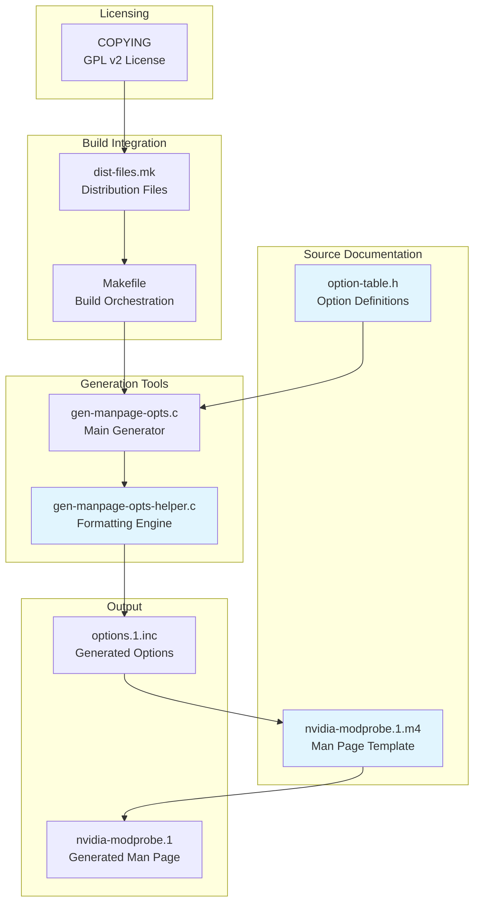
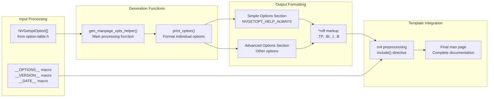
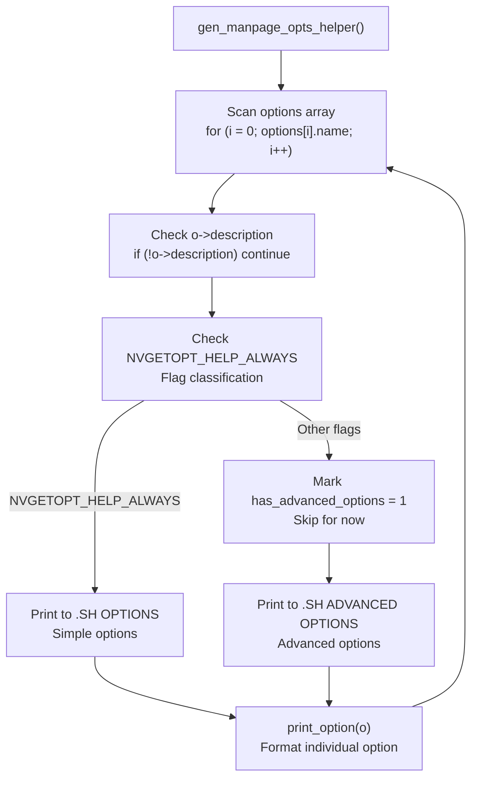
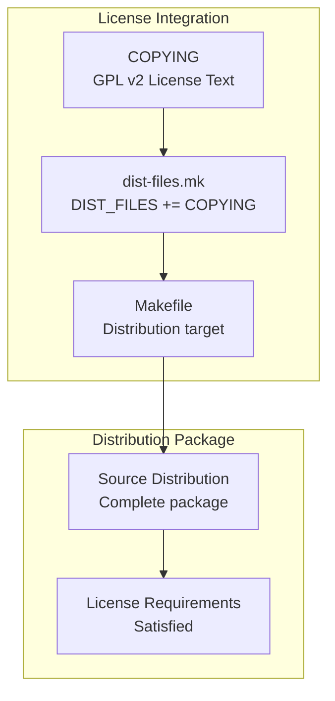

<!-- source: DeepWiki mcp.deepwiki.com · repo NVIDIA/nvidia-modprobe · page 5 Documentation System · fetched 2026-10-26 -->

# Documentation System

Relevant source files

The following files were used as context for generating this wiki page:

- [COPYING](COPYING)
- [common-utils/gen-manpage-opts-helper.c](common-utils/gen-manpage-opts-helper.c)
- [dist-files.mk](dist-files.mk)
- [gen-manpage-opts.c](gen-manpage-opts.c)
- [modprobe-utils/pci-sysfs.h](modprobe-utils/pci-sysfs.h)
- [nvidia-modprobe.1.m4](nvidia-modprobe.1.m4)

The Documentation System manages the automated generation of man pages and handles project licensing for the nvidia-modprobe utility. This system ensures that command-line options are consistently documented across both the help system and the man page, while maintaining proper licensing compliance.

For information about the build system that orchestrates documentation generation, see [Build System](#3). For details about the command-line options that are documented, see [Command Line Interface](#2.4).

## Overview

The documentation system consists of two main components: an automated man page generation system that extracts documentation from source code, and licensing management. The man page generation uses m4 preprocessing to create formatted documentation from structured option definitions.

Sources: [nvidia-modprobe.1.m4:1-84](), [gen-manpage-opts.c:1-29](), [common-utils/gen-manpage-opts-helper.c:1-225](), [dist-files.mk:1-9](), [COPYING:1-340]()

## Man Page Generation System

### Template Processing Architecture

The man page generation system uses m4 macro processing to create the final documentation. The system is designed to automatically synchronize command-line options with their documentation.

Sources: [common-utils/gen-manpage-opts-helper.c:182-224](), [nvidia-modprobe.1.m4:1-84](), [gen-manpage-opts.c:24-28]()

### Option Documentation Processing

The `gen_manpage_opts_helper` function processes command-line options and generates formatted *roff markup. The system handles both simple and advanced options, with sophisticated text formatting capabilities.

#### Text Formatting Features

The system supports special formatting characters in option descriptions:

| Character | Function | Implementation |
|-----------|----------|----------------|
| `&` | Toggle italics | [common-utils/gen-manpage-opts-helper.c:115-124]() |
| `^` | Toggle bold | [common-utils/gen-manpage-opts-helper.c:125-134]() |
| `-` | Escaped dash | [common-utils/gen-manpage-opts-helper.c:135-139]() |
| `.` | Protected period | [common-utils/gen-manpage-opts-helper.c:151-159]() |
| `'` | Protected quote | [common-utils/gen-manpage-opts-helper.c:161-169]() |

#### Option Processing Logic

Sources: [common-utils/gen-manpage-opts-helper.c:182-224](), [common-utils/gen-manpage-opts-helper.c:32-180]()

### M4 Template System

The `nvidia-modprobe.1.m4` template uses m4 macros to integrate generated content with static documentation. The template includes platform-specific handling and dynamic content insertion.

Key template features:
- **Platform Detection**: Solaris-specific macro handling at [nvidia-modprobe.1.m4:4-5]()
- **Dynamic Content**: `__OPTIONS__` macro includes generated options at [nvidia-modprobe.1.m4:58]()
- **Version Information**: `__VERSION__` and `__DATE__` macros for build information at [nvidia-modprobe.1.m4:15]()
- **URL Handling**: Cross-platform URL macro definition at [nvidia-modprobe.1.m4:11-14]()

Sources: [nvidia-modprobe.1.m4:1-84]()

## Licensing

The nvidia-modprobe project is licensed under the GNU General Public License version 2 (GPL v2). The license file provides the complete terms and conditions for software distribution and modification.

### License Terms

The GPL v2 license grants users the following rights:
- **Freedom to Run**: Use the software for any purpose
- **Freedom to Study**: Access to source code 
- **Freedom to Modify**: Right to change the software
- **Freedom to Distribute**: Right to share copies and modifications

### License Requirements

Users who distribute the software must:
- **Include Source Code**: Provide source code with distributions at [COPYING:138-140]()
- **Preserve Notices**: Keep copyright and license notices intact at [COPYING:82-84]()
- **License Compatibility**: Ensure derivative works use compatible licenses at [COPYING:98-101]()

### Warranty Disclaimer

The license explicitly disclaims warranties:
- **No Warranty**: Software provided "as is" without warranty at [COPYING:260-268]()
- **Liability Limitation**: No liability for damages from software use at [COPYING:270-278]()
- **User Responsibility**: Users assume all risks of software use at [COPYING:264-268]()

### Distribution Files

The documentation system includes the license in the distribution through the build system:

Sources: [COPYING:1-340](), [dist-files.mk:4]()

---

