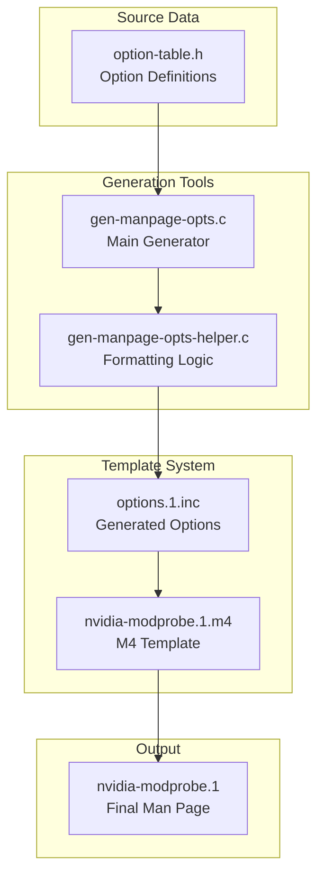
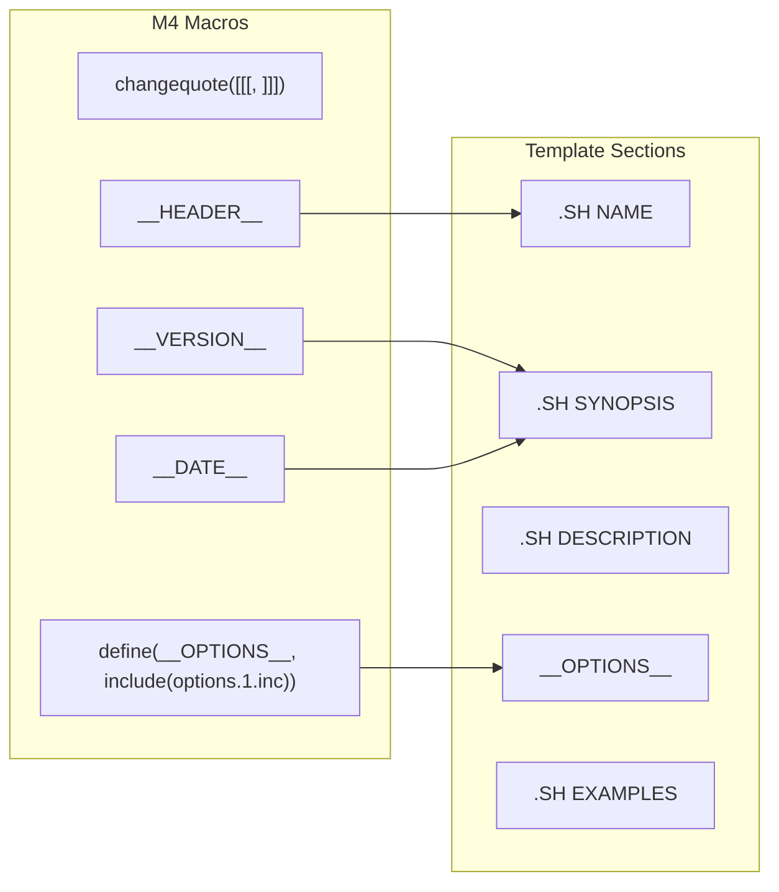
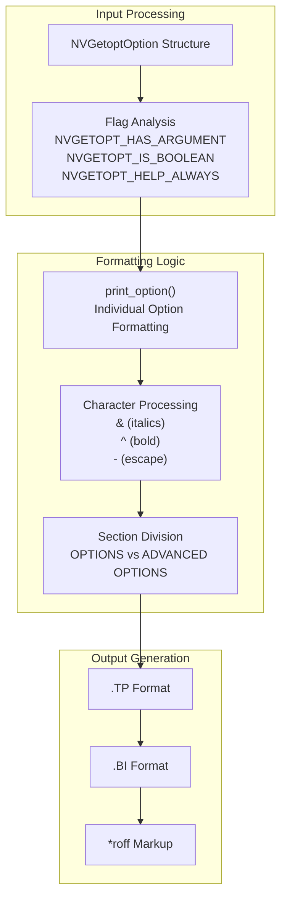
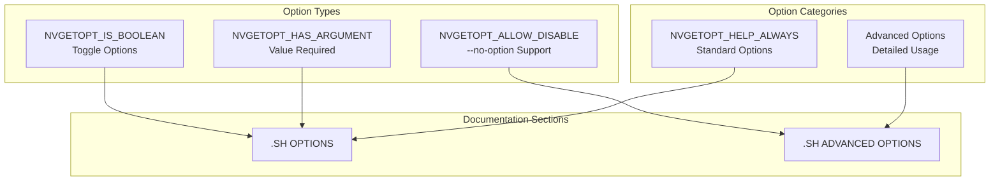
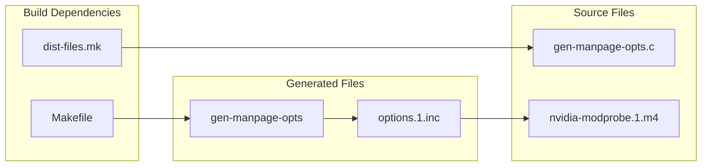

<!-- source: DeepWiki mcp.deepwiki.com · repo NVIDIA/nvidia-modprobe · page 5.1 Man Page Generation · fetched 2026-10-26 -->

# Man Page Generation

Relevant source files

The following files were used as context for generating this wiki page:

- [COPYING](COPYING)
- [common-utils/gen-manpage-opts-helper.c](common-utils/gen-manpage-opts-helper.c)
- [dist-files.mk](dist-files.mk)
- [gen-manpage-opts.c](gen-manpage-opts.c)
- [modprobe-utils/pci-sysfs.h](modprobe-utils/pci-sysfs.h)
- [nvidia-modprobe.1.m4](nvidia-modprobe.1.m4)

The man page generation system automatically creates documentation from command-line option definitions, ensuring that the manual page stays synchronized with the actual command-line interface. This system converts structured option data into properly formatted *roff markup through a multi-stage build process.

For information about the command-line options themselves, see [Command Line Interface](#2.4). For details about the build system integration, see [Build Configuration](#3.2).

## System Architecture

The man page generation system operates through a three-stage pipeline that transforms option definitions into formatted documentation:

**Sources:** [nvidia-modprobe.1.m4:1-84](), [gen-manpage-opts.c:1-29](), [common-utils/gen-manpage-opts-helper.c:1-224]()

## M4 Template Processing

The template system uses m4 macros to integrate generated content into the man page structure:

The template at [nvidia-modprobe.1.m4:3]() defines the `__OPTIONS__` macro to include generated content, which is then expanded at [nvidia-modprobe.1.m4:58]() within the main template structure.

**Sources:** [nvidia-modprobe.1.m4:1-84]()

## Option Formatting Engine

The core formatting logic transforms option structures into *roff markup through specialized processing:

The `print_option()` function at [common-utils/gen-manpage-opts-helper.c:32-180]() handles the complex formatting requirements, including special character processing for markup control.

**Sources:** [common-utils/gen-manpage-opts-helper.c:32-224]()

## Generation Process Flow

The man page generation follows a specific sequence that processes options and integrates them into the final documentation:

| Stage | Component | Function | Output |
|-------|-----------|----------|--------|
| 1 | `gen-manpage-opts.c` | Entry point | Calls helper with option table |
| 2 | `gen_manpage_opts_helper()` | Main processing | Generates *roff sections |
| 3 | `print_option()` | Option formatting | Individual option entries |
| 4 | M4 preprocessing | Template expansion | Complete man page |

The main entry point at [gen-manpage-opts.c:24-28]() simply calls `gen_manpage_opts_helper(__options)` to process the complete option table defined in `option-table.h`.

**Sources:** [gen-manpage-opts.c:24-28](), [common-utils/gen-manpage-opts-helper.c:182-224]()

## Option Classification System

The generator distinguishes between different types of options based on their usage patterns:

The classification logic at [common-utils/gen-manpage-opts-helper.c:188-223]() separates options into standard and advanced categories, with advanced options only included if they exist.

**Sources:** [common-utils/gen-manpage-opts-helper.c:188-223]()

## Special Character Processing

The formatting engine includes sophisticated character processing to handle markup and formatting requirements:

| Character | Purpose | Processing |
|-----------|---------|------------|
| `&` | Italics toggle | Switches between `.I` and normal text |
| `^` | Bold toggle | Switches between `.B` and normal text |
| `-` | Dash escape | Converted to `\-` for *roff |
| `\n` | Line break | Resets formatting state |
| `.` | Dot protection | Error if at line start |
| `'` | Quote protection | Error if at line start |

The character processing loop at [common-utils/gen-manpage-opts-helper.c:112-177]() handles these special cases to ensure proper *roff formatting and prevent syntax errors.

**Sources:** [common-utils/gen-manpage-opts-helper.c:112-177]()

## Build System Integration

The man page generation integrates with the build system through makefile dependencies:

The distribution files specification at [dist-files.mk:8]() includes `gen-manpage-opts.c` as part of the build system, ensuring the generation tools are available during compilation.

**Sources:** [dist-files.mk:8](), [dist-files.mk:7]()

---

