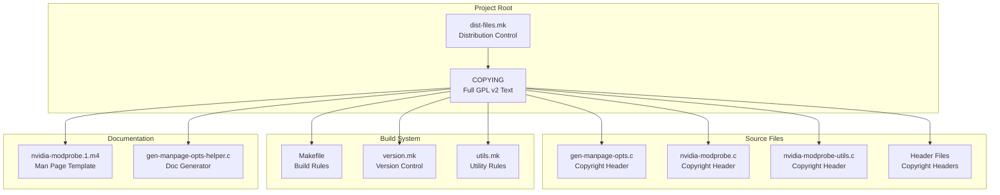
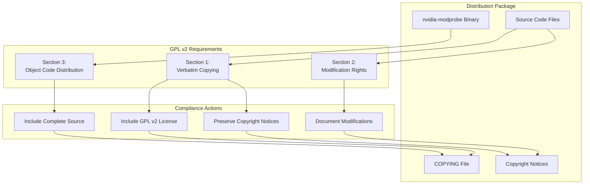

<!-- source: DeepWiki mcp.deepwiki.com · repo NVIDIA/nvidia-modprobe · page 5.2 Licensing · fetched 2026-10-26 -->

# Licensing

<details>
<summary>Relevant source files</summary>

The following files were used as context for generating this wiki page:

- [COPYING](COPYING)
- [dist-files.mk](dist-files.mk)
- [gen-manpage-opts.c](gen-manpage-opts.c)

</details>


This document covers the licensing terms and distribution requirements for the nvidia-modprobe system. It explains the GNU General Public License version 2 (GPL v2) under which the project is distributed, copyright ownership, and compliance requirements for users and distributors.

For information about the documentation generation system, see [5.1](#5.1).

## License Overview

The nvidia-modprobe system is distributed under the GNU General Public License version 2 (GPL v2). The complete license text is provided in the [COPYING:1-340]() file in the project root directory.

### License Summary

| Aspect | Details |
|--------|---------|
| **License Type** | GNU General Public License version 2 |
| **License File** | [COPYING:1-340]() |
| **Copyright Holder** | NVIDIA CORPORATION |
| **Year** | 2013 (based on source headers) |
| **FSF Address** | 51 Franklin Street, Fifth Floor, Boston, MA 02110-1301 USA |

The GPL v2 is a copyleft license that ensures the software remains free and open source. Key provisions include:

- **Freedom to use**: The software can be used for any purpose
- **Freedom to study**: Source code must be available  
- **Freedom to modify**: Users can modify the software
- **Freedom to distribute**: Both original and modified versions can be distributed
- **Copyleft requirement**: Derivative works must also be licensed under GPL v2

Sources: [COPYING:1-340](), [gen-manpage-opts.c:1-28]()

## Copyright Structure

### Copyright Notices in Source Files

Standard copyright headers appear in source files throughout the project. The canonical copyright notice format is demonstrated in [gen-manpage-opts.c:1-15]():

```c
/*
 * Copyright (c) 2013, NVIDIA CORPORATION.  All rights reserved.
 *
 * This program is free software; you can redistribute it and/or modify it
 * under the terms and conditions of the GNU General Public License,
 * version 2, as published by the Free Software Foundation.
 *
 * This program is distributed in the hope it will be useful, but WITHOUT
 * ANY WARRANTY; without even the implied warranty of MERCHANTABILITY or
 * FITNESS FOR A PARTICULAR PURPOSE.  See the GNU General Public License for
 * more details.
 *
 * You should have received a copy of the GNU General Public License
 * along with this program.  If not, see <http://www.gnu.org/licenses/>.
 */
```

### License Application Hierarchy



Sources: [COPYING:1-340](), [gen-manpage-opts.c:1-15](), [dist-files.mk:1-9]()

## Distribution Requirements

### File Distribution Structure

The [dist-files.mk:1-9]() file defines which files must be included in distributions:

```makefile
SRC += nvidia-modprobe.c

DIST_FILES := $(SRC)
DIST_FILES += COPYING
DIST_FILES += dist-files.mk
DIST_FILES += option-table.h
DIST_FILES += nvidia-modprobe.1.m4
DIST_FILES += gen-manpage-opts.c
```

### GPL v2 Distribution Requirements

The GPL v2 imposes specific requirements for distribution, as outlined in [COPYING:79-88]():

1. **Source Code Availability**: Must provide complete source code or offer to provide it
2. **License Inclusion**: Must include the GPL v2 license text with all distributions
3. **Copyright Notices**: Must preserve all copyright notices and warranty disclaimers
4. **Modification Documentation**: Modified files must carry notices stating changes and dates

### Distribution Compliance Flow



Sources: [COPYING:79-153](), [dist-files.mk:1-9]()

## Usage Rights and Restrictions

### Permitted Activities

Under GPL v2, users have the following rights as defined in [COPYING:79-88]():

- **Use**: Run the program for any purpose
- **Study**: Examine source code to understand functionality  
- **Modify**: Change the program to suit needs
- **Distribute**: Share both original and modified versions

### Restrictions and Obligations

The GPL v2 also imposes restrictions, particularly in [COPYING:172-187]():

- **No Sublicensing**: Cannot change the license terms
- **Copyleft Requirement**: Derivative works must be GPL v2 licensed
- **Patent Licensing**: Any patent rights must be freely available
- **Warranty Disclaimer**: No warranty is provided

### Warranty Disclaimer

The GPL v2 includes explicit warranty disclaimers in [COPYING:260-278]():

```
BECAUSE THE PROGRAM IS LICENSED FREE OF CHARGE, THERE IS NO WARRANTY
FOR THE PROGRAM, TO THE EXTENT PERMITTED BY APPLICABLE LAW.
```

Sources: [COPYING:79-88](), [COPYING:172-187](), [COPYING:260-278]()

## Compliance Requirements

### For End Users

End users of the nvidia-modprobe system must:

1. **Retain License**: Keep the GPL v2 license text
2. **Preserve Notices**: Maintain copyright and warranty disclaimers
3. **No Additional Restrictions**: Cannot impose further restrictions on recipients

### For Developers and Distributors

Developers modifying or distributing the system must:

1. **License Compatibility**: Ensure all modifications are GPL v2 compatible
2. **Source Availability**: Provide complete source code for all distributions
3. **Change Documentation**: Document all modifications as required by [COPYING:95-96]()
4. **Version Control**: Maintain proper version information through the build system

### Compliance Verification Matrix

| Component | License Check | Source Availability | Notice Preservation | Modification Docs |
|-----------|---------------|-------------------|-------------------|------------------|
| `nvidia-modprobe.c` | ✓ GPL v2 | ✓ Required | ✓ Required | ✓ If modified |
| `nvidia-modprobe-utils.c` | ✓ GPL v2 | ✓ Required | ✓ Required | ✓ If modified |
| `COPYING` | ✓ GPL v2 Text | ✓ Required | ✓ Required | ✗ Not modified |
| Build System | ✓ GPL v2 | ✓ Required | ✓ Required | ✓ If modified |
| Documentation | ✓ GPL v2 | ✓ Required | ✓ Required | ✓ If modified |

Sources: [COPYING:95-96](), [gen-manpage-opts.c:1-15](), [dist-files.mk:1-9]()