# Page: Overview

# Overview

<details>
<summary>Relevant source files</summary>

The following files were used as context for generating this wiki page:

- [Makefile](Makefile)
- [modprobe-utils/nvidia-modprobe-utils.c](modprobe-utils/nvidia-modprobe-utils.c)
- [nvidia-modprobe.c](nvidia-modprobe.c)
- [version.mk](version.mk)

</details>


## Purpose and Scope

The nvidia-modprobe repository provides a setuid utility for loading NVIDIA kernel modules and creating device files in a Linux distribution-independent manner. This utility serves as a bridge between user-space NVIDIA driver components that lack sufficient privileges and the privileged operations required for kernel module loading and device file creation.

The system handles automatic loading of various NVIDIA kernel modules (`nvidia`, `nvidia-uvm`, `nvidia-modeset`, `nvidia-nvlink`, `nvidia-nvswitch`) and creates the corresponding device files under `/dev/`. It is designed to work across different Linux distributions that handle module loading and device management differently.

For detailed information about the main executable implementation, see [Main Executable](#2.1). For the core library functionality, see [Core Library Implementation](#2.2). For build system details, see [Build System](#3).

## System Architecture

The nvidia-modprobe system follows a layered architecture with clear separation between the user interface, core business logic, and system integration layers.

### High-Level Component Structure

```mermaid
graph TB
    subgraph "User Interface Layer"
        main_exec["`nvidia-modprobe.c`<br/>Main Executable"]
        cli_opts["`option-table.h`<br/>CLI Options"]
        arg_parser["`nvgetopt.c`<br/>Argument Parser"]
    end
    
    subgraph "Core Business Logic"
        api_header["`nvidia-modprobe-utils.h`<br/>Public API"]
        core_impl["`nvidia-modprobe-utils.c`<br/>Core Implementation"]
    end
    
    subgraph "System Integration"
        pci_enum["`pci-sysfs.c`<br/>PCI Enumeration"]
        kernel_interface["`Linux Kernel`<br/>Module & Device APIs"]
    end
    
    subgraph "Support Systems"
        common_utils["`common-utils.c`<br/>Utility Functions"]
        msg_system["`msg.c`<br/>Message Handling"]
        version_mgmt["`version.mk`<br/>Version Management"]
    end
    
    main_exec --> cli_opts
    main_exec --> arg_parser
    main_exec --> api_header
    api_header --> core_impl
    core_impl --> pci_enum
    core_impl --> kernel_interface
    main_exec --> common_utils
    core_impl --> common_utils
    main_exec --> msg_system
    core_impl --> msg_system
    version_mgmt --> main_exec
    version_mgmt --> core_impl
```

**Sources:** [nvidia-modprobe.c:1-290](), [modprobe-utils/nvidia-modprobe-utils.c:1-1167](), [version.mk:1-12](), [Makefile:1-163]()

### Code Entity Mapping

```mermaid
graph LR
    subgraph "Module Loading Functions"
        nvidia_modprobe["`nvidia_modprobe()`<br/>Load nvidia module"]
        nvidia_uvm_modprobe["`nvidia_uvm_modprobe()`<br/>Load nvidia-uvm module"]
        nvidia_modeset_modprobe["`nvidia_modeset_modprobe()`<br/>Load nvidia-modeset module"]
        modprobe_helper["`modprobe_helper()`<br/>Core loading logic"]
    end
    
    subgraph "Device Creation Functions"
        nvidia_mknod["`nvidia_mknod()`<br/>Create /dev/nvidia*"]
        nvidia_uvm_mknod["`nvidia_uvm_mknod()`<br/>Create /dev/nvidia-uvm*"]
        nvidia_nvlink_mknod["`nvidia_nvlink_mknod()`<br/>Create /dev/nvidia-nvlink*"]
        nvidia_nvswitch_mknod["`nvidia_nvswitch_mknod()`<br/>Create /dev/nvidia-nvswitch*"]
        mknod_helper["`mknod_helper()`<br/>Core creation logic"]
    end
    
    subgraph "Hardware Detection"
        pci_enum_match_id["`pci_enum_match_id()`<br/>Find NVIDIA PCI devices"]
        is_kernel_module_loaded["`is_kernel_module_loaded()`<br/>Check module status"]
        nvidia_get_chardev_major["`nvidia_get_chardev_major()`<br/>Get device major number"]
    end
    
    subgraph "Main Entry Point"
        main_func["`main()`<br/>Command processing"]
        nvgetopt_parse["`nvgetopt()`<br/>Argument parsing"]
    end
    
    main_func --> nvidia_modprobe
    main_func --> nvidia_uvm_modprobe
    main_func --> nvidia_modeset_modprobe
    main_func --> nvidia_mknod
    main_func --> nvidia_uvm_mknod
    main_func --> nvidia_nvlink_mknod
    main_func --> nvidia_nvswitch_mknod
    
    nvidia_modprobe --> modprobe_helper
    nvidia_uvm_modprobe --> modprobe_helper
    nvidia_modeset_modprobe --> modprobe_helper
    
    nvidia_mknod --> mknod_helper
    nvidia_uvm_mknod --> mknod_helper
    nvidia_nvlink_mknod --> mknod_helper
    nvidia_nvswitch_mknod --> mknod_helper
    
    modprobe_helper --> pci_enum_match_id
    modprobe_helper --> is_kernel_module_loaded
    mknod_helper --> nvidia_get_chardev_major
    
    main_func --> nvgetopt_parse
```

**Sources:** [nvidia-modprobe.c:89-289](), [modprobe-utils/nvidia-modprobe-utils.c:354-357](), [modprobe-utils/nvidia-modprobe-utils.c:820-823](), [modprobe-utils/nvidia-modprobe-utils.c:836-839](), [modprobe-utils/nvidia-modprobe-utils.c:642-649](), [modprobe-utils/nvidia-modprobe-utils.c:803-814]()

## Key Components

The system consists of several key components that work together to provide kernel module loading and device file creation capabilities:

| Component | Primary Files | Purpose |
|-----------|---------------|---------|
| **Main Executable** | `nvidia-modprobe.c` | Command-line interface and operation orchestration |
| **Core Library** | `nvidia-modprobe-utils.c/h` | Module loading and device creation implementation |
| **PCI Integration** | `pci-sysfs.c` | Hardware detection and PCI device enumeration |
| **Build System** | `version.mk`, `utils.mk`, `Makefile` | Version management and cross-platform compilation |
| **Common Utilities** | `common-utils.c/h` | Shared utility functions and memory management |
| **Message System** | `msg.c` | Formatted output and error reporting |
| **CLI Processing** | `nvgetopt.c`, `option-table.h` | Command-line argument parsing |

The main executable handles command-line processing and delegates actual work to the core library, which implements the low-level operations for interacting with the Linux kernel module system and device filesystem.

**Sources:** [nvidia-modprobe.c:17-30](), [modprobe-utils/nvidia-modprobe-utils.c:24-26](), [Makefile:29-34]()

## Integration Context

The nvidia-modprobe utility operates as a critical component in the NVIDIA driver ecosystem, serving as a privilege escalation mechanism for user-space components. It is designed to be installed as a setuid binary, allowing unprivileged processes to perform privileged operations.

### Operational Flow

```mermaid
graph TD
    user_app["`User Application`<br/>(e.g., CUDA program)"]
    driver_lib["`NVIDIA Driver Library`<br/>(user-space)"]
    modprobe_util["`nvidia-modprobe`<br/>(setuid binary)"]
    kernel_mod["`NVIDIA Kernel Module`<br/>(nvidia.ko)"]
    dev_files["`Device Files`<br/>(/dev/nvidia*)"]
    
    user_app --> driver_lib
    driver_lib --> modprobe_util
    modprobe_util --> kernel_mod
    modprobe_util --> dev_files
    driver_lib --> dev_files
    
    user_app -.-> dev_files
```

The utility supports multiple NVIDIA kernel modules and their corresponding device files:

- **nvidia module**: Primary graphics driver (`/dev/nvidia*`)
- **nvidia-uvm module**: Unified Virtual Memory (`/dev/nvidia-uvm`, `/dev/nvidia-uvm-tools`)
- **nvidia-modeset module**: Display/KMS functionality (`/dev/nvidia-modeset`)
- **nvidia-nvlink module**: High-speed interconnect (`/dev/nvidia-nvlink`)
- **nvidia-nvswitch module**: Switch fabric (`/dev/nvidia-nvswitch*`)

The system includes hardware detection to verify NVIDIA PCI devices are present before attempting module loading, preventing unnecessary error messages on systems without NVIDIA hardware.

**Sources:** [nvidia-modprobe.c:18-29](), [modprobe-utils/nvidia-modprobe-utils.c:56-81](), [modprobe-utils/nvidia-modprobe-utils.c:234-252]()

---

# Page: nvidia-modprobe System

# nvidia-modprobe System

<details>
<summary>Relevant source files</summary>

The following files were used as context for generating this wiki page:

- [modprobe-utils/nvidia-modprobe-utils.c](modprobe-utils/nvidia-modprobe-utils.c)
- [modprobe-utils/nvidia-modprobe-utils.h](modprobe-utils/nvidia-modprobe-utils.h)
- [nvidia-modprobe.c](nvidia-modprobe.c)

</details>


## Purpose and Scope

The nvidia-modprobe system is a setuid utility that provides distribution-independent loading of NVIDIA kernel modules and creation of NVIDIA device files on Linux systems. This system enables NVIDIA driver components running with limited privileges to access GPU hardware by ensuring the necessary kernel modules are loaded and device files are properly created.

This document covers the core system architecture, main components, and integration mechanisms. For detailed information about the command-line interface and option processing, see [Command Line Interface](#2.4). For PCI hardware detection and enumeration details, see [PCI Hardware Integration](#2.5).

## System Architecture Overview

The nvidia-modprobe system follows a layered architecture with the main executable orchestrating operations through a core library that interfaces with the Linux kernel and hardware subsystems.

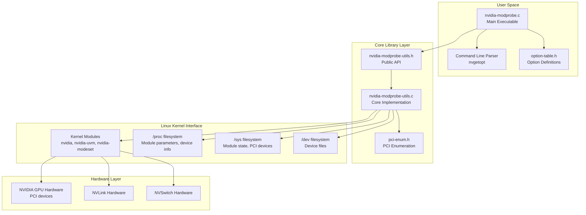

Sources: [nvidia-modprobe.c:89-289](), [modprobe-utils/nvidia-modprobe-utils.c:1-1167](), [modprobe-utils/nvidia-modprobe-utils.h:1-145]()

## Core Components

The system consists of three primary components that work together to provide module loading and device file creation functionality:

### Main Executable (`nvidia-modprobe.c`)

The main executable serves as the entry point and command-line interface, parsing user arguments and orchestrating the appropriate operations. Key functions include:

- `main()` - Primary entry point with argument processing
- Command-line option parsing using `nvgetopt()`
- Operation selection based on flags (`uvm_modprobe`, `modeset`, `nvswitch`, `nvlink`)

### Core Library (`nvidia-modprobe-utils.c`)

The core library implements the actual module loading and device file creation logic. Major function categories include:

| Function Category | Key Functions | Purpose |
|------------------|---------------|---------|
| Module Loading | `nvidia_modprobe()`, `nvidia_uvm_modprobe()`, `nvidia_modeset_modprobe()` | Load kernel modules using `posix_spawn()` and `modprobe` |
| Device Creation | `nvidia_mknod()`, `nvidia_uvm_mknod()`, `nvidia_nvlink_mknod()` | Create device files with proper permissions |
| Hardware Detection | `modprobe_helper()`, `pci_enum_match_id()` | Enumerate PCI devices and validate hardware presence |
| File State Management | `nvidia_get_file_state()`, `get_file_state_helper()` | Check device file existence and permissions |

### Public API (`nvidia-modprobe-utils.h`)

The header file defines the public interface with constants, data structures, and function declarations. Key definitions include:

- Device file path constants (`NV_DEVICE_FILE_PATH`, `NV_CTRL_DEVICE_FILE_PATH`)
- Module name constants (`NV_UVM_MODULE_NAME`, `NV_MODESET_MODULE_NAME`)
- File state enumeration (`NvDeviceFileState`)
- Device file utility functions (`assign_device_file_name()`)

Sources: [nvidia-modprobe.c:89-289](), [modprobe-utils/nvidia-modprobe-utils.c:354-358](), [modprobe-utils/nvidia-modprobe-utils.h:28-145]()

## Module Loading Process

The system implements a sophisticated module loading process that validates hardware presence before attempting to load kernel modules:

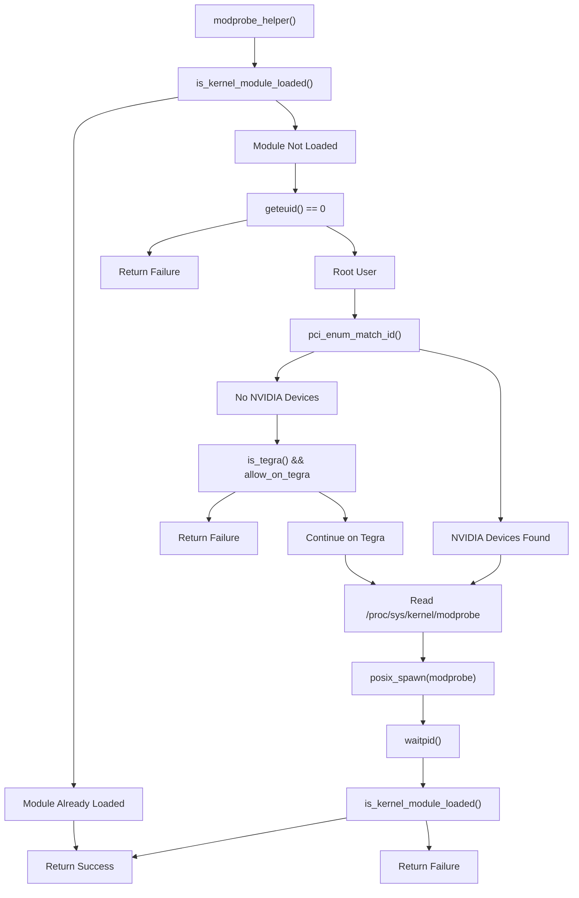

The process includes several validation steps:
- Hardware presence validation using PCI enumeration
- Special handling for Tegra SoC platforms
- Process isolation using `posix_spawn()` with output redirection
- Module state verification through `/sys/module/*/initstate`

Sources: [modprobe-utils/nvidia-modprobe-utils.c:179-348](), [modprobe-utils/nvidia-modprobe-utils.c:99-122](), [modprobe-utils/nvidia-modprobe-utils.c:234-252]()

## Device File Management

Device file creation follows a comprehensive process that handles permissions, ownership, and symbolic link management:

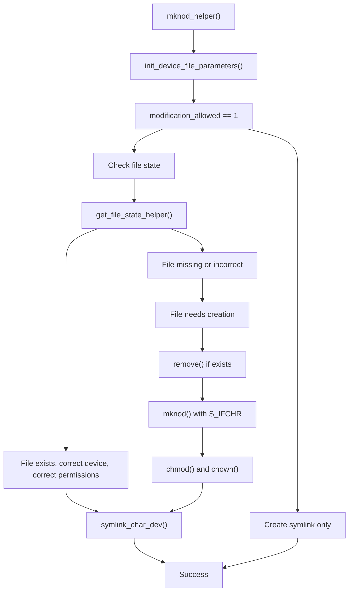

The system manages multiple types of device files:

| Device Type | Major Number | Device Path | Module |
|-------------|--------------|-------------|---------|
| Main GPU devices | 195 | `/dev/nvidia*` | `nvidia` |
| Control device | 195 | `/dev/nvidiactl` | `nvidia` |
| UVM devices | Dynamic | `/dev/nvidia-uvm*` | `nvidia-uvm` |
| Modeset device | 195 | `/dev/nvidia-modeset` | `nvidia-modeset` |
| NVLink device | Dynamic | `/dev/nvidia-nvlink` | `nvidia-nvlink` |
| NVSwitch devices | Dynamic | `/dev/nvidia-nvswitch*` | `nvidia-nvswitch` |

Sources: [modprobe-utils/nvidia-modprobe-utils.c:549-636](), [modprobe-utils/nvidia-modprobe-utils.c:478-541](), [modprobe-utils/nvidia-modprobe-utils.c:367-414]()

## Hardware Integration

The system integrates with hardware through PCI device enumeration and platform-specific detection mechanisms. Hardware validation occurs before module loading to prevent unnecessary error messages and ensure appropriate hardware is present.

Key hardware integration components:
- PCI vendor ID matching (`NV_PCI_VENDOR_ID = 0x10DE`)
- Display controller class detection (`PCI_BASE_CLASS_DISPLAY = 0x0300`)
- Tegra SoC platform detection via `/sys/devices/soc0/family`
- Dynamic major number resolution through `/proc/devices`

The system supports multiple NVIDIA hardware types including discrete GPUs, integrated Tegra graphics, NVLink interconnects, and NVSwitch fabric devices.

Sources: [modprobe-utils/nvidia-modprobe-utils.c:90-91](), [modprobe-utils/nvidia-modprobe-utils.c:195-203](), [modprobe-utils/nvidia-modprobe-utils.c:146-169](), [modprobe-utils/nvidia-modprobe-utils.c:657-724]()

---

# Page: Main Executable

# Main Executable

<details>
<summary>Relevant source files</summary>

The following files were used as context for generating this wiki page:

- [nvidia-modprobe.c](nvidia-modprobe.c)
- [option-table.h](option-table.h)

</details>


This document covers the main executable program `nvidia-modprobe.c`, which serves as the entry point and command-line interface for the nvidia-modprobe system. The executable is a setuid utility that processes command-line arguments and orchestrates kernel module loading and device file creation operations.

For information about the underlying implementation functions that this executable calls, see [Core Library Implementation](#2.2). For details about the public API definitions, see [Library API](#2.3).

## Purpose and Architecture

The main executable in [nvidia-modprobe.c:1-290]() is a distribution-independent setuid utility designed to load NVIDIA kernel modules and create device files on behalf of user-space components that lack sufficient privileges. The program serves as a command-line wrapper around the core functionality implemented in the nvidia-modprobe-utils library.

### Program Structure Overview

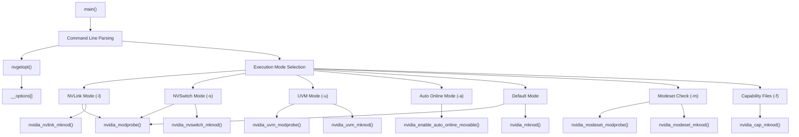

Sources: [nvidia-modprobe.c:89-290]()

## Command-Line Processing System

The executable uses a sophisticated command-line parsing system based on the `nvgetopt` library. The available options are defined in a static table structure.

### Option Definition Structure

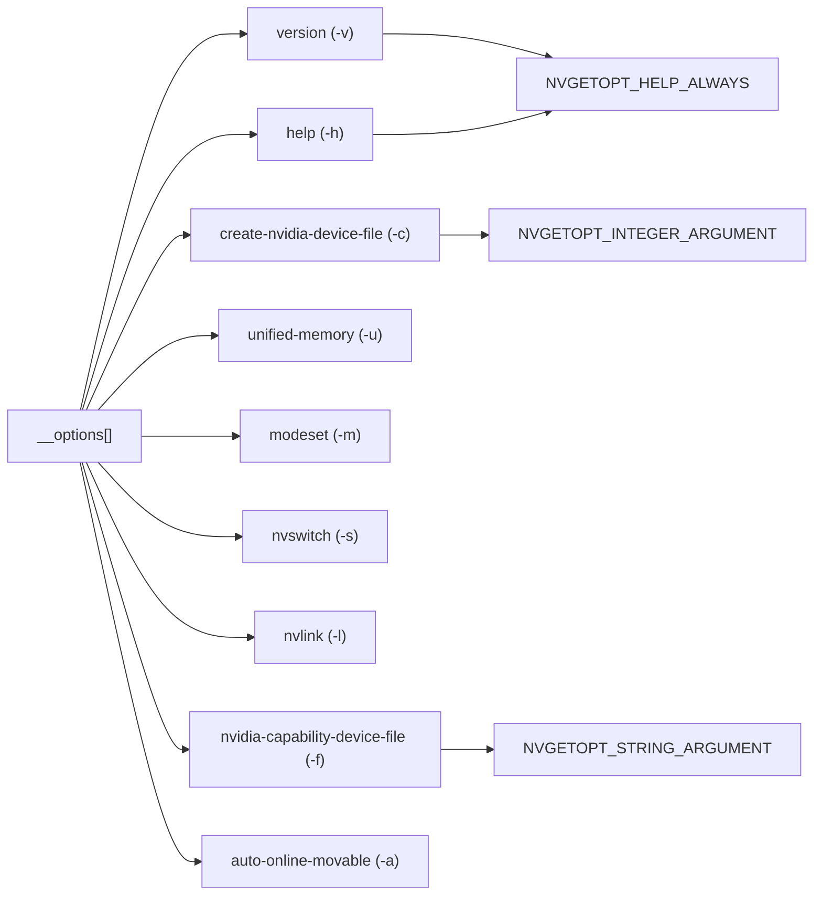

Sources: [option-table.h:19-84]()

### Argument Processing Flow

The main parsing loop in [nvidia-modprobe.c:103-169]() processes arguments using `nvgetopt()` and maintains several data structures:

| Data Structure | Purpose | Maximum Size |
|---|---|---|
| `minors[]` | Device minor numbers for `-c` option | 64 entries |
| `cap_files[]` | Capability file paths for `-f` option | 256 entries |
| Boolean flags | Mode selection (`uvm_modprobe`, `modeset`, `nvswitch`, etc.) | N/A |

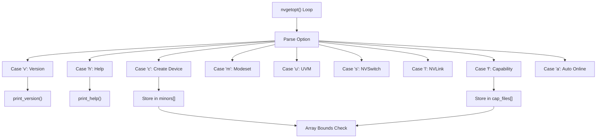

Sources: [nvidia-modprobe.c:103-169]()

## Operational Modes and Execution Flow

The executable supports multiple operational modes, each targeting different NVIDIA subsystems. The execution flow is determined by the command-line flags provided.

### Mode Selection Logic

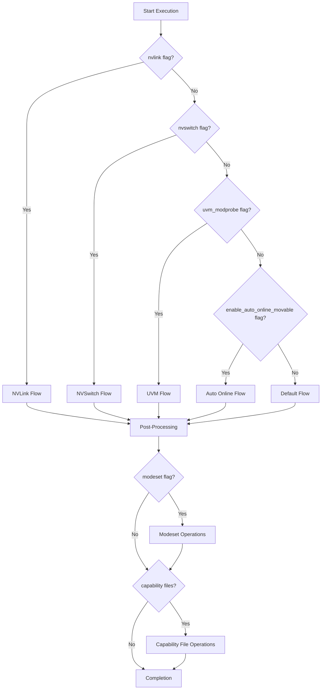

Sources: [nvidia-modprobe.c:171-285]()

### Core Operation Functions

Each operational mode calls specific functions from the nvidia-modprobe-utils library:

| Mode | Module Loading Function | Device Creation Function |
|---|---|---|
| Default | `nvidia_modprobe(0)` | `nvidia_mknod(minor)` |
| UVM | `nvidia_uvm_modprobe()` | `nvidia_uvm_mknod(minor)` |
| NVLink | `nvidia_modprobe(0)` | `nvidia_nvlink_mknod()` |
| NVSwitch | `nvidia_modprobe(0)` | `nvidia_nvswitch_mknod(minor)` |
| Modeset | `nvidia_modeset_modprobe()` | `nvidia_modeset_mknod()` |
| Capability | N/A | `nvidia_cap_mknod(path, &unused)` |
| Auto Online | `nvidia_enable_auto_online_movable(0)` | N/A |

Sources: [nvidia-modprobe.c:171-285]()

## Integration with Core Library

The main executable acts as a thin wrapper around the core library functionality. It handles argument parsing, mode selection, and error handling, while delegating all actual work to the nvidia-modprobe-utils library.

### Function Call Patterns

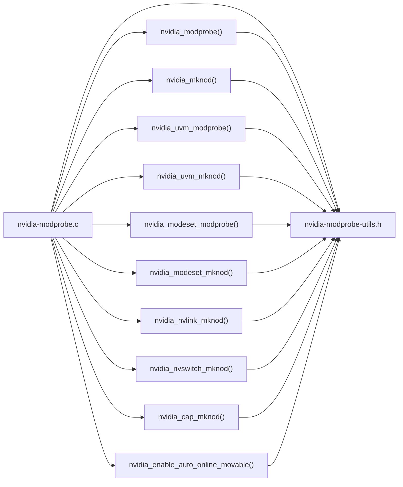

Sources: [nvidia-modprobe.c:40](), [nvidia-modprobe.c:176](), [nvidia-modprobe.c:193](), [nvidia-modprobe.c:212](), [nvidia-modprobe.c:232](), [nvidia-modprobe.c:242](), [nvidia-modprobe.c:252](), [nvidia-modprobe.c:264](), [nvidia-modprobe.c:270](), [nvidia-modprobe.c:279]()

## Error Handling and Return Values

The program implements a consistent error handling pattern where all library functions return success/failure status, and the main executable converts this to appropriate exit codes.

### Error Handling Flow

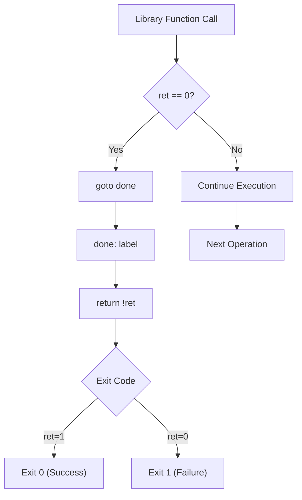

Sources: [nvidia-modprobe.c:177-180](), [nvidia-modprobe.c:194-197](), [nvidia-modprobe.c:213-216](), [nvidia-modprobe.c:233-236](), [nvidia-modprobe.c:243-246](), [nvidia-modprobe.c:253-256](), [nvidia-modprobe.c:265-268](), [nvidia-modprobe.c:271-274](), [nvidia-modprobe.c:280-283](), [nvidia-modprobe.c:286-289]()

The executable follows a consistent pattern where successful operations return `1` from library functions, and the main program returns `!ret` to convert this to standard Unix exit codes (0 for success, 1 for failure).

Sources: [nvidia-modprobe.c:1-290](), [option-table.h:1-85]()

---

# Page: Core Library Implementation

# Core Library Implementation

<details>
<summary>Relevant source files</summary>

The following files were used as context for generating this wiki page:

- [modprobe-utils/nvidia-modprobe-utils.c](modprobe-utils/nvidia-modprobe-utils.c)
- [modprobe-utils/nvidia-modprobe-utils.h](modprobe-utils/nvidia-modprobe-utils.h)

</details>


This document covers the core library implementation of the nvidia-modprobe system, specifically the `nvidia-modprobe-utils.c` file and its public API defined in `nvidia-modprobe-utils.h`. This library provides the fundamental functionality for loading NVIDIA kernel modules and creating device files on Linux systems.

For information about the command-line interface that uses this library, see [Main Executable](#2.1). For details about the public API functions, see [Library API](#2.3).

## Purpose and Scope

The core library serves as the heart of the nvidia-modprobe system, implementing two primary responsibilities:

1. **Kernel Module Loading**: Safely loading NVIDIA kernel modules (`nvidia`, `nvidia-uvm`, `nvidia-modeset`, etc.) with proper hardware detection and permission checks
2. **Device File Management**: Creating and managing character device files in `/dev/` with correct permissions, ownership, and symbolic links

The library is designed to be used by setuid root programs that need to perform privileged operations on behalf of unprivileged users.

## Architecture Overview

The core library follows a layered architecture with helper functions providing common functionality for module-specific operations:

```mermaid
graph TD
    subgraph "Public API Layer"
        nvidia_modprobe["nvidia_modprobe()"]
        nvidia_mknod["nvidia_mknod()"]
        nvidia_uvm_modprobe["nvidia_uvm_modprobe()"]
        nvidia_uvm_mknod["nvidia_uvm_mknod()"]
        nvidia_modeset_modprobe["nvidia_modeset_modprobe()"]
        nvidia_modeset_mknod["nvidia_modeset_mknod()"]
        nvidia_nvlink_mknod["nvidia_nvlink_mknod()"]
        nvidia_nvswitch_mknod["nvidia_nvswitch_mknod()"]
        nvidia_cap_mknod["nvidia_cap_mknod()"]
    end
    
    subgraph "Core Helper Functions"
        modprobe_helper["modprobe_helper()"]
        mknod_helper["mknod_helper()"]
        get_file_state_helper["get_file_state_helper()"]
        init_device_file_parameters["init_device_file_parameters()"]
    end
    
    subgraph "System Integration"
        is_kernel_module_loaded["is_kernel_module_loaded()"]
        nvidia_get_chardev_major["nvidia_get_chardev_major()"]
        symlink_char_dev["symlink_char_dev()"]
        silence_process_actions["silence_process_actions()"]
    end
    
    subgraph "Hardware Detection"
        pci_enum_match_id["pci_enum_match_id()"]
        is_tegra["is_tegra()"]
    end
    
    subgraph "Linux Kernel Interface"
        posix_spawn["posix_spawn()"]
        mknod_syscall["mknod()"]
        stat_syscall["stat()"]
        access_syscall["access()"]
    end
    
    nvidia_modprobe --> modprobe_helper
    nvidia_mknod --> mknod_helper
    nvidia_uvm_modprobe --> modprobe_helper
    nvidia_uvm_mknod --> mknod_helper
    nvidia_modeset_modprobe --> modprobe_helper
    nvidia_modeset_mknod --> mknod_helper
    nvidia_nvlink_mknod --> mknod_helper
    nvidia_nvswitch_mknod --> mknod_helper
    nvidia_cap_mknod --> mknod_helper
    
    modprobe_helper --> is_kernel_module_loaded
    modprobe_helper --> pci_enum_match_id
    modprobe_helper --> is_tegra
    modprobe_helper --> silence_process_actions
    
    mknod_helper --> get_file_state_helper
    mknod_helper --> init_device_file_parameters
    mknod_helper --> symlink_char_dev
    mknod_helper --> nvidia_get_chardev_major
    
    modprobe_helper --> posix_spawn
    mknod_helper --> mknod_syscall
    get_file_state_helper --> stat_syscall
    is_kernel_module_loaded --> access_syscall
```

**Sources**: [modprobe-utils/nvidia-modprobe-utils.c:1-1167](), [modprobe-utils/nvidia-modprobe-utils.h:1-145]()

## Module Loading System

The module loading system is built around the `modprobe_helper()` function, which implements a robust workflow for loading kernel modules:

### Core Module Loading Flow

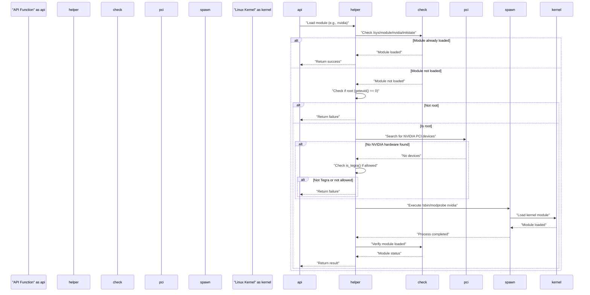

**Sources**: [modprobe-utils/nvidia-modprobe-utils.c:179-348]()

### Key Constants and Definitions

The system uses several important constants and paths:

| Constant | Value | Purpose |
|----------|-------|---------|
| `NV_NVIDIA_MODULE_NAME` | `"nvidia"` | Main GPU driver module |
| `NV_UVM_MODULE_NAME` | `"nvidia-uvm"` | Unified Virtual Memory module |
| `NV_MODESET_MODULE_NAME` | `"nvidia-modeset"` | Display/modesetting module |
| `NV_NVLINK_MODULE_NAME` | `"nvidia-nvlink"` | NVLink interconnect module |
| `NV_NVSWITCH_MODULE_NAME` | `"nvidia-nvswitch"` | NVSwitch fabric module |
| `NV_PROC_MODPROBE_PATH` | `"/proc/sys/kernel/modprobe"` | System modprobe path |
| `NV_PROC_DEVICES_PATH` | `"/proc/devices"` | Character device registry |

**Sources**: [modprobe-utils/nvidia-modprobe-utils.c:56-78]()

### Hardware Detection Integration

The module loading system integrates with hardware detection to prevent unnecessary module loading:

```mermaid
graph LR
    subgraph "Hardware Detection"
        pci_match["`pci_id_match`<br/>Vendor: 0x10DE<br/>Class: 0x0300<br/>Mask: PCI_BASE_CLASS_MASK"]
        pci_enum["pci_enum_match_id()"]
        tegra_check["is_tegra()"]
        soc_family["`/sys/devices/soc0/family`<br/>Check for 'Tegra'"]
    end
    
    subgraph "Decision Logic"
        has_nvidia_gpu["NVIDIA GPU Present?"]
        is_tegra_platform["Tegra Platform?"]
        allow_tegra["Module allows Tegra?"]
    end
    
    pci_match --> pci_enum
    pci_enum --> has_nvidia_gpu
    
    has_nvidia_gpu -->|No| is_tegra_platform
    has_nvidia_gpu -->|Yes| proceed["Proceed with modprobe"]
    
    is_tegra_platform --> tegra_check
    tegra_check --> soc_family
    soc_family --> allow_tegra
    
    allow_tegra -->|Yes| proceed
    allow_tegra -->|No| abort["Abort: No NVIDIA devices"]
```

**Sources**: [modprobe-utils/nvidia-modprobe-utils.c:195-252](), [modprobe-utils/nvidia-modprobe-utils.c:146-169]()

## Device File Management

The device file management system handles creating character device files with proper permissions, ownership, and symbolic links:

### Device File Creation Flow

```mermaid
graph TD
    subgraph "Device File Creation Process"
        start["`mknod_helper()`<br/>Entry Point"]
        init_params["`init_device_file_parameters()`<br/>Read /proc permissions"]
        check_modify["Check modification_allowed"]
        get_state["`get_file_state_helper()`<br/>Check existing file"]
        
        subgraph "File State Checks"
            exists["FileExists?"]
            chrdev_ok["ChrDevOk?"]
            perms_ok["PermissionsOk?"]
        end
        
        subgraph "File Operations"
            remove_file["remove() old file"]
            create_mknod["mknod() new file"]
            set_perms["chmod() & chown()"]
            create_symlink["`symlink_char_dev()`<br/>Create /dev/char/major:minor"]
        end
    end
    
    start --> init_params
    init_params --> check_modify
    
    check_modify -->|Not allowed| create_symlink
    check_modify -->|Allowed| get_state
    
    get_state --> exists
    get_state --> chrdev_ok
    get_state --> perms_ok
    
    exists -->|No| create_mknod
    chrdev_ok -->|No| remove_file
    perms_ok -->|No| set_perms
    
    exists -->|Yes| chrdev_ok
    chrdev_ok -->|Yes| perms_ok
    perms_ok -->|Yes| create_symlink
    
    remove_file --> create_mknod
    create_mknod --> set_perms
    set_perms --> create_symlink
```

**Sources**: [modprobe-utils/nvidia-modprobe-utils.c:549-636]()

### Device File State Management

The system tracks device file state using a bitmask approach:

```mermaid
graph LR
    subgraph "NvDeviceFileState Enum"
        file_exists["NvDeviceFileStateFileExists = 0"]
        chrdev_ok["NvDeviceFileStateChrDevOk = 1"]
        perms_ok["NvDeviceFileStatePermissionsOk = 2"]
    end
    
    subgraph "State Functions"
        update_state["`nvidia_update_file_state()`<br/>Set bit in state mask"]
        test_state["`nvidia_test_file_state()`<br/>Test bit in state mask"]
    end
    
    subgraph "State Checks"
        stat_check["`stat()` system call<br/>Check file existence & type"]
        dev_check["Compare st_rdev with expected dev_t"]
        perm_check["Check mode, uid, gid"]
    end
    
    stat_check --> file_exists
    dev_check --> chrdev_ok
    perm_check --> perms_ok
    
    file_exists --> update_state
    chrdev_ok --> update_state
    perms_ok --> update_state
    
    update_state --> test_state
```

**Sources**: [modprobe-utils/nvidia-modprobe-utils.h:59-76](), [modprobe-utils/nvidia-modprobe-utils.c:419-452]()

## Character Device Integration

The system integrates with the Linux character device subsystem through several key mechanisms:

### Major Number Discovery

```mermaid
graph LR
    subgraph "Character Device Discovery"
        proc_devices["`/proc/devices`<br/>Character devices registry"]
        get_major["`nvidia_get_chardev_major()`<br/>Parse device list"]
        
        subgraph "Search Process"
            find_char_section["Find 'Character devices:' section"]
            search_name["Search for module name"]
            extract_major["Extract major number"]
        end
    end
    
    subgraph "Module-Specific Lookups"
        nvidia_major["nvidia → 195 (fixed)"]
        uvm_major["nvidia-uvm → dynamic"]
        nvlink_major["nvidia-nvlink → dynamic"]
        nvswitch_major["nvidia-nvswitch → dynamic"]
        caps_major["nvidia-caps → dynamic"]
    end
    
    proc_devices --> get_major
    get_major --> find_char_section
    find_char_section --> search_name
    search_name --> extract_major
    
    extract_major --> nvidia_major
    extract_major --> uvm_major
    extract_major --> nvlink_major
    extract_major --> nvswitch_major
    extract_major --> caps_major
```

**Sources**: [modprobe-utils/nvidia-modprobe-utils.c:657-724]()

### Symbolic Link Management

The system creates symbolic links in `/dev/char/` to maintain compatibility with udev:

```mermaid
graph TD
    subgraph "Symbolic Link Creation"
        symlink_char_dev["`symlink_char_dev()`<br/>Create /dev/char/major:minor"]
        
        subgraph "Path Construction"
            build_symlink["Build /dev/char/195:0 path"]
            build_target["Build ../nvidia0 target"]
            verify_target["Verify target exists"]
        end
        
        subgraph "Link Operations"
            remove_old["remove() existing link"]
            create_symlink["symlink() new link"]
            verify_link["Verify link points to target"]
        end
    end
    
    symlink_char_dev --> build_symlink
    symlink_char_dev --> build_target
    build_target --> verify_target
    
    verify_target --> remove_old
    remove_old --> create_symlink
    create_symlink --> verify_link
```

**Sources**: [modprobe-utils/nvidia-modprobe-utils.c:478-541]()

## Module-Specific Implementations

The library provides specialized implementations for different NVIDIA modules:

### Standard GPU Devices

| Function | Module | Device Path | Major | Minor |
|----------|--------|-------------|-------|-------|
| `nvidia_mknod()` | nvidia | `/dev/nvidia0` | 195 | 0-254 |
| `nvidia_mknod()` | nvidia | `/dev/nvidiactl` | 195 | 255 |
| `nvidia_modeset_mknod()` | nvidia-modeset | `/dev/nvidia-modeset` | 195 | 254 |

### Unified Virtual Memory (UVM)

```mermaid
graph LR
    subgraph "UVM Device Creation"
        uvm_mknod["`nvidia_uvm_mknod()`<br/>Create UVM devices"]
        
        subgraph "Device Files"
            uvm_device["`/dev/nvidia-uvm`<br/>Minor: base_minor"]
            uvm_tools["`/dev/nvidia-uvm-tools`<br/>Minor: base_minor + 1"]
        end
        
        subgraph "Operations"
            get_uvm_major["`nvidia_get_chardev_major()`<br/>Get nvidia-uvm major"]
            create_both["Create both device files"]
        end
    end
    
    uvm_mknod --> get_uvm_major
    get_uvm_major --> create_both
    create_both --> uvm_device
    create_both --> uvm_tools
```

**Sources**: [modprobe-utils/nvidia-modprobe-utils.c:803-814]()

### Capability Devices

The capability device system provides fine-grained access control:

```mermaid
graph TD
    subgraph "Capability Device System"
        cap_mknod["`nvidia_cap_mknod()`<br/>Create capability device"]
        
        subgraph "Path Validation"
            validate_path["Validate /proc/driver/nvidia/ prefix"]
            check_access["Check R_OK access permission"]
            prevent_traversal["Prevent './' path traversal"]
        end
        
        subgraph "Device Creation"
            read_attrs["`nvidia_cap_get_device_file_attrs()`<br/>Read DeviceFileMinor"]
            create_dir["mkdir /dev/nvidia-caps/"]
            create_device["Create /dev/nvidia-caps/nvidia-cap%d"]
        end
    end
    
    cap_mknod --> validate_path
    validate_path --> check_access
    check_access --> prevent_traversal
    prevent_traversal --> read_attrs
    read_attrs --> create_dir
    create_dir --> create_device
```

**Sources**: [modprobe-utils/nvidia-modprobe-utils.c:993-1034]()

## System Integration Features

### Auto-Online Memory Management

The library provides functionality to enable automatic memory onlining:

```mermaid
graph LR
    subgraph "Memory Management"
        auto_online["`nvidia_enable_auto_online_movable()`<br/>Enable auto-online movable"]
        
        subgraph "System Interface"
            sysfs_path["`/sys/devices/system/memory/auto_online_blocks`<br/>Kernel memory management"]
            write_mode["Write 'online_movable' setting"]
        end
        
        subgraph "Error Handling"
            check_open["Check file open permissions"]
            check_write["Verify write operation"]
            error_reporting["Report errors if print_errors set"]
        end
    end
    
    auto_online --> sysfs_path
    sysfs_path --> write_mode
    write_mode --> check_open
    check_open --> check_write
    check_write --> error_reporting
```

**Sources**: [modprobe-utils/nvidia-modprobe-utils.c:1128-1164]()

### Process Output Silencing

The system includes functionality to silence modprobe output:

```mermaid
graph LR
    subgraph "Output Silencing"
        silence_actions["`silence_process_actions()`<br/>Create posix_spawn actions"]
        
        subgraph "File Actions"
            open_devnull["addopen(STDOUT, /dev/null, O_RDWR)"]
            dup_stderr["adddup2(STDOUT, STDERR)"]
        end
        
        subgraph "Spawn Control"
            file_actions["posix_spawn_file_actions_t"]
            apply_spawn["Apply to posix_spawn()"]
        end
    end
    
    silence_actions --> file_actions
    file_actions --> open_devnull
    file_actions --> dup_stderr
    open_devnull --> apply_spawn
    dup_stderr --> apply_spawn
```

**Sources**: [modprobe-utils/nvidia-modprobe-utils.c:130-144]()

---

# Page: Library API

# Library API

<details>
<summary>Relevant source files</summary>

The following files were used as context for generating this wiki page:

- [modprobe-utils/nvidia-modprobe-utils.c](modprobe-utils/nvidia-modprobe-utils.c)
- [modprobe-utils/nvidia-modprobe-utils.h](modprobe-utils/nvidia-modprobe-utils.h)

</details>


This document covers the public API defined in `nvidia-modprobe-utils.h`, which provides the core programming interface for loading NVIDIA kernel modules and creating device files. This library serves as the foundation for the nvidia-modprobe system and can be used by other applications requiring NVIDIA hardware initialization.

For information about the underlying implementation details, see [Core Library Implementation](#2.2). For command-line interface specifics, see [Command Line Interface](#2.4).

## API Overview

The nvidia-modprobe library API is organized around three primary functional areas: module loading, device file creation, and system state management. The API follows a consistent pattern where functions return integers indicating success (1) or failure (0).

```mermaid
graph TB
    subgraph "Public API Functions"
        modprobe_funcs["Module Loading Functions<br/>nvidia_modprobe()<br/>nvidia_uvm_modprobe()<br/>nvidia_modeset_modprobe()<br/>nvidia_msr_modprobe()"]
        
        mknod_funcs["Device File Creation<br/>nvidia_mknod()<br/>nvidia_uvm_mknod()<br/>nvidia_modeset_mknod()<br/>nvidia_nvlink_mknod()<br/>nvidia_nvswitch_mknod()<br/>nvidia_cap_mknod()"]
        
        state_funcs["File State Management<br/>nvidia_get_file_state()<br/>nvidia_nvlink_get_file_state()<br/>nvidia_nvswitch_get_file_state()<br/>nvidia_cap_get_file_state()"]
        
        util_funcs["Utility Functions<br/>nvidia_get_chardev_major()<br/>nvidia_enable_auto_online_movable()"]
    end
    
    subgraph "Supporting Data Structures"
        device_state["NvDeviceFileState enum<br/>File existence and permissions tracking"]
        constants["Device Path Constants<br/>NV_DEVICE_FILE_PATH<br/>NV_CTRL_DEVICE_FILE_PATH<br/>NV_MODESET_DEVICE_NAME"]
        helpers["Inline Helper Functions<br/>nvidia_update_file_state()<br/>nvidia_test_file_state()<br/>assign_device_file_name()"]
    end
    
    modprobe_funcs --> device_state
    mknod_funcs --> device_state
    state_funcs --> device_state
    mknod_funcs --> constants
    state_funcs --> helpers
```

Sources: [modprobe-utils/nvidia-modprobe-utils.h:1-144]()

## Core Data Structures

The API defines several key data structures and constants that form the foundation of the system:

### Device File State Management

```mermaid
graph LR
    subgraph "NvDeviceFileState Enum"
        file_exists["NvDeviceFileStateFileExists<br/>Bit 0: File exists on filesystem"]
        chrdev_ok["NvDeviceFileStateChrDevOk<br/>Bit 1: Valid character device"]
        perms_ok["NvDeviceFileStatePermissionsOk<br/>Bit 2: Correct permissions/ownership"]
    end
    
    subgraph "State Management Functions"
        update_func["nvidia_update_file_state()<br/>Sets state bits"]
        test_func["nvidia_test_file_state()<br/>Tests state bits"]
    end
    
    file_exists --> update_func
    chrdev_ok --> update_func
    perms_ok --> update_func
    
    update_func --> test_func
```

The `NvDeviceFileState` enum provides a bitmask system for tracking device file states:

| State | Value | Description |
|-------|-------|-------------|
| `NvDeviceFileStateFileExists` | 0 | File exists on filesystem |
| `NvDeviceFileStateChrDevOk` | 1 | Valid character device with correct major/minor |
| `NvDeviceFileStatePermissionsOk` | 2 | Correct permissions and ownership |

Sources: [modprobe-utils/nvidia-modprobe-utils.h:59-76]()

### Device Path Constants

The API defines standardized device file paths and minor device numbers:

| Constant | Value | Purpose |
|----------|-------|---------|
| `NV_MAX_CHARACTER_DEVICE_FILE_STRLEN` | 128 | Maximum device file path length |
| `NV_CTL_DEVICE_NUM` | 255 | Control device minor number |
| `NV_MODESET_MINOR_DEVICE_NUM` | 254 | Mode setting device minor number |
| `NV_NVSWITCH_CTL_MINOR` | 255 | NVSwitch control device minor |
| `NV_DEVICE_FILE_PATH` | "/dev/nvidia%d" | Standard GPU device path template |
| `NV_CTRL_DEVICE_FILE_PATH` | "/dev/nvidiactl" | Control device path |

Sources: [modprobe-utils/nvidia-modprobe-utils.h:33-56]()

## Module Loading Functions

The API provides dedicated functions for loading different NVIDIA kernel modules:

### Core Module Loading

```c
int nvidia_modprobe(const int print_errors)
```

Loads the main NVIDIA kernel module. The `print_errors` parameter controls whether error messages are printed to stderr. Returns 1 on success, 0 on failure.

### Specialized Module Loading

```c
int nvidia_uvm_modprobe(void)
int nvidia_modeset_modprobe(void)
int nvidia_msr_modprobe(void)
```

These functions load specific NVIDIA kernel modules:
- `nvidia_uvm_modprobe()`: Loads the Unified Virtual Memory module
- `nvidia_modeset_modprobe()`: Loads the mode setting module (allowed on Tegra platforms)
- `nvidia_msr_modprobe()`: Loads the MSR (Model Specific Register) module

Sources: [modprobe-utils/nvidia-modprobe-utils.h:79-96]()

## Device File Creation Functions

The API provides functions for creating various types of NVIDIA device files:

```mermaid
graph TB
    subgraph "Device File Creation API"
        nvidia_mknod["nvidia_mknod(int minor)<br/>Create /dev/nvidia{minor} or /dev/nvidiactl"]
        uvm_mknod["nvidia_uvm_mknod(int base_minor)<br/>Create UVM device files"]
        modeset_mknod["nvidia_modeset_mknod(void)<br/>Create mode setting device"]
        nvlink_mknod["nvidia_nvlink_mknod(void)<br/>Create NVLink device"]
        nvswitch_mknod["nvidia_nvswitch_mknod(int minor)<br/>Create NVSwitch devices"]
        cap_mknod["nvidia_cap_mknod(const char* cap_file_path, int *minor)<br/>Create capability devices"]
        vgpu_mknod["nvidia_vgpu_vfio_mknod(int minor_num)<br/>Create vGPU VFIO devices"]
        imex_mknod["nvidia_cap_imex_channel_mknod(int minor)<br/>Create IMEX channel devices"]
    end
    
    subgraph "Device Types"
        gpu_devices["/dev/nvidia{0-N}<br/>/dev/nvidiactl"]
        uvm_devices["/dev/nvidia-uvm<br/>/dev/nvidia-uvm-tools"]
        modeset_device["/dev/nvidia-modeset"]
        nvlink_device["/dev/nvidia-nvlink"]
        nvswitch_devices["/dev/nvidia-nvswitch{0-N}<br/>/dev/nvidia-nvswitchctl"]
        cap_devices["/dev/nvidia-caps/nvidia-cap{0-N}"]
        vgpu_devices["/dev/nvidia-vgpu{0-N}<br/>/dev/nvidia-vgpuctl"]
        imex_devices["/dev/nvidia-caps-imex-channels/channel{0-N}"]
    end
    
    nvidia_mknod --> gpu_devices
    uvm_mknod --> uvm_devices
    modeset_mknod --> modeset_device
    nvlink_mknod --> nvlink_device
    nvswitch_mknod --> nvswitch_devices
    cap_mknod --> cap_devices
    vgpu_mknod --> vgpu_devices
    imex_mknod --> imex_devices
```

### Primary Device Creation

```c
int nvidia_mknod(int minor)
```

Creates the primary NVIDIA device files. If `minor` equals `NV_CTL_DEVICE_NUM` (255), creates `/dev/nvidiactl`. Otherwise, creates `/dev/nvidia{minor}`.

### Specialized Device Creation

```c
int nvidia_uvm_mknod(int base_minor)
int nvidia_modeset_mknod(void)
int nvidia_nvlink_mknod(void)
int nvidia_nvswitch_mknod(int minor)
int nvidia_cap_mknod(const char* cap_file_path, int *minor)
```

Each function creates specific device files for different NVIDIA subsystems, following the device naming conventions defined in the constants.

Sources: [modprobe-utils/nvidia-modprobe-utils.h:80-93]()

## File State Management

The API provides functions to query the state of device files without modifying them:

```mermaid
graph LR
    subgraph "State Query Functions"
        get_file_state["nvidia_get_file_state(int minor)<br/>Query primary device state"]
        nvlink_state["nvidia_nvlink_get_file_state(void)<br/>Query NVLink device state"]
        nvswitch_state["nvidia_nvswitch_get_file_state(int minor)<br/>Query NVSwitch device state"]
        cap_state["nvidia_cap_get_file_state(const char* cap_file_path)<br/>Query capability device state"]
        imex_state["nvidia_cap_imex_channel_file_state(int minor)<br/>Query IMEX channel state"]
    end
    
    subgraph "State Representation"
        state_bits["32-bit integer<br/>Bit 0: File exists<br/>Bit 1: Character device OK<br/>Bit 2: Permissions OK"]
    end
    
    get_file_state --> state_bits
    nvlink_state --> state_bits
    nvswitch_state --> state_bits
    cap_state --> state_bits
    imex_state --> state_bits
```

These functions return an integer where each bit represents a different aspect of the file state, as defined by the `NvDeviceFileState` enum.

Sources: [modprobe-utils/nvidia-modprobe-utils.h:78-94]()

## Utility Functions

The API includes several utility functions for system integration:

### Character Device Major Number Query

```c
int nvidia_get_chardev_major(const char *name)
```

Scans `/proc/devices` to find the major number for a given character device name. Returns the major number on success, or -1 on failure.

### Device File Name Assignment

```c
static __inline__ void assign_device_file_name(
    char name[NV_MAX_CHARACTER_DEVICE_FILE_STRLEN],
    int minor
)
```

Inline utility function that constructs device file names based on minor numbers. Handles the special case where `minor == NV_CTL_DEVICE_NUM` to generate the control device path.

### Memory Auto-Onlining

```c
int nvidia_enable_auto_online_movable(const int print_errors)
```

Enables automatic memory onlining in movable mode by writing to `/sys/devices/system/memory/auto_online_blocks`. Used for memory management optimization.

Sources: [modprobe-utils/nvidia-modprobe-utils.h:94-142]()

## API Usage Patterns

The library follows consistent patterns for error handling and return values:

```mermaid
graph TB
    subgraph "Typical API Usage Flow"
        check_module["1. Load kernel module<br/>nvidia_modprobe(1)"]
        check_state["2. Check device file state<br/>nvidia_get_file_state(minor)"]
        create_device["3. Create device file if needed<br/>nvidia_mknod(minor)"]
        verify_state["4. Verify final state<br/>nvidia_test_file_state()"]
    end
    
    subgraph "Return Value Convention"
        success["Success: Return 1"]
        failure["Failure: Return 0"]
        error_handling["Error output controlled by<br/>print_errors parameter"]
    end
    
    check_module --> check_state
    check_state --> create_device
    create_device --> verify_state
    
    check_module --> success
    check_module --> failure
    success --> error_handling
    failure --> error_handling
```

All functions return integers where 1 indicates success and 0 indicates failure. Functions that can produce diagnostic output accept a `print_errors` parameter to control stderr output.

Sources: [modprobe-utils/nvidia-modprobe-utils.h:66-96](), [modprobe-utils/nvidia-modprobe-utils.c:354-357]()

---

# Page: Command Line Interface

# Command Line Interface

<details>
<summary>Relevant source files</summary>

The following files were used as context for generating this wiki page:

- [common-utils/nvgetopt.c](common-utils/nvgetopt.c)
- [common-utils/nvgetopt.h](common-utils/nvgetopt.h)
- [option-table.h](option-table.h)

</details>


This document covers the command-line interface system for nvidia-modprobe, including option definitions, argument parsing, and help generation. The system provides a comprehensive CLI for controlling module loading and device file creation operations.

For information about how CLI options are processed by the main executable, see [Main Executable](#2.1). For details on the core functionality triggered by these options, see [Core Library Implementation](#2.2).

## CLI Architecture Overview

The command-line interface consists of two main components: option definitions and argument parsing. The system uses a custom `nvgetopt` implementation that provides enhanced functionality beyond standard `getopt_long()`.

### CLI System Architecture

```mermaid
graph TB
    subgraph "Option Definition System"
        option_table["option-table.h<br/>__options[]"]
        nvgetopt_option["NVGetoptOption<br/>Structure"]
        option_table --> nvgetopt_option
    end
    
    subgraph "Argument Parsing System"
        nvgetopt_func["nvgetopt()<br/>Parser Function"]
        nvgetopt_h["nvgetopt.h<br/>API Definitions"]
        nvgetopt_c["nvgetopt.c<br/>Implementation"]
        
        nvgetopt_h --> nvgetopt_func
        nvgetopt_c --> nvgetopt_func
    end
    
    subgraph "Help Generation System"
        print_help["nvgetopt_print_help()<br/>Help Generator"]
        help_callback["nvgetopt_print_help_callback_ptr<br/>Output Callback"]
        
        print_help --> help_callback
    end
    
    subgraph "Main Program Integration"
        main_program["nvidia-modprobe.c<br/>Main Function"]
        option_processing["Command Line Processing"]
        
        main_program --> option_processing
    end
    
    nvgetopt_option --> nvgetopt_func
    nvgetopt_func --> option_processing
    print_help --> option_processing
    option_table --> print_help
```

Sources: [option-table.h:19-84](), [common-utils/nvgetopt.h:135-178](), [common-utils/nvgetopt.c:37-44]()

## Option Definition System

The CLI options are defined in a static table using the `NVGetoptOption` structure. Each option specifies its name, short character, behavior flags, argument requirements, and description.

### Option Table Structure

```mermaid
graph TB
    subgraph "NVGetoptOption Structure"
        name["name<br/>Long option name"]
        val["val<br/>Short option character"]
        flags["flags<br/>Behavior flags"]
        arg_name["arg_name<br/>Argument name for help"]
        description["description<br/>Help text"]
    end
    
    subgraph "Option Flags"
        help_always["NVGETOPT_HELP_ALWAYS<br/>Always show in help"]
        int_arg["NVGETOPT_INTEGER_ARGUMENT<br/>Takes integer argument"]
        str_arg["NVGETOPT_STRING_ARGUMENT<br/>Takes string argument"]
        bool_opt["NVGETOPT_IS_BOOLEAN<br/>Boolean option"]
        allow_disable["NVGETOPT_ALLOW_DISABLE<br/>Can be disabled with --no-"]
        arg_optional["NVGETOPT_ARGUMENT_IS_OPTIONAL<br/>Optional argument"]
    end
    
    subgraph "Defined Options"
        version_opt["version (-v)<br/>Print version"]
        help_opt["help (-h)<br/>Print help"]
        create_dev["create-nvidia-device-file (-c)<br/>Create device file"]
        unified_mem["unified-memory (-u)<br/>Load UVM module"]
        modeset_opt["modeset (-m)<br/>Load modeset module"]
        nvswitch_opt["nvswitch (-s)<br/>Create NVSwitch devices"]
        nvlink_opt["nvlink (-l)<br/>Create NVLink device"]
        cap_dev["nvidia-capability-device-file (-f)<br/>Create capability device"]
        auto_online["auto-online-movable (-a)<br/>Enable auto onlining"]
    end
    
    flags --> help_always
    flags --> int_arg
    flags --> str_arg
    flags --> bool_opt
    flags --> allow_disable
    flags --> arg_optional
    
    name --> version_opt
    name --> help_opt
    name --> create_dev
    name --> unified_mem
    name --> modeset_opt
    name --> nvswitch_opt
    name --> nvlink_opt
    name --> cap_dev
    name --> auto_online
```

Sources: [option-table.h:19-84](), [common-utils/nvgetopt.h:135-141]()

## Command Line Parsing System

The `nvgetopt` system provides robust argument parsing with support for multiple option formats and advanced features not available in standard `getopt_long()`.

### Parsing Flow

```mermaid
graph TB
    subgraph "Input Processing"
        argv_input["argv[]<br/>Command line arguments"]
        argv_index["argv_index<br/>Static parser state"]
        arg_parsing["Argument parsing<br/>-- vs - prefix detection"]
        
        argv_input --> argv_index
        argv_index --> arg_parsing
    end
    
    subgraph "Option Matching"
        short_match["Short option matching<br/>Single character (-x)"]
        long_match["Long option matching<br/>Full name (--option)"]
        multi_short["Multiple short options<br/>Combined (-xyz)"]
        negate_match["Negation matching<br/>--no- prefix"]
        
        arg_parsing --> short_match
        arg_parsing --> long_match
        arg_parsing --> multi_short
        arg_parsing --> negate_match
    end
    
    subgraph "Argument Processing"
        arg_detection["Argument detection<br/>= separator or next argv"]
        int_parse["Integer parsing<br/>strtol() with validation"]
        str_parse["String parsing<br/>strdup() allocation"]
        double_parse["Double parsing<br/>strtod() with validation"]
        bool_parse["Boolean parsing<br/>negate flag processing"]
        
        short_match --> arg_detection
        long_match --> arg_detection
        arg_detection --> int_parse
        arg_detection --> str_parse
        arg_detection --> double_parse
        arg_detection --> bool_parse
    end
    
    subgraph "Output Values"
        strval["*strval<br/>String result"]
        intval["*intval<br/>Integer result"]
        doubleval["*doubleval<br/>Double result"]
        boolval["*boolval<br/>Boolean result"]
        disable_val["*disable_val<br/>Disable flag result"]
        
        str_parse --> strval
        int_parse --> intval
        double_parse --> doubleval
        bool_parse --> boolval
        negate_match --> disable_val
    end
```

Sources: [common-utils/nvgetopt.c:37-366](), [common-utils/nvgetopt.c:110-116](), [common-utils/nvgetopt.c:117-146]()

## Available Command Line Options

The nvidia-modprobe utility supports nine primary command-line options, each designed for specific hardware management tasks.

| Option | Short | Argument | Description |
|--------|-------|----------|-------------|
| `--version` | `-v` | None | Print utility version and exit |
| `--help` | `-h` | None | Print usage information and exit |
| `--create-nvidia-device-file` | `-c` | `MINOR-NUMBER` | Create NVIDIA device file with specified minor number |
| `--unified-memory` | `-u` | None | Load NVIDIA Unified Memory kernel module |
| `--modeset` | `-m` | None | Load NVIDIA modeset kernel module |
| `--nvswitch` | `-s` | None | Create NVSwitch device files for specified minor numbers |
| `--nvlink` | `-l` | None | Create NVLink control device file |
| `--nvidia-capability-device-file` | `-f` | `CAPABILITY-PATH` | Create capability device files from /proc path |
| `--auto-online-movable` | `-a` | None | Enable auto onlining for GPU memory on Grace Hopper |

Sources: [option-table.h:21-82]()

### Option Categories

```mermaid
graph TB
    subgraph "Information Options"
        version_info["--version (-v)<br/>Print version"]
        help_info["--help (-h)<br/>Print help"]
    end
    
    subgraph "Device Creation Options"
        create_device["--create-nvidia-device-file (-c)<br/>MINOR-NUMBER argument"]
        nvswitch_dev["--nvswitch (-s)<br/>Uses -c for minor numbers"]
        nvlink_dev["--nvlink (-l)<br/>Control device"]
        cap_device["--nvidia-capability-device-file (-f)<br/>CAPABILITY-PATH argument"]
    end
    
    subgraph "Module Loading Options"
        unified_mod["--unified-memory (-u)<br/>UVM module"]
        modeset_mod["--modeset (-m)<br/>Display module"]
    end
    
    subgraph "System Configuration Options"
        auto_online_opt["--auto-online-movable (-a)<br/>Memory management"]
    end
    
    subgraph "Option Characteristics"
        repeatable["Repeatable Options<br/>-c, -f can be used multiple times"]
        int_args["Integer Arguments<br/>-c takes MINOR-NUMBER"]
        str_args["String Arguments<br/>-f takes CAPABILITY-PATH"]
        bool_flags["Boolean Flags<br/>-u, -m, -s, -l, -a"]
    end
    
    create_device --> repeatable
    cap_device --> repeatable
    create_device --> int_args
    cap_device --> str_args
    unified_mod --> bool_flags
    modeset_mod --> bool_flags
    nvswitch_dev --> bool_flags
    nvlink_dev --> bool_flags
    auto_online_opt --> bool_flags
```

Sources: [option-table.h:33-82]()

## Help Generation System

The system includes sophisticated help generation capabilities that automatically format option descriptions and handle different output requirements.

### Help Processing Flow

```mermaid
graph TB
    subgraph "Help Generation Input"
        options_array["options[]<br/>NVGetoptOption array"]
        include_mask["include_mask<br/>Filter flags"]
        callback_ptr["callback<br/>Output function pointer"]
    end
    
    subgraph "Option Processing"
        option_filter["Option filtering<br/>include_mask matching"]
        arg_processing["Argument processing<br/>arg_name or derived name"]
        name_formatting["Name formatting<br/>Short + long + negation"]
        desc_cooking["Description cooking<br/>Remove special characters"]
    end
    
    subgraph "Format Generation"
        short_format["Short format<br/>-c MINOR-NUMBER"]
        long_format["Long format<br/>--create-nvidia-device-file=MINOR-NUMBER"]
        negation_format["Negation format<br/>--no-option"]
        combined_format["Combined format<br/>-c MINOR-NUMBER, --create-nvidia-device-file=MINOR-NUMBER"]
    end
    
    subgraph "Output Generation"
        callback_invoke["Callback invocation<br/>callback(name, description)"]
        help_display["Help display<br/>Formatted output"]
    end
    
    options_array --> option_filter
    include_mask --> option_filter
    option_filter --> arg_processing
    arg_processing --> name_formatting
    name_formatting --> desc_cooking
    
    name_formatting --> short_format
    name_formatting --> long_format
    name_formatting --> negation_format
    name_formatting --> combined_format
    
    desc_cooking --> callback_invoke
    combined_format --> callback_invoke
    callback_ptr --> callback_invoke
    callback_invoke --> help_display
```

Sources: [common-utils/nvgetopt.c:405-490](), [common-utils/nvgetopt.c:376-402]()

## Advanced Parsing Features

The `nvgetopt` system supports several advanced features that enhance usability and flexibility.

### Advanced Feature Support

```mermaid
graph TB
    subgraph "Multiple Option Formats"
        combined_short["Combined short options<br/>-abc = -a -b -c"]
        embedded_args["Embedded arguments<br/>-c5 = -c 5"]
        equals_syntax["Equals syntax<br/>--option=value"]
        space_syntax["Space syntax<br/>--option value"]
    end
    
    subgraph "Negation Support"
        no_prefix["--no- prefix<br/>--no-option"]
        disable_flag["NVGETOPT_ALLOW_DISABLE<br/>Enable negation"]
        boolean_negate["Boolean negation<br/>NVGETOPT_IS_BOOLEAN"]
    end
    
    subgraph "Argument Validation"
        int_validation["Integer validation<br/>strtol() with endptr check"]
        double_validation["Double validation<br/>strtod() with endptr check"]
        optional_args["Optional arguments<br/>NVGETOPT_ARGUMENT_IS_OPTIONAL"]
        arg_detection["Argument detection<br/>Next argv starts with -"]
    end
    
    subgraph "Error Handling"
        invalid_option["Invalid option<br/>unrecognized option error"]
        missing_arg["Missing argument<br/>requires argument error"]
        invalid_arg["Invalid argument<br/>not valid argument error"]
        unexpected_arg["Unexpected argument<br/>does not take argument error"]
    end
    
    combined_short --> embedded_args
    no_prefix --> disable_flag
    disable_flag --> boolean_negate
    int_validation --> optional_args
    double_validation --> optional_args
    optional_args --> arg_detection
    
    invalid_option --> missing_arg
    missing_arg --> invalid_arg
    invalid_arg --> unexpected_arg
```

Sources: [common-utils/nvgetopt.c:153-206](), [common-utils/nvgetopt.c:213-241](), [common-utils/nvgetopt.c:264-266](), [common-utils/nvgetopt.c:308-340]()

---

# Page: PCI Hardware Integration

# PCI Hardware Integration

<details>
<summary>Relevant source files</summary>

The following files were used as context for generating this wiki page:

- [common-utils/nvpci-utils.c](common-utils/nvpci-utils.c)
- [common-utils/nvpci-utils.h](common-utils/nvpci-utils.h)
- [modprobe-utils/pci-enum.h](modprobe-utils/pci-enum.h)
- [modprobe-utils/pci-sysfs.c](modprobe-utils/pci-sysfs.c)
- [modprobe-utils/pci-sysfs.h](modprobe-utils/pci-sysfs.h)
- [nvidia-modprobe.1.m4](nvidia-modprobe.1.m4)

</details>


This page documents the PCI hardware integration capabilities of the nvidia-modprobe system. These components provide low-level access to PCI devices through Linux's sysfs interface, enabling device enumeration, configuration access, and PCIe link management for NVIDIA hardware.

For information about the higher-level device management APIs that use these PCI utilities, see [Library API](#2.3). For details about the common utility functions that support PCI operations, see [PCI Utilities](#4.4).

## Overview

The PCI hardware integration system consists of two main components:
- **sysfs PCI Interface**: Direct access to PCI devices through Linux's `/sys/bus/pci/devices` filesystem
- **libpciaccess Integration**: Higher-level PCI device discovery using the libpciaccess library

The system supports device enumeration, configuration space access, PCIe link control, and GPU-specific operations required for NVIDIA driver initialization.

## PCI Device Enumeration

### Device Discovery Architecture

```mermaid
graph TB
    subgraph "PCI Discovery Methods"
        sysfs["pci_enum_match_id()"]
        libpci["nvpci_find_gpu_by_vendor()"]
    end
    
    subgraph "Linux Kernel Interfaces"
        sysfs_fs["/sys/bus/pci/devices"]
        config_space["/sys/bus/pci/devices/DDDD:BB:SS.F/config"]
    end
    
    subgraph "Hardware Matching"
        match_struct["struct pci_id_match"]
        device_class["device_class & device_class_mask"]
        vendor_device["vendor_id & device_id"]
    end
    
    subgraph "Device Classification"
        vga_check["nvpci_dev_is_vga()"]
        gpu_filter["PCI_CLASS_DISPLAY_VGA"]
    end
    
    sysfs --> sysfs_fs
    sysfs --> config_space
    libpci --> sysfs_fs
    
    sysfs --> match_struct
    match_struct --> device_class
    match_struct --> vendor_device
    
    libpci --> vga_check
    vga_check --> gpu_filter
```

Sources: [modprobe-utils/pci-sysfs.c:89-111](), [modprobe-utils/pci-enum.h:76-110](), [common-utils/nvpci-utils.c:39-55]()

### Device Enumeration Process

The `pci_enum_match_id()` function implements the core device enumeration algorithm:

1. **Directory Scanning**: Reads `/sys/bus/pci/devices` to find all PCI devices
2. **Configuration Reading**: Accesses each device's config file to read PCI header
3. **Criteria Matching**: Compares device attributes against search criteria
4. **Match Counting**: Returns the number of devices that match the criteria

```mermaid
flowchart TD
    start["pci_enum_match_id()"] --> check_sysfs["stat('/sys/bus/pci/devices')"]
    check_sysfs --> open_dir["opendir(SYS_BUS_PCI_DEVICES)"]
    open_dir --> read_entry["readdir() - Get next device"]
    
    read_entry --> skip_dots["Skip '.' and '..' entries"]
    skip_dots --> parse_dbdf["Parse DDDD:BB:SS.F format"]
    parse_dbdf --> read_config["pci_sysfs_read_cfg(config, 48 bytes)"]
    
    read_config --> extract_ids["Extract vendor_id, device_id, device_class"]
    extract_ids --> compare_match["PCI_ID_COMPARE() for each field"]
    compare_match --> match_found["Match found?"]
    
    match_found -->|Yes| increment["num_matches++"]
    match_found -->|No| next_device["Continue to next device"]
    increment --> next_device
    
    next_device --> read_entry
    read_entry -->|EOF| close_dir["closedir()"]
    close_dir --> return_count["Return error code"]
```

Sources: [modprobe-utils/pci-sysfs.c:120-184](), [modprobe-utils/pci-enum.h:71-72]()

## PCI Configuration Space Access

### Configuration Space Operations

The system provides both read and write access to PCI configuration space through dedicated functions:

| Function | Purpose | Access Mode |
|----------|---------|-------------|
| `pci_sysfs_read_cfg()` | Read configuration registers | Read-only |
| `pci_sysfs_write_cfg()` | Write configuration registers | Write-only |

Both functions support:
- **Arbitrary Offsets**: Access any configuration space offset
- **Variable Sizes**: Read/write 1, 2, 4, or more bytes
- **Partial Operations**: Handle incomplete reads/writes gracefully

```mermaid
graph LR
    subgraph "Configuration Access"
        read_cfg["pci_sysfs_read_cfg()"]
        write_cfg["pci_sysfs_write_cfg()"]
    end
    
    subgraph "File Operations"
        config_file["/sys/bus/pci/devices/DDDD:BB:SS.F/config"]
        open_ro["open(O_RDONLY)"]
        open_wo["open(O_WRONLY)"]
        lseek_op["lseek(offset)"]
        read_op["read(data, size)"]
        write_op["write(data, size)"]
    end
    
    subgraph "PCI Registers"
        vendor_reg["Vendor ID (0x00)"]
        device_reg["Device ID (0x02)"]
        class_reg["Class Code (0x0A)"]
        custom_reg["Custom Registers"]
    end
    
    read_cfg --> open_ro
    write_cfg --> open_wo
    open_ro --> config_file
    open_wo --> config_file
    
    config_file --> lseek_op
    lseek_op --> read_op
    lseek_op --> write_op
    
    read_op --> vendor_reg
    read_op --> device_reg
    read_op --> class_reg
    write_op --> custom_reg
```

Sources: [modprobe-utils/pci-sysfs.c:187-251](), [modprobe-utils/pci-sysfs.c:253-321]()

### Configuration Space Data Structures

The system uses standard PCI configuration space layout for device identification:

```mermaid
graph TB
    subgraph "PCI Configuration Header (48 bytes)"
        byte0["0x00: Vendor ID (16-bit)"]
        byte2["0x02: Device ID (16-bit)"]
        byte10["0x0A: Class Code (16-bit)"]
        byte44["0x2C: Subsystem Vendor ID (16-bit)"]
        byte46["0x2E: Subsystem Device ID (16-bit)"]
    end
    
    subgraph "Extracted Values"
        vendor_id["vendor_id"]
        device_id["device_id"]
        device_class["device_class"]
        subvendor_id["subvendor_id"]
        subdevice_id["subdevice_id"]
    end
    
    byte0 --> vendor_id
    byte2 --> device_id
    byte10 --> device_class
    byte44 --> subvendor_id
    byte46 --> subdevice_id
```

Sources: [modprobe-utils/pci-sysfs.c:152-159]()

## PCIe Link Management

### Bridge Link Control

The `pci_bridge_link_set_enable()` function provides PCIe link enable/disable functionality for power management and hot-plug operations:

```mermaid
stateDiagram-v2
    [*] --> FindPCIeCaps: "pci_find_pcie_caps()"
    FindPCIeCaps --> ReadLinkControl: "Read PCI_EXP_LNKCTL"
    ReadLinkControl --> ModifyBits: "Set/Clear PCI_EXP_LNKCTL_LD"
    ModifyBits --> WriteLinkControl: "Write PCI_EXP_LNKCTL"
    
    WriteLinkControl --> CheckEnable: "enable?"
    CheckEnable --> WaitForLink: "Check PCI_EXP_LNKCAP_DLLLARC"
    CheckEnable --> [*]: "disable - return"
    
    WaitForLink --> PollStatus: "Read PCI_EXP_LNKSTA"
    PollStatus --> CheckDLLLA: "PCI_EXP_LNKSTA_DLLLA set?"
    CheckDLLLA --> DelayComplete: "nanosleep(100ms)"
    CheckDLLLA --> PollStatus: "Continue polling"
    DelayComplete --> [*]: "Success"
```

Sources: [modprobe-utils/pci-sysfs.c:439-527]()

### PCIe Capability Detection

The system locates PCIe capabilities through the PCI capability list:

```mermaid
flowchart TD
    start["pci_find_pcie_caps()"] --> init_offset["offset = PCI_CAPABILITY_LIST"]
    init_offset --> read_next["pci_sysfs_read_cfg(offset)"]
    read_next --> check_valid["offset >= 0x40 && offset != 0xff?"]
    
    check_valid -->|No| not_found["return ENXIO"]
    check_valid -->|Yes| mask_bits["offset &= ~3"]
    mask_bits --> read_cap_id["pci_sysfs_read_cfg(PCI_CAP_LIST_ID)"]
    
    read_cap_id --> check_pcie["cap_id == PCI_CAP_ID_EXP?"]
    check_pcie -->|Yes| found["return capability offset"]
    check_pcie -->|No| next_cap["offset += PCI_CAP_LIST_NEXT"]
    next_cap --> read_next
    
    found --> [*]
    not_found --> [*]
```

Sources: [modprobe-utils/pci-sysfs.c:393-436]()

## PCI Bus Management

### Bus Rescanning

The `pci_rescan()` function triggers PCI bus rescanning to detect hot-plugged devices:

| Rescan Scope | Target Path | Description |
|-------------|-------------|-------------|
| System-wide | `/sys/bus/pci/rescan` | Rescan entire PCI hierarchy |
| Bridge-specific | `/sys/bus/pci/devices/DDDD:BB:SS.F/rescan` | Rescan specific bridge |

```mermaid
graph TD
    rescan_call["pci_rescan(domain, bus, slot, function)"] --> check_params["Check parameters"]
    check_params --> all_zero["All parameters == 0?"]
    
    all_zero -->|Yes| system_rescan["node = /sys/bus/pci/rescan"]
    all_zero -->|No| bridge_rescan["node = /sys/bus/pci/devices/DDDD:BB:SS.F/rescan"]
    
    system_rescan --> open_node["open(node, O_WRONLY)"]
    bridge_rescan --> open_node
    
    open_node --> write_trigger["write('1\\n', 2)"]
    write_trigger --> close_node["close(node_fd)"]
    close_node --> check_result["cnt == 2 ? 0 : EIO"]
```

Sources: [modprobe-utils/pci-sysfs.c:323-355]()

### Bridge Discovery

The `pci_find_parent_bridge()` function locates the parent bridge of a PCI device:

```mermaid
graph LR
    subgraph "Device Path Resolution"
        gpu_path["/sys/bus/pci/devices/DDDD:BB:SS.F/.."]
        realpath_call["realpath()"]
        bridge_path["/sys/bus/pci/devices/DDDD:BB:SS.F"]
    end
    
    subgraph "Path Parsing"
        strrchr_call["strrchr(path, '/')"]
        bridge_name["DDDD:BB:SS.F"]
        sscanf_parse["sscanf(PCI_DBDF_FORMAT)"]
    end
    
    subgraph "Bridge Information"
        bridge_info["pci_info_t"]
        domain_field["domain"]
        bus_field["bus"]
        dev_field["dev"]
        ftn_field["ftn"]
    end
    
    gpu_path --> realpath_call
    realpath_call --> bridge_path
    bridge_path --> strrchr_call
    strrchr_call --> bridge_name
    bridge_name --> sscanf_parse
    
    sscanf_parse --> bridge_info
    bridge_info --> domain_field
    bridge_info --> bus_field
    bridge_info --> dev_field
    bridge_info --> ftn_field
```

Sources: [modprobe-utils/pci-sysfs.c:357-390]()

## GPU-Specific PCI Operations

### NVIDIA GPU Detection

The system provides specialized functions for NVIDIA GPU detection through libpciaccess:

```mermaid
graph TB
    subgraph "GPU Discovery"
        find_gpu["nvpci_find_gpu_by_vendor()"]
        vendor_param["vendor_id parameter"]
        match_struct["pci_id_match structure"]
    end
    
    subgraph "Device Classification"
        vga_class["PCI_CLASS_DISPLAY_VGA (0x30000)"]
        class_mask["PCI_CLASS_SUBCLASS_MASK & ~0x200"]
        vga_check["nvpci_dev_is_vga()"]
    end
    
    subgraph "libpciaccess Integration"
        iterator["pci_device_iterator"]
        match_create["pci_id_match_iterator_create()"]
        device_loop["Iterate through devices"]
    end
    
    find_gpu --> vendor_param
    vendor_param --> match_struct
    match_struct --> vga_class
    match_struct --> class_mask
    
    match_struct --> match_create
    match_create --> iterator
    iterator --> device_loop
    device_loop --> vga_check
```

Sources: [common-utils/nvpci-utils.c:39-55](), [common-utils/nvpci-utils.c:61-65]()

### Device Class Filtering

The GPU detection system distinguishes between different display device types:

| Device Class | Value | Description |
|-------------|-------|-------------|
| `PCI_CLASS_DISPLAY_VGA` | 0x30000 | VGA controller |
| `PCI_CLASS_DISPLAY_3D` | 0x30200 | 3D controller |
| `PCI_CLASS_SUBCLASS_MASK` | 0xffff00 | Class and subclass mask |

The system accepts both VGA and 3D controllers by using a mask that ignores bit 1 of the subclass field.

Sources: [common-utils/nvpci-utils.c:30-51]()

## Integration with nvidia-modprobe

The PCI hardware integration components are used throughout the nvidia-modprobe system for:

- **Device Enumeration**: Finding NVIDIA GPUs before loading kernel modules
- **Hardware Validation**: Verifying PCI device presence and configuration
- **Power Management**: Controlling PCIe link states during initialization
- **Hot-Plug Support**: Rescanning PCI buses after device insertion

These low-level PCI operations form the foundation for the higher-level device management functions documented in [Core Library Implementation](#2.2).

Sources: [modprobe-utils/pci-sysfs.c:1-530](), [modprobe-utils/pci-sysfs.h:1-87](), [common-utils/nvpci-utils.c:1-66]()

---

# Page: Build System

# Build System

<details>
<summary>Relevant source files</summary>

The following files were used as context for generating this wiki page:

- [Makefile](Makefile)
- [utils.mk](utils.mk)
- [version.mk](version.mk)

</details>


The Build System is the foundation that manages compilation, linking, documentation generation, and distribution of the nvidia-modprobe utility. It provides cross-platform build capabilities, version management, and automated documentation generation. This system coordinates the compilation of the main executable, core libraries, and supporting utilities across different operating systems and architectures.

For information about the nvidia-modprobe runtime components, see [nvidia-modprobe System](#2). For details about the documentation generation process, see [Documentation System](#5).

## Architecture Overview

The build system follows a hierarchical structure with three primary components: version management, build configuration, and build orchestration. The system is designed to handle cross-platform compilation while maintaining consistent version information throughout the build process.

### Build System Component Hierarchy

```mermaid
graph TB
    subgraph "Version Management Layer"
        version_mk[version.mk]
        version_h["$(OUTPUTDIR)/version.h"]
        nvidia_version["NVIDIA_VERSION = 575.64"]
        
        version_mk --> version_h
        version_mk --> nvidia_version
    end
    
    subgraph "Build Configuration Layer"
        utils_mk[utils.mk]
        toolchain["CC, CXX, LD, AR"]
        target_detection["TARGET_OS, TARGET_ARCH"]
        cflags_config["CFLAGS, LDFLAGS"]
        
        utils_mk --> toolchain
        utils_mk --> target_detection
        utils_mk --> cflags_config
    end
    
    subgraph "Build Orchestration Layer"
        makefile[Makefile]
        source_lists["dist-files.mk, src.mk"]
        build_rules["DEFINE_OBJECT_RULE"]
        targets["$(NVIDIA_MODPROBE), $(MANPAGE)"]
        
        makefile --> source_lists
        makefile --> build_rules
        makefile --> targets
    end
    
    subgraph "Documentation Generation"
        gen_manpage_opts["$(GEN_MANPAGE_OPTS)"]
        options_inc["$(OPTIONS_1_INC)"]
        manpage_m4["nvidia-modprobe.1.m4"]
        
        gen_manpage_opts --> options_inc
        options_inc --> manpage_m4
    end
    
    version_mk --> makefile
    utils_mk --> makefile
    makefile --> gen_manpage_opts
```

Sources: [version.mk:1-12](), [utils.mk:1-619](), [Makefile:1-163]()

## Version Management System

The version management system is the most critical component of the build system, responsible for maintaining consistent version information across all build artifacts. It centers around the `version.mk` file and automated header generation.

### Version Management Flow

```mermaid
graph LR
    subgraph "Version Definition"
        version_mk_file["version.mk"]
        nvidia_version_var["NVIDIA_VERSION = 575.64"]
        nvidia_nvid_version["NVIDIA_NVID_VERSION = 575.64"]
        nvidia_nvid_extra["NVIDIA_NVID_EXTRA = "]
        
        version_mk_file --> nvidia_version_var
        version_mk_file --> nvidia_nvid_version
        version_mk_file --> nvidia_nvid_extra
    end
    
    subgraph "Header Generation"
        version_mk_list["$(lastword $(MAKEFILE_LIST))"]
        outputdir_version_h["$(OUTPUTDIR)/version.h"]
        define_nvidia_version["#define NVIDIA_VERSION \"575.64\""]
        
        version_mk_list --> outputdir_version_h
        outputdir_version_h --> define_nvidia_version
    end
    
    subgraph "Build Integration"
        nv_generated_headers["NV_GENERATED_HEADERS"]
        makefile_include["include $(VERSION_MK)"]
        version_validation["ifndef NVIDIA_VERSION"]
        
        outputdir_version_h --> nv_generated_headers
        version_mk_file --> makefile_include
        makefile_include --> version_validation
    end
    
    nvidia_version_var --> outputdir_version_h
```

The version system operates through several key mechanisms:

| Component | Purpose | Location |
|-----------|---------|----------|
| `NVIDIA_VERSION` | Primary version string | [version.mk:1]() |
| `NVIDIA_NVID_VERSION` | NVID-specific version | [version.mk:2]() |
| `NVIDIA_NVID_EXTRA` | Additional version info | [version.mk:3]() |
| `$(OUTPUTDIR)/version.h` | Generated header file | [version.mk:7-9]() |
| `NV_GENERATED_HEADERS` | Build dependency list | [version.mk:11]() |

The version header generation rule ensures that any changes to `version.mk` trigger regeneration of the version header, maintaining build consistency.

Sources: [version.mk:1-12](), [utils.mk:278-284]()

## Build Configuration System

The `utils.mk` file provides comprehensive cross-platform build configuration, toolchain detection, and compiler flag management. It serves as the foundation for all compilation operations across different operating systems and architectures.

### Toolchain and Platform Detection

```mermaid
graph TB
    subgraph "Toolchain Configuration"
        default_tools["CC ?= gcc, CXX ?= g++, LD ?= ld, AR ?= ar"]
        host_tools["HOST_CC, HOST_LD, HOST_CFLAGS"]
        tool_detection["TEST_CC_ARG, AS_HAS_INSTR"]
        
        default_tools --> host_tools
        default_tools --> tool_detection
    end
    
    subgraph "Platform Detection"
        target_os["TARGET_OS := $(shell uname)"]
        target_arch["TARGET_ARCH := $(shell uname -m)"]
        arch_mapping["x86, x86_64, aarch64, ppc64le"]
        
        target_os --> target_arch
        target_arch --> arch_mapping
    end
    
    subgraph "Compiler Flags"
        base_cflags["CFLAGS += -fno-strict-aliasing"]
        warning_flags["CC_ONLY_CFLAGS += -Wstrict-prototypes"]
        platform_flags["CFLAGS += -DNV_LINUX"]
        arch_flags["CFLAGS += -DNV_X86_64 -DNV_ARCH_BITS=64"]
        
        base_cflags --> warning_flags
        platform_flags --> arch_flags
    end
    
    target_os --> platform_flags
    target_arch --> arch_flags
```

The build configuration system handles multiple aspects:

**Platform-Specific Definitions:**
- Linux: `CFLAGS += -DNV_LINUX` [utils.mk:129-131]()
- FreeBSD: `CFLAGS += -DNV_BSD` [utils.mk:133-135]()
- SunOS: `CFLAGS += -DNV_SUNOS` [utils.mk:137-139]()

**Architecture-Specific Flags:**
- x86: `CFLAGS += -DNV_X86 -DNV_ARCH_BITS=32` [utils.mk:154-156]()
- x86_64: `CFLAGS += -DNV_X86_64 -DNV_ARCH_BITS=64` [utils.mk:158-160]()
- aarch64: `CFLAGS += -DNV_AARCH64 -DNV_ARCH_BITS=64` [utils.mk:166-168]()

**Build Mode Configuration:**
- Debug: `CFLAGS += -O0 -g -DDEBUG=1` [utils.mk:77-84]()
- Release: `CFLAGS += -O2` [utils.mk:83]()
- Development: `CFLAGS += -DDEVELOP=1` [utils.mk:86-90]()

Sources: [utils.mk:35-196](), [utils.mk:125-196]()

## Build Orchestration

The main `Makefile` coordinates the entire build process, integrating version management, build configuration, and source compilation into a cohesive build system.

### Build Target Dependencies

```mermaid
graph TB
    subgraph "Primary Targets"
        all_target["all: $(NVIDIA_MODPROBE) $(MANPAGE)"]
        nvidia_modprobe_target["$(NVIDIA_MODPROBE)"]
        manpage_target["$(MANPAGE)"]
        
        all_target --> nvidia_modprobe_target
        all_target --> manpage_target
    end
    
    subgraph "Source Organization"
        dist_files_mk["dist-files.mk"]
        common_utils_src["$(COMMON_UTILS_DIR)/src.mk"]
        modprobe_utils_src["$(MODPROBE_UTILS_DIR)/nvidia-modprobe-utils.mk"]
        src_list["SRC += $(addprefix ...)"]
        
        dist_files_mk --> src_list
        common_utils_src --> src_list
        modprobe_utils_src --> src_list
    end
    
    subgraph "Object Generation"
        build_object_list["$(call BUILD_OBJECT_LIST,$(SRC))"]
        define_object_rule["$(eval $(call DEFINE_OBJECT_RULE,TARGET,$(src)))"]
        objs_variable["OBJS = $(call BUILD_OBJECT_LIST,$(SRC))"]
        
        src_list --> build_object_list
        build_object_list --> define_object_rule
        build_object_list --> objs_variable
    end
    
    subgraph "Linking"
        unstripped_binary["$(NVIDIA_MODPROBE).unstripped"]
        debug_info_rules["$(eval $(call DEBUG_INFO_RULES, $(NVIDIA_MODPROBE)))"]
        final_binary["$(NVIDIA_MODPROBE)"]
        
        objs_variable --> unstripped_binary
        unstripped_binary --> debug_info_rules
        debug_info_rules --> final_binary
    end
    
    src_list --> objs_variable
    nvidia_modprobe_target --> final_binary
```

The build orchestration follows these key patterns:

**Source File Integration:**
- Main sources: `include dist-files.mk` [Makefile:73]()
- Common utilities: `SRC += $(addprefix $(COMMON_UTILS_DIR)/,$(COMMON_UTILS_SRC))` [Makefile:75-76]()
- Modprobe utilities: `SRC += $(addprefix $(MODPROBE_UTILS_DIR)/,$(MODPROBE_UTILS_SRC))` [Makefile:78-79]()

**Object File Generation:**
- Object list: `OBJS = $(call BUILD_OBJECT_LIST,$(SRC))` [Makefile:81]()
- Build rules: `$(foreach src,$(SRC),$(eval $(call DEFINE_OBJECT_RULE,TARGET,$(src))))` [Makefile:121]()

**Linking Process:**
- Unstripped binary: `$(NVIDIA_MODPROBE).unstripped: $(OBJS)` [Makefile:116]()
- Debug info processing: `$(eval $(call DEBUG_INFO_RULES, $(NVIDIA_MODPROBE)))` [Makefile:115]()

Sources: [Makefile:29-121](), [utils.mk:406-499]()

## Documentation Generation System

The build system includes a sophisticated documentation generation mechanism that creates man pages from command-line option definitions, ensuring synchronization between code and documentation.

### Documentation Build Flow

```mermaid
graph LR
    subgraph "Option Processing"
        gen_manpage_opts_src["gen-manpage-opts.c"]
        gen_manpage_opts_helper["gen-manpage-opts-helper.c"]
        gen_manpage_opts_binary["$(GEN_MANPAGE_OPTS)"]
        
        gen_manpage_opts_src --> gen_manpage_opts_binary
        gen_manpage_opts_helper --> gen_manpage_opts_binary
    end
    
    subgraph "Option Extraction"
        options_1_inc["$(OPTIONS_1_INC)"]
        gen_manpage_opts_execution["$< > $@"]
        
        gen_manpage_opts_binary --> options_1_inc
        gen_manpage_opts_binary --> gen_manpage_opts_execution
    end
    
    subgraph "Man Page Generation"
        nvidia_modprobe_1_m4["nvidia-modprobe.1.m4"]
        m4_processing["$(M4) -D__HEADER__ -D__VERSION__ -D__DATE__"]
        manpage_not_gzipped["$(MANPAGE_not_gzipped)"]
        
        options_1_inc --> nvidia_modprobe_1_m4
        nvidia_modprobe_1_m4 --> m4_processing
        m4_processing --> manpage_not_gzipped
    end
    
    subgraph "Final Processing"
        manpage_gzipped["$(MANPAGE_gzipped)"]
        gzip_compression["$(GZIP_CMD) -9nf"]
        
        manpage_not_gzipped --> gzip_compression
        gzip_compression --> manpage_gzipped
    end
```

The documentation generation system operates through these components:

**Option Extraction Tools:**
- Source generator: `GEN_MANPAGE_OPTS_SRC = gen-manpage-opts.c` [Makefile:139]()
- Helper functions: `GEN_MANPAGE_OPTS_SRC += $(COMMON_UTILS_DIR)/gen-manpage-opts-helper.c` [Makefile:140]()
- Binary target: `GEN_MANPAGE_OPTS = $(OUTPUTDIR_ABSOLUTE)/gen-manpage-opts` [Makefile:45]()

**M4 Template Processing:**
- Version substitution: `-D__VERSION__=$(NVIDIA_VERSION)` [Makefile:156]()
- Date substitution: `-D__DATE__="`$(DATE) +%F`"` [Makefile:157]()
- Build OS: `-D__BUILD_OS__=$(TARGET_OS)` [Makefile:158]()

**Compression Handling:**
- Conditional compression: `ifeq ($(MANPAGE_GZIP),1)` [Makefile:40-44]()
- Gzip processing: `$(GZIP_CMD) -9nf < $< > $@` [Makefile:162]()

Sources: [Makefile:134-163](), [utils.mk:103-117]()

## Build Utility Functions

The build system provides several utility functions and macros that handle complex build operations, dependency tracking, and cross-platform compilation.

### Object Rule Generation System

```mermaid
graph TB
    subgraph "Rule Definition Functions"
        define_object_rule["DEFINE_OBJECT_RULE"]
        define_object_rule_with_dir["DEFINE_OBJECT_RULE_WITH_DIR"]
        define_object_rule_with_object_name["DEFINE_OBJECT_RULE_WITH_OBJECT_NAME"]
        
        define_object_rule --> define_object_rule_with_dir
        define_object_rule_with_dir --> define_object_rule_with_object_name
    end
    
    subgraph "Dependency Tracking"
        auto_dep_suffix["AUTO_DEP_SUFFIX"]
        mmd_flag["-MMD -MF $(@:.o=.d.to_be_processed)"]
        mp_flag["-MP -MT $@"]
        sed_processing["$(SED) -e \"1,3s| $< | |\""]
        
        auto_dep_suffix --> mmd_flag
        auto_dep_suffix --> mp_flag
        auto_dep_suffix --> sed_processing
    end
    
    subgraph "Source Type Detection"
        nv_get_source_type["NV_GET_SOURCE_TYPE"]
        c_files["$(filter %.c, $(1))"]
        cpp_files["$(filter %.cpp, $(1))"]
        
        nv_get_source_type --> c_files
        nv_get_source_type --> cpp_files
    end
    
    subgraph "Build List Generation"
        build_object_list["BUILD_OBJECT_LIST"]
        build_dependency_list["BUILD_DEPENDENCY_LIST"]
        addprefix_outputdir["$(addprefix $(OUTPUTDIR)/,$(notdir ...))"]
        
        build_object_list --> addprefix_outputdir
        build_dependency_list --> addprefix_outputdir
    end
```

**Key Build Functions:**

| Function | Purpose | Usage |
|----------|---------|-------|
| `BUILD_OBJECT_LIST` | Generate object file list | [utils.mk:409-410]() |
| `DEFINE_OBJECT_RULE` | Create compilation rules | [utils.mk:497-499]() |
| `TEST_CC_ARG` | Test compiler arguments | [utils.mk:230-232]() |
| `DEBUG_INFO_RULES` | Handle debug information | [utils.mk:511-526]() |

**Dependency Tracking:**
- Automatic dependency generation: `AUTO_DEP_SUFFIX = -MMD -MF $(@:.o=.d.to_be_processed)` [utils.mk:338-342]()
- Dependency file processing: `$(SED) -e "1,3s| $< | |"` [utils.mk:339]()
- Include dependency files: `-include $(call BUILD_DEPENDENCY_LIST_WITH_DIR,$(3),$(4))` [utils.mk:477]()

**Cross-Platform Support:**
- Host vs. target compilation: `host_target = $(patsubst HOST,HOST_,$(patsubst TARGET,,$(1)))` [utils.mk:309]()
- Source type detection: `NV_GET_SOURCE_TYPE = $(strip $(if $(filter %.c, $(1)),CC, $(if $(filter %.cpp, $(1)),CXX, $(error ...))))` [utils.mk:292-295]()

Sources: [utils.mk:292-499](), [utils.mk:511-526]()

## Output Directory Structure

The build system uses a structured output directory layout that separates build artifacts by target platform and maintains organization across different build configurations.

### Output Directory Organization

```mermaid
graph TB
    subgraph "Base Directory Structure"
        curdir["$(CURDIR)"]
        outputdir["$(OUTPUTDIR) = _out/$(TARGET_OS)_$(TARGET_ARCH)"]
        outputdir_absolute["$(OUTPUTDIR_ABSOLUTE) = $(CURDIR)/$(OUTPUTDIR)"]
        
        curdir --> outputdir
        outputdir --> outputdir_absolute
    end
    
    subgraph "Platform-Specific Directories"
        linux_x86_64["_out/Linux_x86_64/"]
        linux_aarch64["_out/Linux_aarch64/"]
        freebsd_x86_64["_out/FreeBSD_x86_64/"]
        
        outputdir --> linux_x86_64
        outputdir --> linux_aarch64
        outputdir --> freebsd_x86_64
    end
    
    subgraph "Generated Files"
        version_h["$(OUTPUTDIR)/version.h"]
        object_files["$(OUTPUTDIR)/*.o"]
        dependency_files["$(OUTPUTDIR)/*.d"]
        nvidia_modprobe_binary["$(OUTPUTDIR)/nvidia-modprobe"]
        manpage_files["$(OUTPUTDIR)/nvidia-modprobe.1*"]
        
        outputdir_absolute --> version_h
        outputdir_absolute --> object_files
        outputdir_absolute --> dependency_files
        outputdir_absolute --> nvidia_modprobe_binary
        outputdir_absolute --> manpage_files
    end
```

The output directory structure provides:

**Platform Separation:**
- Linux x86_64: `_out/Linux_x86_64/` [utils.mk:197]()
- Linux aarch64: `_out/Linux_aarch64/` [utils.mk:197]()
- FreeBSD x86_64: `_out/FreeBSD_x86_64/` [utils.mk:197]()

**Generated Artifacts:**
- Version header: `$(OUTPUTDIR)/version.h` [version.mk:7]()
- Object files: `$(OUTPUTDIR)/*.o` [utils.mk:406-410]()
- Dependency files: `$(OUTPUTDIR)/*.d` [utils.mk:422-426]()
- Final binary: `$(OUTPUTDIR)/nvidia-modprobe` [Makefile:29]()

**Build Tool Outputs:**
- Option generator: `$(OUTPUTDIR_ABSOLUTE)/gen-manpage-opts` [Makefile:45]()
- Option includes: `$(OUTPUTDIR)/options.1.inc` [Makefile:46]()
- Manual pages: `$(OUTPUTDIR)/nvidia-modprobe.1[.gz]` [Makefile:37-38]()

Sources: [utils.mk:197-198](), [version.mk:7-11](), [Makefile:29-46]()

---

# Page: Version Management

# Version Management

<details>
<summary>Relevant source files</summary>

The following files were used as context for generating this wiki page:

- [version.mk](version.mk)

</details>


## Purpose and Scope

The Version Management system is the foundational component of the nvidia-modprobe build system, responsible for defining and propagating version information throughout the entire codebase. This system ensures consistent version numbering across all build artifacts, generated headers, and runtime components.

This document covers the `version.mk` build system, header generation process, and integration with the broader build infrastructure. For information about the overall build configuration and cross-platform utilities, see [Build Configuration](#3.2). For details about source file organization and build rules, see [Source Organization](#3.3).

## Version System Architecture

The version management system centers around the `version.mk` file, which defines canonical version information and orchestrates the generation of version headers used throughout the codebase.

```mermaid
graph TB
    subgraph "Version Definition"
        version_mk[version.mk]
        nvidia_version["NVIDIA_VERSION = 575.64"]
        nvid_version["NVIDIA_NVID_VERSION = 575.64"]
        nvid_extra["NVIDIA_NVID_EXTRA = "]
        
        version_mk --> nvidia_version
        version_mk --> nvid_version
        version_mk --> nvid_extra
    end
    
    subgraph "Header Generation"
        version_mk_file["VERSION_MK_FILE := $(lastword $(MAKEFILE_LIST))"]
        outputdir_version_h["$(OUTPUTDIR)/version.h"]
        nv_generated_headers["NV_GENERATED_HEADERS += $(OUTPUTDIR)/version.h"]
        
        version_mk --> version_mk_file
        version_mk_file --> outputdir_version_h
        outputdir_version_h --> nv_generated_headers
    end
    
    subgraph "Build System Integration"
        makefile["Main Makefile"]
        utils_mk["utils.mk"]
        src_mk["src.mk"]
        
        outputdir_version_h --> makefile
        nv_generated_headers --> makefile
        makefile --> utils_mk
        makefile --> src_mk
    end
    
    subgraph "Runtime Integration"
        c_source["C Source Files"]
        header_include["#include version.h"]
        nvidia_version_macro["NVIDIA_VERSION macro"]
        
        outputdir_version_h --> header_include
        header_include --> c_source
        nvidia_version_macro --> c_source
    end
```

**Sources:** [version.mk:1-12]()

## Version Constants

The version system defines three primary version constants that serve different purposes within the build system:

| Constant | Value | Purpose |
|----------|-------|---------|
| `NVIDIA_VERSION` | 575.64 | Primary version identifier used throughout the system |
| `NVIDIA_NVID_VERSION` | 575.64 | NVID-specific version identifier |
| `NVIDIA_NVID_EXTRA` | (empty) | Additional version suffix for custom builds |

These constants are defined at [version.mk:1-3]() and serve as the single source of truth for version information across the entire build system.

**Sources:** [version.mk:1-3]()

## Header Generation Process

The version management system implements an automated header generation process that converts Make variables into C preprocessor definitions. This process ensures that version information is available to runtime code.

```mermaid
graph TB
    subgraph "Dependency Tracking"
        version_mk_file["VERSION_MK_FILE := $(lastword $(MAKEFILE_LIST))"]
        version_mk["version.mk"]
        makefile_list["$(MAKEFILE_LIST)"]
        
        makefile_list --> version_mk_file
        version_mk --> version_mk_file
    end
    
    subgraph "Build Rule"
        target_rule["$(OUTPUTDIR)/version.h: $(VERSION_MK_FILE)"]
        mkdir_cmd["@$(MKDIR) $(OUTPUTDIR)"]
        echo_cmd["@$(ECHO) '#define NVIDIA_VERSION \"$(NVIDIA_VERSION)\"' > $@"]
        
        target_rule --> mkdir_cmd
        mkdir_cmd --> echo_cmd
    end
    
    subgraph "Generated Output"
        version_h["$(OUTPUTDIR)/version.h"]
        define_macro["#define NVIDIA_VERSION \"575.64\""]
        
        echo_cmd --> version_h
        version_h --> define_macro
    end
    
    subgraph "Build System Registration"
        nv_generated_headers["NV_GENERATED_HEADERS += $(OUTPUTDIR)/version.h"]
        
        version_h --> nv_generated_headers
    end
```

The header generation process involves several key steps:

1. **Dependency Tracking**: The `VERSION_MK_FILE` variable captures the path to `version.mk` using `$(lastword $(MAKEFILE_LIST))` [version.mk:6]()
2. **Build Rule**: A Make rule generates `$(OUTPUTDIR)/version.h` when `version.mk` changes [version.mk:7]()
3. **Directory Creation**: The output directory is created if it doesn't exist [version.mk:8]()
4. **Header Generation**: The version constant is written as a C preprocessor define [version.mk:9]()
5. **Registration**: The generated header is added to `NV_GENERATED_HEADERS` [version.mk:11]()

**Sources:** [version.mk:6-11]()

## Build System Integration

The version management system integrates seamlessly with the broader build infrastructure through the `NV_GENERATED_HEADERS` mechanism. This ensures that version headers are properly tracked and included in dependency calculations.

The generated `version.h` header contains C preprocessor definitions that can be included in source files:

```c
#define NVIDIA_VERSION "575.64"
```

This header is automatically regenerated whenever `version.mk` is modified, ensuring that version changes are immediately reflected in all build artifacts.

**Sources:** [version.mk:9-11]()

## Self-Dependency Tracking

The version management system implements sophisticated self-dependency tracking to ensure that version headers are regenerated whenever the version definition file changes. This is accomplished through the `VERSION_MK_FILE` variable, which uses Make's `$(lastword $(MAKEFILE_LIST))` function to capture the path to the current makefile.

This mechanism ensures that any modification to version constants will trigger a rebuild of the version header, maintaining consistency across the build system.

**Sources:** [version.mk:6-7]()

---

# Page: Build Configuration

# Build Configuration

<details>
<summary>Relevant source files</summary>

The following files were used as context for generating this wiki page:

- [Makefile](Makefile)
- [utils.mk](utils.mk)

</details>


This document covers the cross-platform build configuration system for nvidia-modprobe, including toolchain detection, compiler flags management, and build rule definitions. The build configuration is primarily implemented through the `utils.mk` utility framework and the project-specific `Makefile`. For version management specifics, see [Version Management](#3.1). For source file organization, see [Source Organization](#3.3).

## Build System Architecture

The build configuration system consists of two main components that work together to provide cross-platform compilation capabilities:

### Build Configuration Architecture
```mermaid
graph TB
    subgraph "Build Configuration Layer"
        utils_mk["utils.mk<br/>Cross-platform Build Framework"]
        makefile["Makefile<br/>Project Build Control"]
    end
    
    subgraph "Configuration Sources"
        version_mk["version.mk<br/>Version Information"]
        dist_files["dist-files.mk<br/>Source Lists"]
        common_utils["common-utils/src.mk<br/>Common Utilities"]
        modprobe_utils["modprobe-utils/nvidia-modprobe-utils.mk<br/>Modprobe Utils"]
    end
    
    subgraph "Build Variables"
        toolchain["CC, CXX, LD, AR<br/>Toolchain Variables"]
        cflags["CFLAGS, LDFLAGS<br/>Compiler Flags"]
        platform["TARGET_OS, TARGET_ARCH<br/>Platform Detection"]
        output["OUTPUTDIR<br/>Build Output"]
    end
    
    subgraph "Build Rules"
        object_rules["DEFINE_OBJECT_RULE<br/>Object Compilation"]
        debug_rules["DEBUG_INFO_RULES<br/>Debug Information"]
        install_rules["Install Rules<br/>Binary Installation"]
    end
    
    utils_mk --> makefile
    version_mk --> utils_mk
    dist_files --> makefile
    common_utils --> makefile
    modprobe_utils --> makefile
    
    utils_mk --> toolchain
    utils_mk --> cflags
    utils_mk --> platform
    utils_mk --> output
    
    utils_mk --> object_rules
    utils_mk --> debug_rules
    makefile --> install_rules
```

Sources: [utils.mk:1-619](), [Makefile:1-163]()

## Cross-Platform Configuration

The `utils.mk` framework provides comprehensive cross-platform build support through automatic platform detection and configuration:

### Platform Detection Flow
```mermaid
graph TD
    subgraph "Platform Detection"
        target_os["TARGET_OS<br/>$(shell uname)"]
        target_arch["TARGET_ARCH<br/>$(shell uname -m)"]
        target_abi["TARGET_ARCH_ABI<br/>ARM ABI Selection"]
    end
    
    subgraph "Architecture Normalization"
        arch_norm["Architecture Mapping<br/>i386→x86, amd64→x86_64"]
        arch_flags["Architecture Flags<br/>NV_X86, NV_X86_64, NV_AARCH64"]
        arch_bits["Architecture Bits<br/>NV_ARCH_BITS=32/64"]
    end
    
    subgraph "OS-Specific Configuration"
        linux_config["Linux Configuration<br/>NV_LINUX, -ldl"]
        freebsd_config["FreeBSD Configuration<br/>NV_BSD"]
        sunos_config["SunOS Configuration<br/>NV_SUNOS"]
    end
    
    subgraph "Output Directory"
        outputdir["OUTPUTDIR<br/>_out/$(TARGET_OS)_$(TARGET_ARCH)"]
    end
    
    target_os --> linux_config
    target_os --> freebsd_config
    target_os --> sunos_config
    target_arch --> arch_norm
    arch_norm --> arch_flags
    arch_norm --> arch_bits
    
    target_os --> outputdir
    target_arch --> outputdir
```

The platform detection system automatically configures build settings based on the detected operating system and architecture. Architecture names are normalized [utils.mk:147-152]() to canonical forms, and appropriate preprocessor flags are set [utils.mk:154-172]().

Sources: [utils.mk:125-198]()

## Toolchain Configuration

The build system provides flexible toolchain configuration with sensible defaults:

| Variable | Default | Purpose |
|----------|---------|---------|
| `CC` | `gcc` | C compiler |
| `CXX` | `g++` | C++ compiler |
| `LD` | `ld` | Linker |
| `AR` | `ar` | Archive tool |
| `HOST_CC` | `$(CC)` | Host C compiler |
| `STRIP_CMD` | `strip` | Symbol stripping |
| `INSTALL` | `install` | Installation utility |

### Compiler Flags Management
```mermaid
graph LR
    subgraph "Base Flags"
        base_cflags["Base CFLAGS<br/>-Wall -fno-strict-aliasing"]
        cc_only["CC_ONLY_CFLAGS<br/>-Wstrict-prototypes"]
        cxx_only["CXX_ONLY_CFLAGS<br/>C++ specific flags"]
    end
    
    subgraph "Debug Configuration"
        debug_check["DEBUG=1?"]
        debug_flags["Debug Flags<br/>-O0 -g -DDEBUG=1"]
        release_flags["Release Flags<br/>-O2"]
    end
    
    subgraph "Warning Configuration"
        warning_ctrl["Warning Control<br/>-Wno-unused-parameter"]
        warnings_errors["WARNINGS_AS_ERRORS<br/>-Werror"]
        stack_usage["STACK_USAGE_WARNING<br/>-Wstack-usage"]
    end
    
    subgraph "Final Flags"
        final_cflags["Final CFLAGS<br/>Combined flags"]
    end
    
    base_cflags --> final_cflags
    cc_only --> final_cflags
    debug_check --> debug_flags
    debug_check --> release_flags
    debug_flags --> final_cflags
    release_flags --> final_cflags
    warning_ctrl --> final_cflags
    warnings_errors --> final_cflags
    stack_usage --> final_cflags
```

The compiler flags are built up incrementally, with base flags [utils.mk:40-42](), debug/release configuration [utils.mk:77-84](), and warning controls [utils.mk:64-72]().

Sources: [utils.mk:35-96]()

## Build Rules and Functions

The `utils.mk` framework provides several key build rule generation functions:

### Object Rule Generation
The `DEFINE_OBJECT_RULE` function generates compilation rules for source files:

```mermaid
graph TD
    subgraph "Object Rule Functions"
        define_obj["DEFINE_OBJECT_RULE<br/>$(1)=HOST/TARGET $(2)=source"]
        define_obj_name["DEFINE_OBJECT_RULE_WITH_OBJECT_NAME<br/>Custom object name"]
        define_obj_dir["DEFINE_OBJECT_RULE_WITH_DIR<br/>Custom directory"]
    end
    
    subgraph "Rule Components"
        source_type["NV_GET_SOURCE_TYPE<br/>CC for .c, CXX for .cpp"]
        auto_depend["AUTO_DEP_SUFFIX<br/>-MMD -MF dependency tracking"]
        quiet_cmd["quiet_cmd<br/>Verbose/quiet build output"]
    end
    
    subgraph "Generated Rule"
        obj_rule["$(obj): $(src)<br/>Compilation rule"]
        dep_rule["$(obj:.o=.d)<br/>Dependency rule"]
    end
    
    define_obj --> source_type
    define_obj --> auto_depend
    define_obj --> quiet_cmd
    source_type --> obj_rule
    auto_depend --> dep_rule
    quiet_cmd --> obj_rule
```

The object rule system [utils.mk:464-499]() automatically handles source type detection, dependency generation, and supports both host and target compilation.

### Debug Information Rules
The `DEBUG_INFO_RULES` function generates rules for separate debug information:

```mermaid
graph LR
    subgraph "Debug Info Configuration"
        nv_sep_debug["NV_SEPARATE_DEBUG_INFO<br/>Enable separate debug"]
        nv_keep_unstrip["NV_KEEP_UNSTRIPPED_BINARIES<br/>Keep unstripped"]
        do_strip["DO_STRIP<br/>Strip symbols"]
    end
    
    subgraph "Generated Rules"
        unstripped["$(target).unstripped<br/>Unstripped binary"]
        stripped["$(target)<br/>Stripped binary"]
        debug_info["$(target).debug<br/>Debug symbols"]
    end
    
    nv_sep_debug --> debug_info
    nv_keep_unstrip --> unstripped
    do_strip --> stripped
    unstripped --> stripped
    unstripped --> debug_info
```

Sources: [utils.mk:292-295](), [utils.mk:337-342](), [utils.mk:464-499](), [utils.mk:511-526]()

## Project-Specific Configuration

The main `Makefile` builds upon the `utils.mk` framework with project-specific configuration:

### Project Build Configuration
```mermaid
graph TB
    subgraph "Project Variables"
        nvidia_modprobe["NVIDIA_MODPROBE<br/>$(OUTPUTDIR)/nvidia-modprobe"]
        program_name["NVIDIA_MODPROBE_PROGRAM_NAME<br/>nvidia-modprobe"]
        version["NVIDIA_MODPROBE_VERSION<br/>$(NVIDIA_VERSION)"]
    end
    
    subgraph "Source Organization"
        common_utils_dir["COMMON_UTILS_DIR<br/>common-utils/"]
        modprobe_utils_dir["MODPROBE_UTILS_DIR<br/>modprobe-utils/"]
        src_files["SRC<br/>Combined source files"]
    end
    
    subgraph "Compilation Flags"
        common_cflags["common_cflags<br/>-std=gnu99 -pedantic"]
        include_dirs["Include Directories<br/>-I $(OUTPUTDIR) -I $(COMMON_UTILS_DIR)"]
        program_define["Program Definition<br/>-DPROGRAM_NAME=\\\"nvidia-modprobe\\\""]
    end
    
    subgraph "Build Objects"
        objs["OBJS<br/>$(call BUILD_OBJECT_LIST,$(SRC))"]
    end
    
    common_utils_dir --> src_files
    modprobe_utils_dir --> src_files
    src_files --> objs
    common_cflags --> objs
    include_dirs --> objs
    program_define --> objs
```

The project configuration [Makefile:29-93]() sets up source directories, compilation flags, and defines the main executable target.

Sources: [Makefile:29-93]()

## Build Targets and Installation

The build system defines several key targets for building and installing the software:

### Build and Install Targets
```mermaid
graph TD
    subgraph "Main Targets"
        all["all<br/>Build executable and manpage"]
        install["install<br/>Install binary and documentation"]
        clean["clean/clobber<br/>Clean build artifacts"]
    end
    
    subgraph "Binary Build"
        nvidia_modprobe_unstripped["$(NVIDIA_MODPROBE).unstripped<br/>Unstripped binary"]
        nvidia_modprobe["$(NVIDIA_MODPROBE)<br/>Final binary"]
        debug_info_rules["DEBUG_INFO_RULES<br/>Debug information handling"]
    end
    
    subgraph "Documentation"
        manpage["$(MANPAGE)<br/>Manual page"]
        gen_manpage_opts["$(GEN_MANPAGE_OPTS)<br/>Option generator"]
        options_inc["$(OPTIONS_1_INC)<br/>Generated options"]
    end
    
    subgraph "Installation"
        bindir["$(BINDIR)<br/>Binary installation"]
        mandir["$(MANDIR)<br/>Manual page installation"]
    end
    
    all --> nvidia_modprobe
    all --> manpage
    install --> bindir
    install --> mandir
    nvidia_modprobe_unstripped --> nvidia_modprobe
    debug_info_rules --> nvidia_modprobe
    gen_manpage_opts --> options_inc
    options_inc --> manpage
```

The build targets [Makefile:99-128]() handle the complete build process from source compilation to final installation. The installation system uses standard Unix directory variables [utils.mk:253-257]() for flexible deployment.

Sources: [Makefile:99-128](), [utils.mk:253-257]()

## Build Utilities and Helper Functions

The `utils.mk` framework provides several utility functions for advanced build operations:

| Function | Purpose |
|----------|---------|
| `TEST_CC_ARG` | Test compiler argument support |
| `AS_HAS_INSTR` | Test assembler instruction support |
| `BUILD_OBJECT_LIST` | Generate object file lists |
| `BUILD_DEPENDENCY_LIST` | Generate dependency file lists |
| `READ_ONLY_OBJECT_FROM_FILE_RULE` | Embed files as objects |
| `GENERATE_NVIDSTRING` | Generate build identification |

These utilities [utils.mk:230-232](), [utils.mk:243-245](), [utils.mk:406-426](), [utils.mk:599-609](), [utils.mk:547-559]() enable advanced build features like compiler capability detection, file embedding, and build identification.

Sources: [utils.mk:230-232](), [utils.mk:243-245](), [utils.mk:406-426](), [utils.mk:599-609](), [utils.mk:547-559]()

---

# Page: Source Organization

# Source Organization

<details>
<summary>Relevant source files</summary>

The following files were used as context for generating this wiki page:

- [COPYING](COPYING)
- [common-utils/gen-manpage-opts-helper.h](common-utils/gen-manpage-opts-helper.h)
- [common-utils/src.mk](common-utils/src.mk)
- [dist-files.mk](dist-files.mk)
- [gen-manpage-opts.c](gen-manpage-opts.c)
- [modprobe-utils/nvidia-modprobe-utils.mk](modprobe-utils/nvidia-modprobe-utils.mk)

</details>


The Source Organization system manages how source files are structured, categorized, and included across the nvidia-modprobe build system. This system provides a modular approach to organizing code into logical groups and handling conditional compilation based on feature requirements.

For information about the overall build configuration and toolchain management, see [Build Configuration](#3.2). For details about the version management system, see [Version Management](#3.1).

## Source File Structure

The nvidia-modprobe project organizes source files into distinct categories using makefile fragments that define source lists and distribution requirements. This modular approach allows for flexible compilation and packaging while maintaining clear separation of concerns.

```mermaid
graph TB
    subgraph "Source Organization System"
        dist["dist-files.mk<br/>Main Distribution Files"]
        common["common-utils/src.mk<br/>Common Utilities"]
        modprobe["modprobe-utils/nvidia-modprobe-utils.mk<br/>Modprobe Utilities"]
        
        subgraph "Main Program Sources"
            main_src["nvidia-modprobe.c"]
            option_table["option-table.h"]
            manpage_template["nvidia-modprobe.1.m4"]
        end
        
        subgraph "Common Utility Sources"
            nvgetopt_src["nvgetopt.c"]
            common_utils_src["common-utils.c"]
            msg_src["msg.c"]
            nvpci_src["nvpci-utils.c<br/>(conditional)"]
        end
        
        subgraph "Modprobe Utility Sources"
            modprobe_utils_src["nvidia-modprobe-utils.c"]
            pci_sysfs_src["pci-sysfs.c"]
        end
        
        subgraph "Documentation Generation"
            gen_manpage["gen-manpage-opts.c"]
            gen_helper["gen-manpage-opts-helper.c"]
        end
    end
    
    dist --> main_src
    dist --> option_table
    dist --> manpage_template
    dist --> gen_manpage
    
    common --> nvgetopt_src
    common --> common_utils_src
    common --> msg_src
    common --> nvpci_src
    common --> gen_helper
    
    modprobe --> modprobe_utils_src
    modprobe --> pci_sysfs_src
```

Sources: [dist-files.mk:1-9](), [common-utils/src.mk:1-41](), [modprobe-utils/nvidia-modprobe-utils.mk:1-7]()

## Common Utilities Organization

The common utilities system provides shared functionality across multiple NVIDIA projects. The source organization uses conditional compilation to include only necessary components based on feature requirements.

```mermaid
graph TB
    subgraph "Common Utilities Structure"
        src_mk["common-utils/src.mk"]
        
        subgraph "Core Sources (COMMON_UTILS_SRC)"
            nvgetopt["nvgetopt.c<br/>Command Line Parsing"]
            common_utils["common-utils.c<br/>Memory & String Utils"]
            msg["msg.c<br/>Message System"]
        end
        
        subgraph "Distribution Headers (COMMON_UTILS_EXTRA_DIST)"
            nvgetopt_h["nvgetopt.h"]
            common_utils_h["common-utils.h"]
            msg_h["msg.h"]
            nvpci_h["nvpci-utils.h"]
            gen_helper_h["gen-manpage-opts-helper.h"]
            gen_helper_c["gen-manpage-opts-helper.c"]
        end
        
        subgraph "Conditional PCI Support"
            pciaccess_check["COMMON_UTILS_PCIACCESS check"]
            nvpci_utils["nvpci-utils.c<br/>PCI Access Functions"]
            pciaccess_flags["PCIACCESS_CFLAGS<br/>PCIACCESS_LDFLAGS"]
        end
    end
    
    src_mk --> nvgetopt
    src_mk --> common_utils
    src_mk --> msg
    src_mk --> nvgetopt_h
    src_mk --> common_utils_h
    src_mk --> msg_h
    src_mk --> nvpci_h
    src_mk --> gen_helper_h
    src_mk --> gen_helper_c
    
    pciaccess_check --> nvpci_utils
    pciaccess_check --> pciaccess_flags
```

The common utilities system uses the `COMMON_UTILS_PCIACCESS` variable to conditionally include PCI access functionality. When this variable is set, the system includes `nvpci-utils.c` in the source list and configures the appropriate compiler and linker flags using `pkg-config`.

| Variable | Purpose | Files Affected |
|----------|---------|----------------|
| `COMMON_UTILS_SRC` | Core source files | `nvgetopt.c`, `common-utils.c`, `msg.c` |
| `COMMON_UTILS_EXTRA_DIST` | Distribution headers | All `.h` files and helper sources |
| `COMMON_UTILS_PCIACCESS` | PCI access toggle | `nvpci-utils.c` inclusion |

Sources: [common-utils/src.mk:6-8](), [common-utils/src.mk:10-13](), [common-utils/src.mk:18-32]()

## Modprobe Utilities Organization

The modprobe utilities provide the core functionality for NVIDIA kernel module management and PCI device interaction. This subsystem is organized as a self-contained module with its own source management.

```mermaid
graph LR
    subgraph "Modprobe Utils Structure"
        modprobe_mk["modprobe-utils/nvidia-modprobe-utils.mk"]
        
        subgraph "Implementation Sources"
            modprobe_utils_src["nvidia-modprobe-utils.c<br/>Core Module Management"]
            pci_sysfs_src["pci-sysfs.c<br/>PCI sysfs Interface"]
        end
        
        subgraph "Interface Headers"
            modprobe_utils_h["nvidia-modprobe-utils.h<br/>Public API"]
            pci_enum_h["pci-enum.h<br/>PCI Enumeration"]
            pci_sysfs_h["pci-sysfs.h<br/>PCI sysfs Interface"]
        end
    end
    
    modprobe_mk --> modprobe_utils_src
    modprobe_mk --> pci_sysfs_src
    modprobe_mk --> modprobe_utils_h
    modprobe_mk --> pci_enum_h
    modprobe_mk --> pci_sysfs_h
```

The modprobe utilities organization separates implementation files (added to `MODPROBE_UTILS_SRC`) from interface headers and the makefile itself (added to `MODPROBE_UTILS_EXTRA_DIST`). This structure supports both building the functionality and packaging it for distribution.

Sources: [modprobe-utils/nvidia-modprobe-utils.mk:1-7]()

## Distribution File Management

The distribution file management system defines which files are included in source packages and how the main program sources are organized. This system ensures complete source distribution while maintaining build dependencies.

```mermaid
graph TB
    subgraph "Distribution Management"
        dist_mk["dist-files.mk"]
        
        subgraph "Source Files (SRC)"
            main_program["nvidia-modprobe.c<br/>Main Program Entry Point"]
        end
        
        subgraph "Distribution Files (DIST_FILES)"
            copying["COPYING<br/>License Information"]
            dist_mk_self["dist-files.mk<br/>Self-Reference"]
            option_table["option-table.h<br/>CLI Option Definitions"]
            manpage_m4["nvidia-modprobe.1.m4<br/>Man Page Template"]
            gen_manpage["gen-manpage-opts.c<br/>Documentation Generator"]
        end
        
        subgraph "Build Dependencies"
            src_var["SRC variable<br/>Source compilation"]
            dist_var["DIST_FILES variable<br/>Package distribution"]
        end
    end
    
    dist_mk --> main_program
    dist_mk --> copying
    dist_mk --> dist_mk_self
    dist_mk --> option_table
    dist_mk --> manpage_m4
    dist_mk --> gen_manpage
    
    main_program --> src_var
    copying --> dist_var
    dist_mk_self --> dist_var
    option_table --> dist_var
    manpage_m4 --> dist_var
    gen_manpage --> dist_var
```

The distribution system uses two key variables: `SRC` for files that need compilation and `DIST_FILES` for the complete set of files included in source distributions. The `DIST_FILES` variable includes all source files plus essential build and documentation files.

Sources: [dist-files.mk:1-9]()

## Documentation Generation Organization

The documentation generation system provides automated man page creation from command-line option definitions. This system bridges the gap between code and documentation through programmatic generation.

```mermaid
graph TB
    subgraph "Documentation Generation System"
        gen_program["gen-manpage-opts.c<br/>Main Generation Program"]
        helper_header["gen-manpage-opts-helper.h<br/>Helper Interface"]
        helper_impl["gen-manpage-opts-helper.c<br/>Helper Implementation"]
        option_table["option-table.h<br/>Option Definitions"]
        
        subgraph "Generation Process"
            main_func["main() function"]
            gen_helper_call["gen_manpage_opts_helper(__options)"]
            options_array["__options array"]
        end
        
        subgraph "Output"
            manpage_content["Man Page Content<br/>Generated Output"]
        end
    end
    
    gen_program --> main_func
    main_func --> gen_helper_call
    gen_helper_call --> options_array
    option_table --> options_array
    
    helper_header --> gen_program
    helper_impl --> gen_helper_call
    
    gen_helper_call --> manpage_content
```

The documentation generation system uses a simple but effective approach: the `gen-manpage-opts.c` program includes the actual option table definitions and calls a helper function to generate formatted man page content. This ensures that documentation stays synchronized with the actual command-line options.

Sources: [gen-manpage-opts.c:24-28](), [common-utils/gen-manpage-opts-helper.h:26-30]()

## Conditional Compilation Handling

The source organization system implements sophisticated conditional compilation to include only necessary components based on feature requirements. This approach optimizes build times and reduces dependencies for projects that don't need all functionality.

| Compilation Condition | Affected Files | Purpose |
|----------------------|----------------|---------|
| `COMMON_UTILS_PCIACCESS` set | `nvpci-utils.c` | Include PCI access functionality |
| `COMMON_UTILS_PCIACCESS` unset | `nvpci-utils.c` | Package in distribution only |
| Always included | `nvgetopt.c`, `common-utils.c`, `msg.c` | Core utilities |
| Always distributed | All `.h` files | Interface definitions |

The conditional compilation system uses makefile conditionals to check for the `COMMON_UTILS_PCIACCESS` variable. When set, it includes the PCI utilities in the source list and configures the appropriate compiler flags using `pkg-config` to link against `libpciaccess`.

Sources: [common-utils/src.mk:18-32]()

---

# Page: Common Utilities

# Common Utilities

<details>
<summary>Relevant source files</summary>

The following files were used as context for generating this wiki page:

- [common-utils/common-utils.c](common-utils/common-utils.c)
- [common-utils/common-utils.h](common-utils/common-utils.h)
- [common-utils/msg.c](common-utils/msg.c)

</details>


The Common Utilities subsystem provides foundational support functions used throughout the nvidia-modprobe system. This includes memory management, string manipulation, file operations, message handling, and version management utilities. These utilities form the base layer that enables safe and consistent operations across all components of the system.

For information about the main nvidia-modprobe implementation that uses these utilities, see [nvidia-modprobe System](#2). For details about the build system configuration, see [Build System](#3).

## Architecture Overview

The Common Utilities system is organized into several functional domains that provide essential services to the core nvidia-modprobe components:

```mermaid
graph TB
    subgraph "Memory Management"
        nvalloc["nvalloc()"]
        nvrealloc["nvrealloc()"]
        nvfree["nvfree()"]
        nvstrdup["nvstrdup()"]
        nvstrndup["nvstrndup()"]
    end
    
    subgraph "String Operations"
        nvstrcat["nvstrcat()"]
        nvvstrcat["nvvstrcat()"]
        nvasprintf["nvasprintf()"]
        nvstrtolower["nvstrtolower()"]
        nvstrtoupper["nvstrtoupper()"]
        nv_trim_space["nv_trim_space()"]
        nv_trim_char["nv_trim_char()"]
    end
    
    subgraph "File Operations"
        nv_open["nv_open()"]
        nv_get_file_length["nv_get_file_length()"]
        nv_mmap["nv_mmap()"]
        nv_basename["nv_basename()"]
        nv_dirname["nv_dirname()"]
        nv_mkdir_recursive["nv_mkdir_recursive()"]
        nv_string_to_file["nv_string_to_file()"]
    end
    
    subgraph "Message System"
        nv_error_msg["nv_error_msg()"]
        nv_warning_msg["nv_warning_msg()"]
        nv_info_msg["nv_info_msg()"]
        nv_msg["nv_msg()"]
        nv_format_text_rows["nv_format_text_rows()"]
        verbosity["NvVerbosity System"]
    end
    
    subgraph "Version Management"
        nv_encode_version["nv_encode_version()"]
        NV_VERSION2["NV_VERSION2()"]
        NV_VERSION3["NV_VERSION3()"]
        NV_VERSION4["NV_VERSION4()"]
    end
    
    subgraph "Core System Components"
        main_exec["nvidia-modprobe.c"]
        modprobe_utils["nvidia-modprobe-utils.c"]
        pci_sysfs["pci-sysfs.c"]
    end
    
    Memory_Management --> main_exec
    String_Operations --> main_exec
    File_Operations --> modprobe_utils
    Message_System --> main_exec
    Version_Management --> main_exec
    
    Memory_Management --> modprobe_utils
    String_Operations --> modprobe_utils
    Message_System --> modprobe_utils
    
    File_Operations --> pci_sysfs
    Message_System --> pci_sysfs
```

Sources: [common-utils/common-utils.h:1-143](), [common-utils/common-utils.c:1-839](), [common-utils/msg.c:1-429]()

## Utility Function Categories

The common utilities are organized into distinct functional categories, each serving specific operational needs:

```mermaid
graph LR
    subgraph "Safe Memory Operations"
        stdlib["Standard Library<br/>malloc, realloc, free"]
        nvalloc_impl["nvalloc()<br/>Error-checked malloc"]
        nvrealloc_impl["nvrealloc()<br/>Error-checked realloc"]
        nvfree_impl["nvfree()<br/>NULL-safe free"]
        
        stdlib --> nvalloc_impl
        stdlib --> nvrealloc_impl
        stdlib --> nvfree_impl
    end
    
    subgraph "String Manipulation"
        string_funcs["String Functions<br/>concat, dup, case conversion"]
        format_funcs["Format Functions<br/>sprintf, append_sprintf"]
        trim_funcs["Trim Functions<br/>whitespace, character removal"]
        
        nvalloc_impl --> string_funcs
        nvalloc_impl --> format_funcs
        nvalloc_impl --> trim_funcs
    end
    
    subgraph "File System Integration"
        posix_api["POSIX API<br/>open, stat, mmap"]
        file_helpers["File Helpers<br/>length, mmap, basename"]
        path_helpers["Path Helpers<br/>dirname, mkdir_recursive"]
        
        posix_api --> file_helpers
        posix_api --> path_helpers
        nvalloc_impl --> file_helpers
        nvalloc_impl --> path_helpers
    end
    
    subgraph "Message Formatting"
        terminal_api["Terminal API<br/>TIOCGWINSZ, isatty"]
        text_rows["TextRows<br/>Word wrapping system"]
        message_levels["Message Levels<br/>Error, Warning, Info"]
        
        terminal_api --> text_rows
        text_rows --> message_levels
        nvalloc_impl --> text_rows
    end
```

Sources: [common-utils/common-utils.c:52-291](), [common-utils/msg.c:62-427]()

## Core Data Structures

The common utilities define several key data structures that support system operations:

| Structure | Definition | Purpose |
|-----------|------------|---------|
| `NvVerbosity` | Enumeration in msg.c | Controls message output levels |
| `NVOptionalBool` | Enum with DEFAULT/FALSE/TRUE | Three-state boolean values |
| `TextRows` | Structure for text formatting | Word-wrapped text display |
| Version encoding | 64-bit integer format | Version comparison and storage |

### NvVerbosity Levels

```mermaid
graph TB
    NV_VERBOSITY_ERROR["NV_VERBOSITY_ERROR<br/>Error messages only"]
    NV_VERBOSITY_WARNING["NV_VERBOSITY_WARNING<br/>Warnings and errors"]
    NV_VERBOSITY_DEPRECATED["NV_VERBOSITY_DEPRECATED<br/>Deprecation messages"]
    NV_VERBOSITY_ALL["NV_VERBOSITY_ALL<br/>All messages including info"]
    NV_VERBOSITY_DEFAULT["NV_VERBOSITY_DEFAULT<br/>Default verbosity level"]
    
    NV_VERBOSITY_ERROR --> NV_VERBOSITY_WARNING
    NV_VERBOSITY_WARNING --> NV_VERBOSITY_DEPRECATED
    NV_VERBOSITY_DEPRECATED --> NV_VERBOSITY_ALL
    NV_VERBOSITY_DEFAULT --> NV_VERBOSITY_WARNING
```

Sources: [common-utils/msg.c:45-55](), [common-utils/common-utils.h:135-139]()

## Error Handling Strategy

The common utilities implement a consistent error handling strategy across all functions:

```mermaid
graph TD
    function_call["Function Call<br/>(nvalloc, nv_open, etc.)"]
    system_call["System Call<br/>(malloc, open, stat, etc.)"]
    check_result["Check Result"]
    success["Success Path<br/>Return result"]
    error_msg["Print Error Message<br/>with strerror(errno)"]
    exit_program["exit(1)<br/>Terminate program"]
    
    function_call --> system_call
    system_call --> check_result
    check_result --> success
    check_result --> error_msg
    error_msg --> exit_program
```

This approach ensures that memory allocation failures, file system errors, and other system-level problems are immediately detected and reported with clear error messages before terminating the program.

Sources: [common-utils/common-utils.c:52-63](), [common-utils/common-utils.c:455-465](), [common-utils/common-utils.c:476-488]()

## Integration with Main System

The common utilities are extensively used throughout the nvidia-modprobe system:

```mermaid
graph TB
    subgraph "nvidia-modprobe.c"
        main_memory["Memory allocation<br/>nvalloc, nvfree"]
        main_strings["String operations<br/>nvstrcat, nvasprintf"]
        main_messages["Message output<br/>nv_error_msg, nv_info_msg"]
    end
    
    subgraph "nvidia-modprobe-utils.c"
        utils_memory["Memory management<br/>nvalloc, nvstrdup"]
        utils_files["File operations<br/>nv_open, nv_string_to_file"]
        utils_paths["Path manipulation<br/>nv_basename, nv_dirname"]
    end
    
    subgraph "pci-sysfs.c"
        pci_files["File access<br/>nv_open, nv_get_file_length"]
        pci_strings["String processing<br/>nv_trim_space, nvstrcat"]
        pci_memory["Memory allocation<br/>nvalloc, nvfree"]
    end
    
    subgraph "Common Utilities"
        memory_mgmt["Memory Management"]
        string_ops["String Operations"]
        file_ops["File Operations"]
        msg_system["Message System"]
    end
    
    memory_mgmt --> main_memory
    string_ops --> main_strings
    msg_system --> main_messages
    
    memory_mgmt --> utils_memory
    file_ops --> utils_files
    string_ops --> utils_paths
    
    file_ops --> pci_files
    string_ops --> pci_strings
    memory_mgmt --> pci_memory
```

Sources: [common-utils/common-utils.h:54-82](), [common-utils/msg.c:126-222]()

## Subsystem Components

The Common Utilities system is detailed in the following subsections:

- **[Utility Functions](#4.1)**: Core memory management, string manipulation, and file system utilities
- **[Message System](#4.2)**: Formatted output, logging, and verbosity control system  
- **[Command Line Parsing](#4.3)**: Portable command-line argument processing utilities
- **[PCI Utilities](#4.4)**: Hardware discovery and PCI device management functions

Each subsection provides detailed documentation of the specific utility functions, their parameters, return values, and usage patterns within the broader nvidia-modprobe system.

Sources: [common-utils/common-utils.h:1-143](), [common-utils/common-utils.c:1-839](), [common-utils/msg.c:1-429]()

---

# Page: Utility Functions

# Utility Functions

<details>
<summary>Relevant source files</summary>

The following files were used as context for generating this wiki page:

- [common-utils/common-utils.c](common-utils/common-utils.c)
- [common-utils/common-utils.h](common-utils/common-utils.h)

</details>


## Purpose and Scope

The utility functions system provides a comprehensive set of shared functionality used throughout the nvidia-modprobe codebase. This system implements safe memory management, string manipulation, file operations, and path handling utilities that abstract away platform-specific behaviors and provide consistent error handling across all components.

The utilities are organized into the `common-utils` module and serve as the foundation layer for higher-level operations. For message handling and logging functionality, see [Message System](#4.2). For command-line argument parsing, see [Command Line Parsing](#4.3).

## System Architecture

The utility functions are organized into several functional categories, each providing robust implementations with comprehensive error checking:

```mermaid
graph TB
    subgraph "Memory Management"
        nvalloc["nvalloc()"]
        nvrealloc["nvrealloc()"]
        nvfree["nvfree()"]
        nvstrdup["nvstrdup()"]
        nvstrndup["nvstrndup()"]
    end
    
    subgraph "String Operations"
        nvstrcat["nvstrcat()"]
        nvvstrcat["nvvstrcat()"]
        nvasprintf["nvasprintf()"]
        nv_append_sprintf["nv_append_sprintf()"]
        nvstrtolower["nvstrtolower()"]
        nvstrtoupper["nvstrtoupper()"]
        nvstrchrnul["nvstrchrnul()"]
    end
    
    subgraph "File System Operations"
        nv_open["nv_open()"]
        nv_get_file_length["nv_get_file_length()"]
        nv_set_file_length["nv_set_file_length()"]
        nv_mmap["nv_mmap()"]
        nv_string_to_file["nv_string_to_file()"]
        fget_next_line["fget_next_line()"]
    end
    
    subgraph "Path Handling"
        nv_basename["nv_basename()"]
        nv_dirname["nv_dirname()"]
        nvdircat["nvdircat()"]
        nv_mkdir_recursive["nv_mkdir_recursive()"]
        tilde_expansion["tilde_expansion()"]
    end
    
    subgraph "String Utilities"
        nv_trim_space["nv_trim_space()"]
        nv_trim_char["nv_trim_char()"]
        nv_trim_char_strict["nv_trim_char_strict()"]
        remove_trailing_slashes["remove_trailing_slashes()"]
        collapse_multiple_slashes["collapse_multiple_slashes()"]
    end
    
    subgraph "Version Management"
        nv_encode_version["nv_encode_version()"]
        NV_VERSION2["NV_VERSION2()"]
        NV_VERSION3["NV_VERSION3()"]
        NV_VERSION4["NV_VERSION4()"]
    end
```

Sources: [common-utils/common-utils.h:54-143](), [common-utils/common-utils.c:43-838]()

## Memory Management System

The memory management system provides safe wrappers around standard library functions with automatic error handling:

```mermaid
graph LR
    subgraph "Standard Library"
        calloc["calloc()"]
        realloc["realloc()"]
        free["free()"]
        strdup["strdup()"]
        malloc["malloc()"]
    end
    
    subgraph "Safe Wrappers"
        nvalloc["nvalloc()"]
        nvrealloc["nvrealloc()"]
        nvfree["nvfree()"]
        nvstrdup["nvstrdup()"]
        nvstrndup["nvstrndup()"]
    end
    
    nvalloc --> calloc
    nvrealloc --> realloc
    nvfree --> free
    nvstrdup --> strdup
    nvstrndup --> malloc
    
    subgraph "Error Handling"
        error_exit["Print error + exit(1)"]
    end
    
    nvalloc --> error_exit
    nvrealloc --> error_exit
    nvstrdup --> error_exit
    nvstrndup --> error_exit
```

### Core Memory Functions

| Function | Purpose | Error Handling |
|----------|---------|----------------|
| `nvalloc()` | Allocate zero-initialized memory | Exit on failure |
| `nvrealloc()` | Resize memory block | Exit on failure |
| `nvfree()` | Safe free with NULL check | No-op on NULL |
| `nvstrdup()` | Duplicate string with error checking | Exit on failure |
| `nvstrndup()` | Duplicate string with length limit | Exit on failure |

The memory functions automatically handle error conditions by printing detailed error messages and calling `exit(1)`, ensuring that memory allocation failures are never silently ignored.

Sources: [common-utils/common-utils.c:52-199](), [common-utils/common-utils.h:54-65]()

## String Manipulation System

The string manipulation system provides advanced string operations with automatic memory management:

```mermaid
graph TD
    subgraph "String Construction"
        nvstrcat["nvstrcat()"]
        nvvstrcat["nvvstrcat()"]
        nvasprintf["nvasprintf()"]
        nv_append_sprintf["nv_append_sprintf()"]
    end
    
    subgraph "String Transformation"
        nvstrtolower["nvstrtolower()"]
        nvstrtoupper["nvstrtoupper()"]
        nv_trim_space["nv_trim_space()"]
        nv_trim_char["nv_trim_char()"]
    end
    
    subgraph "String Utilities"
        nvstrchrnul["nvstrchrnul()"]
        nv_prepend_to_string_list["nv_prepend_to_string_list()"]
    end
    
    subgraph "Memory Management"
        nvalloc_mem["nvalloc()"]
        nvfree_mem["nvfree()"]
    end
    
    nvstrcat --> nvvstrcat
    nvvstrcat --> nvalloc_mem
    nvasprintf --> nvalloc_mem
    nv_append_sprintf --> nvstrcat
    nv_prepend_to_string_list --> nvstrcat
    nv_prepend_to_string_list --> nvfree_mem
```

### String Construction Functions

The `nvstrcat()` function [common-utils/common-utils.c:112-122]() provides variadic string concatenation with automatic memory allocation. It uses `nvvstrcat()` internally, which performs two passes over the arguments - first to calculate the total length, then to concatenate the strings.

The `nvasprintf()` function [common-utils/common-utils.c:249-257]() provides formatted string creation with automatic memory allocation, while `nv_append_sprintf()` [common-utils/common-utils.c:266-280]() allows appending formatted strings to existing buffers.

Sources: [common-utils/common-utils.c:72-281](), [common-utils/common-utils.h:55-64]()

## File System Operations

The file system operations provide safe wrappers around system calls with comprehensive error handling:

```mermaid
graph TB
    subgraph "File Access"
        nv_open["nv_open()"]
        nv_get_file_length["nv_get_file_length()"]
        nv_set_file_length["nv_set_file_length()"]
        nv_mmap["nv_mmap()"]
    end
    
    subgraph "File I/O"
        nv_string_to_file["nv_string_to_file()"]
        fget_next_line["fget_next_line()"]
    end
    
    subgraph "Directory Operations"
        directory_exists["directory_exists()"]
        nv_mkdir_recursive["nv_mkdir_recursive()"]
    end
    
    subgraph "System Calls"
        open_sys["open()"]
        stat_sys["stat()"]
        mmap_sys["mmap()"]
        mkdir_sys["mkdir()"]
    end
    
    nv_open --> open_sys
    nv_get_file_length --> stat_sys
    nv_mmap --> mmap_sys
    nv_mkdir_recursive --> mkdir_sys
    directory_exists --> stat_sys
    
    nv_string_to_file --> nv_mkdir_recursive
```

### File Operation Functions

| Function | Purpose | System Call |
|----------|---------|-------------|
| `nv_open()` | Open file with error handling | `open()` |
| `nv_get_file_length()` | Get file size via stat | `stat()` |
| `nv_set_file_length()` | Set file size via lseek/write | `lseek()`, `write()` |
| `nv_mmap()` | Memory map file | `mmap()` |
| `nv_string_to_file()` | Write string to file | `fopen()`, `fwrite()` |

The `nv_mkdir_recursive()` function [common-utils/common-utils.c:553-607]() creates directory hierarchies, tracking created directories and providing detailed error reporting.

Sources: [common-utils/common-utils.c:455-689](), [common-utils/common-utils.h:72-81]()

## Path Handling System

The path handling system provides cross-platform path manipulation with proper separator handling:

```mermaid
graph LR
    subgraph "Path Decomposition"
        nv_basename["nv_basename()"]
        nv_dirname["nv_dirname()"]
    end
    
    subgraph "Path Construction"
        nvdircat["nvdircat()"]
        tilde_expansion["tilde_expansion()"]
    end
    
    subgraph "Path Normalization"
        remove_trailing_slashes["remove_trailing_slashes()"]
        collapse_multiple_slashes["collapse_multiple_slashes()"]
    end
    
    subgraph "User Directory"
        getenv_home["getenv(HOME)"]
        getpwuid["getpwuid()"]
        getpwnam["getpwnam()"]
    end
    
    tilde_expansion --> getenv_home
    tilde_expansion --> getpwuid
    tilde_expansion --> getpwnam
    nvdircat --> collapse_multiple_slashes
```

### Path Manipulation Functions

The `nv_basename()` and `nv_dirname()` functions [common-utils/common-utils.c:537-652]() provide alternatives to the standard library functions that avoid implementation-specific behaviors and always return heap-allocated strings.

The `tilde_expansion()` function [common-utils/common-utils.c:311-362]() handles both `~` (current user) and `~user` (specific user) expansions by consulting environment variables and the password database.

Sources: [common-utils/common-utils.c:311-652](), [common-utils/common-utils.h:67-80]()

## Version Management System

The version management system provides utilities for encoding and comparing version numbers:

```mermaid
graph TD
    subgraph "Version Components"
        major["major (16 bits)"]
        minor["minor (16 bits)"]
        micro["micro (16 bits)"]
        nano["nano (16 bits)"]
    end
    
    subgraph "Encoding Function"
        nv_encode_version["nv_encode_version()"]
    end
    
    subgraph "Convenience Macros"
        NV_VERSION2["NV_VERSION2(major, minor)"]
        NV_VERSION3["NV_VERSION3(major, minor, micro)"]
        NV_VERSION4["NV_VERSION4(major, minor, micro, nano)"]
    end
    
    major --> nv_encode_version
    minor --> nv_encode_version
    micro --> nv_encode_version
    nano --> nv_encode_version
    
    nv_encode_version --> NV_VERSION2
    nv_encode_version --> NV_VERSION3
    nv_encode_version --> NV_VERSION4
    
    subgraph "64-bit Encoded Version"
        encoded_version["uint64_t encoded_version"]
    end
    
    nv_encode_version --> encoded_version
```

The `nv_encode_version()` function [common-utils/common-utils.h:103-112]() packs four 16-bit version components into a 64-bit integer, allowing direct comparison of version numbers. The encoding places the major version in the most significant bits, enabling natural ordering.

Sources: [common-utils/common-utils.h:103-123]()

## Helper Macros and Constants

The utility system defines several important macros and constants used throughout the codebase:

| Macro/Constant | Purpose | Definition |
|----------------|---------|------------|
| `TRUE`/`FALSE` | Boolean values | `1`/`0` |
| `ARRAY_LEN()` | Array length calculation | `sizeof(arr)/sizeof(arr[0])` |
| `NV_MIN()`/`NV_MAX()` | Min/max comparison | Conditional expressions |
| `TAB`/`BIGTAB` | Indentation strings | `"  "`/`"      "` |
| `NV_INLINE` | Inline function attribute | `__inline__` on GCC |
| `NV_ID_STRING` | Program identification | Program name + version |

The `NVOptionalBool` enum [common-utils/common-utils.h:135-139]() provides a three-state boolean system with `NV_OPTIONAL_BOOL_DEFAULT`, `NV_OPTIONAL_BOOL_FALSE`, and `NV_OPTIONAL_BOOL_TRUE` values.

Sources: [common-utils/common-utils.h:34-142]()

---

# Page: Message System

# Message System

<details>
<summary>Relevant source files</summary>

The following files were used as context for generating this wiki page:

- [common-utils/msg.c](common-utils/msg.c)
- [common-utils/msg.h](common-utils/msg.h)

</details>


## Purpose and Scope

The Message System provides centralized logging, output formatting, and verbosity control for the nvidia-modprobe utility. It handles all user-facing messages including errors, warnings, deprecation notices, and informational output with intelligent terminal width detection and text wrapping capabilities.

For command-line argument parsing, see [4.3](#4.3). For general utility functions, see [4.1](#4.1).

## Verbosity Control System

The message system implements a hierarchical verbosity control mechanism that determines which messages are displayed based on the current verbosity level.

### Verbosity Levels

The system defines five verbosity levels in the `NvVerbosity` enumeration:

| Level | Value | Description |
|-------|-------|-------------|
| `NV_VERBOSITY_NONE` | 0 | No output |
| `NV_VERBOSITY_ERROR` | 1 | Errors only |
| `NV_VERBOSITY_DEPRECATED` | 2 | Errors and deprecation messages |
| `NV_VERBOSITY_WARNING` | 3 | Errors and all warnings |
| `NV_VERBOSITY_ALL` | 4 | All messages including info |

```mermaid
graph TD
    verbosity_state["__verbosity<br/>(static global)"]
    get_func["nv_get_verbosity()"]
    set_func["nv_set_verbosity(level)"]
    
    verbosity_state --> get_func
    set_func --> verbosity_state
    
    verbosity_state --> error_check["nv_error_msg()<br/>checks NV_VERBOSITY_ERROR"]
    verbosity_state --> deprecated_check["nv_deprecated_msg()<br/>checks NV_VERBOSITY_DEPRECATED"]
    verbosity_state --> warning_check["nv_warning_msg()<br/>checks NV_VERBOSITY_WARNING"]
    verbosity_state --> info_check["nv_info_msg()<br/>checks NV_VERBOSITY_ALL"]
    
    error_check --> stderr_output["stderr output"]
    deprecated_check --> stderr_output
    warning_check --> stderr_output
    info_check --> stdout_output["stdout output"]
```

Sources: [common-utils/msg.h:94-101](), [common-utils/msg.c:45-55]()

## Message Types and Functions

The system provides specialized functions for different message types, each with specific formatting and output behavior.

### Core Message Functions

```mermaid
graph TB
    subgraph "Error Messages"
        nv_error_msg["nv_error_msg(fmt, ...)<br/>ERROR: prefix"]
        nv_deprecated_msg["nv_deprecated_msg(fmt, ...)<br/>DEPRECATED: prefix"]
        nv_warning_msg["nv_warning_msg(fmt, ...)<br/>WARNING: prefix"]
    end
    
    subgraph "Info Messages"
        nv_info_msg["nv_info_msg(prefix, fmt, ...)<br/>Custom prefix"]
        nv_info_msg_to_file["nv_info_msg_to_file(stream, prefix, fmt, ...)<br/>Custom stream"]
    end
    
    subgraph "General Messages"
        nv_msg["nv_msg(prefix, fmt, ...)<br/>No verbosity check"]
        nv_msg_preserve_whitespace["nv_msg_preserve_whitespace(prefix, fmt, ...)<br/>Preserve formatting"]
    end
    
    subgraph "Core Formatting"
        NV_FORMAT["NV_FORMAT(stream, prefix, fmt, whitespace)<br/>Macro for formatted output"]
        format_func["format(stream, prefix, buf, whitespace)<br/>Terminal-aware formatting"]
    end
    
    nv_error_msg --> NV_FORMAT
    nv_deprecated_msg --> NV_FORMAT
    nv_warning_msg --> NV_FORMAT
    nv_info_msg --> NV_FORMAT
    nv_info_msg_to_file --> NV_FORMAT
    nv_msg --> NV_FORMAT
    nv_msg_preserve_whitespace --> NV_FORMAT
    
    NV_FORMAT --> format_func
```

Sources: [common-utils/msg.c:126-133](), [common-utils/msg.c:143-150](), [common-utils/msg.c:160-167](), [common-utils/msg.c:177-182](), [common-utils/msg.c:191-196](), [common-utils/msg.c:207-210](), [common-utils/msg.c:219-222]()

### Message Function Characteristics

| Function | Output Stream | Verbosity Check | Prefix | Whitespace Handling |
|----------|---------------|-----------------|--------|-------------------|
| `nv_error_msg` | stderr | `NV_VERBOSITY_ERROR` | "ERROR: " | Normalized |
| `nv_deprecated_msg` | stderr | `NV_VERBOSITY_DEPRECATED` | "DEPRECATED: " | Normalized |
| `nv_warning_msg` | stderr | `NV_VERBOSITY_WARNING` | "WARNING: " | Normalized |
| `nv_info_msg` | stdout | `NV_VERBOSITY_ALL` | Custom | Normalized |
| `nv_info_msg_to_file` | Custom | `NV_VERBOSITY_ALL` | Custom | Normalized |
| `nv_msg` | stdout | None | Custom | Normalized |
| `nv_msg_preserve_whitespace` | stdout | None | Custom | Preserved |

Sources: [common-utils/msg.h:113-123]()

## Text Formatting System

The message system includes a sophisticated text formatting engine built around the `TextRows` structure that provides terminal-aware text wrapping and formatting.

### TextRows Structure

The `TextRows` structure manages formatted text output:

```c
typedef struct {
    char **t; /* the text rows */
    int n;    /* number of rows */
    int m;    /* maximum row length */
} TextRows;
```

Sources: [common-utils/msg.h:130-134]()

### Text Formatting Pipeline

```mermaid
graph TB
    input_text["Input Text String"]
    nv_format_text_rows["nv_format_text_rows(prefix, str, width, word_boundary)"]
    
    subgraph "Terminal Detection"
        isatty_check["isatty(fileno(stream))"]
        terminal_width["__terminal_width"]
        reset_terminal_width["reset_current_terminal_width(new_val)"]
        tiocgwinsz["TIOCGWINSZ ioctl"]
        default_width["DEFAULT_WIDTH (75)"]
    end
    
    subgraph "Text Processing"
        text_analysis["Analyze text length and boundaries"]
        word_boundary_check["word_boundary parameter"]
        newline_detection["Newline character detection"]
        line_creation["Create formatted lines with prefix"]
    end
    
    subgraph "Output Generation"
        textrows_struct["TextRows structure"]
        nv_text_rows_append["nv_text_rows_append(t, msg)"]
        nv_concat_text_rows["nv_concat_text_rows(t0, t1)"]
        nv_free_text_rows["nv_free_text_rows(t)"]
    end
    
    input_text --> nv_format_text_rows
    nv_format_text_rows --> terminal_width
    terminal_width --> reset_terminal_width
    reset_terminal_width --> tiocgwinsz
    tiocgwinsz --> default_width
    
    nv_format_text_rows --> text_analysis
    text_analysis --> word_boundary_check
    word_boundary_check --> newline_detection
    newline_detection --> line_creation
    line_creation --> textrows_struct
    
    textrows_struct --> nv_text_rows_append
    textrows_struct --> nv_concat_text_rows
    textrows_struct --> nv_free_text_rows
```

Sources: [common-utils/msg.c:252-366](), [common-utils/msg.c:73-87](), [common-utils/msg.c:373-388](), [common-utils/msg.c:395-410](), [common-utils/msg.c:418-427]()

### Word Boundary Processing

The text formatting system implements intelligent word boundary detection for natural text wrapping:

1. **Line Length Calculation**: Adjusts available width based on prefix length
2. **Boundary Detection**: Searches backwards from line end for whitespace
3. **Fallback Handling**: Falls back to hard break if no word boundary found
4. **Newline Preservation**: Respects explicit newline characters in input

Sources: [common-utils/msg.c:292-360]()

## Terminal Integration

The message system integrates with terminal capabilities to provide optimal output formatting across different terminal environments.

### Terminal Width Detection

```mermaid
graph TB
    reset_func["reset_current_terminal_width(new_val)"]
    new_val_check{"new_val != 0?"}
    set_direct["__terminal_width = new_val"]
    ioctl_call["ioctl(STDERR_FILENO, TIOCGWINSZ, &ws)"]
    ioctl_success{"ioctl success && ws.ws_col != 0?"}
    use_detected["__terminal_width = ws.ws_col - 1"]
    use_default["__terminal_width = DEFAULT_WIDTH (75)"]
    
    reset_func --> new_val_check
    new_val_check -->|Yes| set_direct
    new_val_check -->|No| ioctl_call
    ioctl_call --> ioctl_success
    ioctl_success -->|Yes| use_detected
    ioctl_success -->|No| use_default
```

Sources: [common-utils/msg.c:73-87](), [common-utils/msg.c:62]()

### TTY-Aware Formatting

The `format()` function adapts its behavior based on whether the output stream is connected to a terminal:

- **TTY Output**: Uses `nv_format_text_rows()` for intelligent wrapping
- **Non-TTY Output**: Outputs raw text with prefix concatenation

Sources: [common-utils/msg.c:90-107]()

## Memory Management

The message system implements careful memory management for dynamic text formatting and buffer allocation.

### Dynamic Buffer Allocation

The `NV_VSNPRINTF` macro handles variable-length string formatting with automatic buffer resizing:

```c
#define NV_VSNPRINTF(buf, fmt)                                  \
do {                                                            \
    if (!fmt) {                                                 \
        (buf) = NULL;                                           \
    } else {                                                    \
        va_list ap;                                             \
        int len, current_len = NV_FMT_BUF_LEN;                  \
        /* Buffer allocation loop with size adaptation */       \
    }                                                           \
} while (0)
```

The macro starts with a default buffer size of 256 bytes (`NV_FMT_BUF_LEN`) and dynamically resizes based on `vsnprintf()` return values to handle different glibc semantics.

Sources: [common-utils/msg.h:58-86]()

### TextRows Memory Management

The system provides complete lifecycle management for `TextRows` structures:

- **Creation**: `nv_format_text_rows()` allocates initial structure
- **Modification**: `nv_text_rows_append()` and `nv_concat_text_rows()` manage dynamic growth
- **Cleanup**: `nv_free_text_rows()` ensures complete memory deallocation

Sources: [common-utils/msg.c:252-366](), [common-utils/msg.c:373-388](), [common-utils/msg.c:395-410](), [common-utils/msg.c:418-427]()

---

# Page: Command Line Parsing

# Command Line Parsing

<details>
<summary>Relevant source files</summary>

The following files were used as context for generating this wiki page:

- [common-utils/nvgetopt.c](common-utils/nvgetopt.c)
- [common-utils/nvgetopt.h](common-utils/nvgetopt.h)

</details>


The nvgetopt system provides a portable, feature-enhanced replacement for the standard `getopt_long()` function. This system handles command line argument parsing for nvidia-modprobe and related utilities, offering extended functionality including boolean options, argument validation, and automatic help generation.

For information about how the main executable uses this command line parsing system, see [Command Line Interface](#2.4). For details about the message system used for error reporting, see [Message System](#4.2).

## System Architecture

The nvgetopt system consists of two main components: the core parsing engine and the help generation subsystem. The system is designed to be self-contained and portable across different platforms.

```mermaid
graph TB
    subgraph "nvgetopt System Architecture"
        options["`NVGetoptOption[]`<br/>Option Definitions"]
        parser["`nvgetopt()`<br/>Core Parser"]
        help["`nvgetopt_print_help()`<br/>Help Generator"]
        
        options --> parser
        options --> help
        
        subgraph "Input Processing"
            argv["`argv[]`<br/>Command Line Args"]
            flags["`Option Flags`<br/>Parsing Control"]
        end
        
        subgraph "Output Values"
            strval["`char **strval`<br/>String Arguments"]
            intval["`int *intval`<br/>Integer Arguments"]
            boolval["`int *boolval`<br/>Boolean Values"]
            doubleval["`double *doubleval`<br/>Double Arguments"]
            disable_val["`int *disable_val`<br/>Disable States"]
        end
        
        argv --> parser
        flags --> parser
        parser --> strval
        parser --> intval
        parser --> boolval
        parser --> doubleval
        parser --> disable_val
        
        help --> callback["`nvgetopt_print_help_callback_ptr`<br/>Format Callback"]
    end
```

Sources: [common-utils/nvgetopt.h:135-204](), [common-utils/nvgetopt.c:37-367]()

## Core Data Structures

The nvgetopt system is built around the `NVGetoptOption` structure, which defines each command line option's characteristics and behavior.

### NVGetoptOption Structure

The `NVGetoptOption` structure encapsulates all information needed to define a command line option:

| Field | Type | Purpose |
|-------|------|---------|
| `name` | `const char *` | Long option name (e.g., "help", "version") |
| `val` | `int` | Short option character or return value |
| `flags` | `unsigned int` | Bitfield controlling option behavior |
| `arg_name` | `const char *` | Argument name for help text (not used by parser) |
| `description` | `const char *` | Help description (not used by parser) |

```mermaid
graph LR
    subgraph "Option Flag Categories"
        subgraph "Argument Types"
            bool["`NVGETOPT_IS_BOOLEAN`<br/>0x0001"]
            string["`NVGETOPT_STRING_ARGUMENT`<br/>0x0002"]
            integer["`NVGETOPT_INTEGER_ARGUMENT`<br/>0x0004"]
            double["`NVGETOPT_DOUBLE_ARGUMENT`<br/>0x0008"]
        end
        
        subgraph "Behavioral Modifiers"
            disable["`NVGETOPT_ALLOW_DISABLE`<br/>0x0010"]
            optional["`NVGETOPT_ARGUMENT_IS_OPTIONAL`<br/>0x0020"]
            always_help["`NVGETOPT_HELP_ALWAYS`<br/>0x0040"]
            deprecated["`NVGETOPT_IS_DEPRECATED`<br/>0x0080"]
        end
        
        subgraph "Validation Flags"
            disable_invalid["`NVGETOPT_DISABLE_IS_INVALID`<br/>0x0100"]
            enable_invalid["`NVGETOPT_ENABLE_IS_INVALID`<br/>0x0200"]
        end
    end
```

Sources: [common-utils/nvgetopt.h:135-141](), [common-utils/nvgetopt.h:46-133]()

## Core Parsing Function

The `nvgetopt()` function implements the main parsing logic, processing command line arguments according to the option definitions.

### Function Signature

```c
int nvgetopt(int argc, char *argv[], const NVGetoptOption *options,
             char **strval, int *boolval, int *intval, 
             double *doubleval, int *disable_val)
```

### Parsing Flow

```mermaid
graph TB
    start["`Start nvgetopt()`"]
    check_args["`Check argv_index < argc`"]
    get_arg["`Get argv[argv_index]`"]
    parse_prefix["`Parse -- or - prefix`"]
    find_equals["`Look for = in argument`"]
    
    subgraph "Option Matching"
        short_match["`Try Short Option Match`<br/>Single character"]
        long_match["`Try Long Option Match`<br/>Full name comparison"]
        multi_short["`Try Multi-Short Options`<br/>Combined flags"]
        concat_arg["`Try Concatenated Argument`<br/>-j8 style"]
    end
    
    subgraph "Argument Processing"
        has_arg["`Option has argument?`"]
        get_next_arg["`Get next argv entry`"]
        parse_arg["`Parse argument by type`"]
        validate["`Validate argument`"]
    end
    
    subgraph "Output Assignment"
        set_bool["`Set *boolval`"]
        set_str["`Set *strval`"]
        set_int["`Set *intval`"]
        set_double["`Set *doubleval`"]
        set_disable["`Set *disable_val`"]
    end
    
    start --> check_args
    check_args -->|"More args"| get_arg
    check_args -->|"No more args"| return_end["`Return -1`"]
    
    get_arg --> parse_prefix
    parse_prefix --> find_equals
    find_equals --> short_match
    short_match -->|"No match"| long_match
    long_match -->|"No match"| multi_short
    multi_short -->|"No match"| concat_arg
    concat_arg -->|"No match"| error["`Print error, return 0`"]
    
    short_match -->|"Match found"| has_arg
    long_match -->|"Match found"| has_arg
    multi_short -->|"Match found"| has_arg
    concat_arg -->|"Match found"| has_arg
    
    has_arg -->|"Yes"| get_next_arg
    has_arg -->|"No"| set_bool
    get_next_arg --> parse_arg
    parse_arg --> validate
    validate --> set_str
    validate --> set_int
    validate --> set_double
    
    set_bool --> return_val["`Return option.val`"]
    set_str --> return_val
    set_int --> return_val
    set_double --> return_val
    set_disable --> return_val
```

Sources: [common-utils/nvgetopt.c:37-367]()

## Option Types and Processing

The nvgetopt system supports multiple argument types with sophisticated processing rules.

### Boolean Options

Boolean options can be specified in multiple ways:
- `--option` sets the value to TRUE
- `--no-option` sets the value to FALSE
- Boolean state is returned through the `boolval` parameter

```mermaid
graph LR
    subgraph "Boolean Option Processing"
        input1["`--verbose`"] --> bool_true["`*boolval = TRUE`"]
        input2["`--no-verbose`"] --> bool_false["`*boolval = FALSE`"]
        
        subgraph "Flag Check"
            check["`flags & NVGETOPT_IS_BOOLEAN`"]
            negate["`Check for 'no-' prefix`"]
        end
        
        bool_true --> check
        bool_false --> check
        check --> negate
        negate --> result["`*boolval = !negate`"]
    end
```

Sources: [common-utils/nvgetopt.c:251-255]()

### Argument Parsing

The system handles different argument types with validation:

| Type | Flag | Validation | Output |
|------|------|------------|---------|
| String | `NVGETOPT_STRING_ARGUMENT` | None | `*strval = strdup(argument)` |
| Integer | `NVGETOPT_INTEGER_ARGUMENT` | `strtol()` with endptr check | `*intval = (int)strtol(...)` |
| Double | `NVGETOPT_DOUBLE_ARGUMENT` | `strtod()` with endptr check | `*doubleval = (double)strtod(...)` |

Sources: [common-utils/nvgetopt.c:309-340]()

### Special Processing Features

The nvgetopt system includes several advanced features:

1. **Concatenated Short Options**: Multiple boolean short options can be combined (e.g., `-abc` for `-a -b -c`)
2. **Concatenated Arguments**: Integer arguments can be attached to short options (e.g., `-j8`)
3. **Optional Arguments**: Arguments can be marked as optional with `NVGETOPT_ARGUMENT_IS_OPTIONAL`
4. **Disable Support**: Options can be disabled with `--no-` prefix when `NVGETOPT_ALLOW_DISABLE` is set

Sources: [common-utils/nvgetopt.c:153-205](), [common-utils/nvgetopt.c:213-241](), [common-utils/nvgetopt.c:291-295]()

## Help Generation System

The nvgetopt system includes a sophisticated help generation mechanism that automatically creates formatted help text from option definitions.

### Help Generation Flow

```mermaid
graph TB
    subgraph "Help Generation Process"
        options_array["`NVGetoptOption[]`<br/>Option Definitions"]
        include_mask["`include_mask`<br/>Filter Options"]
        callback["`nvgetopt_print_help_callback_ptr`<br/>Format Function"]
        
        options_array --> filter["`Filter by include_mask`"]
        include_mask --> filter
        filter --> process["`Process Each Option`"]
        
        subgraph "Option Processing"
            get_arg_name["`Get Argument Name`"]
            build_long["`Build Long Form`<br/>--option=ARG"]
            build_short["`Build Short Form`<br/>-o ARG"]
            build_negated["`Build Negated Form`<br/>--no-option"]
            cook_desc["`cook_description()`<br/>Remove markup"]
        end
        
        process --> get_arg_name
        get_arg_name --> build_long
        build_long --> build_short
        build_short --> build_negated
        build_negated --> cook_desc
        cook_desc --> callback
        
        callback --> output["`Formatted Help Text`"]
    end
```

Sources: [common-utils/nvgetopt.c:405-490]()

### Help Text Format

The help generation system creates comprehensive help text that includes:

1. **Short Form**: Single character option with argument (e.g., `-v`, `-f FILE`)
2. **Long Form**: Full option name with argument (e.g., `--verbose`, `--file=FILE`)
3. **Negated Form**: Boolean negation for applicable options (e.g., `--no-verbose`)
4. **Description**: Processed description text with markup removed

The `cook_description()` function removes special markup characters (`&` and `^`) used by the manpage generator to produce clean help text.

Sources: [common-utils/nvgetopt.c:376-402](), [common-utils/nvgetopt.c:444-478]()

## Integration with nvidia-modprobe

The nvgetopt system integrates seamlessly with the nvidia-modprobe main executable and other utilities in the system. The parsing results are used to configure program behavior and validate user input.

```mermaid
graph TB
    subgraph "nvgetopt Integration"
        main["`nvidia-modprobe.c`<br/>Main Executable"]
        option_table["`option-table.h`<br/>Option Definitions"]
        nvgetopt_sys["`nvgetopt()`<br/>Parser"]
        
        main --> option_table
        option_table --> nvgetopt_sys
        nvgetopt_sys --> main
        
        subgraph "Output Handling"
            config["`Program Configuration`"]
            validation["`Input Validation`"]
            help_text["`Help Generation`"]
        end
        
        main --> config
        main --> validation
        main --> help_text
    end
```

Sources: [common-utils/nvgetopt.h:1-205](), [common-utils/nvgetopt.c:1-491]()

---

# Page: PCI Utilities

# PCI Utilities

<details>
<summary>Relevant source files</summary>

The following files were used as context for generating this wiki page:

- [common-utils/nvpci-utils.c](common-utils/nvpci-utils.c)
- [common-utils/nvpci-utils.h](common-utils/nvpci-utils.h)

</details>


## Purpose and Scope

The PCI Utilities system provides a simplified interface for GPU device discovery and classification using the libpciaccess library. This system enables the nvidia-modprobe utility to locate NVIDIA graphics hardware and determine device characteristics needed for proper module loading and device file creation.

For broader hardware integration capabilities, see [PCI Hardware Integration](#2.5). For system-level PCI device management, see [Core Library Implementation](#2.2).

## Overview

The PCI Utilities system consists of two main components that wrap libpciaccess functionality:

| Component | Purpose |
|-----------|---------|
| `nvpci_find_gpu_by_vendor()` | Locates GPU devices by vendor ID using PCI device enumeration |
| `nvpci_dev_is_vga()` | Determines if a discovered device is a VGA controller (vs 3D controller) |

The system defines NVIDIA's vendor ID and PCI device class constants, providing a focused API for GPU hardware discovery.

**Sources:** [common-utils/nvpci-utils.h:1-33](), [common-utils/nvpci-utils.c:1-66]()

## Core Functions

### GPU Discovery by Vendor

The `nvpci_find_gpu_by_vendor()` function creates a PCI device iterator that matches display devices from a specified vendor:

```c
struct pci_device_iterator *nvpci_find_gpu_by_vendor(uint32_t vendor_id);
```

This function constructs a `pci_id_match` structure that:
- Matches the specified vendor ID (typically `NV_PCI_VENDOR_ID` for NVIDIA)
- Accepts any device, subvendor, and subdevice IDs
- Filters for display class devices (`PCI_CLASS_DISPLAY_VGA`)
- Includes both VGA controllers (0x30000) and 3D controllers (0x30200) using a mask

**Sources:** [common-utils/nvpci-utils.c:39-55]()

### VGA Controller Classification

The `nvpci_dev_is_vga()` function determines whether a PCI device is specifically a VGA controller:

```c
int nvpci_dev_is_vga(struct pci_device *dev);
```

This function distinguishes between:
- VGA controllers (class 0x0300) - returns non-zero
- 3D controllers (class 0x0302) - returns zero

**Sources:** [common-utils/nvpci-utils.c:61-65]()

## PCI Device Classification System

```mermaid
graph TB
    subgraph "PCI Device Classes"
        display_class["PCI_CLASS_DISPLAY_VGA<br/>0x30000"]
        vga_controller["VGA Controller<br/>0x30000"]
        3d_controller["3D Controller<br/>0x30200"]
    end
    
    subgraph "Classification Logic"
        class_mask["PCI_CLASS_SUBCLASS_MASK<br/>0xffff00"]
        search_mask["Search Mask<br/>0xfffe00"]
        
        class_mask --> vga_test["nvpci_dev_is_vga()"]
        search_mask --> gpu_search["nvpci_find_gpu_by_vendor()"]
    end
    
    subgraph "Device Types"
        vga_controller --> vga_test
        3d_controller --> vga_test
        vga_controller --> gpu_search
        3d_controller --> gpu_search
    end
    
    vga_test --> vga_result["Returns 1 for VGA<br/>Returns 0 for 3D"]
    gpu_search --> iterator["pci_device_iterator"]
```

**Sources:** [common-utils/nvpci-utils.c:26-31](), [common-utils/nvpci-utils.c:46-51]()

## Constants and Vendor Information

### NVIDIA Vendor Identification

```c
#define NV_PCI_VENDOR_ID 0x10de
```

This constant defines NVIDIA's official PCI vendor ID, used throughout the system for device identification.

### PCI Class Constants

| Constant | Value | Purpose |
|----------|-------|---------|
| `PCI_CLASS_DISPLAY_VGA` | 0x30000 | Base class for VGA display controllers |
| `PCI_CLASS_SUBCLASS_MASK` | 0xffff00 | Mask for extracting class and subclass bits |

**Sources:** [common-utils/nvpci-utils.h:28-28](), [common-utils/nvpci-utils.c:30-31]()

## Integration with libpciaccess

```mermaid
graph LR
    subgraph "nvidia-modprobe System"
        modprobe["nvidia-modprobe"]
        nvpci_utils["nvpci-utils"]
    end
    
    subgraph "libpciaccess API"
        pci_system["pci_system_init()<br/>pci_system_cleanup()"]
        pci_iterator["pci_id_match_iterator_create()"]
        pci_device["struct pci_device"]
        pci_match["struct pci_id_match"]
    end
    
    subgraph "System Resources"
        pci_bus["PCI Bus"]
        sysfs["Linux sysfs<br/>/sys/bus/pci"]
    end
    
    modprobe --> nvpci_utils
    nvpci_utils --> pci_iterator
    nvpci_utils --> pci_device
    pci_iterator --> pci_match
    pci_system --> pci_bus
    pci_bus --> sysfs
```

The system requires the calling code to handle libpciaccess initialization and cleanup:
- `pci_system_init()` must be called before using PCI utilities
- `pci_system_cleanup()` must be called when PCI access is no longer needed

**Sources:** [common-utils/nvpci-utils.c:34-38]()

## Usage Patterns

### Typical Integration Flow

1. **System Initialization**: Call `pci_system_init()` to initialize libpciaccess
2. **Device Discovery**: Use `nvpci_find_gpu_by_vendor(NV_PCI_VENDOR_ID)` to find NVIDIA GPUs
3. **Device Classification**: For each found device, use `nvpci_dev_is_vga()` to determine VGA status
4. **Iterator Management**: Process devices using standard libpciaccess iterator patterns
5. **System Cleanup**: Call `pci_system_cleanup()` when finished

### Device Class Filtering

The search function uses a clever masking approach to include both VGA and 3D controllers:
- Base class: `PCI_CLASS_DISPLAY_VGA` (0x30000)
- Mask: `PCI_CLASS_SUBCLASS_MASK & ~0x200` (0xfffe00)
- This allows both 0x30000 (VGA) and 0x30200 (3D) devices to match

**Sources:** [common-utils/nvpci-utils.c:41-52]()

---

# Page: Documentation System

# Documentation System

<details>
<summary>Relevant source files</summary>

The following files were used as context for generating this wiki page:

- [COPYING](COPYING)
- [common-utils/gen-manpage-opts-helper.c](common-utils/gen-manpage-opts-helper.c)
- [dist-files.mk](dist-files.mk)
- [gen-manpage-opts.c](gen-manpage-opts.c)
- [modprobe-utils/pci-sysfs.h](modprobe-utils/pci-sysfs.h)
- [nvidia-modprobe.1.m4](nvidia-modprobe.1.m4)

</details>


The Documentation System manages the automated generation of man pages and handles project licensing for the nvidia-modprobe utility. This system ensures that command-line options are consistently documented across both the help system and the man page, while maintaining proper licensing compliance.

For information about the build system that orchestrates documentation generation, see [Build System](#3). For details about the command-line options that are documented, see [Command Line Interface](#2.4).

## Overview

The documentation system consists of two main components: an automated man page generation system that extracts documentation from source code, and licensing management. The man page generation uses m4 preprocessing to create formatted documentation from structured option definitions.

```mermaid
graph TB
    subgraph "Source Documentation"
        option_table["option-table.h<br/>Option Definitions"]
        m4_template["nvidia-modprobe.1.m4<br/>Man Page Template"]
    end
    
    subgraph "Generation Tools"
        gen_opts["gen-manpage-opts.c<br/>Main Generator"]
        gen_helper["gen-manpage-opts-helper.c<br/>Formatting Engine"]
    end
    
    subgraph "Build Integration"
        dist_files["dist-files.mk<br/>Distribution Files"]
        makefile["Makefile<br/>Build Orchestration"]
    end
    
    subgraph "Output"
        man_page["nvidia-modprobe.1<br/>Generated Man Page"]
        options_inc["options.1.inc<br/>Generated Options"]
    end
    
    subgraph "Licensing"
        copying["COPYING<br/>GPL v2 License"]
    end
    
    option_table --> gen_opts
    gen_opts --> gen_helper
    gen_helper --> options_inc
    options_inc --> m4_template
    m4_template --> man_page
    
    dist_files --> makefile
    makefile --> gen_opts
    copying --> dist_files
    
    style option_table fill:#e1f5fe
    style gen_helper fill:#e1f5fe
    style m4_template fill:#e1f5fe
```

Sources: [nvidia-modprobe.1.m4:1-84](), [gen-manpage-opts.c:1-29](), [common-utils/gen-manpage-opts-helper.c:1-225](), [dist-files.mk:1-9](), [COPYING:1-340]()

## Man Page Generation System

### Template Processing Architecture

The man page generation system uses m4 macro processing to create the final documentation. The system is designed to automatically synchronize command-line options with their documentation.

```mermaid
graph LR
    subgraph "Input Processing"
        NVGetoptOption["NVGetoptOption[]<br/>from option-table.h"]
        m4_defines["__OPTIONS__ macro<br/>__VERSION__ macro<br/>__DATE__ macro"]
    end
    
    subgraph "Generation Functions"
        gen_manpage_opts_helper["gen_manpage_opts_helper()<br/>Main processing function"]
        print_option["print_option()<br/>Format individual options"]
    end
    
    subgraph "Output Formatting"
        simple_opts["Simple Options Section<br/>NVGETOPT_HELP_ALWAYS"]
        advanced_opts["Advanced Options Section<br/>Other options"]
        roff_format["*roff markup<br/>.TP, .BI, .I, .B"]
    end
    
    subgraph "Template Integration"
        m4_template_processing["m4 preprocessing<br/>include() directive"]
        final_manpage["Final man page<br/>Complete documentation"]
    end
    
    NVGetoptOption --> gen_manpage_opts_helper
    gen_manpage_opts_helper --> print_option
    print_option --> simple_opts
    print_option --> advanced_opts
    simple_opts --> roff_format
    advanced_opts --> roff_format
    roff_format --> m4_template_processing
    m4_defines --> m4_template_processing
    m4_template_processing --> final_manpage
```

Sources: [common-utils/gen-manpage-opts-helper.c:182-224](), [nvidia-modprobe.1.m4:1-84](), [gen-manpage-opts.c:24-28]()

### Option Documentation Processing

The `gen_manpage_opts_helper` function processes command-line options and generates formatted *roff markup. The system handles both simple and advanced options, with sophisticated text formatting capabilities.

#### Text Formatting Features

The system supports special formatting characters in option descriptions:

| Character | Function | Implementation |
|-----------|----------|----------------|
| `&` | Toggle italics | [common-utils/gen-manpage-opts-helper.c:115-124]() |
| `^` | Toggle bold | [common-utils/gen-manpage-opts-helper.c:125-134]() |
| `-` | Escaped dash | [common-utils/gen-manpage-opts-helper.c:135-139]() |
| `.` | Protected period | [common-utils/gen-manpage-opts-helper.c:151-159]() |
| `'` | Protected quote | [common-utils/gen-manpage-opts-helper.c:161-169]() |

#### Option Processing Logic

```mermaid
flowchart TD
    start["gen_manpage_opts_helper()"]
    scan_options["Scan options array<br/>for (i = 0; options[i].name; i++)"]
    check_desc["Check o->description<br/>if (!o->description) continue"]
    check_help_always["Check NVGETOPT_HELP_ALWAYS<br/>Flag classification"]
    
    simple_section["Print to .SH OPTIONS<br/>Simple options"]
    mark_advanced["Mark has_advanced_options = 1<br/>Skip for now"]
    
    advanced_section["Print to .SH ADVANCED OPTIONS<br/>Advanced options"]
    
    print_option_call["print_option(o)<br/>Format individual option"]
    
    start --> scan_options
    scan_options --> check_desc
    check_desc --> check_help_always
    check_help_always -->|"NVGETOPT_HELP_ALWAYS"| simple_section
    check_help_always -->|"Other flags"| mark_advanced
    
    simple_section --> print_option_call
    mark_advanced --> advanced_section
    advanced_section --> print_option_call
    
    print_option_call --> scan_options
```

Sources: [common-utils/gen-manpage-opts-helper.c:182-224](), [common-utils/gen-manpage-opts-helper.c:32-180]()

### M4 Template System

The `nvidia-modprobe.1.m4` template uses m4 macros to integrate generated content with static documentation. The template includes platform-specific handling and dynamic content insertion.

Key template features:
- **Platform Detection**: Solaris-specific macro handling at [nvidia-modprobe.1.m4:4-5]()
- **Dynamic Content**: `__OPTIONS__` macro includes generated options at [nvidia-modprobe.1.m4:58]()
- **Version Information**: `__VERSION__` and `__DATE__` macros for build information at [nvidia-modprobe.1.m4:15]()
- **URL Handling**: Cross-platform URL macro definition at [nvidia-modprobe.1.m4:11-14]()

Sources: [nvidia-modprobe.1.m4:1-84]()

## Licensing

The nvidia-modprobe project is licensed under the GNU General Public License version 2 (GPL v2). The license file provides the complete terms and conditions for software distribution and modification.

### License Terms

The GPL v2 license grants users the following rights:
- **Freedom to Run**: Use the software for any purpose
- **Freedom to Study**: Access to source code 
- **Freedom to Modify**: Right to change the software
- **Freedom to Distribute**: Right to share copies and modifications

### License Requirements

Users who distribute the software must:
- **Include Source Code**: Provide source code with distributions at [COPYING:138-140]()
- **Preserve Notices**: Keep copyright and license notices intact at [COPYING:82-84]()
- **License Compatibility**: Ensure derivative works use compatible licenses at [COPYING:98-101]()

### Warranty Disclaimer

The license explicitly disclaims warranties:
- **No Warranty**: Software provided "as is" without warranty at [COPYING:260-268]()
- **Liability Limitation**: No liability for damages from software use at [COPYING:270-278]()
- **User Responsibility**: Users assume all risks of software use at [COPYING:264-268]()

### Distribution Files

The documentation system includes the license in the distribution through the build system:

```mermaid
graph TD
    subgraph "License Integration"
        copying_file["COPYING<br/>GPL v2 License Text"]
        dist_files_mk["dist-files.mk<br/>DIST_FILES += COPYING"]
        makefile_dist["Makefile<br/>Distribution target"]
    end
    
    subgraph "Distribution Package"
        source_dist["Source Distribution<br/>Complete package"]
        license_included["License Requirements<br/>Satisfied"]
    end
    
    copying_file --> dist_files_mk
    dist_files_mk --> makefile_dist
    makefile_dist --> source_dist
    source_dist --> license_included
```

Sources: [COPYING:1-340](), [dist-files.mk:4]()

---

# Page: Man Page Generation

# Man Page Generation

<details>
<summary>Relevant source files</summary>

The following files were used as context for generating this wiki page:

- [COPYING](COPYING)
- [common-utils/gen-manpage-opts-helper.c](common-utils/gen-manpage-opts-helper.c)
- [dist-files.mk](dist-files.mk)
- [gen-manpage-opts.c](gen-manpage-opts.c)
- [modprobe-utils/pci-sysfs.h](modprobe-utils/pci-sysfs.h)
- [nvidia-modprobe.1.m4](nvidia-modprobe.1.m4)

</details>


The man page generation system automatically creates documentation from command-line option definitions, ensuring that the manual page stays synchronized with the actual command-line interface. This system converts structured option data into properly formatted *roff markup through a multi-stage build process.

For information about the command-line options themselves, see [Command Line Interface](#2.4). For details about the build system integration, see [Build Configuration](#3.2).

## System Architecture

The man page generation system operates through a three-stage pipeline that transforms option definitions into formatted documentation:

```mermaid
graph TB
    subgraph "Source Data"
        option_table["option-table.h<br/>Option Definitions"]
    end
    
    subgraph "Generation Tools"
        gen_main["gen-manpage-opts.c<br/>Main Generator"]
        gen_helper["gen-manpage-opts-helper.c<br/>Formatting Logic"]
    end
    
    subgraph "Template System"
        m4_template["nvidia-modprobe.1.m4<br/>M4 Template"]
        options_inc["options.1.inc<br/>Generated Options"]
    end
    
    subgraph "Output"
        manpage["nvidia-modprobe.1<br/>Final Man Page"]
    end
    
    option_table --> gen_main
    gen_main --> gen_helper
    gen_helper --> options_inc
    options_inc --> m4_template
    m4_template --> manpage
```

**Sources:** [nvidia-modprobe.1.m4:1-84](), [gen-manpage-opts.c:1-29](), [common-utils/gen-manpage-opts-helper.c:1-224]()

## M4 Template Processing

The template system uses m4 macros to integrate generated content into the man page structure:

```mermaid
graph LR
    subgraph "M4 Macros"
        changequote["changequote([[[, ]]])"]
        define_opts["define(__OPTIONS__, include(options.1.inc))"]
        header_macro["__HEADER__"]
        version_macro["__VERSION__"]
        date_macro["__DATE__"]
    end
    
    subgraph "Template Sections"
        name_section[".SH NAME"]
        synopsis_section[".SH SYNOPSIS"]
        description_section[".SH DESCRIPTION"]
        options_placeholder["__OPTIONS__"]
        examples_section[".SH EXAMPLES"]
    end
    
    define_opts --> options_placeholder
    header_macro --> name_section
    version_macro --> synopsis_section
    date_macro --> synopsis_section
```

The template at [nvidia-modprobe.1.m4:3]() defines the `__OPTIONS__` macro to include generated content, which is then expanded at [nvidia-modprobe.1.m4:58]() within the main template structure.

**Sources:** [nvidia-modprobe.1.m4:1-84]()

## Option Formatting Engine

The core formatting logic transforms option structures into *roff markup through specialized processing:

```mermaid
graph TB
    subgraph "Input Processing"
        nvgetopt_option["NVGetoptOption Structure"]
        flags_analysis["Flag Analysis<br/>NVGETOPT_HAS_ARGUMENT<br/>NVGETOPT_IS_BOOLEAN<br/>NVGETOPT_HELP_ALWAYS"]
    end
    
    subgraph "Formatting Logic"
        print_option["print_option()<br/>Individual Option Formatting"]
        character_processing["Character Processing<br/>& (italics)<br/>^ (bold)<br/>- (escape)"]
        section_division["Section Division<br/>OPTIONS vs ADVANCED OPTIONS"]
    end
    
    subgraph "Output Generation"
        tp_format[".TP Format"]
        bi_format[".BI Format"]
        roff_markup["*roff Markup"]
    end
    
    nvgetopt_option --> flags_analysis
    flags_analysis --> print_option
    print_option --> character_processing
    character_processing --> section_division
    section_division --> tp_format
    tp_format --> bi_format
    bi_format --> roff_markup
```

The `print_option()` function at [common-utils/gen-manpage-opts-helper.c:32-180]() handles the complex formatting requirements, including special character processing for markup control.

**Sources:** [common-utils/gen-manpage-opts-helper.c:32-224]()

## Generation Process Flow

The man page generation follows a specific sequence that processes options and integrates them into the final documentation:

| Stage | Component | Function | Output |
|-------|-----------|----------|--------|
| 1 | `gen-manpage-opts.c` | Entry point | Calls helper with option table |
| 2 | `gen_manpage_opts_helper()` | Main processing | Generates *roff sections |
| 3 | `print_option()` | Option formatting | Individual option entries |
| 4 | M4 preprocessing | Template expansion | Complete man page |

The main entry point at [gen-manpage-opts.c:24-28]() simply calls `gen_manpage_opts_helper(__options)` to process the complete option table defined in `option-table.h`.

**Sources:** [gen-manpage-opts.c:24-28](), [common-utils/gen-manpage-opts-helper.c:182-224]()

## Option Classification System

The generator distinguishes between different types of options based on their usage patterns:

```mermaid
graph TB
    subgraph "Option Categories"
        help_always["NVGETOPT_HELP_ALWAYS<br/>Standard Options"]
        advanced_opts["Advanced Options<br/>Detailed Usage"]
    end
    
    subgraph "Option Types"
        has_argument["NVGETOPT_HAS_ARGUMENT<br/>Value Required"]
        is_boolean["NVGETOPT_IS_BOOLEAN<br/>Toggle Options"]
        allow_disable["NVGETOPT_ALLOW_DISABLE<br/>--no-option Support"]
    end
    
    subgraph "Documentation Sections"
        options_section[".SH OPTIONS"]
        advanced_section[".SH ADVANCED OPTIONS"]
    end
    
    help_always --> options_section
    advanced_opts --> advanced_section
    has_argument --> options_section
    is_boolean --> options_section
    allow_disable --> advanced_section
```

The classification logic at [common-utils/gen-manpage-opts-helper.c:188-223]() separates options into standard and advanced categories, with advanced options only included if they exist.

**Sources:** [common-utils/gen-manpage-opts-helper.c:188-223]()

## Special Character Processing

The formatting engine includes sophisticated character processing to handle markup and formatting requirements:

| Character | Purpose | Processing |
|-----------|---------|------------|
| `&` | Italics toggle | Switches between `.I` and normal text |
| `^` | Bold toggle | Switches between `.B` and normal text |
| `-` | Dash escape | Converted to `\-` for *roff |
| `\n` | Line break | Resets formatting state |
| `.` | Dot protection | Error if at line start |
| `'` | Quote protection | Error if at line start |

The character processing loop at [common-utils/gen-manpage-opts-helper.c:112-177]() handles these special cases to ensure proper *roff formatting and prevent syntax errors.

**Sources:** [common-utils/gen-manpage-opts-helper.c:112-177]()

## Build System Integration

The man page generation integrates with the build system through makefile dependencies:

```mermaid
graph LR
    subgraph "Build Dependencies"
        makefile["Makefile"]
        dist_files["dist-files.mk"]
    end
    
    subgraph "Generated Files"
        gen_opts_exe["gen-manpage-opts"]
        options_inc["options.1.inc"]
    end
    
    subgraph "Source Files"
        gen_opts_c["gen-manpage-opts.c"]
        m4_template["nvidia-modprobe.1.m4"]
    end
    
    makefile --> gen_opts_exe
    gen_opts_exe --> options_inc
    options_inc --> m4_template
    dist_files --> gen_opts_c
```

The distribution files specification at [dist-files.mk:8]() includes `gen-manpage-opts.c` as part of the build system, ensuring the generation tools are available during compilation.

**Sources:** [dist-files.mk:8](), [dist-files.mk:7]()

---

# Page: Licensing

# Licensing

<details>
<summary>Relevant source files</summary>

The following files were used as context for generating this wiki page:

- [COPYING](COPYING)
- [dist-files.mk](dist-files.mk)
- [gen-manpage-opts.c](gen-manpage-opts.c)

</details>


This document covers the licensing terms and distribution requirements for the nvidia-modprobe system. It explains the GNU General Public License version 2 (GPL v2) under which the project is distributed, copyright ownership, and compliance requirements for users and distributors.

For information about the documentation generation system, see [5.1](#5.1).

## License Overview

The nvidia-modprobe system is distributed under the GNU General Public License version 2 (GPL v2). The complete license text is provided in the [COPYING:1-340]() file in the project root directory.

### License Summary

| Aspect | Details |
|--------|---------|
| **License Type** | GNU General Public License version 2 |
| **License File** | [COPYING:1-340]() |
| **Copyright Holder** | NVIDIA CORPORATION |
| **Year** | 2013 (based on source headers) |
| **FSF Address** | 51 Franklin Street, Fifth Floor, Boston, MA 02110-1301 USA |

The GPL v2 is a copyleft license that ensures the software remains free and open source. Key provisions include:

- **Freedom to use**: The software can be used for any purpose
- **Freedom to study**: Source code must be available  
- **Freedom to modify**: Users can modify the software
- **Freedom to distribute**: Both original and modified versions can be distributed
- **Copyleft requirement**: Derivative works must also be licensed under GPL v2

Sources: [COPYING:1-340](), [gen-manpage-opts.c:1-28]()

## Copyright Structure

### Copyright Notices in Source Files

Standard copyright headers appear in source files throughout the project. The canonical copyright notice format is demonstrated in [gen-manpage-opts.c:1-15]():

```c
/*
 * Copyright (c) 2013, NVIDIA CORPORATION.  All rights reserved.
 *
 * This program is free software; you can redistribute it and/or modify it
 * under the terms and conditions of the GNU General Public License,
 * version 2, as published by the Free Software Foundation.
 *
 * This program is distributed in the hope it will be useful, but WITHOUT
 * ANY WARRANTY; without even the implied warranty of MERCHANTABILITY or
 * FITNESS FOR A PARTICULAR PURPOSE.  See the GNU General Public License for
 * more details.
 *
 * You should have received a copy of the GNU General Public License
 * along with this program.  If not, see <http://www.gnu.org/licenses/>.
 */
```

### License Application Hierarchy

```mermaid
graph TB
    subgraph "Project Root"
        copying["COPYING<br/>Full GPL v2 Text"]
        distfiles["dist-files.mk<br/>Distribution Control"]
    end
    
    subgraph "Source Files"
        genmain["gen-manpage-opts.c<br/>Copyright Header"]
        modprobe["nvidia-modprobe.c<br/>Copyright Header"]
        utils["nvidia-modprobe-utils.c<br/>Copyright Header"]
        headers["Header Files<br/>Copyright Headers"]
    end
    
    subgraph "Build System"
        makefile["Makefile<br/>Build Rules"]
        version["version.mk<br/>Version Control"]
        utilsmk["utils.mk<br/>Utility Rules"]
    end
    
    subgraph "Documentation"
        manpage["nvidia-modprobe.1.m4<br/>Man Page Template"]
        genhelper["gen-manpage-opts-helper.c<br/>Doc Generator"]
    end
    
    copying --> genmain
    copying --> modprobe
    copying --> utils
    copying --> headers
    copying --> makefile
    copying --> version
    copying --> utilsmk
    copying --> manpage
    copying --> genhelper
    
    distfiles --> copying
```

Sources: [COPYING:1-340](), [gen-manpage-opts.c:1-15](), [dist-files.mk:1-9]()

## Distribution Requirements

### File Distribution Structure

The [dist-files.mk:1-9]() file defines which files must be included in distributions:

```makefile
SRC += nvidia-modprobe.c

DIST_FILES := $(SRC)
DIST_FILES += COPYING
DIST_FILES += dist-files.mk
DIST_FILES += option-table.h
DIST_FILES += nvidia-modprobe.1.m4
DIST_FILES += gen-manpage-opts.c
```

### GPL v2 Distribution Requirements

The GPL v2 imposes specific requirements for distribution, as outlined in [COPYING:79-88]():

1. **Source Code Availability**: Must provide complete source code or offer to provide it
2. **License Inclusion**: Must include the GPL v2 license text with all distributions
3. **Copyright Notices**: Must preserve all copyright notices and warranty disclaimers
4. **Modification Documentation**: Modified files must carry notices stating changes and dates

### Distribution Compliance Flow

```mermaid
graph TD
    subgraph "Distribution Package"
        binary["nvidia-modprobe Binary"]
        source["Source Code Files"]
        license["COPYING File"]
        notices["Copyright Notices"]
    end
    
    subgraph "GPL v2 Requirements"
        section1["Section 1:<br/>Verbatim Copying"]
        section2["Section 2:<br/>Modification Rights"]
        section3["Section 3:<br/>Object Code Distribution"]
    end
    
    subgraph "Compliance Actions"
        include_source["Include Complete Source"]
        include_license["Include GPL v2 License"]
        preserve_notices["Preserve Copyright Notices"]
        document_changes["Document Modifications"]
    end
    
    binary --> section3
    source --> section1
    source --> section2
    
    section1 --> include_license
    section1 --> preserve_notices
    section2 --> document_changes
    section3 --> include_source
    
    include_source --> license
    include_license --> license
    preserve_notices --> notices
    document_changes --> notices
```

Sources: [COPYING:79-153](), [dist-files.mk:1-9]()

## Usage Rights and Restrictions

### Permitted Activities

Under GPL v2, users have the following rights as defined in [COPYING:79-88]():

- **Use**: Run the program for any purpose
- **Study**: Examine source code to understand functionality  
- **Modify**: Change the program to suit needs
- **Distribute**: Share both original and modified versions

### Restrictions and Obligations

The GPL v2 also imposes restrictions, particularly in [COPYING:172-187]():

- **No Sublicensing**: Cannot change the license terms
- **Copyleft Requirement**: Derivative works must be GPL v2 licensed
- **Patent Licensing**: Any patent rights must be freely available
- **Warranty Disclaimer**: No warranty is provided

### Warranty Disclaimer

The GPL v2 includes explicit warranty disclaimers in [COPYING:260-278]():

```
BECAUSE THE PROGRAM IS LICENSED FREE OF CHARGE, THERE IS NO WARRANTY
FOR THE PROGRAM, TO THE EXTENT PERMITTED BY APPLICABLE LAW.
```

Sources: [COPYING:79-88](), [COPYING:172-187](), [COPYING:260-278]()

## Compliance Requirements

### For End Users

End users of the nvidia-modprobe system must:

1. **Retain License**: Keep the GPL v2 license text
2. **Preserve Notices**: Maintain copyright and warranty disclaimers
3. **No Additional Restrictions**: Cannot impose further restrictions on recipients

### For Developers and Distributors

Developers modifying or distributing the system must:

1. **License Compatibility**: Ensure all modifications are GPL v2 compatible
2. **Source Availability**: Provide complete source code for all distributions
3. **Change Documentation**: Document all modifications as required by [COPYING:95-96]()
4. **Version Control**: Maintain proper version information through the build system

### Compliance Verification Matrix

| Component | License Check | Source Availability | Notice Preservation | Modification Docs |
|-----------|---------------|-------------------|-------------------|------------------|
| `nvidia-modprobe.c` | ✓ GPL v2 | ✓ Required | ✓ Required | ✓ If modified |
| `nvidia-modprobe-utils.c` | ✓ GPL v2 | ✓ Required | ✓ Required | ✓ If modified |
| `COPYING` | ✓ GPL v2 Text | ✓ Required | ✓ Required | ✗ Not modified |
| Build System | ✓ GPL v2 | ✓ Required | ✓ Required | ✓ If modified |
| Documentation | ✓ GPL v2 | ✓ Required | ✓ Required | ✓ If modified |

Sources: [COPYING:95-96](), [gen-manpage-opts.c:1-15](), [dist-files.mk:1-9]()