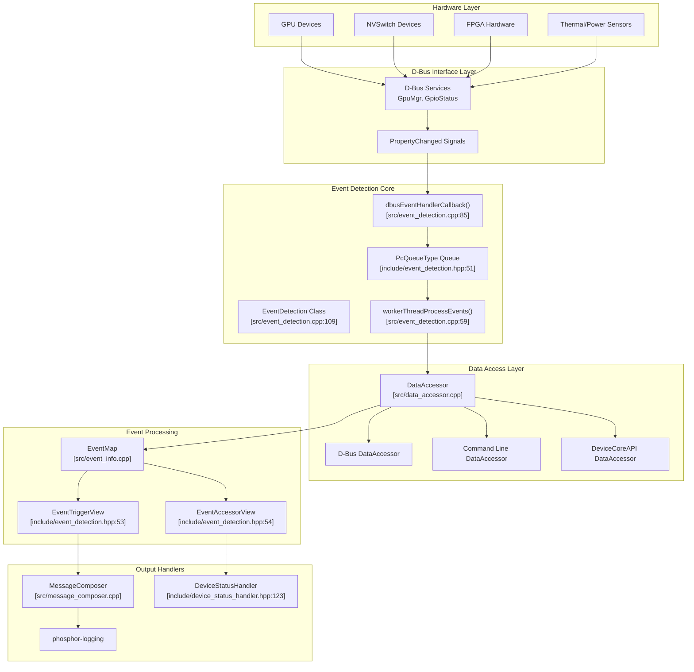
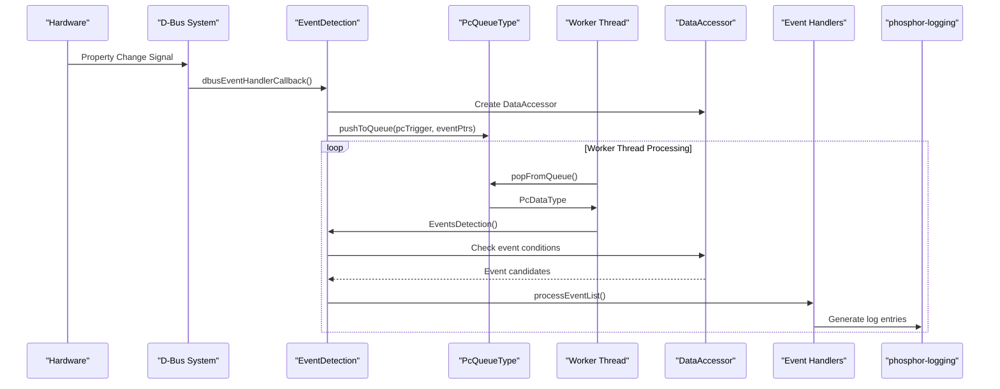
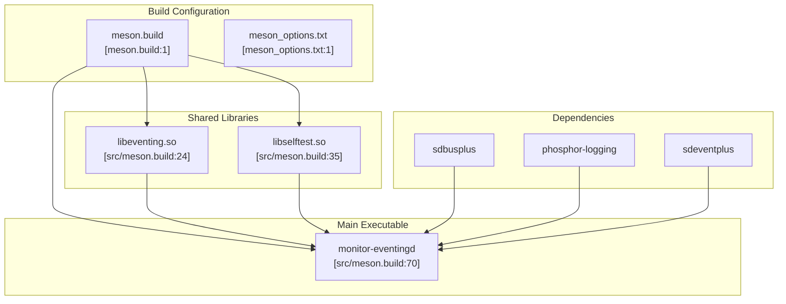

<!-- source: DeepWiki mcp.deepwiki.com · repo NVIDIA/nvidia-monitor-eventing · page 1 Overview · fetched 2026-10-26 -->

# Overview

Relevant source files

The following files were used as context for generating this wiki page:

- [examples/dat.json](examples/dat.json)
- [examples/event_info.json](examples/event_info.json)
- [include/device_status_handler.hpp](include/device_status_handler.hpp)
- [include/event_detection.hpp](include/event_detection.hpp)
- [include/meson.build](include/meson.build)
- [meson.build](meson.build)
- [meson_options.txt](meson_options.txt)
- [src/event_detection.cpp](src/event_detection.cpp)
- [src/eventing_main.cpp](src/eventing_main.cpp)
- [src/meson.build](src/meson.build)
- [test/dat_test.cpp](test/dat_test.cpp)
- [tools/mctp-error-detection](tools/mctp-error-detection)

The `nvidia-monitor-eventing` repository implements a comprehensive hardware monitoring and event detection system for NVIDIA server platforms. This system provides real-time monitoring of GPU, NVSwitch, FPGA, and other hardware components, automatically detecting fault conditions and generating structured logging events for the OpenBMC ecosystem.

The system serves as the foundation for hardware reliability, availability, and serviceability (RAS) capabilities in NVIDIA server deployments, integrating with phosphor-logging and Redfish APIs to provide enterprise-grade monitoring and alerting.

For information about specific event definitions and configuration, see [Event Definitions](#3.1). For details about the main service daemon, see [Main Service - monitor-eventingd](#4).

## Core System Architecture

The monitoring system is built around several key runtime components that work together to detect, process, and respond to hardware events:

**Sources:** [src/event_detection.cpp:18-773](), [include/event_detection.hpp:18-773](), [src/eventing_main.cpp:18-755](), [meson.build:1-253]()

## Main Operational Flow

The system operates through a multi-threaded event-driven architecture that processes hardware state changes in real-time:

**Sources:** [src/event_detection.cpp:85-156](), [src/event_detection.cpp:215-264](), [src/event_detection.cpp:408-567]()

## Key Runtime Components

| Component | Class Name | Primary Function | Location |
|-----------|------------|------------------|----------|
| **Main Daemon** | `monitor-eventingd` | Service entry point and initialization | [src/eventing_main.cpp:373]() |
| **Event Detection Engine** | `EventDetection` | D-Bus signal processing and event discovery | [src/event_detection.cpp:109]() |
| **Data Access Layer** | `DataAccessor` | Unified interface to hardware data sources | [src/data_accessor.cpp]() |
| **Message Composition** | `MessageComposer` | Redfish-compliant log message generation | [src/message_composer.cpp]() |
| **Device Status Management** | `DeviceStatusHandler` | Health rollup and device status tracking | [include/device_status_handler.hpp:123]() |
| **Self-Test System** | `Selftest` | Boot-up hardware validation | [src/selftest.cpp]() |

## Configuration System

The system is driven by JSON configuration files that define device hierarchies and event specifications:

| Configuration File | Purpose | Key Content |
|-------------------|---------|-------------|
| `event_info.json` | Event definitions and triggers | Device types, D-Bus paths, Redfish message formats |
| `dat.json` | Device Association Tree | Hardware topology and health rollup relationships |

The configuration system supports device range patterns (e.g., `GPU[0-7]`, `NVSwitch[0-3]`) for scalable hardware deployments.

**Sources:** [examples/event_info.json:1-2857](), [examples/dat.json:1-4186](), [src/eventing_main.cpp:108-157]()

## Build System and Integration

The project uses Meson build system and generates the following primary outputs:

The main daemon `monitor-eventingd` integrates into the OpenBMC systemd environment and connects to the D-Bus system bus for real-time hardware monitoring.

**Sources:** [meson.build:1-253](), [src/meson.build:1-77](), [meson_options.txt:1-130]()

## Integration with OpenBMC Ecosystem

The system integrates tightly with the OpenBMC platform through several key interfaces:

- **D-Bus Services**: Subscribes to `PropertyChanged` signals from hardware management services
- **phosphor-logging**: Generates structured log entries with Redfish message registry compliance  
- **Device Health**: Updates device health properties and rollup status via D-Bus
- **systemd**: Runs as a system service with proper dependency management

This integration enables the monitoring system to participate in the broader BMC ecosystem while providing NVIDIA-specific hardware monitoring capabilities.

**Sources:** [src/eventing_main.cpp:373-755](), [include/device_status_handler.hpp:81-297]()

---

