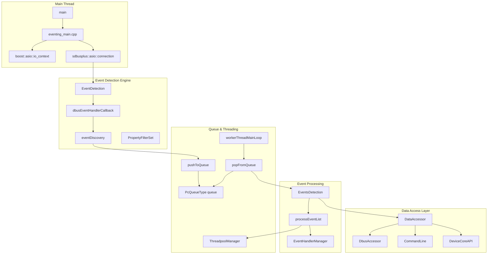
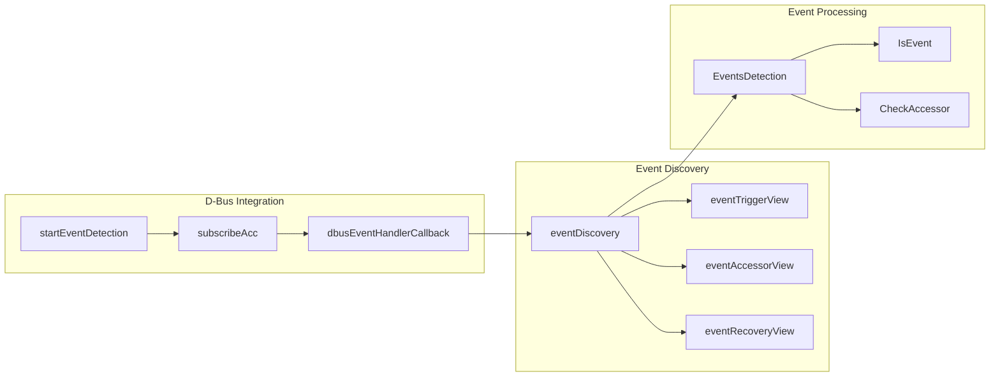
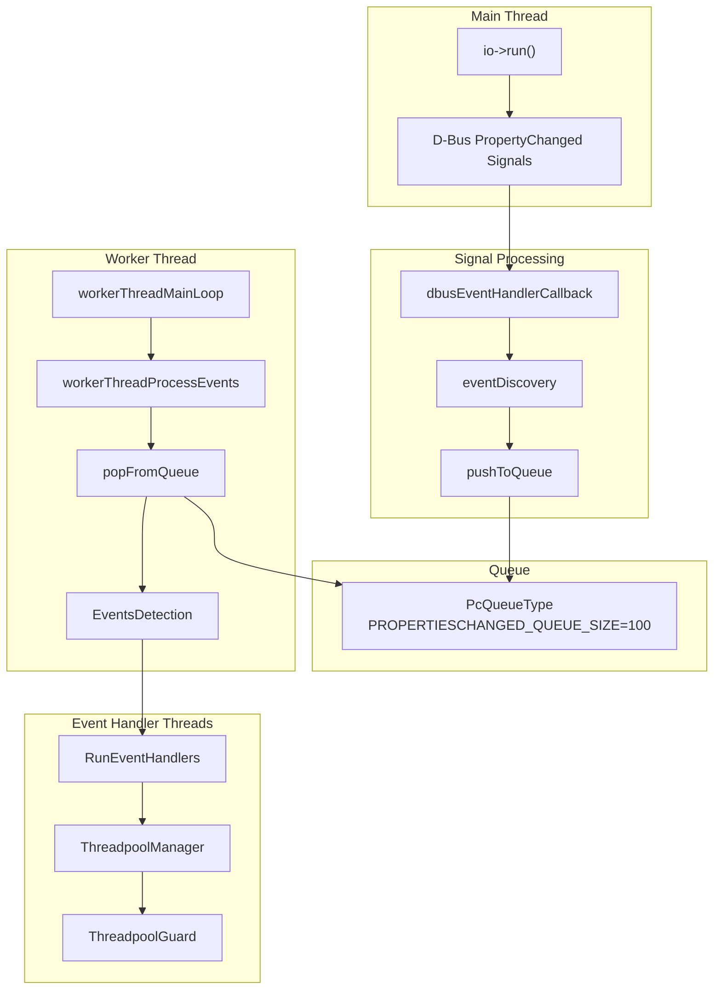
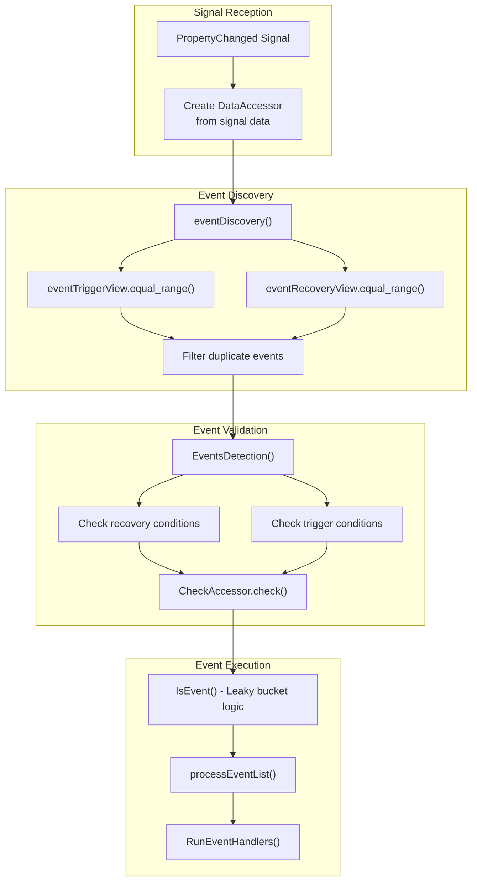

<!-- source: DeepWiki mcp.deepwiki.com · repo NVIDIA/nvidia-monitor-eventing · page 2 Core Runtime Architecture · fetched 2026-10-26 -->

# Core Runtime Architecture

Relevant source files

The following files were used as context for generating this wiki page:

- [include/data_accessor.hpp](include/data_accessor.hpp)
- [include/device_status_handler.hpp](include/device_status_handler.hpp)
- [include/event_detection.hpp](include/event_detection.hpp)
- [include/meson.build](include/meson.build)
- [meson.build](meson.build)
- [meson_options.txt](meson_options.txt)
- [src/data_accessor.cpp](src/data_accessor.cpp)
- [src/event_detection.cpp](src/event_detection.cpp)
- [src/eventing_main.cpp](src/eventing_main.cpp)
- [src/meson.build](src/meson.build)
- [test/accessor_test.cpp](test/accessor_test.cpp)

## Purpose and Scope

This document covers the main runtime components of the nvidia-monitor-eventing system and how they work together to detect, process, and respond to hardware events in real-time. The core runtime architecture provides the foundation for continuous monitoring of NVIDIA hardware components through D-Bus signals, command-line interfaces, and hardware APIs.

For detailed information about event definitions and configuration, see [Configuration System](#3). For testing and validation workflows, see [Testing and Validation](#5). For the main service executable configuration, see [Main Service - monitor-eventingd](#4).

## Runtime Architecture Overview

The runtime architecture centers around the `EventDetection` class which orchestrates event detection, data access, and event processing through a multi-threaded, queue-based design.

**Core Runtime Architecture**

Sources: [src/eventing_main.cpp:302-314](), [src/event_detection.cpp:59-84](), [include/event_detection.hpp:105-180]()

## Key Runtime Components

### EventDetection Engine

The `EventDetection` class serves as the central orchestrator for the runtime system. It manages D-Bus signal subscriptions, processes incoming events, and coordinates with other subsystems.

**EventDetection Core Components**

The `EventDetection` class implements several key methods:

- `startEventDetection()` - Initializes D-Bus subscriptions for all configured event triggers and accessors
- `dbusEventHandlerCallback()` - Processes incoming D-Bus PropertyChanged signals
- `eventDiscovery()` - Maps incoming signals to potential events using view containers
- `EventsDetection()` - Validates and processes candidate events

Sources: [include/event_detection.hpp:108-224](), [src/event_detection.cpp:158-181](), [src/event_detection.cpp:85-156]()

### DataAccessor System

The `DataAccessor` class provides a unified interface for accessing data from multiple sources including D-Bus properties, command-line tools, and hardware APIs.

| Accessor Type | Key Field | Usage |
|---------------|-----------|-------|
| `DBUS` | `object`, `interface`, `property` | D-Bus property access |
| `CMDLINE` | `executable`, `arguments` | Command execution |
| `DeviceCoreAPI` | `property` | Hardware API calls |
| `DEVICE` | `device_name` | Device name resolution |
| `CONSTANT` | `value` | Static values |

The `DataAccessor::read()` method routes to appropriate handlers:

- `readDbus()` - Reads D-Bus properties via `dbus::readDbusProperty()`
- `runCommandLine()` - Executes commands using `boost::process`
- `readDeviceCoreApi()` - Calls hardware APIs via `dbus::deviceGetCoreAPI()`

Sources: [include/data_accessor.hpp:83-421](), [src/data_accessor.cpp:85-110](), [src/data_accessor.cpp:112-217]()

## Threading and Queue Architecture

The runtime uses a producer-consumer pattern with separate threads for D-Bus signal handling and event processing.

**Threading Architecture**

The threading model ensures:

1. **Non-blocking signal processing** - D-Bus signals are quickly queued without blocking
2. **Configurable concurrency** - `ThreadpoolManager` limits concurrent event processing
3. **Resource management** - `ThreadpoolGuard` prevents thread pool exhaustion

Key configuration constants:
- `PROPERTIESCHANGED_QUEUE_SIZE` = 100 (queue capacity)
- `DEFAULT_RUNNING_THREAD_LIMIT` = 3 (concurrent event handlers)
- `DEFAULT_TOTAL_THREAD_LIMIT` = 4 (total thread pool size)

Sources: [src/event_detection.cpp:59-84](), [include/event_detection.hpp:45-47](), [src/eventing_main.cpp:302-314]()

## Event Processing Flow

The event processing pipeline transforms D-Bus signals into actionable events through a multi-stage process.

**Event Processing Pipeline**

The pipeline implements sophisticated event filtering using view containers:

- `eventTriggerView` - Maps trigger accessors to events for real-time detection
- `eventAccessorView` - Maps main accessors to events for bootup validation
- `eventRecoveryView` - Maps recovery accessors to events for fault clearing

Sources: [src/event_detection.cpp:266-341](), [src/event_detection.cpp:408-567](), [src/event_detection.cpp:379-460]()

## Integration with OpenBMC Ecosystem

The runtime architecture integrates deeply with the OpenBMC ecosystem through standardized interfaces and protocols.

| Integration Point | Implementation | Purpose |
|-------------------|----------------|---------|
| **D-Bus System Bus** | `sdbusplus::asio::connection` | IPC with other BMC services |
| **phosphor-logging** | `MessageComposer` handler | Standard OpenBMC logging |
| **Device Health Properties** | `DeviceStatusHandler` | Hardware health reporting |
| **Redfish Events** | Message registry integration | REST API event exposure |

The main service daemon (`monitor-eventingd`) runs as a systemd service and registers the D-Bus service name `xyz.openbmc_project.nvidia_monitor_eventing` for integration with other BMC components.

Sources: [src/eventing_main.cpp:686-696](), [meson.build:89-98](), [include/device_status_handler.hpp:123-274]()

---

