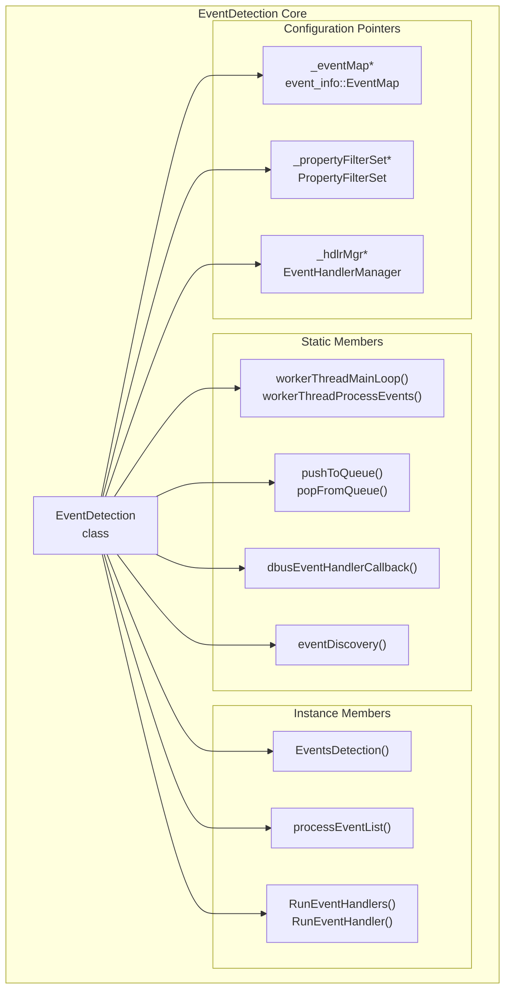
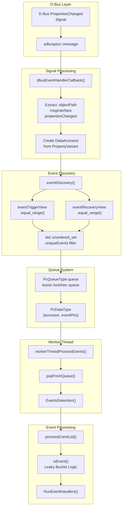
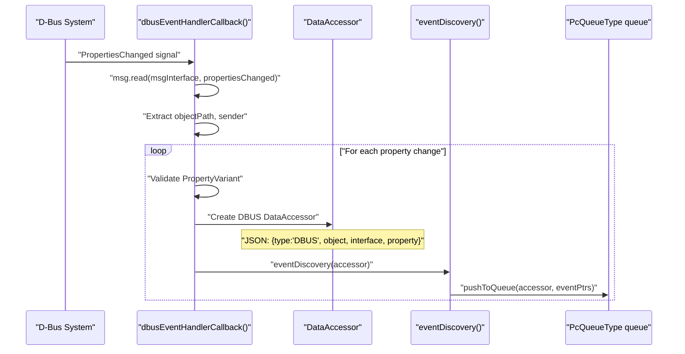
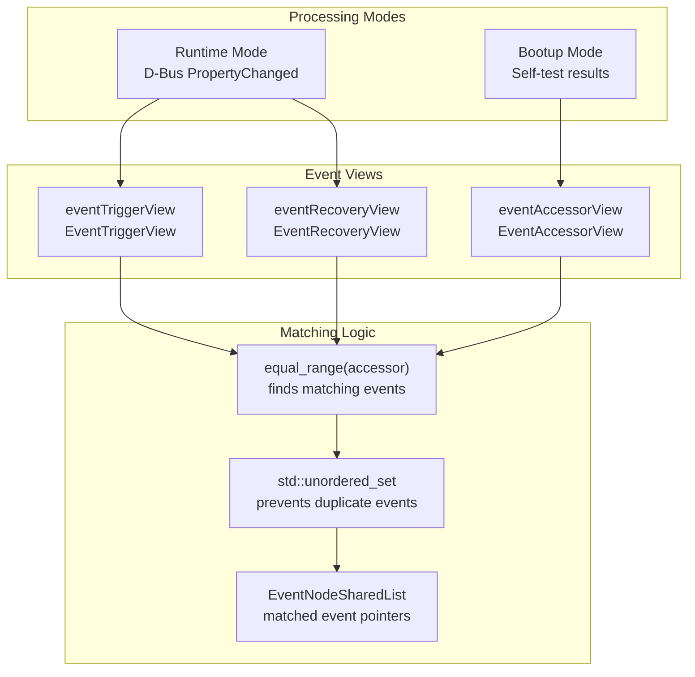
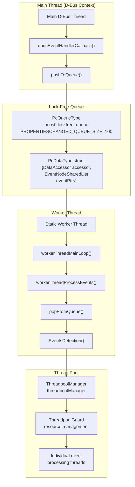
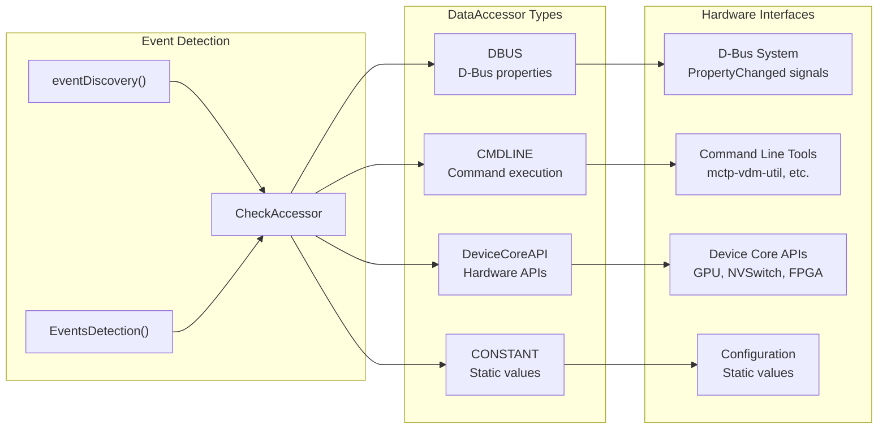
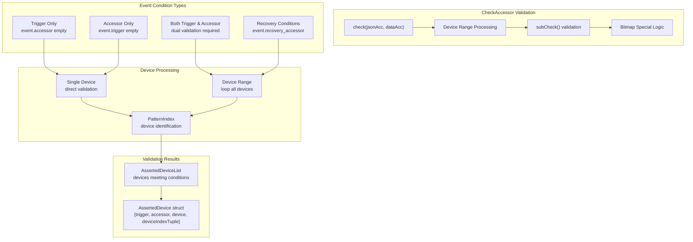
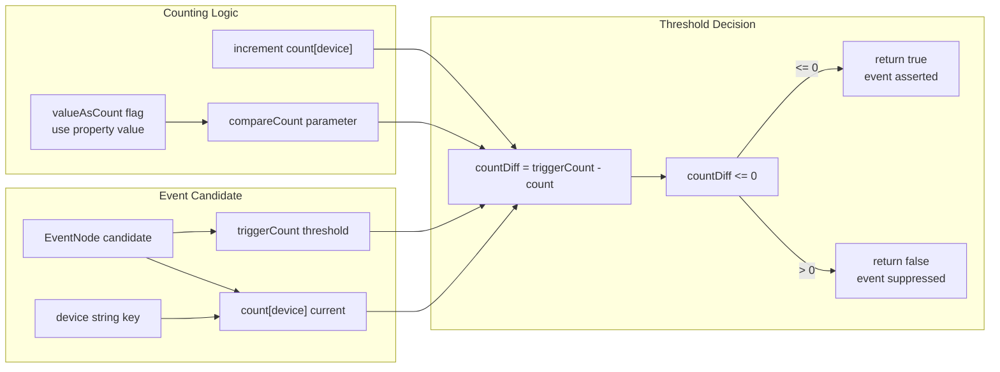

<!-- source: DeepWiki mcp.deepwiki.com · repo NVIDIA/nvidia-monitor-eventing · page 2.1 Event Detection System · fetched 2026-10-26 -->

# Event Detection System

Relevant source files

The following files were used as context for generating this wiki page:

- [include/check_accessor.hpp](include/check_accessor.hpp)
- [include/data_accessor.hpp](include/data_accessor.hpp)
- [include/event_detection.hpp](include/event_detection.hpp)
- [src/check_accessor.cpp](src/check_accessor.cpp)
- [src/data_accessor.cpp](src/data_accessor.cpp)
- [src/event_detection.cpp](src/event_detection.cpp)
- [test/accessor_test.cpp](test/accessor_test.cpp)

## Purpose and Scope

The Event Detection System is the core runtime component responsible for monitoring D-Bus property changes, discovering relevant hardware events, and coordinating their processing through the nvidia-monitor-eventing system. This system acts as the central dispatcher that bridges hardware state changes to event logging, device status management, and recovery actions.

This document covers the `EventDetection` class, its D-Bus signal processing pipeline, multi-threaded event handling, and integration with the Data Access Layer. For information about event definitions and configuration, see [Event Definitions](#3.1). For details about the broader runtime architecture, see [Core Runtime Architecture](#2).

## Core Architecture

The Event Detection System operates as a multi-layered architecture centered around the `EventDetection` class, which orchestrates D-Bus signal processing, event discovery, and multi-threaded event handling.

### EventDetection Class Structure

**Sources:** [include/event_detection.hpp:109-770](), [src/event_detection.cpp:44-516]()

### Event Processing Data Flow

**Sources:** [src/event_detection.cpp:85-156](), [src/event_detection.cpp:215-240](), [src/event_detection.cpp:266-341]()

## D-Bus Signal Processing

The Event Detection System monitors D-Bus `PropertiesChanged` signals through the `dbusEventHandlerCallback()` function, which serves as the entry point for all hardware state change notifications.

### Signal Handler Implementation

The D-Bus callback processes incoming signals by extracting property information and creating `DataAccessor` instances:

The handler creates a standardized `DataAccessor` representation:

| Field | Source | Purpose |
|-------|---------|---------|
| `type` | Hardcoded "DBUS" | Identifies accessor type |
| `object` | `msg.get_path()` | D-Bus object path |
| `interface` | Read from message | D-Bus interface name |  
| `property` | Property name from change | Changed property identifier |

**Sources:** [src/event_detection.cpp:85-156](), [include/data_accessor.hpp:136-145]()

### D-Bus Handler Registration

Event detection subscribes to relevant D-Bus interfaces through `startEventDetection()`, which creates property change matchers for each accessor in the event configuration:

```mermaid
graph LR
    subgraph "Event Configuration"
        EVENT_MAP["EventMap<br/>_eventMap"]
        EVENTS["EventNode list<br/>per device type"]
        ACCESSORS["trigger, accessor,<br/>recovery_accessor"]
    end
    
    subgraph "Registration Process"
        SUBSCRIBE["subscribeAcc()"]
        INTERFACE_MAP["getDbusInterfaceObjectsMap()"]
        UNIQUE_MAP["RegisteredObjectInterfaceMap<br/>prevent duplicate subscriptions"]
    end
    
    subgraph "D-Bus System"
        MATCHERS["sdbusplus::bus::match_t<br/>PropertyChanged handlers"]
        GENERIC_HANDLER["std::bind to<br/>dbusEventHandlerCallback"]
    end
    
    EVENT_MAP --> EVENTS
    EVENTS --> ACCESSORS  
    ACCESSORS --> SUBSCRIBE
    SUBSCRIBE --> INTERFACE_MAP
    INTERFACE_MAP --> UNIQUE_MAP
    UNIQUE_MAP --> MATCHERS
    MATCHERS --> GENERIC_HANDLER
```

**Sources:** [src/event_detection.cpp:157-213](), [include/event_detection.hpp:183-189]()

## Event Discovery and Matching

The `eventDiscovery()` function implements the core logic for matching incoming D-Bus signals to configured events using specialized view containers for efficient lookup.

### Event View System

The system maintains three specialized views for different event matching scenarios:

### Event Discovery Algorithm

The discovery process operates differently based on the operational mode:

**Runtime Mode (bootup = false):**
1. Search `eventTriggerView` for matching trigger accessors
2. Search `eventRecoveryView` for matching recovery accessors  
3. Use `std::unordered_set` to prevent duplicate event processing
4. Recovery events are processed before trigger events

**Bootup Mode (bootup = true):**
1. Search only `eventAccessorView` for matching accessors
2. Requires accessor to contain valid data from self-test results
3. Used for detecting events present at system startup

**Sources:** [src/event_detection.cpp:266-341](), [include/event_detection.hpp:53-55]()

## Multi-threaded Processing Pipeline

The Event Detection System uses a lock-free queue and dedicated worker thread to separate D-Bus signal handling from event processing, preventing D-Bus timeouts during complex event handling.

### Threading Architecture

### Queue Management and Flow Control

The system implements queue monitoring and flow control to handle high-frequency D-Bus events:

| Component | Configuration | Purpose |
|-----------|---------------|---------|
| `PROPERTIESCHANGED_QUEUE_SIZE` | 100 elements | Maximum queue capacity |
| `queue->write_available()` | Runtime check | Available queue space monitoring |
| 50% threshold warning | 50 elements | Early congestion detection |
| 500ms worker loop | Sleep interval | Prevents excessive CPU usage |

The worker thread continuously polls the queue with a 500ms sleep interval, processing all available events in each iteration before sleeping again.

**Sources:** [src/event_detection.cpp:59-83](), [src/event_detection.cpp:241-264](), [include/event_detection.hpp:45-47]()

## Data Access Integration

The Event Detection System integrates tightly with the Data Access Layer through the `DataAccessor` abstraction, enabling unified access to multiple data sources during event processing.

### DataAccessor Integration Points

### Event Processing with Data Validation

The `EventsDetection()` method uses `CheckAccessor` instances to validate event conditions across different data sources:

1. **Trigger Validation**: Uses `CheckAccessor` to verify the triggering condition matches the incoming D-Bus signal
2. **Accessor Validation**: Validates additional data requirements using secondary data sources
3. **Recovery Processing**: Handles event recovery scenarios with specialized recovery accessors

The validation process supports multiple check types defined in the event configuration:

| Check Type | Purpose | Example |
|------------|---------|---------|
| `bitmap` | Bit field validation | GPU error register bits |
| `bitmask` | Single bit testing | Device status flags |
| `equal` | Exact value matching | Boolean state comparisons |
| `lookup` | String/pattern matching | Command output parsing |

**Sources:** [src/event_detection.cpp:408-567](), [include/check_accessor.hpp:88-114](), [src/check_accessor.cpp:88-144]()

## Event Validation System

The Event Detection System implements comprehensive validation logic through the `CheckAccessor` class, which performs multi-stage validation of event conditions against hardware data.

### Validation Pipeline

### Leaky Bucket Event Throttling

The system implements a leaky bucket algorithm in `IsEvent()` to prevent event flooding:

This prevents repeated assertion of the same event until the configured threshold is exceeded, implementing effective rate limiting for high-frequency hardware events.

**Sources:** [src/event_detection.cpp:576-607](), [include/check_accessor.hpp:47-151](), [src/check_accessor.cpp:23-332]()

---

