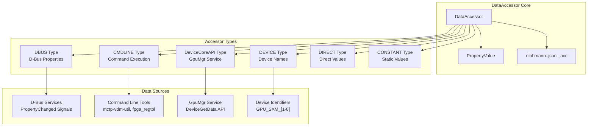
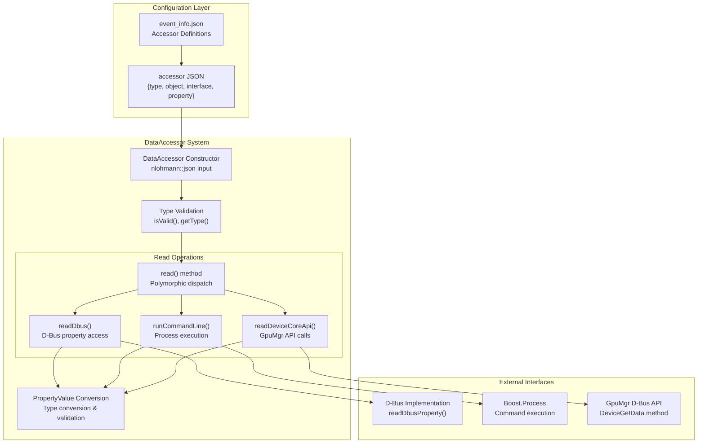
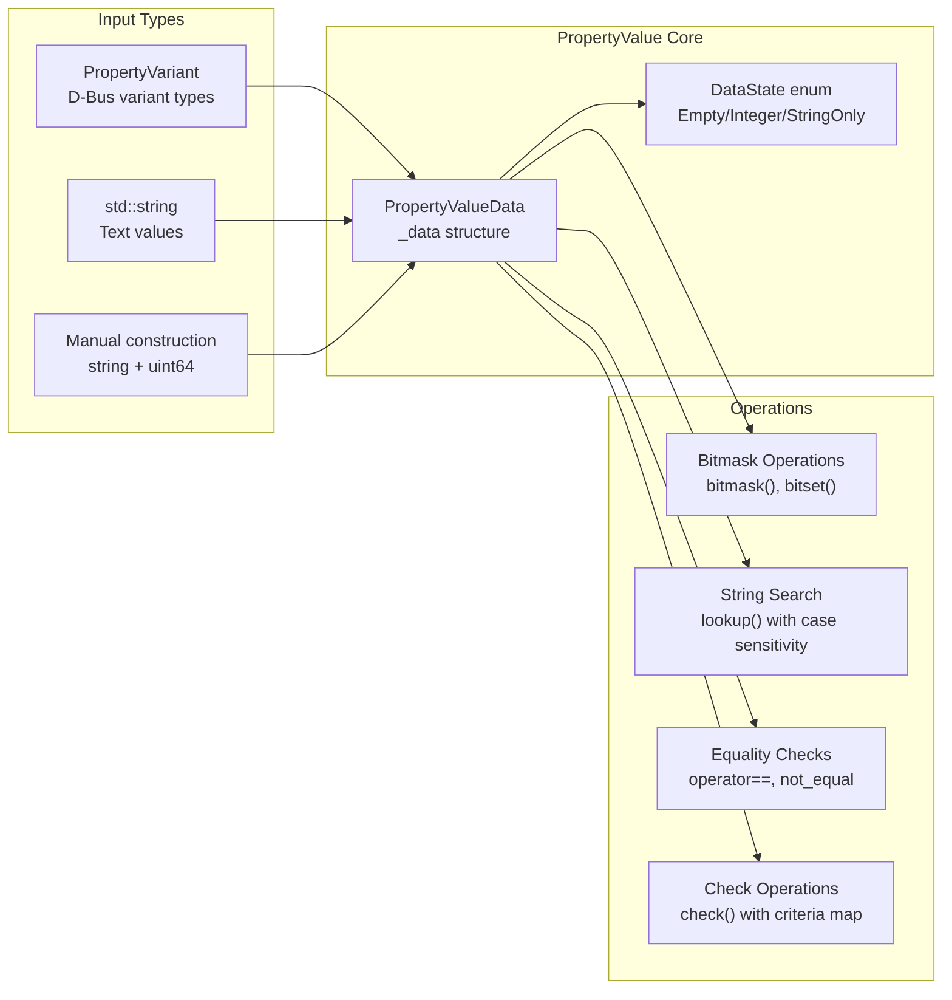
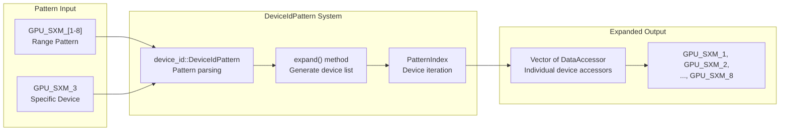
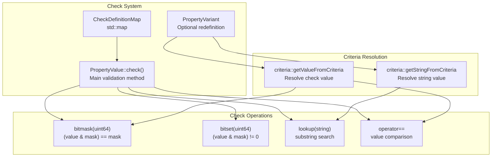

<!-- source: DeepWiki mcp.deepwiki.com · repo NVIDIA/nvidia-monitor-eventing · page 2.2 Data Access Layer · fetched 2026-10-26 -->

# Data Access Layer

<details>
<summary>Relevant source files</summary>

The following files were used as context for generating this wiki page:

- [include/data_accessor.hpp](include/data_accessor.hpp)
- [include/dbus_accessor.hpp](include/dbus_accessor.hpp)
- [include/property_accessor.hpp](include/property_accessor.hpp)
- [include/property_variant.hpp](include/property_variant.hpp)
- [src/data_accessor.cpp](src/data_accessor.cpp)
- [src/dbus_accessor.cpp](src/dbus_accessor.cpp)
- [src/property_accessor.cpp](src/property_accessor.cpp)
- [test/accessor_test.cpp](test/accessor_test.cpp)
- [test/propertyvalue_string_test.cpp](test/propertyvalue_string_test.cpp)
- [test/propertyvalue_variant_test.cpp](test/propertyvalue_variant_test.cpp)

</details>


The Data Access Layer provides unified access to hardware monitoring data from multiple sources including D-Bus properties, command-line tools, device-specific APIs, and constant values. This abstraction enables the event detection system to query hardware state across different interface types using a consistent API.

For information about how this data is used in event processing, see [Event Processing Pipeline](#2.3). For details on the configuration that drives accessor definitions, see [Event Definitions](#3.1).

## Architecture Overview

The Data Access Layer implements a unified interface pattern where different data sources are accessed through a common `DataAccessor` abstraction. Each accessor type handles the specific details of its data source while presenting a consistent read/write interface.

### DataAccessor Type System



**Sources:** [include/data_accessor.hpp:71-77](), [include/data_accessor.hpp:83-108](), [src/data_accessor.cpp:30-67]()

### Data Flow Architecture



**Sources:** [src/data_accessor.cpp:85-110](), [src/data_accessor.cpp:112-217](), [src/data_accessor.cpp:230-264]()

## Core Components

### DataAccessor Class

The `DataAccessor` class serves as the primary interface for all data access operations. It encapsulates accessor configuration in JSON format and provides polymorphic data reading capabilities.

| Component | Purpose | Key Methods |
|-----------|---------|-------------|
| `_acc` | JSON configuration storage | Contains type, object path, interface, property |
| `_dataValue` | Cached data storage | Stores `PropertyValue` after successful read |
| Type checking | Accessor type validation | `isTypeDbus()`, `isTypeCmdline()`, `isTypeDeviceCoreApi()` |
| Read operations | Data retrieval | `read()`, `readDbus()`, `runCommandLine()`, `readDeviceCoreApi()` |

**Sources:** [include/data_accessor.hpp:83-108](), [include/data_accessor.hpp:370-420]()

### PropertyValue System

The `PropertyValue` class handles type conversion and validation for data retrieved from various sources. It supports both string and 64-bit integer representations with automatic conversion between types.



**Sources:** [include/property_accessor.hpp:271-295](), [include/property_accessor.hpp:49-73](), [src/property_accessor.cpp:84-134]()

## Accessor Type Implementations

### DBUS Accessor

D-Bus accessors read properties from OpenBMC D-Bus services using the standard `org.freedesktop.DBus.Properties` interface.

**Configuration Format:**
```json
{
  "type": "DBUS",
  "object": "/xyz/openbmc_project/inventory/system/chassis/GPU[0-7]", 
  "interface": "xyz.openbmc_project.Inventory.Decorator.Dimension",
  "property": "Depth"
}
```

**Implementation Flow:**
1. Service discovery via `ObjectMapper`
2. Property read via `org.freedesktop.DBus.Properties.Get`
3. Type conversion through `PropertyValue`
4. Range expansion for device patterns

**Sources:** [src/data_accessor.cpp:85-110](), [src/dbus_accessor.cpp:216-258](), [src/dbus_accessor.cpp:62-111]()

### CMDLINE Accessor

Command-line accessors execute external tools and parse their output for monitoring data.

**Configuration Format:**
```json
{
  "type": "CMDLINE",
  "executable": "mctp-vdm-util-wrapper",
  "arguments": "AP0_BOOTCOMPLETE_TIMEOUT GPU_SXM_[1-8]",
  "check": {"lookup": "00 02 40"}
}
```

**Implementation Details:**
- Uses `boost::process` for secure execution
- Timeout handling (10 seconds default)
- Process group termination for cleanup
- Device range substitution in arguments

**Sources:** [src/data_accessor.cpp:112-217](), [include/data_accessor.hpp:36-42]()

### DeviceCoreAPI Accessor

DeviceCoreAPI accessors interface with NVIDIA's device management APIs through the GpuMgr D-Bus service.

**Configuration Format:**
```json
{
  "type": "DeviceCoreAPI", 
  "property": "gpu.thermal.temperature.overTemperatureInfo",
  "check": {"bitmap": "1"}
}
```

**API Integration:**
- Calls `xyz.openbmc_project.GpuMgr.Server.DeviceGetData`
- Device ID mapping through `util::getMappedDeviceId()`
- Returns structured data: `(rc, string, uint64)`
- Supports both lookup and bitmap check modes

**Sources:** [src/data_accessor.cpp:230-264](), [src/dbus_accessor.cpp:113-172]()

## Device Range Expansion

The system supports device range patterns (e.g., `GPU[0-7]`, `NVLink_[0-39]`) that expand to individual device instances for iteration and specific device targeting.

### Range Pattern Processing



**Key Methods:**
- `expand()`: Creates individual `DataAccessor` instances for each device in range
- `isDeviceIdRange()`: Determines if accessor should iterate over devices
- `util::expandDeviceRange()`: Utility function for range processing

**Sources:** [src/data_accessor.cpp:317-341](), [include/data_accessor.hpp:365-369](), [test/accessor_test.cpp:697-813]()

## Property Validation and Checking

The Data Access Layer includes sophisticated property validation through the check system, supporting various comparison operations for event trigger evaluation.

### Check Operation Types

| Check Type | Purpose | Example Usage |
|------------|---------|---------------|
| `bitmask` | All specified bits set | `{"bitmask": "0x03"}` |
| `bitmap` | Alias for bitmask with shifting | `{"bitmap": "1"}` |
| `bitset` | Any specified bits set | `{"bitset": "0x03"}` |
| `lookup` | Substring search | `{"lookup": "00 02 40"}` |
| `equal` | Exact value match | `{"equal": "true"}` |
| `not_equal` | Value inequality | `{"not_equal": "0"}` |

### Check Implementation Architecture



**Sources:** [src/property_accessor.cpp:84-134](), [include/property_accessor.hpp:30-40](), [src/property_accessor.cpp:307-330]()

## Integration Points

### D-Bus Integration

The Data Access Layer integrates tightly with the OpenBMC D-Bus ecosystem through several mechanisms:

- **Service Discovery**: Uses `xyz.openbmc_project.ObjectMapper` for dynamic service resolution
- **Property Access**: Standard `org.freedesktop.DBus.Properties` interface for get/set operations  
- **Signal Handling**: Registers for `PropertiesChanged` signals for event detection
- **Caching**: Implements `CachingObjectMapper` for performance optimization

**Sources:** [src/dbus_accessor.cpp:62-111](), [src/dbus_accessor.cpp:260-291](), [src/dbus_accessor.cpp:330-412]()

### Event System Integration

The Data Access Layer serves as the foundation for the event detection system by providing:

1. **Trigger Evaluation**: Accessor data drives event trigger conditions
2. **Device Context**: Range expansion enables per-device event processing  
3. **Property Validation**: Check operations determine event assertion states
4. **Data Caching**: Cached values optimize repeated access during event processing

**Sources:** [src/data_accessor.cpp:343-374](), [include/data_accessor.hpp:422-423]()

---

