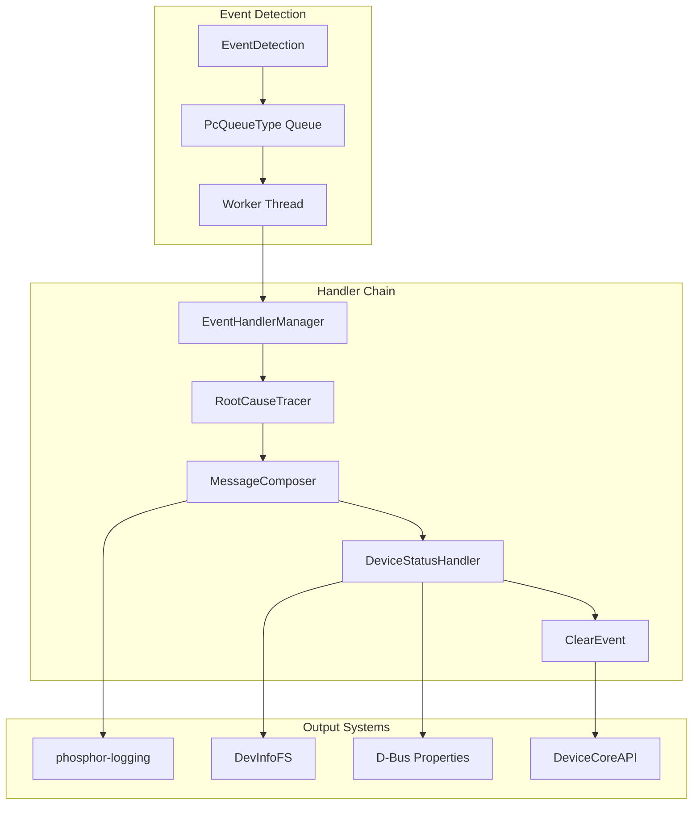
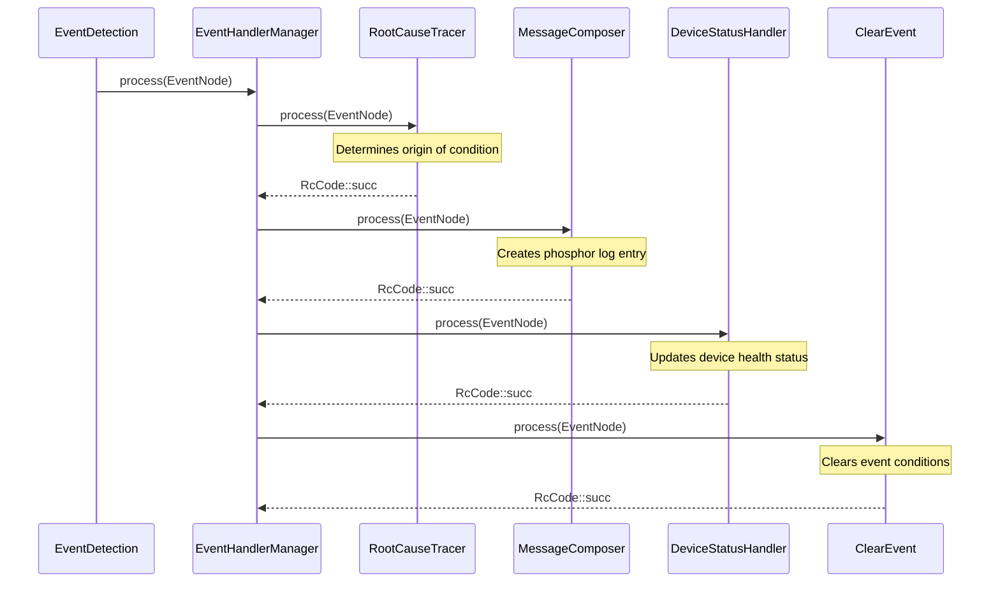
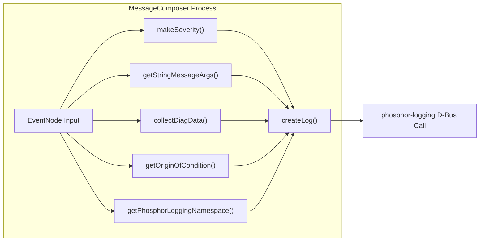
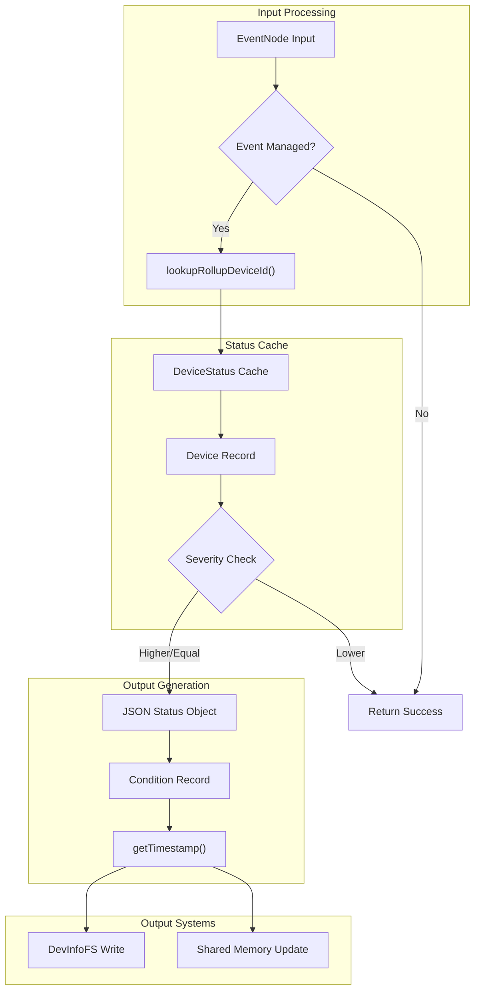
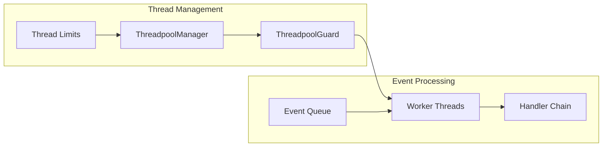

<!-- source: DeepWiki mcp.deepwiki.com · repo NVIDIA/nvidia-monitor-eventing · page 2.3 Event Processing Pipeline · fetched 2026-10-26 -->

# Event Processing Pipeline

<details>
<summary>Relevant source files</summary>

The following files were used as context for generating this wiki page:

- [include/dat_traverse.hpp](include/dat_traverse.hpp)
- [include/device_status_handler.hpp](include/device_status_handler.hpp)
- [include/event_handler.hpp](include/event_handler.hpp)
- [include/meson.build](include/meson.build)
- [include/message_composer.hpp](include/message_composer.hpp)
- [meson.build](meson.build)
- [meson_options.txt](meson_options.txt)
- [src/dat_traverse.cpp](src/dat_traverse.cpp)
- [src/eventing_main.cpp](src/eventing_main.cpp)
- [src/meson.build](src/meson.build)
- [src/message_composer.cpp](src/message_composer.cpp)
- [test/dat_traverse_test.cpp](test/dat_traverse_test.cpp)
- [test/event_test.cpp](test/event_test.cpp)

</details>


## Overview

The Event Processing Pipeline is the core system responsible for transforming detected hardware events into actionable outputs such as phosphor logs, device status updates, and recovery actions. This pipeline coordinates multiple event handlers in a specific sequence to ensure comprehensive event processing and system health management.

For information about event detection and D-Bus signal processing, see [Event Detection System](#2.1). For details about data retrieval mechanisms, see [Data Access Layer](#2.2). For the main daemon configuration, see [Main Service - monitor-eventingd](#4).

## Pipeline Architecture

The event processing pipeline follows a handler chain pattern where each event flows through multiple specialized processors. The pipeline is orchestrated by the `EventHandlerManager` class and executed within the main daemon context.

### Event Processing Flow



**Sources:** [src/eventing_main.cpp:584-669](), [include/event_handler.hpp:103-184]()

### Handler Registration and Execution Order

The event handlers are registered in a specific order that ensures data dependencies are met. Each handler processes the event and may modify it for subsequent handlers.



**Sources:** [src/eventing_main.cpp:661-669](), [include/event_handler.hpp:157-176]()

## Event Handler Components

### EventHandlerManager

The `EventHandlerManager` class coordinates the execution of all registered event handlers. It provides methods for individual and batch handler execution.

| Method | Purpose | Return Type |
|--------|---------|-------------|
| `RegisterHandler()` | Adds handler to execution chain | `void` |
| `RunHandler()` | Executes specific handler by name | `eventing::RcCode` |
| `RunAllHandlers()` | Executes all handlers in order | `eventing::RcCode` |

**Sources:** [include/event_handler.hpp:103-184]()

### MessageComposer

The `MessageComposer` class creates structured log entries in the phosphor-logging system. It transforms event data into OpenBMC-compatible log formats.

#### Key Processing Steps



The `createLog()` method constructs a D-Bus method call with the following properties:

| Property | Source Method | Purpose |
|----------|---------------|---------|
| `REDFISH_MESSAGE_ID` | `event.getMessageId()` | Redfish message identifier |
| `DEVICE_EVENT_DATA` | `collectDiagData()` | Telemetry and diagnostic data |
| `REDFISH_MESSAGE_ARGS` | `event.getStringMessageArgs()` | Message formatting arguments |
| `REDFISH_ORIGIN_OF_CONDITION` | `getOriginOfCondition()` | Device path causing condition |
| `namespace` | `getPhosphorLoggingNamespace()` | Logging namespace |

**Sources:** [src/message_composer.cpp:56-108](), [include/message_composer.hpp:42-233]()

### DeviceStatusHandler

The `DeviceStatusHandler` updates device health information in multiple output formats including filesystem and shared memory.

#### Device Status Update Flow



The status update creates a JSON structure containing:
- `Status.Health` - Current device health
- `Status.HealthRollup` - Aggregated health status  
- `Status.Conditions[]` - Array of active conditions with metadata

**Sources:** [include/device_status_handler.hpp:123-295]()

### ClearEvent

The `ClearEvent` handler processes event clearance operations, particularly for DeviceCoreAPI-based events.

**Sources:** [include/event_handler.hpp:52-97]()

## Thread Safety and Concurrency

The event processing pipeline operates in a multi-threaded environment with the following concurrency controls:

### ThreadpoolManager Integration



Configuration parameters:
- `running_thread_limit` - Maximum concurrent processing threads
- `total_thread_limit` - Maximum total threads (running + queued)

**Sources:** [src/eventing_main.cpp:560-572](), [src/eventing_main.cpp:196-216]()

### Mutex Protection

Critical sections are protected by mutexes in:
- `DeviceStatus` cache operations [include/device_status_handler.hpp:70-78]()
- Device status file operations [include/device_status_handler.hpp:242-243]()

## Configuration and Initialization

The pipeline is initialized during daemon startup with handler registration occurring in dependency order:

```cpp
// Handler registration order from eventing_main.cpp
eventHdlrMgr.RegisterHandler(&rootCauseTracer);  // First - determines OOC
eventHdlrMgr.RegisterHandler(&msgComposer);      // Second - creates logs
eventHdlrMgr.RegisterHandler(&deviceStatus);     // Third - updates status
eventHdlrMgr.RegisterHandler(&clearEvent);       // Last - clears conditions
```

**Sources:** [src/eventing_main.cpp:588-669]()

## Error Handling and Recovery

Each handler returns an `eventing::RcCode` to indicate processing status. The pipeline continues processing even on handler failures to ensure event logging occurs.

Handler failure scenarios:
- D-Bus communication errors during log creation
- File system errors during status updates
- Invalid event data or missing configuration
- Thread pool exhaustion

**Sources:** [include/event_handler.hpp:164-174](), [src/message_composer.cpp:96-107]()

---

