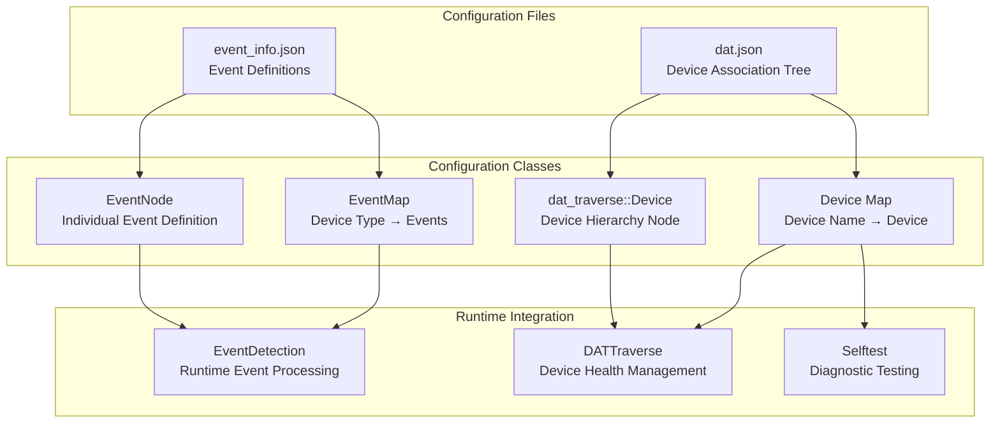
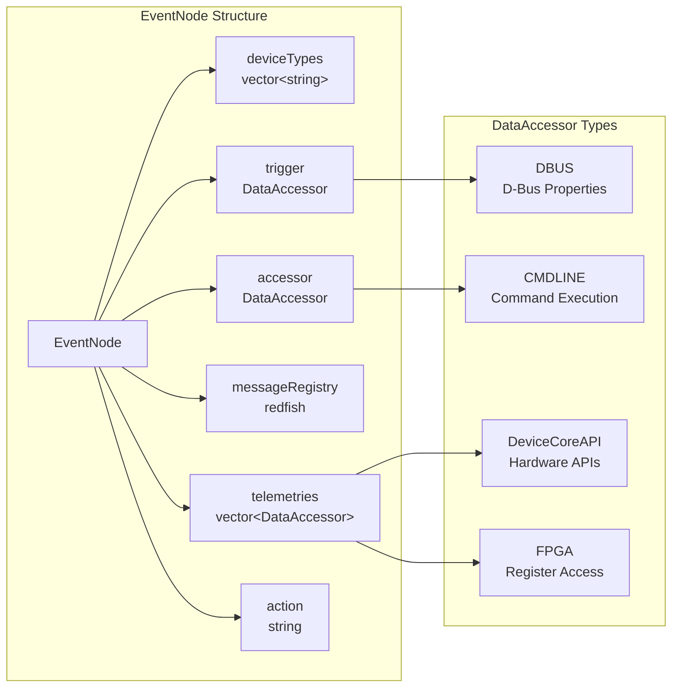
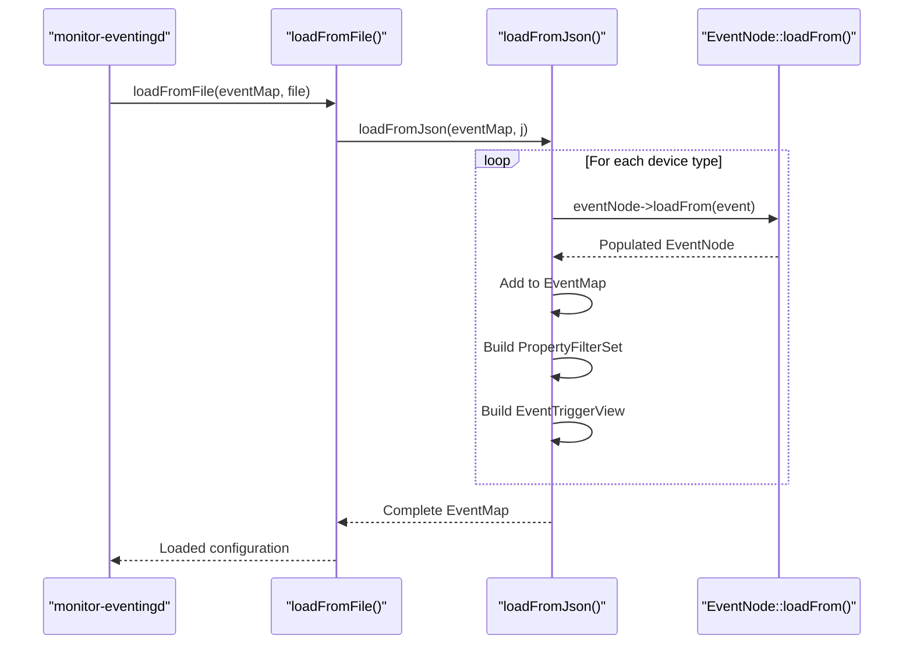
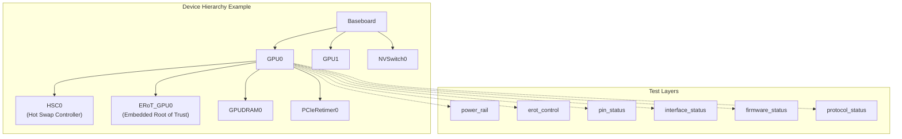
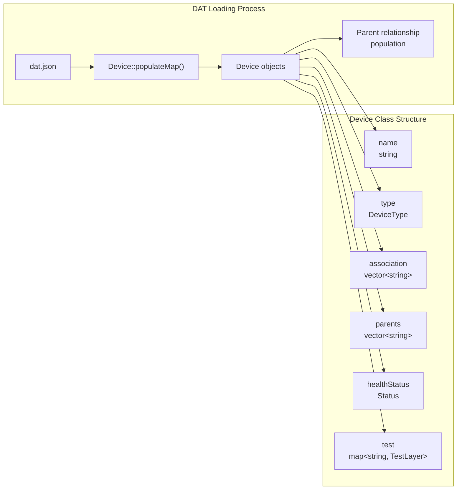
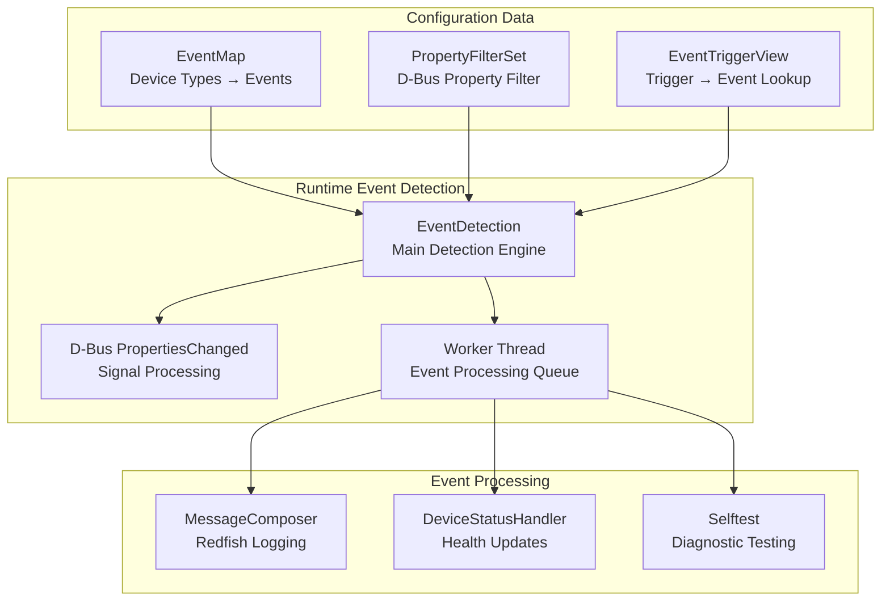
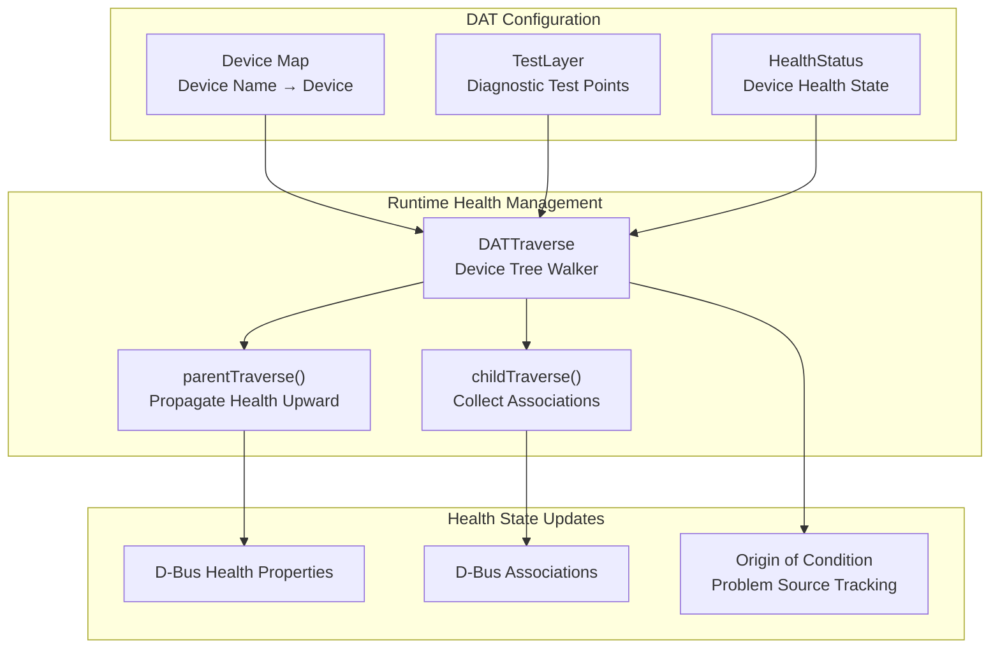

<!-- source: DeepWiki mcp.deepwiki.com · repo NVIDIA/nvidia-monitor-eventing · page 3 Configuration System · fetched 2026-10-26 -->

# Configuration System

<details>
<summary>Relevant source files</summary>

The following files were used as context for generating this wiki page:

- [examples/dat.json](examples/dat.json)
- [examples/event_info.json](examples/event_info.json)
- [include/dat_traverse.hpp](include/dat_traverse.hpp)
- [include/event_handler.hpp](include/event_handler.hpp)
- [include/event_info.hpp](include/event_info.hpp)
- [src/dat_traverse.cpp](src/dat_traverse.cpp)
- [src/event_info.cpp](src/event_info.cpp)
- [test/dat_test.cpp](test/dat_test.cpp)
- [test/dat_traverse_test.cpp](test/dat_traverse_test.cpp)
- [test/event_detection_test.cpp](test/event_detection_test.cpp)
- [tools/mctp-error-detection](tools/mctp-error-detection)

</details>


The Configuration System provides the foundational data structures and loading mechanisms that define how hardware events are detected, processed, and reported across NVIDIA server platforms. It consists of two primary JSON-based configuration files and their corresponding C++ classes that translate static configuration into runtime behavior.

For information about how events flow through the runtime system after configuration loading, see [Event Detection System](#2.1). For details on the main daemon that loads these configurations, see [Main Service - monitor-eventingd](#4).

## Configuration Architecture Overview

The configuration system operates through two complementary configuration files that work together to define the complete monitoring and eventing behavior:



**Configuration System Flow**
Sources: [include/event_info.hpp:334-663](), [include/dat_traverse.hpp:100-224](), [src/event_info.cpp:144-196](), [src/dat_traverse.cpp:87-124]()

## Event Configuration (`event_info.json`)

The `event_info.json` file defines the comprehensive catalog of hardware events that can occur across different device types. Each event specifies detection criteria, message formatting, and response actions.

### Event Definition Structure



**Event Configuration Components**
Sources: [include/event_info.hpp:334-425](), [examples/event_info.json:1-57]()

The `EventNode` class represents individual events with the following key properties:

| Property | Type | Purpose |
|----------|------|---------|
| `event` | `string` | Human-readable event name |
| `device_type` | `vector<string>` | Device patterns this event applies to |
| `trigger` | `DataAccessor` | What condition triggers the event |
| `accessor` | `DataAccessor` | How to read event status/data |
| `severity` | `string` | Event severity level (Critical, Warning, OK) |
| `trigger_count` | `int` | Number of occurrences before triggering |
| `messageRegistry` | `redfish` | Redfish message formatting |
| `telemetries` | `vector<DataAccessor>` | Additional data to collect |

### Event Loading Process



**Event Configuration Loading**
Sources: [src/event_info.cpp:198-212](), [src/event_info.cpp:510-594](), [src/event_info.cpp:144-196]()

The loading process creates several indexed data structures:

- `EventMap`: Maps device types to their applicable events
- `PropertyFilterSet`: Optimized lookup for D-Bus property monitoring  
- `EventTriggerView`: Hash map for trigger-based event lookup
- `EventAccessorView`: Hash map for accessor-based event lookup

### Device Type Patterns

Event definitions use flexible device type patterns to specify which hardware components they apply to:

```json
{
  "event": "OverTemp",
  "device_type": "GPU[0-7]",
  "event_trigger": {
    "type": "DBUS",
    "object": "/xyz/openbmc_project/GpioStatusHandler",
    "interface": "xyz.openbmc_project.GpioStatus",
    "property": "THERM_OVERT"
  }
}
```

Sources: [examples/event_info.json:3-14](), [include/event_info.hpp:555-567](), [src/event_info.cpp:734-782]()

## Device Association Tree (`dat.json`)

The Device Association Tree defines the hierarchical relationships between hardware components and their associated test points for diagnostic purposes.

### DAT Structure and Device Hierarchy



**Device Association Tree Structure**
Sources: [examples/dat.json:1-184](), [include/dat_traverse.hpp:100-224]()

### Device Test Layers

Each device in the DAT contains multiple test layers that define diagnostic test points:

| Layer | Purpose | Example Test Points |
|-------|---------|-------------------|
| `power_rail` | Power supply validation | HSC status, voltage levels |
| `erot_control` | Root of Trust security | ERoT authentication |
| `pin_status` | Hardware pin states | PGOOD signals, interrupts |
| `interface_status` | Communication interfaces | SPI flash, clock enablement |
| `protocol_status` | Protocol-level checks | MCTP, PCIe link status |
| `firmware_status` | Firmware integrity | Boot status, version checks |

Sources: [examples/dat.json:31-155](), [src/dat_traverse.cpp:239-280]()

### DAT Loading and Device Relationships



**DAT Device Class Structure**
Sources: [include/dat_traverse.hpp:100-224](), [src/dat_traverse.cpp:87-124](), [src/dat_traverse.cpp:196-282]()

The `Device` class encapsulates each node in the device hierarchy:

```cpp
class Device {
    std::string name;                              // Device identifier
    DeviceType type;                               // Device category
    std::vector<std::string> association;         // Child devices  
    std::vector<std::string> parents;             // Parent devices
    Status healthStatus;                          // Current health state
    std::map<std::string, TestLayer> test;        // Test point layers
    std::optional<std::string> dbusPathPrimary;   // D-Bus object path
    std::optional<std::string> dbusPathOoc;       // Origin of condition path
};
```

## Configuration Integration with Runtime System

The configuration system provides the foundation for runtime event detection and device health management through several key integration points:

### Event Detection Integration



**Runtime Integration Architecture**
Sources: [include/event_info.hpp:665-686](), [src/event_info.cpp:124-142](), [test/event_detection_test.cpp:142-186]()

### Health Management Integration



**Device Health Management Integration**
Sources: [include/dat_traverse.hpp:235-603](), [src/dat_traverse.cpp:377-603](), [test/dat_traverse_test.cpp:31-147]()

### Configuration File Examples

**Event Definition Example:**
```json
{
  "event": "DRAM Uncontained ECC Error",
  "device_type": "GPUDRAM[0-7]", 
  "event_trigger": {
    "type": "DBUS",
    "object": "/xyz/openbmc_project/inventory/system/chassis/GPU[0-7]",
    "interface": "xyz.openbmc_project.com.nvidia.Events.PendingRegister",
    "property": "EventsPendingRegister",
    "check": { "bitmask": "4" }
  },
  "accessor": {
    "type": "DeviceCoreAPI", 
    "property": "gpu.xid.event",
    "check": { "lookup": "95" }
  },
  "severity": "Critical",
  "redfish": {
    "message_id": "ResourceEvent.1.0.ResourceErrorsDetected",
    "message_args": {
      "patterns": ["{GPUId} Memory", "Uncontained ECC Error"],
      "parameters": [
        { "type": "DIRECT", "field": "CurrentDeviceName" }
      ]
    }
  }
}
```

**DAT Device Definition Example:**
```json
{
  "GPU0": {
    "association": ["HSC0", "ERoT_GPU0", "GPUDRAM0", "PCIeRetimer0"],
    "pin_status": [
      {
        "name": "PGOOD Status",
        "accessor": {
          "type": "DBUS",
          "object": "/xyz/openbmc_project/inventory/system/chassis/GPU0",
          "interface": "xyz.openbmc_project.State.Chassis", 
          "property": "CurrentPowerState"
        },
        "expected_value": "xyz.openbmc_project.State.Chassis.PowerState.On"
      }
    ]
  }
}
```

Sources: [examples/event_info.json:140-183](), [examples/dat.json:24-184]()

## Configuration Validation and Error Handling

The configuration system includes robust validation mechanisms to ensure configuration integrity:

- **JSON Schema Validation**: Ensures proper structure and required fields
- **Device Type Pattern Validation**: Verifies device type patterns are well-formed
- **DataAccessor Validation**: Checks accessor configurations for completeness
- **Cross-Reference Validation**: Ensures DAT device references are consistent
- **Runtime Configuration Reload**: Supports dynamic configuration updates

The system gracefully handles configuration errors by logging detailed error messages and falling back to safe defaults where possible, ensuring system stability even with configuration issues.

Sources: [src/event_info.cpp:494-508](), [src/event_info.cpp:734-782](), [src/dat_traverse.cpp:42-82](), [test/event_detection_test.cpp:268-422]()

---

