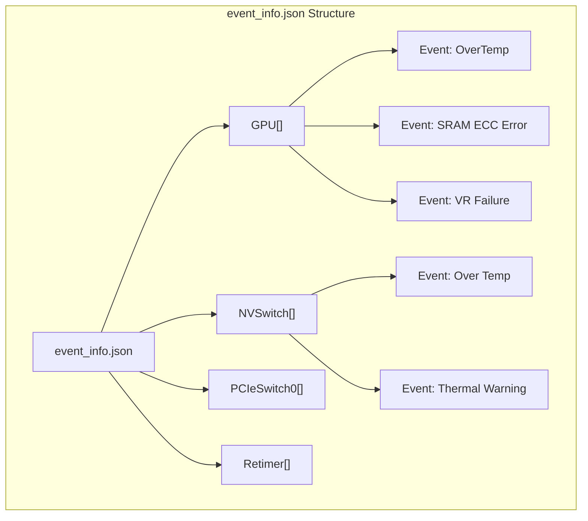
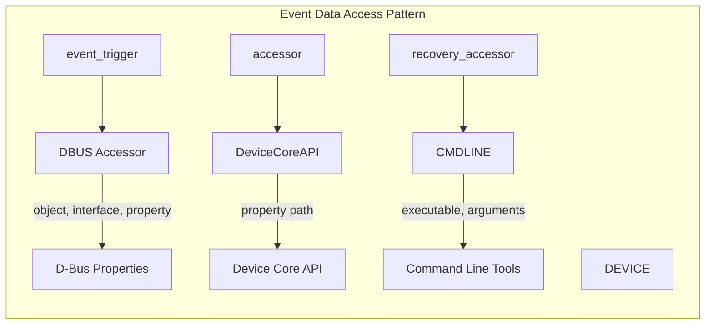
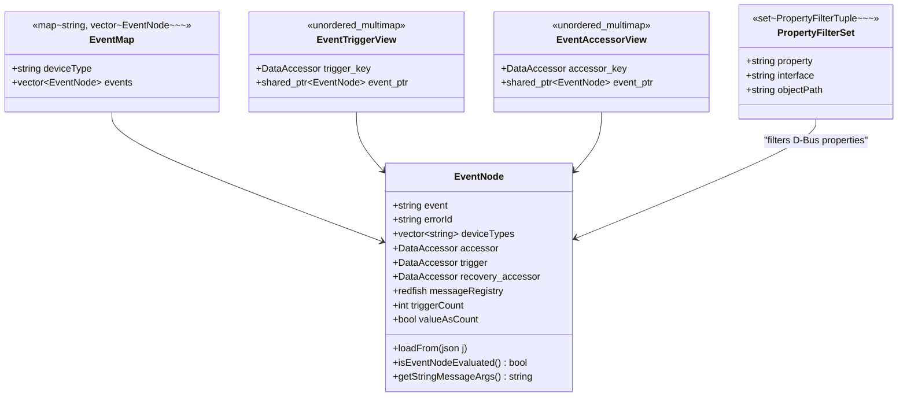
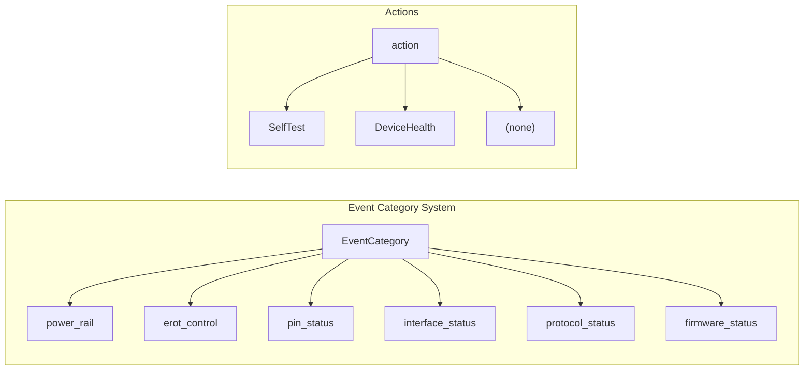
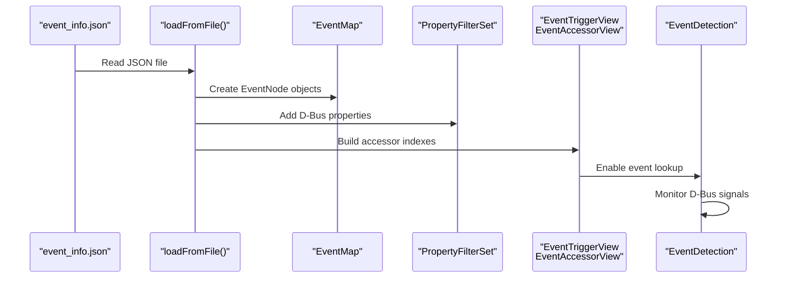
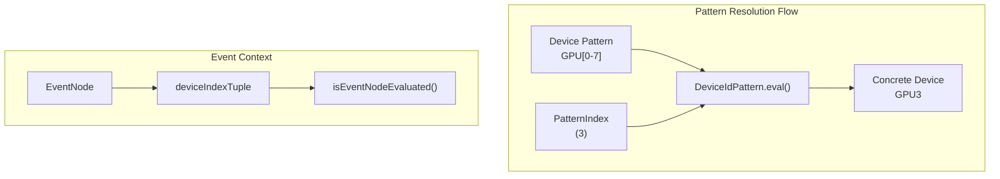

<!-- source: DeepWiki mcp.deepwiki.com · repo NVIDIA/nvidia-monitor-eventing · page 3.1 Event Definitions · fetched 2026-10-26 -->

# Event Definitions

<details>
<summary>Relevant source files</summary>

The following files were used as context for generating this wiki page:

- [examples/dat.json](examples/dat.json)
- [examples/event_info.json](examples/event_info.json)
- [include/event_info.hpp](include/event_info.hpp)
- [include/util.hpp](include/util.hpp)
- [src/event_info.cpp](src/event_info.cpp)
- [src/util.cpp](src/util.cpp)
- [test/dat_test.cpp](test/dat_test.cpp)
- [test/event_detection_test.cpp](test/event_detection_test.cpp)
- [test/util_test.cpp](test/util_test.cpp)
- [tools/mctp-error-detection](tools/mctp-error-detection)

</details>


This page explains how hardware monitoring events are defined and structured in the nvidia-monitor-eventing system. Event definitions specify what conditions constitute hardware events, how to detect them, what data to collect, and how to format alerts for external systems.

For information about how events are detected and processed at runtime, see [Event Detection System](#2.1). For details about the device association trees that define device hierarchies, see [Device Association Trees](#3.2).

## Overview

Events in the system are defined through JSON configuration files that specify monitoring conditions for various hardware devices. Each event definition includes trigger conditions, data accessors, severity levels, recovery actions, and Redfish message formatting. The primary event definitions are stored in `/usr/share/mon_evt/event_info.json` and loaded at runtime by the `EventNode` class.

## Event Definition Structure

Events are organized by device type in the JSON configuration, with each device type containing an array of event definitions. The system supports events for GPUs, NVSwitches, PCIe switches, retimers, and other hardware components.



Sources: [examples/event_info.json:1-458](), [include/event_info.hpp:334-663]()

## Event JSON Schema

Each event definition contains multiple components that define its behavior:

### Core Event Fields

| Field | Type | Description |
|-------|------|-------------|
| `event` | string | Human-readable event name |
| `error_id` | string | Unique error identifier (optional) |
| `device_type` | string/array | Device pattern (e.g., "GPU[0-7]") |
| `severity` | string | "Critical", "Warning", "OK" |
| `resolution` | string | Recommended resolution steps |
| `trigger_count` | integer | Number of occurrences before triggering |
| `value_as_count` | boolean | Use accessor value as trigger count |

### Access and Trigger Configuration

Events use three types of data accessors:



Sources: [examples/event_info.json:6-21](), [examples/event_info.json:286-293](), [src/event_info.cpp:553-576]()

### Accessor Types and Configuration

#### DBUS Accessor
```json
{
  "type": "DBUS",
  "object": "/xyz/openbmc_project/GpioStatusHandler",
  "interface": "xyz.openbmc_project.GpioStatus", 
  "property": "THERM_OVERT",
  "check": {
    "equal": "false"
  }
}
```

#### DeviceCoreAPI Accessor  
```json
{
  "type": "DeviceCoreAPI",
  "property": "gpu.thermal.temperature.overTemperatureInfo",
  "check": {
    "bitmap": "1"
  }
}
```

#### CMDLINE Accessor
```json
{
  "type": "CMDLINE", 
  "executable": "mctp-vdm-util-wrapper",
  "arguments": "AP0_BOOTCOMPLETE_TIMEOUT GPU[0-7]",
  "check": {
    "equal": "1"
  }
}
```

Sources: [examples/event_info.json:7-13](), [examples/event_info.json:16-21](), [examples/event_info.json:287-293]()

## Event Processing Classes

The C++ implementation uses several key classes to manage event definitions:



Sources: [include/event_info.hpp:330-663](), [include/event_info.hpp:665-685](), [src/event_info.cpp:144-196]()

## Redfish Message Formatting

Events include Redfish message formatting for standardized alerting:

### Message Structure

```mermaid
graph TB
    subgraph "Redfish Message Components"
        REDFISH["redfish"]
        MSG_ID["message_id"]
        MSG_ARGS["message_args"]
        
        PATTERNS["patterns[]"]
        PARAMS["parameters[]"]
        
        PAT1["{\"GPUId\"} Temperature"]
        PAT2["{\"UpperFatal Threshold\"}"]
        
        PARAM1["type: DIRECT<br/>field: CurrentDeviceName"]
        PARAM2["type: CONSTANT<br/>value: threshold_value"]
        
        REDFISH --> MSG_ID
        REDFISH --> MSG_ARGS
        
        MSG_ARGS --> PATTERNS
        MSG_ARGS --> PARAMS
        
        PATTERNS --> PAT1
        PATTERNS --> PAT2
        
        PARAMS --> PARAM1
        PARAMS --> PARAM2
    end
```

### Message Parameter Types

| Type | Description | Example |
|------|-------------|---------|
| `DIRECT` | Extract from event context | `CurrentDeviceName` → "GPU3" |
| `CONSTANT` | Static value | `value: "120°C"` |  
| `DBUS` | D-Bus property lookup | D-Bus call result |
| `DeviceCoreAPI` | Device API call | Device register value |

Sources: [examples/event_info.json:29-46](), [include/event_info.hpp:186-296](), [src/event_info.cpp:447-492]()

## Event Categories and Actions

Events can be categorized for different types of processing:

### Event Categories



### Common Event Actions

| Action | Description | Trigger |
|--------|-------------|---------|
| `SelfTest` | Run diagnostic selftest | Critical hardware events |
| `DeviceHealth` | Update device health status | Health state changes |
| `""` (empty) | Log only | Informational events |

Sources: [include/event_info.hpp:306-328](), [examples/event_info.json:55-56](), [src/event_info.cpp:523-525]()

## Event Loading and Processing Flow

The system loads and processes event definitions through a well-defined pipeline:



### Loading Functions

| Function | Purpose | File |
|----------|---------|------|
| `loadFromFile()` | Load from JSON file | [src/event_info.cpp:198-212]() |
| `loadFromJson()` | Parse JSON into structures | [src/event_info.cpp:144-196]() |
| `loadRawEventsFromFile()` | Standalone loading | [src/event_info.cpp:214-256]() |

Sources: [src/event_info.cpp:144-256](), [include/event_info.hpp:695-731]()

## Device Pattern Matching

Event definitions support flexible device pattern matching:

### Pattern Syntax Examples

| Pattern | Matches | Description |
|---------|---------|-------------|
| `GPU[0-7]` | GPU0, GPU1, ..., GPU7 | Single range |
| `NVSwitch[0-3]/NVLink[0-39]` | NVSwitch0/NVLink0, etc. | Hierarchical devices |
| `PCIeRetimer[0-7]` | PCIeRetimer0-7 | Component ranges |
| `GPU_SXM_[1-8]_DRAM_0` | GPU_SXM_1_DRAM_0, etc. | Complex patterns |

### Pattern Processing



Sources: [src/event_info.cpp:640-649](), [include/event_info.hpp:364-366](), [src/event_info.cpp:809-833]()

---

