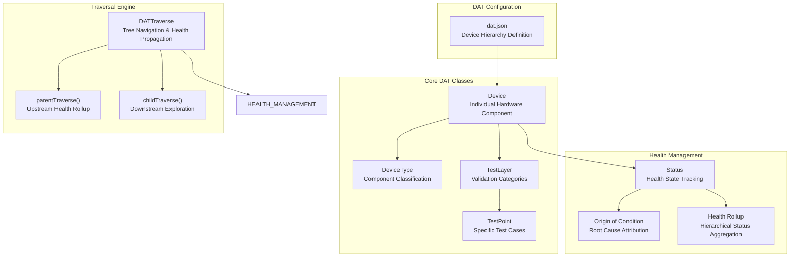
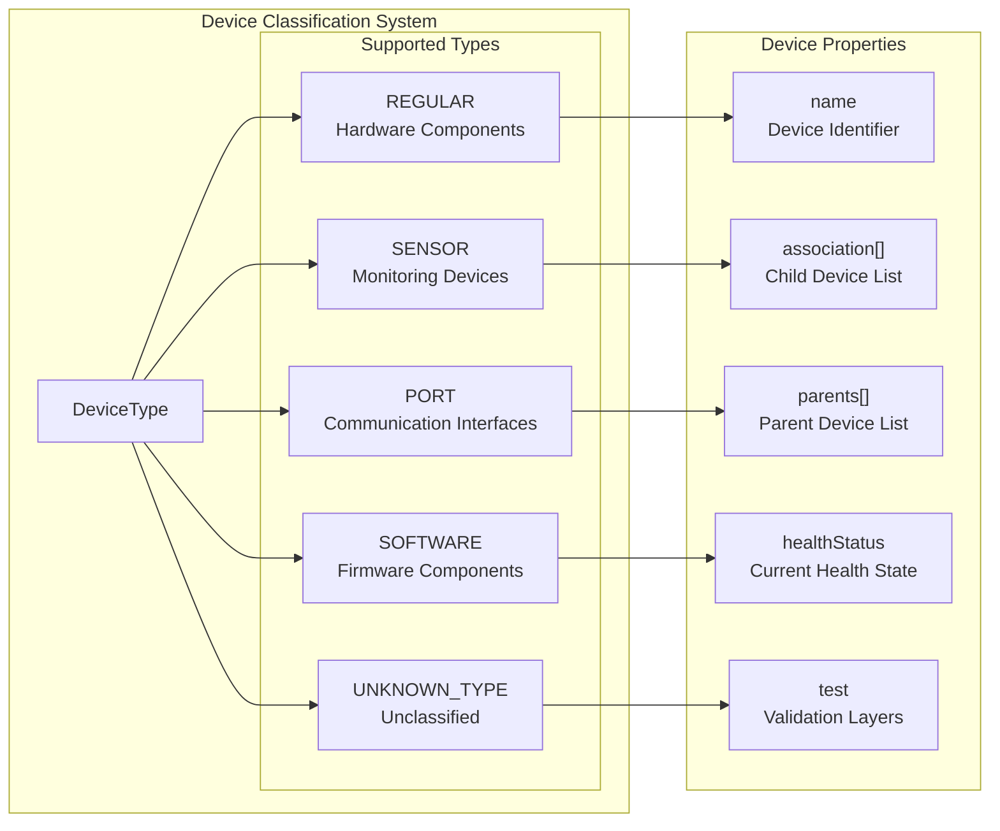
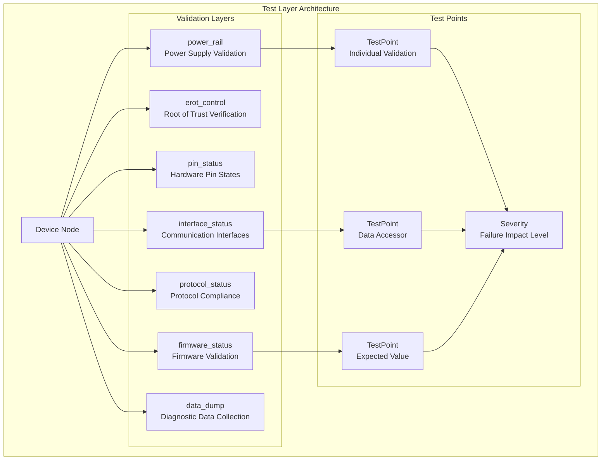
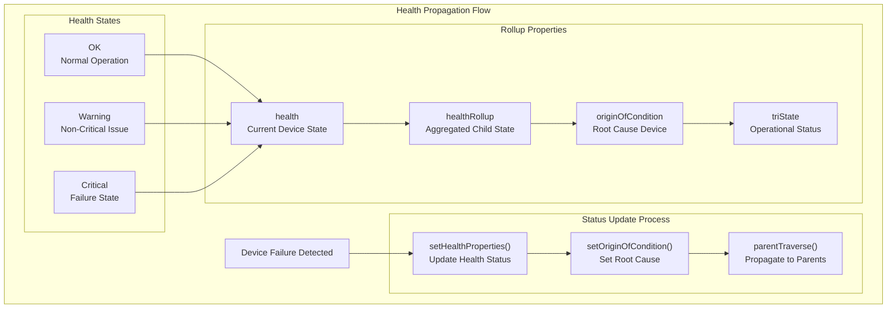
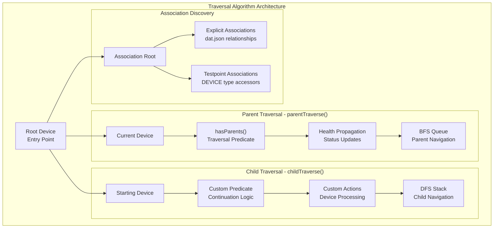
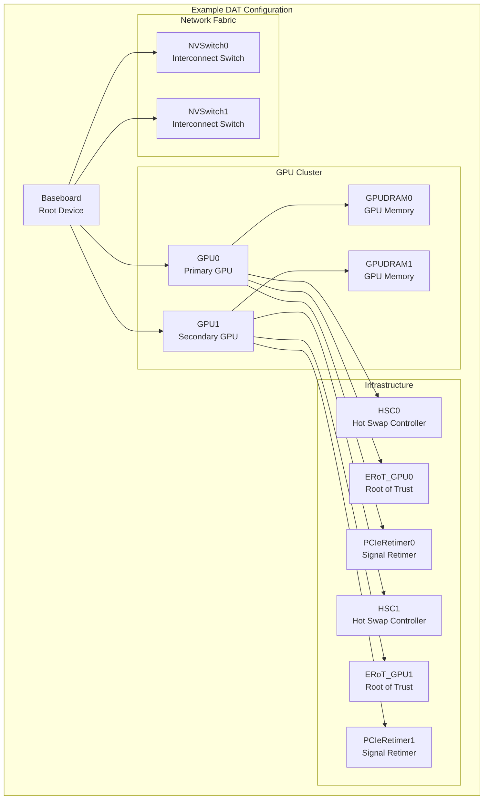
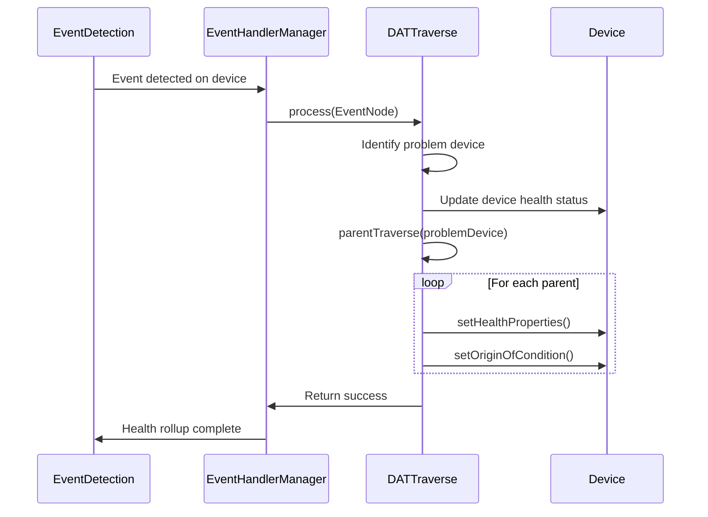
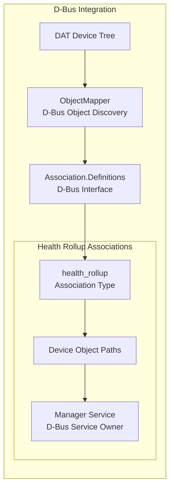

<!-- source: DeepWiki mcp.deepwiki.com · repo NVIDIA/nvidia-monitor-eventing · page 3.2 Device Association Trees · fetched 2026-10-26 -->

# Device Association Trees

<details>
<summary>Relevant source files</summary>

The following files were used as context for generating this wiki page:

- [examples/dat.json](examples/dat.json)
- [examples/event_info.json](examples/event_info.json)
- [include/dat_traverse.hpp](include/dat_traverse.hpp)
- [include/event_handler.hpp](include/event_handler.hpp)
- [src/dat_traverse.cpp](src/dat_traverse.cpp)
- [src/event_handler.cpp](src/event_handler.cpp)
- [test/dat_test.cpp](test/dat_test.cpp)
- [test/dat_traverse_test.cpp](test/dat_traverse_test.cpp)
- [tools/mctp-error-detection](tools/mctp-error-detection)

</details>


The Device Association Tree (DAT) system defines hierarchical relationships between hardware devices and manages health status propagation throughout the device hierarchy. The DAT enables systematic root cause analysis and health rollup for complex hardware platforms by modeling parent-child relationships between devices like GPUs, NVSwitches, Hot Swap Controllers (HSCs), and other components.

For information about event definitions and triggers, see [Event Definitions](#3.1). For details about the self-test system that uses DAT traversal, see [Self-Test System](#5.2).

## Architecture Overview

The DAT system consists of device nodes organized in a tree structure, where each device can have multiple children and parents. The system supports health status propagation from failing child devices up to their parents, enabling comprehensive system health monitoring.



**Sources:** [include/dat_traverse.hpp:100-225](), [src/dat_traverse.cpp:41-347]()

## Device Structure and Types

Each device in the DAT is represented by the `dat_traverse::Device` class, which encapsulates device metadata, relationships, and health information.

### Device Types

The system supports multiple device classifications:

| Device Type | Purpose | Examples |
|-------------|---------|----------|
| `REGULAR` | Standard hardware components | GPUs, NVSwitches, HSCs |
| `SENSOR` | Monitoring and measurement devices | Temperature sensors, Power monitors |
| `PORT` | Communication interfaces | NVLink ports, PCIe connections |
| `SOFTWARE` | Firmware and software components | Boot firmware, InfoROM |
| `UNKNOWN_TYPE` | Unclassified devices | Default fallback |



**Sources:** [include/dat_traverse.hpp:74-98](), [src/dat_traverse.cpp:42-82](), [include/dat_traverse.hpp:104-225]()

## Test Layers and Health Monitoring

The DAT system organizes device validation into structured test layers, each focusing on specific aspects of device functionality.

### Test Layer Categories



### Health Status Propagation

The system implements hierarchical health rollup where device failures propagate upward to parent devices:



**Sources:** [include/dat_traverse.hpp:41-68](), [src/dat_traverse.cpp:391-603](), [include/dat_traverse.hpp:487-514]()

## Traversal Algorithms

The DAT system provides multiple traversal methods for different use cases, implemented in the `event_handler::DATTraverse` class.

### Core Traversal Methods

| Method | Direction | Purpose | Key Use Case |
|--------|-----------|---------|--------------|
| `parentTraverse()` | Child → Parent | Health rollup propagation | Failure escalation |
| `childTraverse()` | Parent → Child | Downstream exploration | Impact assessment |
| `getSubAssociations()` | Parent → Child | Complete subtree discovery | Comprehensive analysis |
| `getTestLayerSubAssociations()` | Event-driven | Targeted device discovery | Root cause analysis |



**Sources:** [src/dat_traverse.cpp:508-603](), [include/dat_traverse.hpp:449-478](), [src/dat_traverse.cpp:449-498]()

## Configuration Format

The DAT hierarchy is defined in `dat.json`, which specifies device relationships and test configurations.

### Basic Device Structure

```json
{
  "DeviceName": {
    "type": "regular|sensor|port|software",
    "association": ["ChildDevice1", "ChildDevice2"],
    "dbus_objects": {
      "primary": "/xyz/openbmc_project/inventory/system/...",
      "ooc_context": "/xyz/openbmc_project/inventory/..."
    },
    "dbus_set_health": true|false,
    "power_rail": [...],
    "erot_control": [...],
    "pin_status": [...],
    "interface_status": [...],
    "protocol_status": [...],
    "firmware_status": [...]
  }
}
```

### Example Hierarchy



**Sources:** [examples/dat.json:1-100](), [src/dat_traverse.cpp:87-124](), [include/dat_traverse.hpp:156-159]()

## Integration with Event System

The DAT system integrates with the event detection framework to provide comprehensive failure analysis and health management.



### D-Bus Association Management

The DAT system also manages D-Bus associations for OpenBMC integration:



**Sources:** [src/dat_traverse.cpp:642-782](), [include/dat_traverse.hpp:252-271](), [include/dat_traverse.hpp:304-328]()

## Key Implementation Classes

| Class | File | Purpose |
|-------|------|---------|
| `dat_traverse::Device` | [include/dat_traverse.hpp:104-225]() | Core device representation with associations and health |
| `dat_traverse::DeviceType` | [include/dat_traverse.hpp:74-98]() | Device type enumeration and validation |
| `dat_traverse::TestLayer` | [include/dat_traverse.hpp:56-68]() | Test point organization by functional layer |
| `dat_traverse::TestPoint` | [include/dat_traverse.hpp:49-54]() | Individual test case with accessor and expectations |
| `event_handler::DATTraverse` | [include/dat_traverse.hpp:236-527]() | Main traversal engine and health management |

The DAT system provides a robust foundation for modeling complex hardware relationships and automating failure analysis through systematic tree traversal and health status propagation.

---

