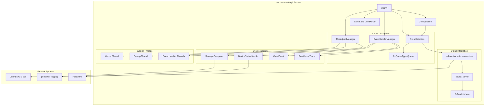
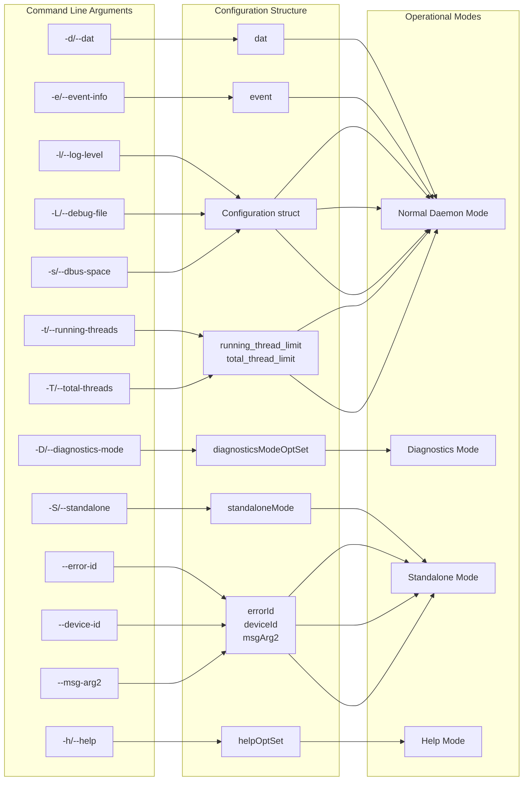
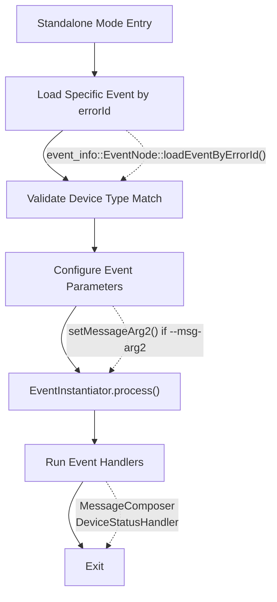
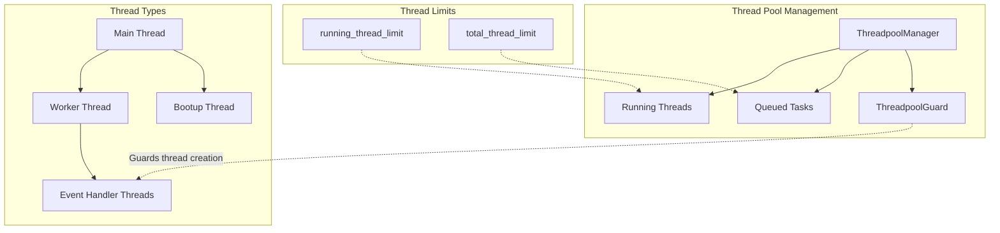

<!-- source: DeepWiki mcp.deepwiki.com · repo NVIDIA/nvidia-monitor-eventing · page 4 Main Service - monitor-eventingd · fetched 2026-10-26 -->

# Main Service - monitor-eventingd

<details>
<summary>Relevant source files</summary>

The following files were used as context for generating this wiki page:

- [include/device_status_handler.hpp](include/device_status_handler.hpp)
- [include/event_detection.hpp](include/event_detection.hpp)
- [include/meson.build](include/meson.build)
- [include/selftest.hpp](include/selftest.hpp)
- [meson.build](meson.build)
- [meson_options.txt](meson_options.txt)
- [src/event_detection.cpp](src/event_detection.cpp)
- [src/eventing_main.cpp](src/eventing_main.cpp)
- [src/meson.build](src/meson.build)
- [src/selftest.cpp](src/selftest.cpp)
- [test/selftest_test.cpp](test/selftest_test.cpp)
- [tools/selftest_tool.cpp](tools/selftest_tool.cpp)

</details>


The `monitor-eventingd` daemon is the primary executable service that orchestrates hardware event detection, processing, and logging for NVIDIA server platforms. It serves as the central runtime that coordinates the Event Detection System ([2.1](#2.1)), Data Access Layer ([2.2](#2.2)), and Event Processing Pipeline ([2.3](#2.3)) to provide comprehensive hardware monitoring within the OpenBMC ecosystem.

For information about the core event detection algorithms, see [Event Detection System](#2.1). For details about configuration files and event definitions, see [Configuration System](#3).

## Service Architecture

The daemon operates as a multi-threaded service that integrates several key components through a centralized event handling framework:



Sources: [src/eventing_main.cpp:373-733](), [src/meson.build:70-76](), [include/event_detection.hpp:109-770]()

## Command Line Interface and Configuration

The daemon supports extensive command-line configuration through a structured argument system:



Sources: [src/eventing_main.cpp:218-283](), [src/eventing_main.cpp:92-107](), [src/eventing_main.cpp:285-296]()

### Required Configuration Files

| Parameter | Description | Usage |
|-----------|-------------|-------|
| `-d/--dat` | Device Association Tree JSON file | Defines device hierarchies and relationships |
| `-e/--event-info` | Event definitions JSON file | Contains event patterns, triggers, and messages |

### Optional Runtime Parameters

| Parameter | Default | Description |
|-----------|---------|-------------|
| `-t/--running-threads` | 3 | Maximum concurrent event handler threads |
| `-T/--total-threads` | 4 | Maximum queued + running threads |
| `-s/--dbus-space` | 0 | Minimum milliseconds between D-Bus calls |
| `-l/--log-level` | 0 | Debug verbosity level (0-4) |

Sources: [src/eventing_main.cpp:65-75](), [src/eventing_main.cpp:196-216]()

## Operational Modes

### Normal Daemon Mode

The default operational mode where the daemon runs as a persistent service:

1. **Initialization Phase**:
   - Loads configuration files ([eventing_main.cpp:541-552]())
   - Creates thread pool ([eventing_main.cpp:562-572]())
   - Initializes event detection queue ([eventing_main.cpp:574-579]())
   
2. **Service Registration**:
   - Establishes D-Bus connection ([eventing_main.cpp:686-687]())
   - Requests service name `mon_evt::SERVICE_BUSNAME` ([eventing_main.cpp:689]())
   - Registers D-Bus interface ([eventing_main.cpp:691-692]())

3. **Runtime Operation**:
   - Spawns worker thread for event processing ([eventing_main.cpp:684]())
   - Performs bootup self-test if first boot ([eventing_main.cpp:614-649]())
   - Enters main event loop ([eventing_main.cpp:724]())

### Standalone Mode

Activated with `-S/--standalone`, processes a single event without daemon services:



Sources: [src/eventing_main.cpp:430-534](), [src/eventing_main.cpp:483-525]()

### Diagnostics Mode

Activated with `-D/--diagnostics-mode`, performs validation tests and outputs JSON results:

- Validates configuration file integrity
- Tests event pattern matching
- Reports system capabilities
- Outputs structured diagnostics to stdout

Sources: [src/eventing_main.cpp:414-427]()

## Thread Management Architecture

The daemon implements sophisticated thread management through the `ThreadpoolManager`:



The thread limits prevent resource exhaustion:
- `running_thread_limit`: Maximum concurrent threads
- `total_thread_limit`: Maximum threads including queued

When limits are exceeded, new events are dropped with error messages.

Sources: [src/eventing_main.cpp:562-572](), [src/event_detection.cpp:631-656](), [include/event_detection.hpp:630-711]()

## OpenBMC Integration

### D-Bus Service Registration

The daemon integrates with OpenBMC through D-Bus service registration:

| Component | Value | Purpose |
|-----------|-------|---------|
| Service Name | `mon_evt::SERVICE_BUSNAME` | D-Bus service identifier |
| Object Path | `mon_evt::TOP_OBJPATH` | Primary object endpoint |
| Interface | `mon_evt::SERVICE_IFCNAME` | Service interface definition |

### Event Handler Integration

The daemon coordinates with OpenBMC services through registered event handlers:

1. **MessageComposer**: Integrates with `phosphor-logging`
2. **DeviceStatusHandler**: Updates device health status  
3. **ClearEvent**: Manages event lifecycle
4. **RootCauseTracer**: Performs diagnostic analysis

Sources: [src/eventing_main.cpp:689-696](), [src/eventing_main.cpp:557-669]()

## Build System Configuration

### Executable Definition

The `monitor-eventingd` executable is built through the Meson build system:

```meson
monitor_eventingd = executable(
    'monitor-eventingd',
    monitor_eventingd_sources,
    include_directories: inc,
    dependencies: deps,
    install: true,
)
```

### Dependencies

| Dependency | Purpose |
|------------|---------|
| `eventinglib` | Core event processing library |
| `selftestlib` | Hardware self-test capabilities |
| `sdbusplus_dep` | D-Bus communication |
| `phosphor_logging_dep` | OpenBMC logging integration |
| `pthread` | Thread management |

### Feature Flags

The build system supports multiple conditional compilation flags:

| Flag | Description |
|------|-------------|
| `EVENTING_FEATURE_ONLY` | Disables self-test and health rollup |
| `EVENTING_SERVICE_NO_DEVICE_HEALTH` | Delegates health to separate service |
| `EVENTING_SERVICE_DEVICE_STATUS_FS` | Enables filesystem status updates |
| `EVENTING_SERVICE_DEVICE_STATUS_NVIDIA_SHMEM` | Enables shared memory IPC |

Sources: [src/meson.build:70-76](), [meson.build:52-72](), [meson_options.txt:34-46]()

## Runtime Behavior

### Startup Sequence

1. **Command Line Processing**: Parse arguments and validate required files
2. **Configuration Loading**: Load DAT and event definition files
3. **Thread Pool Creation**: Initialize worker thread management
4. **D-Bus Connection**: Establish system bus connection and claim service name
5. **Event Handler Registration**: Register all event processing handlers
6. **Worker Thread Spawn**: Start background event processing thread
7. **Bootup Operations**: Perform initial self-test if first boot
8. **Main Event Loop**: Enter asynchronous I/O event loop

### Signal Handling and Event Processing

The daemon subscribes to D-Bus `PropertiesChanged` signals and processes them through:

1. **Signal Reception**: `dbusEventHandlerCallback` receives D-Bus signals
2. **Event Discovery**: `eventDiscovery` matches signals to event patterns  
3. **Queue Management**: Events are queued via `pushToQueue`/`popFromQueue`
4. **Event Detection**: `EventsDetection` validates event conditions
5. **Handler Execution**: `EventHandlerManager` coordinates response handlers

Sources: [src/eventing_main.cpp:373-733](), [src/event_detection.cpp:85-156](), [src/event_detection.cpp:266-341]()

---

