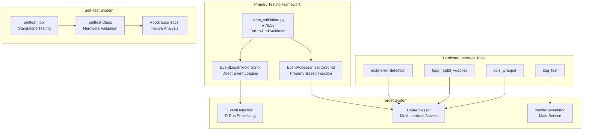
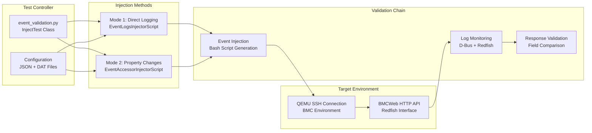
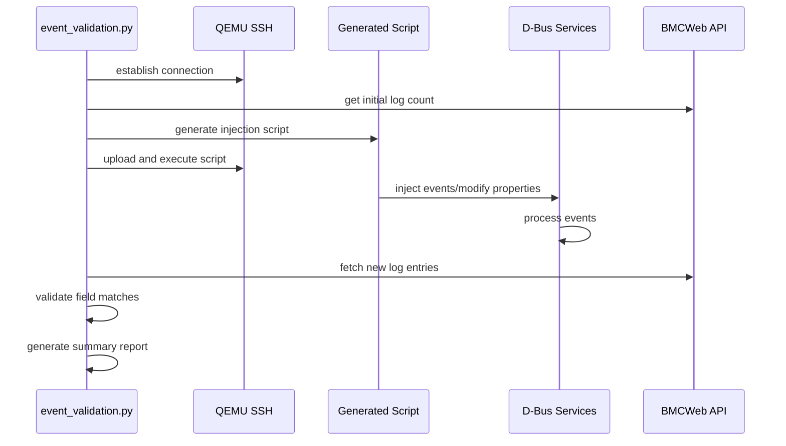
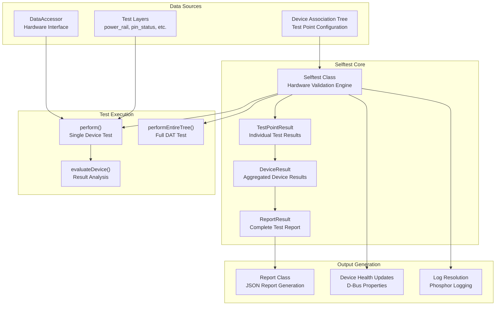
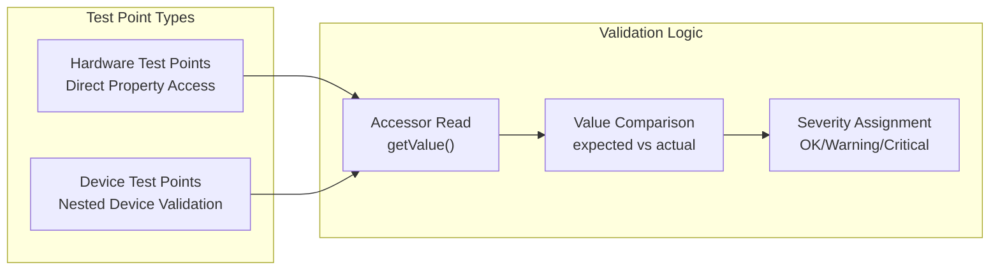
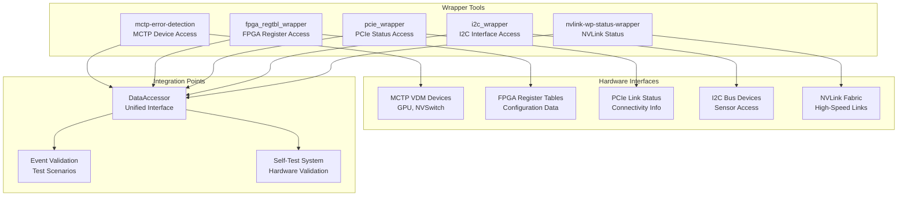
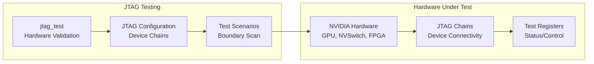
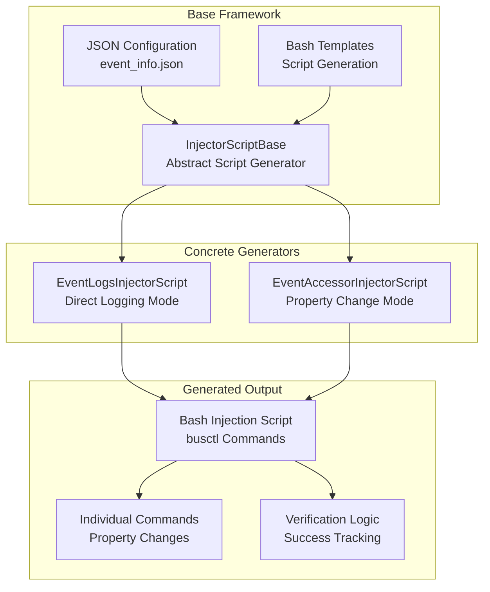
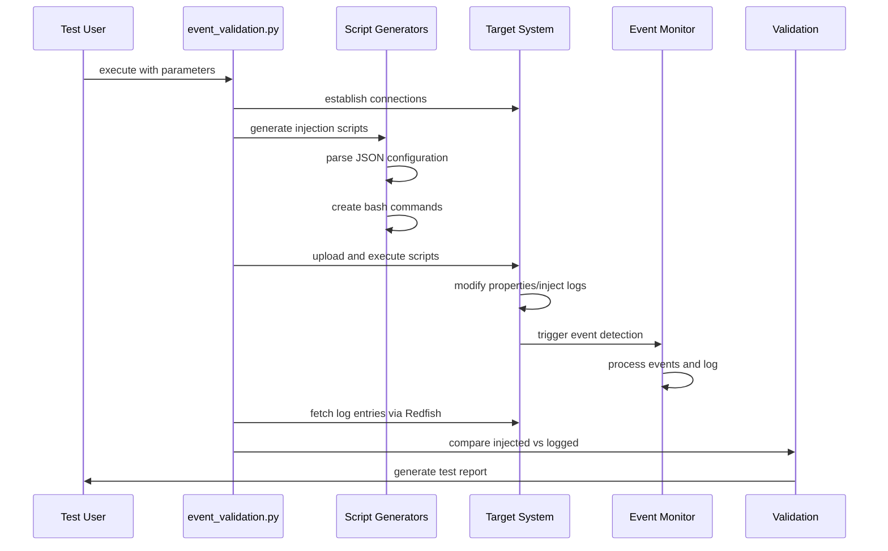

<!-- source: DeepWiki mcp.deepwiki.com · repo NVIDIA/nvidia-monitor-eventing · page 5 Testing and Validation · fetched 2026-10-26 -->

# Testing and Validation

Relevant source files

The following files were used as context for generating this wiki page:

- [include/selftest.hpp](include/selftest.hpp)
- [src/selftest.cpp](src/selftest.cpp)
- [test/selftest_test.cpp](test/selftest_test.cpp)
- [tools/event_validation.py](tools/event_validation.py)
- [tools/jtag/meson.build](tools/jtag/meson.build)
- [tools/meson.build](tools/meson.build)
- [tools/modules/com.py](tools/modules/com.py)
- [tools/modules/event_accessor_script.py](tools/modules/event_accessor_script.py)
- [tools/modules/event_logging_script.py](tools/modules/event_logging_script.py)
- [tools/modules/injector_script_base.py](tools/modules/injector_script_base.py)
- [tools/modules/templates/event_accessor_script.bash](tools/modules/templates/event_accessor_script.bash)
- [tools/selftest_tool.cpp](tools/selftest_tool.cpp)

This document covers the comprehensive testing and validation ecosystem for the nvidia-monitor-eventing system. The testing framework ensures hardware monitoring events are properly detected, processed, and logged through multiple validation layers including end-to-end event injection, hardware self-tests, and interface validation tools.

For information about the core event detection system being tested, see [Event Detection System](#2.1). For configuration of events being validated, see [Event Definitions](#3.1).

## Overview

The testing ecosystem provides multiple validation approaches:

- **End-to-end Event Validation**: Complete event injection and verification workflow
- **Hardware Self-Testing**: Component-level validation and root cause analysis  
- **Interface Validation**: Hardware interface wrapper tools and JTAG testing
- **Configuration Validation**: Event definition and device association testing

The system supports both automated testing scenarios and manual diagnostic workflows, with comprehensive reporting and markdown documentation generation capabilities.

Sources: [tools/event_validation.py:1-866](), [src/selftest.cpp:1-673](), [tools/selftest_tool.cpp:1-279]()

## Event Validation Framework

The primary validation tool is `event_validation.py`, which provides comprehensive end-to-end testing of the event monitoring system. This framework injects events through multiple pathways and validates proper logging through the OpenBMC Redfish interface.

### Core Validation Architecture

The framework operates in two primary modes controlled by the `--mode` parameter:

**Mode 1 (Direct Event Logging)**: Uses `EventLogsInjectorScript` to generate `busctl` commands that directly insert log entries into the phosphor-logging D-Bus service.

**Mode 2 (Property-Based Injection)**: Uses `EventAccessorInjectorScript` to modify D-Bus properties and trigger the monitor-eventing daemon's normal event detection flow.

Sources: [tools/event_validation.py:71-73](), [tools/event_validation.py:318-866]()

### Test Execution Flow

The `InjectTest` class coordinates the complete validation workflow:

1. **Environment Setup**: Establishes SSH connection to QEMU environment and HTTP connection to BMCWeb
2. **Baseline Capture**: Records initial log count before injection
3. **Script Generation**: Creates bash injection scripts from JSON configuration
4. **Event Injection**: Executes generated scripts on target system
5. **Validation**: Compares injected events against Redfish log entries
6. **Reporting**: Generates summary with injection success/failure metrics

Key validation methods include field comparison for mandatory keys (`Severity`, `Resolution`, `MessageId`) and optional keys (`MessageArgs`), with special handling for D-Bus to Redfish severity mapping.

Sources: [tools/event_validation.py:346-815](), [tools/event_validation.py:817-866]()

## Self-Test System

The self-test system provides hardware component validation and root cause analysis capabilities through the `Selftest` class and associated tooling.

### Selftest Architecture

The self-test system validates hardware components across multiple test layers including `power_rail`, `erot_control`, `pin_status`, `interface_status`, `firmware_status`, `protocol_status`, and `data_dump`.

Sources: [src/selftest.cpp:160-378](), [include/selftest.hpp:36-326]()

### Test Point Validation

Individual test points are validated through the `TestPointResult` structure, which captures:

- **Target Name**: Test point identifier (e.g., "PGOOD", "DEVICE_HSC0")
- **Expected Value**: DAT-configured expected result
- **Read Value**: Actual value from hardware accessor
- **Result**: Boolean comparison of expected vs actual
- **Severity**: Failure severity level for reporting

The system supports nested device testing where test points can reference other devices in the DAT, enabling hierarchical validation and dependency analysis.

Sources: [src/selftest.cpp:230-344](), [include/selftest.hpp:39-88]()

### Root Cause Analysis

The `RootCauseTracer` class extends self-testing capabilities by performing failure analysis when events are detected:

1. **Problem Device Identification**: Extracts device name from incoming event
2. **Associated Device Testing**: Performs self-test on device and its DAT associations  
3. **Root Cause Detection**: Identifies the most nested device that failed testing
4. **Health Status Update**: Updates device health and origin of condition properties
5. **Report Generation**: Creates detailed self-test report attached to the event

This enables the system to not only detect failures but also trace them to their underlying hardware cause.

Sources: [src/selftest.cpp:607-672](), [include/selftest.hpp:407-471]()

## Hardware Interface Tools

The system includes specialized wrapper tools for accessing different hardware interfaces, enabling comprehensive hardware validation and event injection.

### Interface Wrapper Architecture  

These wrappers standardize access to various hardware interfaces and enable consistent testing across different device types.

Sources: [tools/meson.build:33-46]()

### JTAG Testing

The `jtag_test` tool provides low-level hardware validation through JTAG interface access:

This provides the lowest-level hardware validation capability, enabling detection of fundamental hardware connectivity and functionality issues.

Sources: [tools/jtag/meson.build:1-11]()

## Event Injection Scripts

The system uses two specialized script generators to create bash injection scripts for different testing scenarios.

### Script Generation Architecture

### EventLogsInjectorScript

Generates scripts that directly insert log entries into the phosphor-logging system using `busctl call` commands to the `xyz.openbmc_project.Logging.Create` interface.

Key features:
- **Direct Log Creation**: Bypasses normal event detection flow
- **Field Validation**: Tests specific log entry fields and severity levels  
- **Success Tracking**: Counts successful vs failed injections
- **Dry Run Support**: Command preview without execution

The generated scripts include error handling, progress reporting, and temporary file management for reliable test execution.

Sources: [tools/modules/event_logging_script.py:1-156]()

### EventAccessorInjectorScript  

Generates scripts that modify D-Bus properties to trigger normal event detection, providing more realistic testing of the complete monitoring pipeline.

Key capabilities:
- **Property Modification**: Changes D-Bus properties using various methods (equal, not_equal, bitmask, lookup)
- **Multi-Interface Support**: Handles DBUS, DeviceCoreAPI, and CMDLINE accessor types
- **Range Expansion**: Supports device ranges like `GPU[0-7]` for bulk testing
- **State Management**: Includes failure state setup and cleanup logic

The script template provides sophisticated property manipulation logic with support for boolean, numeric, and string property types.

Sources: [tools/modules/event_accessor_script.py:1-429](), [tools/modules/templates/event_accessor_script.bash:1-1300]()

## Integration Testing Flow

The complete testing workflow integrates all validation components into a comprehensive testing pipeline.

### End-to-End Testing Process

### Configuration-Driven Testing

The system supports flexible testing scenarios through command-line parameters:

- **Device Filtering**: `--device GPU` tests only GPU-related events
- **Event Filtering**: `--event "PCIe Error"` tests specific event types
- **Index Filtering**: `--device-index 0,1` tests specific device instances
- **Property Filtering**: `--property I2C3_ALERT` tests events using specific D-Bus properties
- **Execution Modes**: `--dry-run`, `--unique-event`, `--markdown` for different testing needs

This enables both comprehensive validation and targeted debugging scenarios.

Sources: [tools/event_validation.py:84-225](), [tools/modules/templates/event_accessor_script.bash:89-132]()

### Reporting and Documentation

The validation framework provides multiple output formats:

- **Console Output**: Real-time progress and debug information
- **Summary Reports**: Success/failure counts and error details
- **Markdown Generation**: Formatted documentation for test procedures
- **JSON Reports**: Structured self-test results with detailed metrics
- **Log Integration**: Redfish log entry analysis and additional data extraction

This comprehensive reporting enables both automated CI/CD integration and manual diagnostic workflows.

Sources: [tools/event_validation.py:792-815](), [src/selftest.cpp:384-531]()

---

