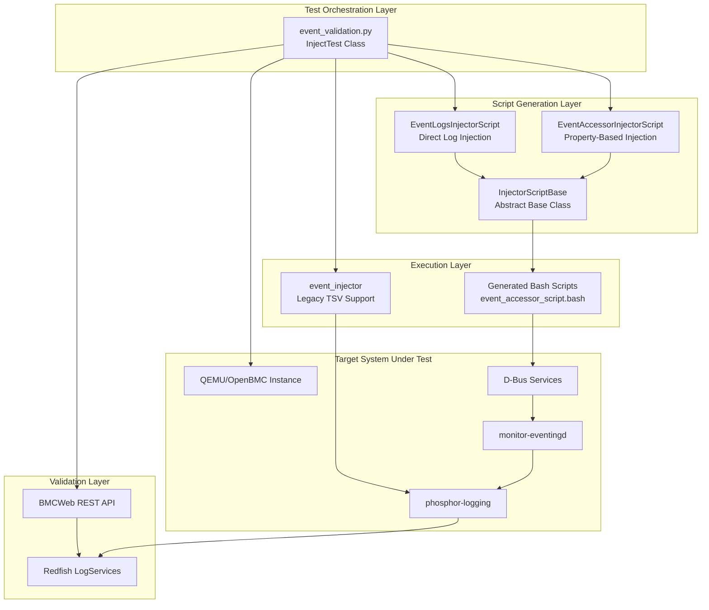
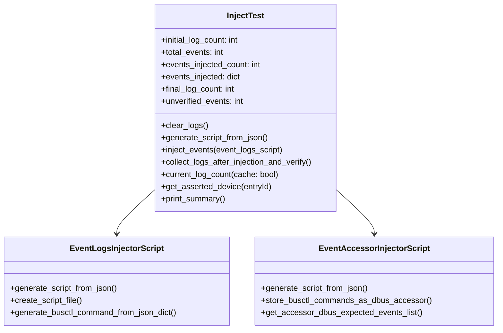
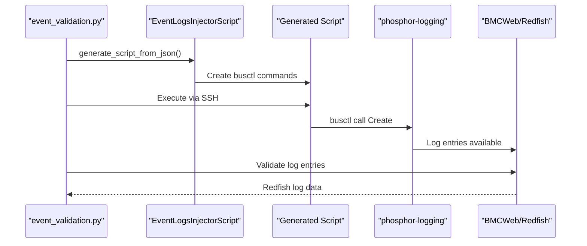
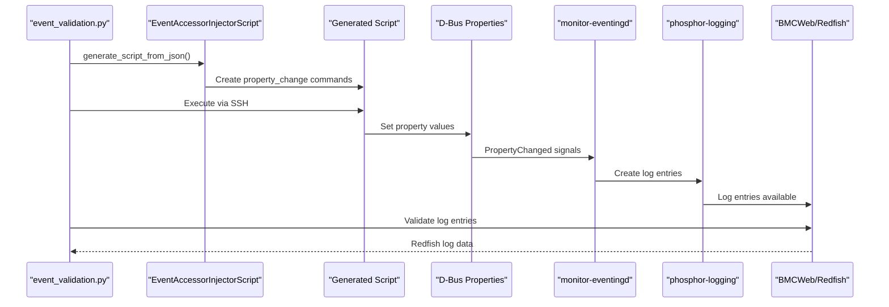
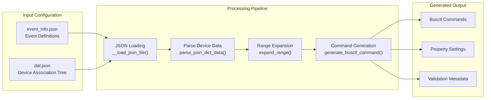
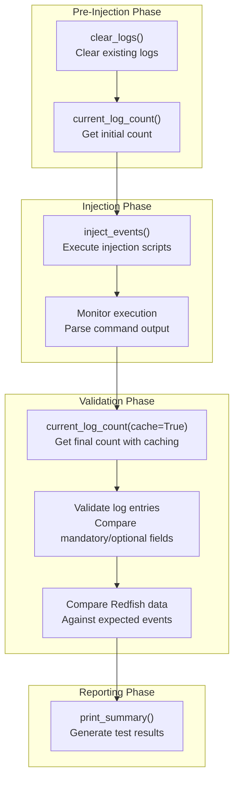
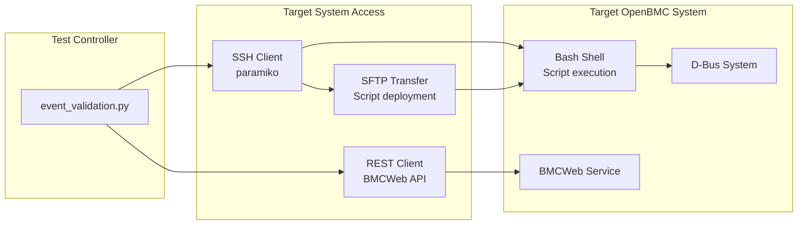

<!-- source: DeepWiki mcp.deepwiki.com · repo NVIDIA/nvidia-monitor-eventing · page 5.1 Event Validation Framework · fetched 2026-10-26 -->

# Event Validation Framework

Relevant source files

The following files were used as context for generating this wiki page:

- [examples/dat.json](examples/dat.json)
- [examples/event_info.json](examples/event_info.json)
- [test/dat_test.cpp](test/dat_test.cpp)
- [tools/dev_evts.tsv](tools/dev_evts.tsv)
- [tools/event_injector](tools/event_injector)
- [tools/event_validation.py](tools/event_validation.py)
- [tools/mctp-error-detection](tools/mctp-error-detection)
- [tools/modules/com.py](tools/modules/com.py)
- [tools/modules/event_accessor_script.py](tools/modules/event_accessor_script.py)
- [tools/modules/event_logging_script.py](tools/modules/event_logging_script.py)
- [tools/modules/injector_script_base.py](tools/modules/injector_script_base.py)
- [tools/modules/templates/event_accessor_script.bash](tools/modules/templates/event_accessor_script.bash)

## Purpose and Scope

The Event Validation Framework provides comprehensive end-to-end testing capabilities for the hardware monitoring and event detection system. It enables automated injection of hardware events, validates proper event propagation through the system, and verifies correct log generation in phosphor-logging and Redfish interfaces.

This framework validates that events defined in configuration files are properly detected, processed, and logged by the monitor-eventingd daemon. For information about the core event detection system, see [Event Detection System](#2.1). For details about event configuration, see [Event Definitions](#3.1).

## Architecture Overview

The Event Validation Framework operates as a multi-layered testing system that orchestrates event injection, monitors system responses, and validates outcomes against expected results.

**Sources:** [tools/event_validation.py:1-866](), [tools/modules/event_accessor_script.py:1-429](), [tools/modules/event_logging_script.py:1-156](), [tools/modules/injector_script_base.py:1-233]()

## Core Components

### InjectTest Class

The `InjectTest` class serves as the primary test orchestration engine, managing the complete validation workflow from event injection to result verification.

**Sources:** [tools/event_validation.py:318-814](), [tools/modules/event_logging_script.py:17-156](), [tools/modules/event_accessor_script.py:21-429]()

### Script Generation Subsystem

The framework generates bash scripts dynamically based on JSON event configurations, supporting two distinct injection methodologies:

| Component | Purpose | Output |
|-----------|---------|---------|
| `EventLogsInjectorScript` | Direct phosphor-logging injection | busctl commands targeting logging service |
| `EventAccessorInjectorScript` | Property-based event simulation | D-Bus property changes triggering monitor-eventingd |
| `InjectorScriptBase` | Common script generation infrastructure | Template processing and file management |

**Sources:** [tools/modules/event_logging_script.py:17-31](), [tools/modules/event_accessor_script.py:21-42](), [tools/modules/injector_script_base.py:22-76]()

## Test Modes and Operational Workflows

The framework supports two primary testing modes, each validating different aspects of the event processing pipeline:

### Mode 1: Direct Event Logging Injection

This mode directly injects log entries into phosphor-logging using `busctl call xyz.openbmc_project.Logging.Create` commands, bypassing the monitor-eventingd daemon.

**Sources:** [tools/event_validation.py:71-73](), [tools/modules/event_logging_script.py:88-111]()

### Mode 2: Property-Based Event Simulation

This mode simulates actual hardware conditions by modifying D-Bus properties, testing the complete event detection and processing pipeline through monitor-eventingd.

**Sources:** [tools/event_validation.py:72](), [tools/modules/event_accessor_script.py:254-298]()

## Configuration and Input Processing

### Event Configuration Processing

The framework processes JSON event definitions to generate appropriate injection commands:

**Sources:** [tools/modules/injector_script_base.py:46-59](), [tools/modules/injector_script_base.py:142-158](), [tools/modules/com.py:228-296]()

### Device Range Expansion

The framework supports complex device naming patterns with range specifications:

| Pattern | Expansion | Usage |
|---------|-----------|-------|
| `GPU[0-7]` | `GPU0, GPU1, ..., GPU7` | Basic numeric ranges |
| `NVSwitch[0-3]/Ports/NVLink[0-39]` | 160 combinations | Nested range expansion |
| `PCIeRetimer[0,2,4-6]` | `PCIeRetimer0, PCIeRetimer2, PCIeRetimer4, PCIeRetimer5, PCIeRetimer6` | Mixed discrete and range values |

**Sources:** [tools/modules/com.py:228-296](), [tools/modules/event_accessor_script.py:96-115]()

## Validation Process and Verification

### Log Entry Validation Workflow

**Sources:** [tools/event_validation.py:725-789](), [tools/event_validation.py:409-444](), [tools/event_validation.py:792-814]()

### Field Validation Methodology

The framework validates both mandatory and optional fields in generated log entries:

| Validation Type | Fields Validated | Comparison Logic |
|----------------|------------------|------------------|
| Mandatory | `Severity`, `Resolution`, `MessageId` | Must match exactly |
| Optional | `MessageArgs` | List comparison with comma parsing |
| Severity | OpenBMC severity levels | Maps to Redfish severity categories |

**Sources:** [tools/modules/com.py:337-400](), [tools/modules/com.py:117-128]()

## Integration Points and System Interfaces

### Remote System Access

The framework connects to target systems via SSH and REST APIs:

**Sources:** [tools/event_validation.py:467-482](), [tools/event_validation.py:484-503](), [tools/event_validation.py:409-444]()

### Command Line Interface

The framework provides extensive command-line options for flexible testing scenarios:

| Option | Purpose | Impact |
|--------|---------|--------|
| `--mode 1/2` | Select injection mode | Direct logging vs. property simulation |
| `--device <name>` | Filter by device type | Test specific device classes |
| `--event <name>` | Filter by event name | Test individual event types |
| `--device-index <idx>` | Target specific device instances | Precise device targeting |
| `--unique-event` | Test only first occurrence | Skip range expansions |
| `--dry-run` | Simulation mode | Generate without execution |

**Sources:** [tools/event_validation.py:84-225](), [tools/event_validation.py:249-315]()

---

