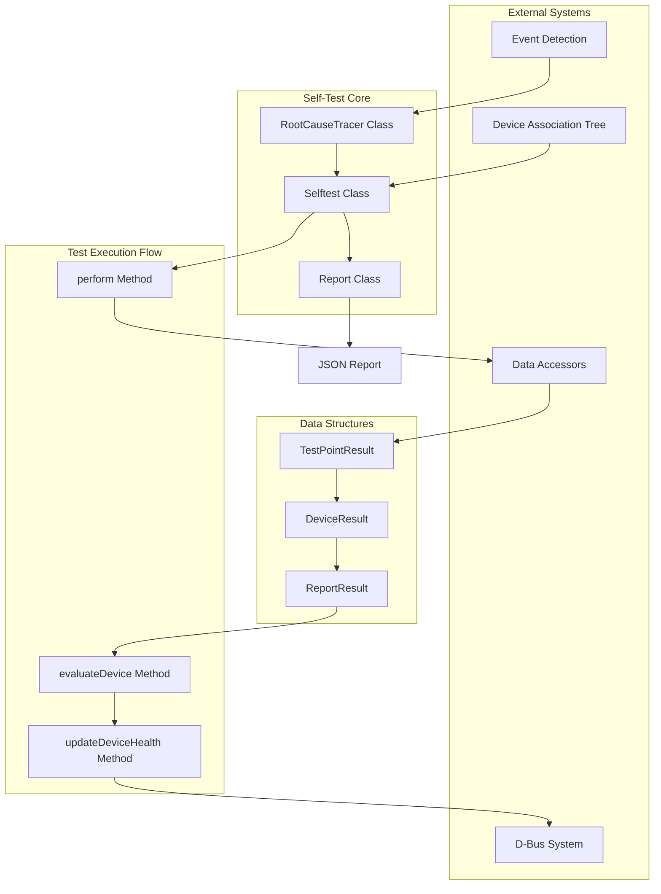
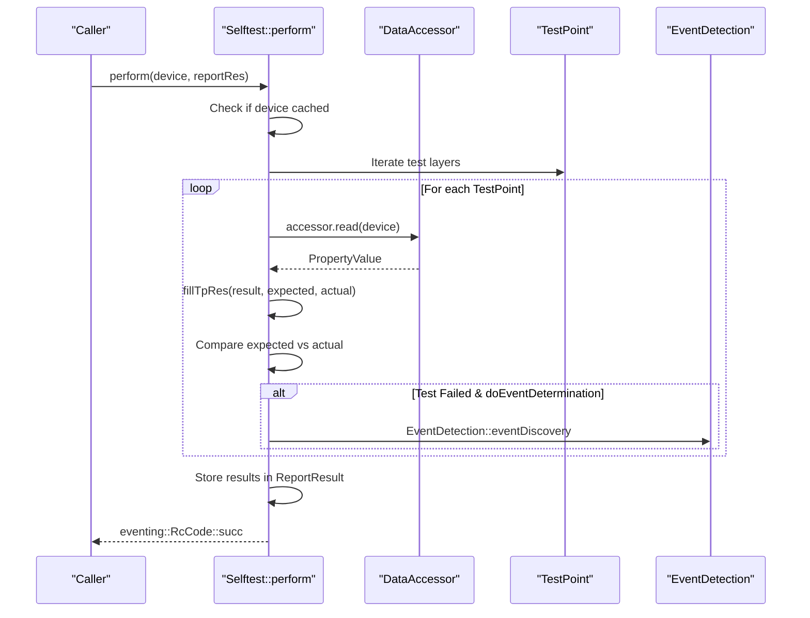
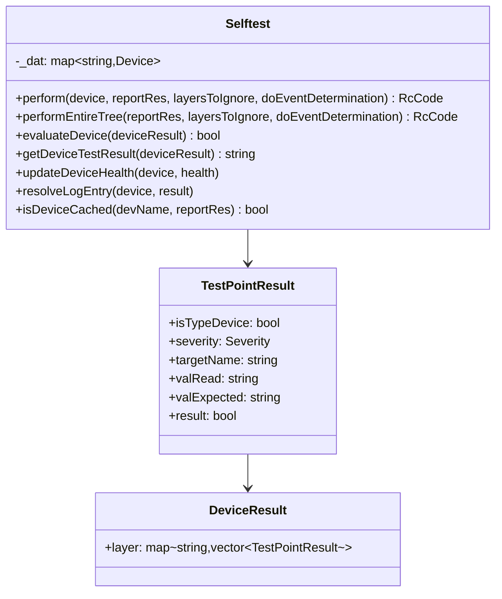
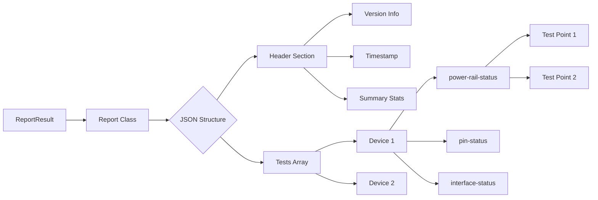
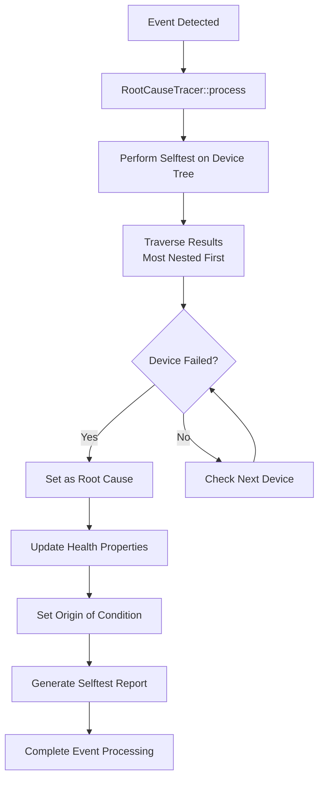
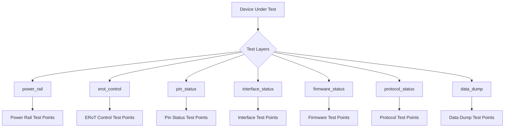
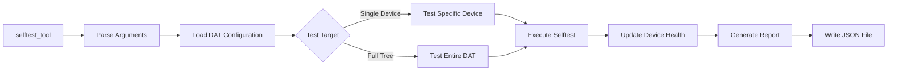
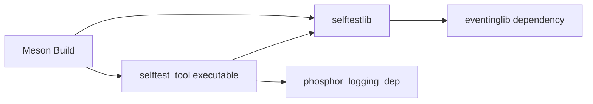

<!-- source: DeepWiki mcp.deepwiki.com · repo NVIDIA/nvidia-monitor-eventing · page 5.2 Self-Test System · fetched 2026-10-26 -->

# Self-Test System

<details>
<summary>Relevant source files</summary>

The following files were used as context for generating this wiki page:

- [include/dat_traverse.hpp](include/dat_traverse.hpp)
- [include/event_handler.hpp](include/event_handler.hpp)
- [include/selftest.hpp](include/selftest.hpp)
- [src/dat_traverse.cpp](src/dat_traverse.cpp)
- [src/selftest.cpp](src/selftest.cpp)
- [test/dat_traverse_test.cpp](test/dat_traverse_test.cpp)
- [test/selftest_test.cpp](test/selftest_test.cpp)
- [tools/jtag/meson.build](tools/jtag/meson.build)
- [tools/meson.build](tools/meson.build)
- [tools/selftest_tool.cpp](tools/selftest_tool.cpp)

</details>


## Purpose and Scope

The Self-Test System provides hardware validation capabilities, root cause analysis, and diagnostic reporting for NVIDIA server platforms. It performs automated tests on devices defined in the Device Association Tree (DAT), generates detailed JSON reports, and integrates with the event detection pipeline to identify failing components.

For information about event detection and processing, see [Event Detection System](#2.1). For details about device association trees and health relationships, see [Device Association Trees](#3.2). For validation frameworks and testing tools, see [Event Validation Framework](#5.1).

## System Architecture

The self-test system consists of three main components working together to provide comprehensive hardware validation:

### Core Self-Test Architecture



Sources: [src/selftest.cpp:40-385](), [include/selftest.hpp:33-327]()

### Test Point Execution Pipeline



Sources: [src/selftest.cpp:230-344]()

## Core Classes and Data Structures

### Selftest Class

The `Selftest` class is the primary interface for hardware validation, inheriting from `EventHandler` to integrate with the event processing pipeline.

**Key Methods:**
- `perform()` - Executes self-tests on a specific device
- `performEntireTree()` - Tests all devices in the DAT
- `evaluateDevice()` - Determines pass/fail status for device results
- `getDeviceTestResult()` - Calculates severity based on failed test points



Sources: [include/selftest.hpp:183-327](), [src/selftest.cpp:230-344]()

### Report Generation System

The `Report` class generates structured JSON reports from self-test results, including summary statistics and detailed test point information.

**Report Structure:**
- Header with firmware version and timestamps
- Summary with pass/fail counts  
- Detailed test results organized by device and layer
- Support for multiple test layers (power_rail, pin_status, etc.)



Sources: [src/selftest.cpp:384-531](), [include/selftest.hpp:92-178]()

## Root Cause Analysis

### RootCauseTracer Class

The `RootCauseTracer` performs comprehensive failure analysis by executing self-tests on a problematic device and its associated components to identify the actual source of failure.

**Root Cause Algorithm:**
1. Perform self-test on triggering device and sub-associations
2. Traverse results from most nested to least nested devices
3. First failed device becomes the root cause
4. Update health properties and origin of condition
5. Generate complete diagnostic report



Sources: [src/selftest.cpp:542-672](), [include/selftest.hpp:407-472]()

### Health Rollup Integration

The system integrates with DAT health rollup by updating device health properties and resolving log entries based on self-test results.

| Health State | Condition | Action |
|--------------|-----------|---------|
| OK | All test points pass | Clear health properties |
| Warning | Warning severity failures only | Set health to Warning |
| Critical | Any critical severity failure | Set health to Critical |

Sources: [src/selftest.cpp:147-204]()

## Test Layer Categories

The system supports multiple test layers, each focusing on different aspects of device validation:



Sources: [src/selftest.cpp:386-393](), [src/dat_traverse.cpp:239-281]()

## Command-Line Tool

### selftest_tool

The standalone `selftest_tool` provides command-line access to self-test functionality for development and debugging.

**Usage Pattern:**
```bash
selftest_tool -d <dat_file> [-D <device>] [-r <report_file>] [-l <log_level>]
```

**Key Features:**
- Single device or full DAT tree testing
- Configurable output reporting  
- Health property updates via D-Bus
- Debug logging support



Sources: [tools/selftest_tool.cpp:1-279]()

## Integration Points

### Event Detection Integration

Self-tests integrate with the event detection system through the `doEventDetermination` parameter, enabling automatic event discovery for failed test points.

**Integration Flow:**
1. Event detection triggers self-test via RootCauseTracer
2. Self-test performs validation on device and associations  
3. Failed test points trigger `EventDetection::eventDiscovery`
4. Log entries are resolved for devices that pass subsequent tests

Sources: [src/selftest.cpp:235-249](), [src/selftest.cpp:335-339](), [src/selftest.cpp:354-368]()

### D-Bus Integration

The system integrates with OpenBMC D-Bus services for:
- Reading device properties via DataAccessors
- Updating device health properties
- Resolving phosphor logging entries
- Reading firmware version information

Sources: [src/selftest.cpp:52-140](), [include/selftest.hpp:107-120]()

### Build Integration

Self-test components are built as part of the main eventing library and tools:



Sources: [tools/meson.build:3-15]()

## Performance Considerations

The system includes optional profiling support for performance analysis:

**Profiling Features:**
- Timing measurements for self-test operations
- Per-device and per-operation breakdowns
- Root cause tracing performance metrics

Sources: [include/selftest.hpp:328-383](), [src/selftest.cpp:276](), [src/selftest.cpp:618]()

---

