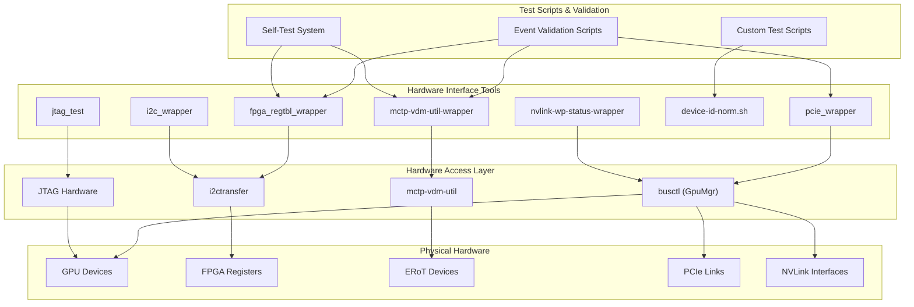
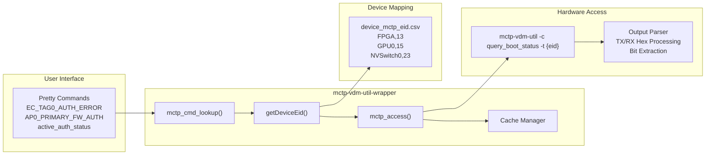
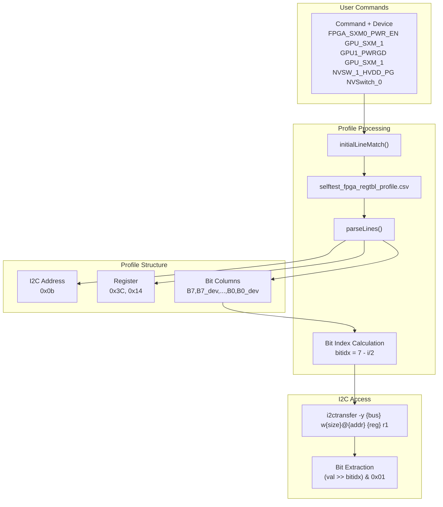
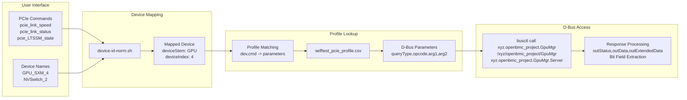
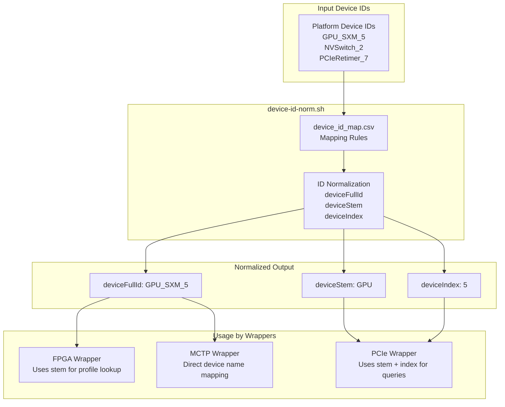
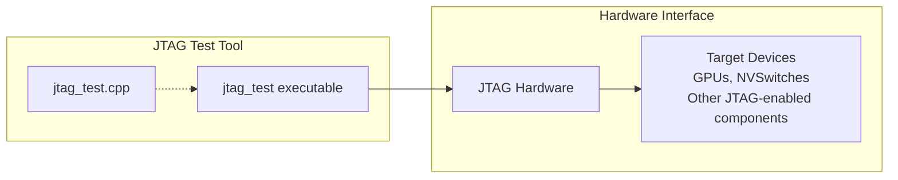
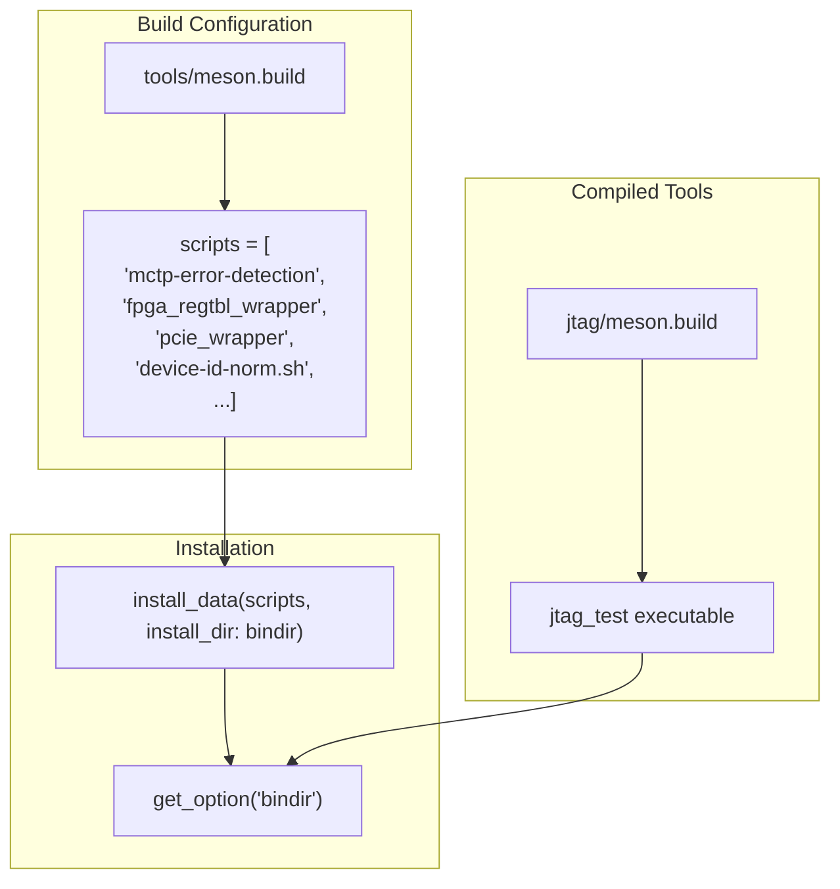

<!-- source: DeepWiki mcp.deepwiki.com · repo NVIDIA/nvidia-monitor-eventing · page 5.3 Hardware Interface Tools · fetched 2026-10-26 -->

# Hardware Interface Tools

Relevant source files

The following files were used as context for generating this wiki page:

- [examples/device_mctp_eid.csv](examples/device_mctp_eid.csv)
- [tools/jtag/meson.build](tools/jtag/meson.build)
- [tools/mctp-vdm-util-wrapper](tools/mctp-vdm-util-wrapper)
- [tools/meson.build](tools/meson.build)
- [tools/wrapper_fpga_register_table/fpga_regtbl_wrapper](tools/wrapper_fpga_register_table/fpga_regtbl_wrapper)
- [tools/wrapper_fpga_register_table/fpga_regtbl_wrapper_test.sh](tools/wrapper_fpga_register_table/fpga_regtbl_wrapper_test.sh)
- [tools/wrapper_fpga_register_table/selftest_fpga_regtbl_profile.csv](tools/wrapper_fpga_register_table/selftest_fpga_regtbl_profile.csv)
- [tools/wrapper_pcie_status/pcie_wrapper](tools/wrapper_pcie_status/pcie_wrapper)

This document covers the wrapper tools and utilities for accessing various hardware interfaces in the nvidia-monitor-eventing system. These tools provide abstracted, user-friendly interfaces for interacting with MCTP devices, FPGA registers, PCIe status, and other low-level hardware components used in testing and validation workflows.

For information about the overall testing framework that uses these tools, see [Event Validation Framework](#5.1). For details about self-test capabilities, see [Self-Test System](#5.2). For specialized diagnostic tools, see [Specialized Testing Tools](#5.4).

## Hardware Interface Architecture

The hardware interface tools form an abstraction layer between high-level testing scripts and low-level hardware access mechanisms. This architecture allows test scripts to use consistent, device-agnostic commands while the wrappers handle the complexity of different hardware interfaces.

Sources: [tools/meson.build:33-46](), [tools/mctp-vdm-util-wrapper:1-470](), [tools/wrapper_fpga_register_table/fpga_regtbl_wrapper:1-285](), [tools/wrapper_pcie_status/pcie_wrapper:1-300]()

## MCTP Device Access Wrapper

The `mctp-vdm-util-wrapper` provides a high-level interface to MCTP (Management Component Transport Protocol) devices, particularly for accessing ERoT (Embedded Root of Trust) functionality.

### MCTP Command Mapping

Sources: [tools/mctp-vdm-util-wrapper:43-60](), [tools/mctp-vdm-util-wrapper:104-121](), [tools/mctp-vdm-util-wrapper:227-363](), [examples/device_mctp_eid.csv:1-17]()

### Key Features

| Feature | Description | Implementation |
|---------|-------------|----------------|
| Device Name Mapping | Maps friendly device names to MCTP EIDs | `getDeviceEid()` function with CSV lookup |
| Command Abstraction | Pretty command names mapped to MCTP operations | `MCTP_CMD_LIST` with bit field specifications |
| Response Caching | Caches `query_boot_status` responses to avoid repeated hardware queries | File-based cache in `/tmp/erot_cache` with staleness tracking |
| Special Handlers | Custom processing for specific commands like `selftest` and `download_log` | `cmd_requires_special_output_handling()` |
| Bit Field Extraction | Extracts specific bit ranges from MCTP response data | Configurable bit ranges in command definitions |

The wrapper supports commands like:
- `EC_TAG0_AUTH_ERROR` - Query boot status bit 0
- `AP0_PRIMARY_FW_AUTHENTICATION_STATUS` - Query boot status bits 8-11  
- `active_auth_status` - Get active authentication status with slot detection
- `selftest` - Execute ERoT self-test with special TX/RX processing
- `download_log` - Download and parse glacier log files

Sources: [tools/mctp-vdm-util-wrapper:66-91](), [tools/mctp-vdm-util-wrapper:267-318](), [tools/mctp-vdm-util-wrapper:169-225]()

## FPGA Register Access Wrapper

The `fpga_regtbl_wrapper` provides bit-level access to FPGA registers via I2C interface, using a comprehensive CSV profile for register mapping.

### FPGA Register Mapping Architecture

Sources: [tools/wrapper_fpga_register_table/fpga_regtbl_wrapper:129-176](), [tools/wrapper_fpga_register_table/fpga_regtbl_wrapper:254-284](), [tools/wrapper_fpga_register_table/selftest_fpga_regtbl_profile.csv:1-10]()

### Profile Structure

The FPGA register profile maps hardware signals to specific I2C register bits. Each row contains:

| Column | Purpose | Example |
|--------|---------|---------|
| I2C Slave Address | 7-bit I2C device address | `0x0b` |
| Register Address | Register offset in hex | `0x3C` |
| B7,B7_dev...B0,B0_dev | Bit signal names and associated devices | `FPGA_SXM0_PWR_EN,GPU0` |

Example profile entries:
- Register `0x3C`: GPU power enable signals (`FPGA_SXM0_PWR_EN` through `FPGA_SXM7_PWR_EN`)
- Register `0x14`: GPU power good signals (`GPU1_PWRGD` through `GPU8_PWRGD`)  
- Register `0x1C`: NVSwitch voltage rail status (`NVSW_1_VDD_PG`, `NVSW_2_HVDD_PG`, etc.)

The wrapper automatically handles ERoT recovery invalidation - if a `*_EROT_RECOV_L` signal is asserted (active low), it invalidates the corresponding MCTP QueryBootStatus cache.

Sources: [tools/wrapper_fpga_register_table/selftest_fpga_regtbl_profile.csv:4-8](), [tools/wrapper_fpga_register_table/fpga_regtbl_wrapper:281-283]()

## PCIe Status Wrapper

The `pcie_wrapper` queries PCIe link status through the GpuMgr D-Bus service, providing access to link state, speed, and LTSSM information.

### PCIe Query Architecture

Sources: [tools/wrapper_pcie_status/pcie_wrapper:122-202](), [tools/wrapper_pcie_status/pcie_wrapper:204-224](), [tools/wrapper_pcie_status/pcie_wrapper:259-296]()

### PCIe Command Processing

The wrapper handles special cases:
- `pcie_link_status` is internally converted to `pcie_LTSSM_state` and post-processed
- LTSSM state 16 is mapped to "link-down", all others to "link-up"
- Device IDs can be placed in either the command ID field or arg2 based on profile configuration
- Bit extraction supports both data register and extended data register sources

The D-Bus response format: `(iau) status byteCount statusRegister commandRegister dataRegister extendedDataRegister`

Sources: [tools/wrapper_pcie_status/pcie_wrapper:116-119](), [tools/wrapper_pcie_status/pcie_wrapper:287-293](), [tools/wrapper_pcie_status/pcie_wrapper:233-256]()

## Device ID Mapping

The `device-id-norm.sh` tool provides standardized device name mapping across all wrapper tools, converting platform-specific device identifiers to normalized forms.

### Device Mapping Flow

Sources: [tools/wrapper_fpga_register_table/fpga_regtbl_wrapper:32-33](), [tools/wrapper_pcie_status/pcie_wrapper:122-137](), [tools/meson.build:39]()

## JTAG Test Interface

The `jtag_test` executable provides low-level JTAG interface testing capabilities for hardware validation.

Sources: [tools/jtag/meson.build:1-11](), [tools/meson.build:30]()

## Tool Integration and Testing

The hardware interface tools include comprehensive testing infrastructure to validate functionality and profile configurations.

### Testing Framework

| Tool | Test Script | Purpose |
|------|-------------|---------|
| FPGA Wrapper | `fpga_regtbl_wrapper_test.sh` | Validates profile parsing and bit extraction |
| MCTP Wrapper | Built-in dry-run mode | Tests command mapping and caching |  
| PCIe Wrapper | Built-in test-run mode | Validates D-Bus parameter generation |

The test scripts use the `device-id-norm.sh` mapper and validate end-to-end functionality including:
- Profile file parsing accuracy
- Device name to hardware address mapping  
- Bit extraction and command processing
- Error handling and edge cases

Sources: [tools/wrapper_fpga_register_table/fpga_regtbl_wrapper_test.sh:20-152](), [tools/wrapper_fpga_register_table/fpga_regtbl_wrapper:189-232](), [tools/wrapper_pcie_status/pcie_wrapper:88-113]()

## Installation and Build Integration  

All hardware interface tools are managed through the Meson build system and installed to the system binary directory.

The build system ensures all wrapper scripts and compiled tools are available system-wide for use by validation frameworks and manual testing procedures.

Sources: [tools/meson.build:32-49](), [tools/jtag/meson.build:4-10]()

---

