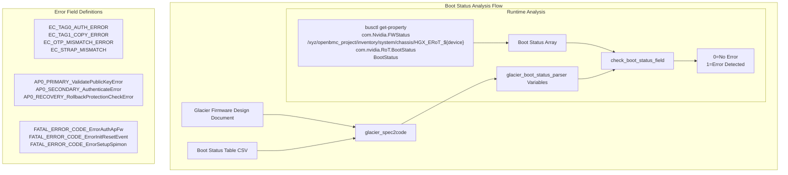
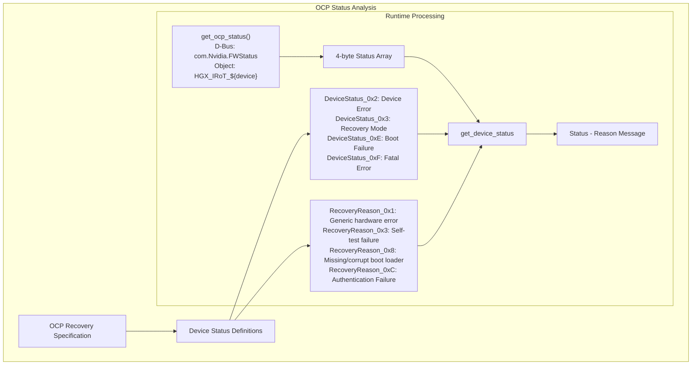
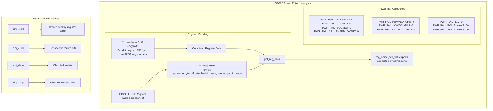
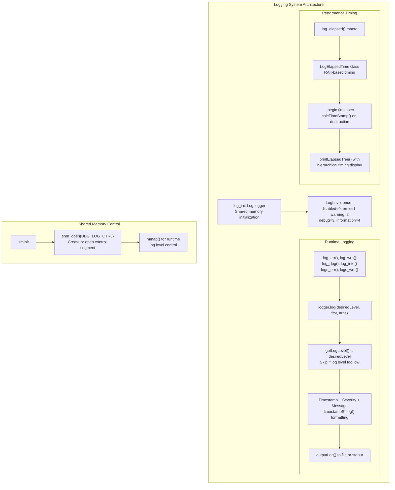
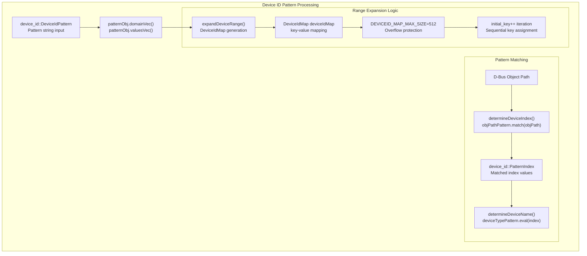

<!-- source: DeepWiki mcp.deepwiki.com · repo NVIDIA/nvidia-monitor-eventing · page 5.4 Specialized Testing Tools · fetched 2026-10-26 -->

# Specialized Testing Tools

Relevant source files

The following files were used as context for generating this wiki page:

- [include/log.hpp](include/log.hpp)
- [spec2code/glacier_spec2code](spec2code/glacier_spec2code)
- [src/device_util.cpp](src/device_util.cpp)
- [tools/gb200_pwrfail_parser](tools/gb200_pwrfail_parser)
- [tools/glacier_boot_status_parser](tools/glacier_boot_status_parser)
- [tools/jtag/jtag.h](tools/jtag/jtag.h)
- [tools/jtag/jtag_test.cpp](tools/jtag/jtag_test.cpp)
- [tools/ocp_recovery_status_parser](tools/ocp_recovery_status_parser)

This document covers specialized diagnostic and testing tools that provide low-level hardware validation, boot status analysis, power failure diagnostics, and JTAG testing capabilities. These tools complement the primary event validation framework covered in [Event Validation Framework](#5.1) and [Self-Test System](#5.2), focusing on specialized hardware diagnostics and parser generation from specifications.

For hardware interface wrapper tools, see [Hardware Interface Tools](#5.3). For the primary end-to-end testing system, see [Event Validation Framework](#5.1).

## Boot Status Analysis Tools

The system provides specialized parsers for analyzing boot status codes from different hardware platforms, converting raw register values into human-readable diagnostic information.

### Glacier Boot Status Parser

The `glacier_boot_status_parser` tool interprets boot status codes from Glacier firmware according to the Glacier Firmware Design Document specification.

The parser defines error detection patterns with bitmask, bit offset, and error value triplets for each potential failure condition. The `get_boot_status()` function retrieves the boot status via D-Bus, while `check_boot_status_field()` performs the actual error detection logic.

**Sources:** [tools/glacier_boot_status_parser:18-133](), [spec2code/glacier_spec2code:19-30]()

### OCP Recovery Status Parser

The `ocp_recovery_status_parser` interprets OCP (Open Compute Project) Recovery device status codes according to the OCP Recovery specification.

The tool uses a two-level mapping system where byte 0 indicates the device status type, and bytes 2-3 provide the recovery reason code when applicable.

**Sources:** [tools/ocp_recovery_status_parser:21-47](), [tools/ocp_recovery_status_parser:99-132]()

## Power Failure Analysis

The `gb200_pwrfail_parser` provides comprehensive analysis of GB200 power failure registers by parsing FPGA register tables to identify specific power rail failures.

The parser supports both runtime analysis and error injection testing capabilities. The error injection framework creates dummy register tables in `/tmp` for testing purposes.

**Sources:** [tools/gb200_pwrfail_parser:24-129](), [tools/gb200_pwrfail_parser:152-231](), [tools/gb200_pwrfail_parser:267-393]()

## JTAG Hardware Testing

The JTAG testing system provides low-level hardware validation by reading device IDCODE values over JTAG interface, enabling verification of hardware chain integrity.

### JTAG Test Architecture

```mermaid
graph TB
    subgraph "JTAG Hardware Testing Flow"
        JTAG_DEV["/dev/jtag0 Device"] --> JTAG_INIT["jtag_test initialization<br/>Set frequency with JTAG_SIOCFREQ"]
        
        subgraph "Chain Discovery"
            JTAG_INIT --> GET_NUM_DEV[get_number_of_devices]
            GET_NUM_DEV --> SHIFT_IR["goto_state(shiftir_tms)<br/>shift_data_in_out(all_ones)"]
            SHIFT_IR --> PATTERN_SEARCH["find_bitset_pattern()<br/>Search for 0xDECAFBAD pattern"]
            PATTERN_SEARCH --> DEVICE_COUNT[Determine device count from pattern position]
        end
        
        subgraph "IR Length Detection"
            DEVICE_COUNT --> GET_IR_LEN[get_ir_length]
            GET_IR_LEN --> IR_PATTERN["Shift 0xDECAFBAD pattern<br/>through instruction register"]
            IR_PATTERN --> IR_LENGTH[Calculate IR length from pattern position]
        end
        
        subgraph "IDCODE Reading"
            IR_LENGTH --> READ_IDCODES[read_idcodes]
            READ_IDCODES --> SHIFT_DR["goto_state(shiftdr_tms)<br/>shift_data_in_out(zeros)"]
            SHIFT_DR --> IDCODE_EXTRACT["Extract 32-bit IDCODE<br/>per device"]
            IDCODE_EXTRACT --> COMPARE["Compare with expected<br/>IDCODE value"]
        end
    end
    
    subgraph "JTAG State Machine Operations"
        TMS_SEQUENCES["trst_tms: {1,1,1,1,1,1,1,1,1,1}<br/>shiftdr_tms: {0,1,0,0}<br/>shiftir_tms: {0,1,1,0,0}<br/>rti_from_exit1_tms: {0,1,1,0}"]
        BITBANG_IOCTL["JTAG_IOCBITBANG ioctl<br/>struct bitbang_packet<br/>struct tck_bitbang array"]
    end
```

The JTAG test system uses a multi-phase approach: device discovery through pattern injection, IR length determination, and finally IDCODE verification against expected values.

**Sources:** [tools/jtag/jtag_test.cpp:136-207](), [tools/jtag/jtag_test.cpp:259-309](), [tools/jtag/jtag.h:184-195]()

### JTAG Protocol Implementation

The implementation uses Linux JTAG subsystem ioctls for low-level bit manipulation:

| JTAG Operation | Implementation | Purpose |
|----------------|----------------|----------|
| State Transitions | `goto_state()` with TMS sequences | Navigate JTAG TAP state machine |
| Data Shifting | `shift_data_in_out()` with TDI/TDO | Exchange data with device registers |
| Frequency Control | `JTAG_SIOCFREQ` ioctl | Set JTAG clock frequency |
| Bitbang Operations | `JTAG_IOCBITBANG` ioctl | Low-level TMS/TDI/TDO control |

**Sources:** [tools/jtag/jtag_test.cpp:61-88](), [tools/jtag/jtag_test.cpp:90-119](), [tools/jtag/jtag.h:232-241]()

## Specification-to-Code Generation

The `glacier_spec2code` tool automates the generation of parser constants from CSV specification files, ensuring consistency between hardware specifications and diagnostic code.

```mermaid
graph TB
    subgraph "Spec2Code Generation Pipeline"
        EXCEL_SPEC[Excel Specifications<br/>RAS Catalog, Boot Status Tables] --> CSV_EXPORT[CSV Export with columns:<br/>Field, Bitmask, Bitoffset, Error Value, Is Error?]
        CSV_EXPORT --> GLACIER_SPEC2CODE["glacier_spec2code.py<br/>to_glacier_boot_status_parser()"]
        
        subgraph "Code Generation Logic"
            GLACIER_SPEC2CODE --> CSV_READER["csv.DictReader()<br/>encoding='iso-8859-1'"]
            CSV_READER --> ERROR_FILTER["Filter rows where<br/>Is Error? == 'yes'"]
            ERROR_FILTER --> VAR_GEN["Generate variable definitions:<br/>FIELD_bitmask=0xVALUE<br/>FIELD_bitoffset=OFFSET<br/>FIELD_value=ERROR_VALUE"]
        end
        
        VAR_GEN --> PARSER_VARS["Variables for glacier_boot_status_parser<br/>Ready for shell script inclusion"]
    end
    
    subgraph "Generated Variable Examples"
        EXAMPLES["EC_TAG0_AUTH_ERROR_bitmask=0x1<br/>EC_TAG0_AUTH_ERROR_bitoffset=0<br/>EC_TAG0_AUTH_ERROR_value=1<br/>AP0_PRIMARY_ValidatePublicKeyError_bitmask=0xF00<br/>AP0_PRIMARY_ValidatePublicKeyError_bitoffset=8<br/>AP0_PRIMARY_ValidatePublicKeyError_value=2"]
    end
```

This automated approach ensures that changes to hardware specifications are automatically reflected in diagnostic tools without manual code updates.

**Sources:** [spec2code/glacier_spec2code:19-30](), [spec2code/glacier_spec2code:32-42]()

## Supporting Utilities

### Advanced Logging System

The logging framework in `log.hpp` provides comprehensive debugging capabilities including performance timing and multi-level log filtering.

The logging system supports runtime log level changes through shared memory, allowing dynamic debugging control across processes.

**Sources:** [include/log.hpp:198-225](), [include/log.hpp:125-152](), [include/log.hpp:442-489]()

### Device Identification Utilities

The device utilities provide pattern matching and range expansion for device identification across the hardware monitoring system.

This system enables flexible device identification patterns that can match multiple devices and expand ranges for bulk operations.

**Sources:** [src/device_util.cpp:45-77](), [src/device_util.cpp:79-104](), [src/device_util.cpp:131-146]()

## Integration with Main System

These specialized testing tools integrate with the main monitor-eventing system through several mechanisms:

1. **D-Bus Integration**: Boot status parsers retrieve data from the same D-Bus services used by the main event detection system
2. **Error Injection**: Power failure parser supports EINJ (Error Injection) testing that can trigger events in the main system
3. **Logging Integration**: All tools use the common logging framework for consistent debugging output
4. **Device Identification**: Common device utilities support both specialized tools and main system device management

The tools can be used standalone for diagnostic purposes or integrated into automated test suites that validate the end-to-end event processing pipeline.

**Sources:** [tools/glacier_boot_status_parser:163-170](), [tools/gb200_pwrfail_parser:267-284](), [src/device_util.cpp:106-122]()

---

