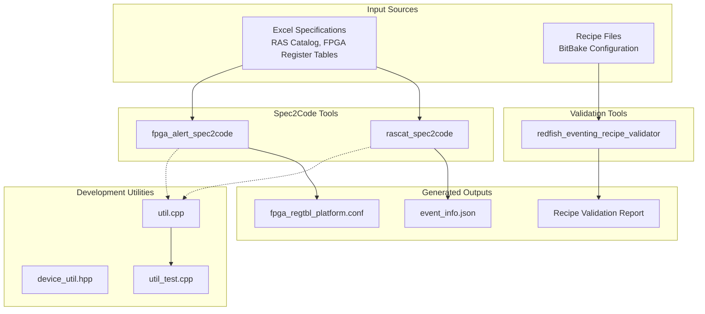
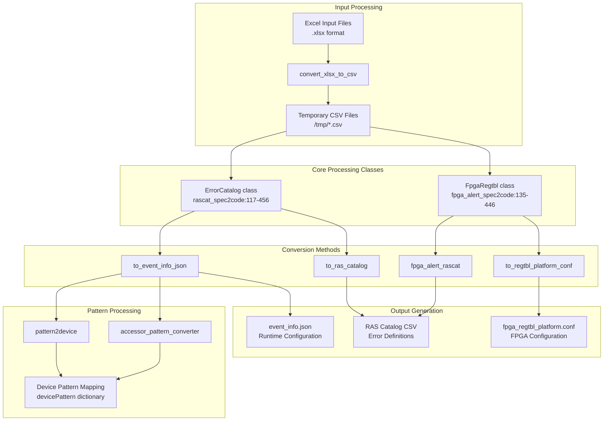
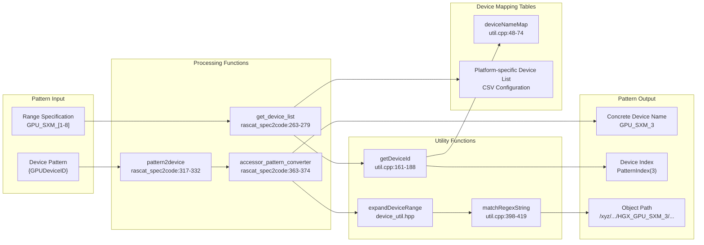
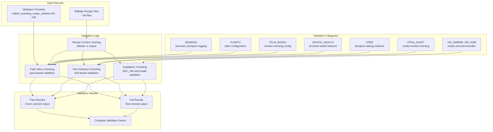

<!-- source: DeepWiki mcp.deepwiki.com · repo NVIDIA/nvidia-monitor-eventing · page 6 Development Tools · fetched 2026-10-26 -->

# Development Tools

<details>
<summary>Relevant source files</summary>

The following files were used as context for generating this wiki page:

- [include/util.hpp](include/util.hpp)
- [spec2code/fpga_alert_spec2code](spec2code/fpga_alert_spec2code)
- [spec2code/rascat_spec2code](spec2code/rascat_spec2code)
- [spec2code/rascat_spec2code.md](spec2code/rascat_spec2code.md)
- [spec2code/redfish_eventing_recipe_validator](spec2code/redfish_eventing_recipe_validator)
- [src/util.cpp](src/util.cpp)
- [test/util_test.cpp](test/util_test.cpp)

</details>


The Development Tools subsystem provides code generation, configuration validation, and development support utilities for the nvidia-monitor-eventing system. These tools primarily convert Excel-based specifications into JSON configuration files and provide validation frameworks for ensuring proper system configuration across different platforms.

For information about testing and validation of the runtime system, see [Testing and Validation](#5). For build system configuration, see [Build System](#7).

## Overview

The development tools ecosystem consists of three main categories: specification-to-code conversion tools, recipe validation systems, and general development utilities. These tools enable automated generation of configuration files from hardware specifications and provide validation mechanisms for deployment recipes.



**Sources**: [spec2code/rascat_spec2code:1-859](), [spec2code/fpga_alert_spec2code:1-572](), [spec2code/redfish_eventing_recipe_validator:1-212](), [src/util.cpp:1-628](), [include/util.hpp:1-448](), [test/util_test.cpp:1-433]()

## Spec2Code Processing Pipeline

The core specification processing workflow converts Excel-based hardware specifications into JSON configuration files used by the runtime monitoring system. The pipeline handles device pattern expansion, platform-specific configuration, and validation of generated outputs.



**Sources**: [spec2code/rascat_spec2code:302-455](), [spec2code/fpga_alert_spec2code:135-446](), [spec2code/rascat_spec2code:719-731]()

## Configuration Field Mapping

The specification conversion process relies on field-to-field mapping between Excel columns and JSON configuration structures. The mapping system handles complex transformations including device pattern expansion and accessor configuration conversion.

| Excel Field | JSON Target | Transformation Function |
|-------------|-------------|------------------------|
| Error ID | error_id | Direct copy |
| Error Name | event | Direct copy |
| Device Type | device_type | `json_dev_name()` |
| Hardware/GPIO Signal | event_trigger | `fc_get_hw_signal()` |
| Trigger data config | event_trigger | `fc_expr_to_json_acc()` |
| Accessor data config | accessor | `fc_expr_to_json_acc()` |
| Recovery data config | recovery | `fc_expr_to_json_acc()` |
| RF Log Message Args | redfish.message_args.patterns | `fc_expr_to_json_list()` |
| MessageArgs Parameters | redfish.message_args.parameters | `json_acc_list_to_fc_expr()` |

The `ErrorCatalog` class provides the core field transformation methods:

- `json_acc_to_fc_expr()` - Converts JSON accessor format to field catalog expression
- `fc_expr_to_json_acc()` - Converts field catalog expression to JSON accessor format  
- `json_dev_name()` - Extracts device name from device type pattern
- `fc_get_hw_signal()` - Extracts hardware GPIO signal name from D-Bus accessor configuration

**Sources**: [spec2code/rascat_spec2code:64-115](), [spec2code/rascat_spec2code:142-214]()

## Device Pattern Processing

Device pattern expansion is critical for supporting multi-device configurations. The system processes device range specifications like `GPU_SXM_[1-8]` and expands them to concrete device instances with proper ID mapping.



The device ID mapping system provides translation between different device naming schemes:

- `deviceNameMap` - Static mapping for GPU SXM slot naming (e.g., "GPU_SXM_1" → "GPU0")
- `getMappedDeviceId()` - Retrieves mapped device ID for known device patterns
- `getDeviceId()` - Extracts numeric device ID from device name patterns
- `introduceDeviceInObjectpath()` - Applies device index to object path patterns

**Sources**: [src/util.cpp:42-75](), [src/util.cpp:144-188](), [src/util.cpp:459-485](), [spec2code/rascat_spec2code:317-332]()

## Recipe Validation System

The `redfish_eventing_recipe_validator` provides automated validation of OpenBMC recipe configurations to ensure proper integration of eventing components. It validates build-time configurations, file installations, and feature flags across multiple recipes.



The validation checklist defines requirements for each eventing feature:

| Feature Category | Recipe | Validation Type | Example Check |
|-----------------|--------|----------------|---------------|
| GENERAL | bmcweb | EXTRA_OEMESON | nvidia-oem-properties=enabled |
| FPGA_ALERT | nvidia-monitor-eventing | [file] | event_info.json |
| FPGA_ALERT | nvidia-monitor-eventing | [install] | fpga_regtbl |
| CPER | phosphor-debug-collector | RDEPENDS | nvidia-cperdecoder |
| XID_SMBPBI | nvidia-xid-event-handler | [file] | xid_devices.csv |
| DEVICE_HEALTH | bmcweb | EXTRA_OEMESON | health-rollup-alternative=disabled |

**Sources**: [spec2code/redfish_eventing_recipe_validator:66-139](), [spec2code/redfish_eventing_recipe_validator:164-206]()

## Development Utilities

The development utilities provide common functionality used across the monitoring system, including device ID manipulation, range processing, regular expression matching, and file operations.

### Device ID and Range Utilities

The `util.cpp` and `util.hpp` files provide comprehensive device ID handling:

```mermaid
graph TD
    subgraph "Device ID Processing"
        DeviceString["Device String<br/>GPU_SXM_3"]
        GetDeviceId[getDeviceId]
        DeviceIdNum["Device ID Number<br/>3"]
    end
    
    subgraph "Range Processing"
        RangeString["Range String<br/>GPU_SXM_[1-8]"]
        ExpandRange[expandDeviceRange]
        DeviceMap["Device Map<br/>{1: GPU_SXM_1, 2: GPU_SXM_2, ...}"]
    end
    
    subgraph "Pattern Matching"
        RegexPattern["Regex Pattern<br/>GPU_SXM_[0-9]+"]
        MatchRegex[matchRegexString]
        MatchResult["Boolean Result<br/>true/false"]
    end
    
    subgraph "Object Path Processing"
        ObjectPattern["Object Path Pattern<br/>/xyz/.../GPU_SXM_[1-8]/..."]
        IntroduceDevice[introduceDeviceInObjectpath]
        ConcreteObject["Concrete Object Path<br/>/xyz/.../GPU_SXM_3/..."]
    end
    
    DeviceString --> GetDeviceId
    GetDeviceId --> DeviceIdNum
    
    RangeString --> ExpandRange
    ExpandRange --> DeviceMap
    
    RegexPattern --> MatchRegex
    MatchRegex --> MatchResult
    
    ObjectPattern --> IntroduceDevice
    IntroduceDevice --> ConcreteObject
```



Key utility functions include:

- `getDeviceId()` - Extracts numeric ID from device names (e.g., "GPU5" → 5)
- `removeRange()` - Removes range specifications from device patterns
- `getMinMaxRange()` - Parses range specifications like "[1-8]" into min/max values
- `matchRegexString()` - Compares device patterns using regular expressions
- `introduceDeviceInObjectpath()` - Applies device index to object path templates

**Sources**: [src/util.cpp:161-188](), [src/util.cpp:117-142](), [src/util.cpp:190-214](), [src/util.cpp:398-419](), [src/util.cpp:459-485]()

### File Operations and JSON Handling

The utilities include thread-safe file operations for JSON configuration management:

```cpp
// Thread-safe JSON file writing with file locking
int writeJson2File(const std::string& filePath, const nlohmann::json& j)
```

This function provides file locking mechanisms using `boost::interprocess::file_lock` to prevent concurrent access issues when multiple processes write configuration files.

**Sources**: [src/util.cpp:565-624](), [include/util.hpp:436-444]()

## Testing Framework

The development tools include comprehensive unit tests covering device ID processing, range expansion, pattern matching, and utility functions. The test suite validates critical functionality used throughout the monitoring system.

Key test categories include:

- **Device ID Tests** - Validation of `getDeviceId()` function with various device name formats
- **Range Processing Tests** - Testing of `expandDeviceRange()` with single and double range specifications  
- **Pattern Matching Tests** - Verification of `matchRegexString()` with complex device patterns
- **Object Path Tests** - Testing of `introduceDeviceInObjectpath()` with device indices
- **File Operation Tests** - Validation of JSON file writing with proper locking

**Sources**: [test/util_test.cpp:25-433]()

---

