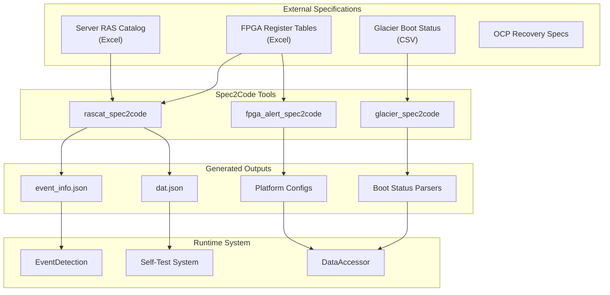
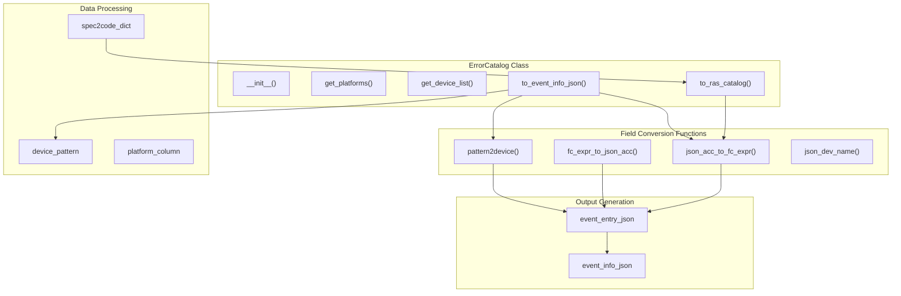
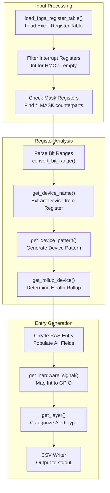
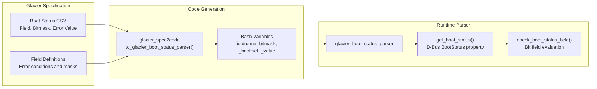
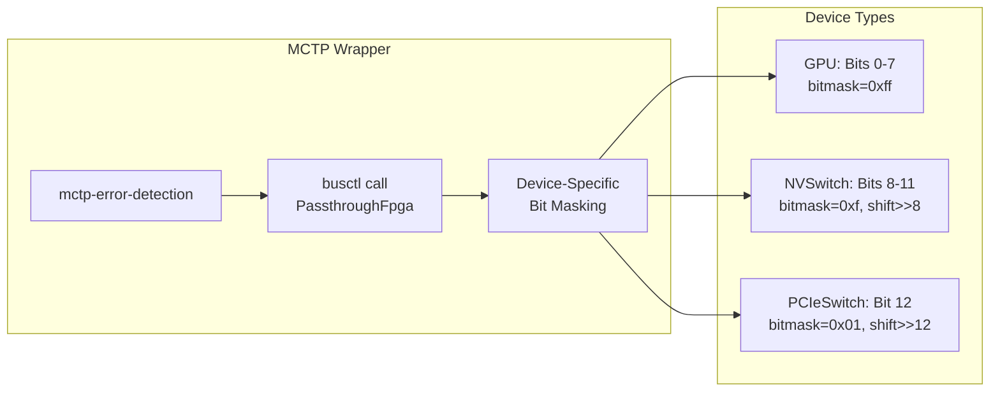
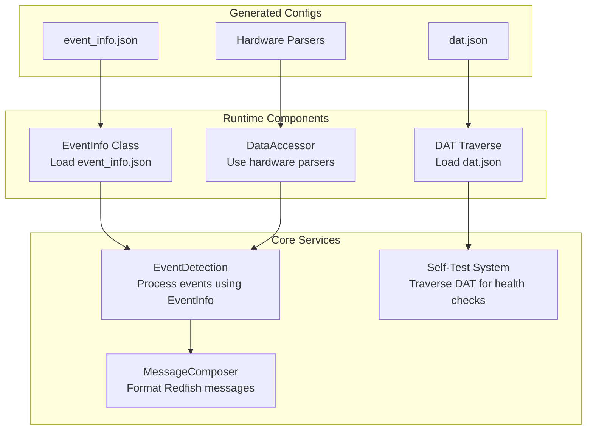

<!-- source: DeepWiki mcp.deepwiki.com · repo NVIDIA/nvidia-monitor-eventing · page 6.1 Spec2Code System · fetched 2026-10-26 -->

# Spec2Code System

<details>
<summary>Relevant source files</summary>

The following files were used as context for generating this wiki page:

- [examples/dat.json](examples/dat.json)
- [examples/event_info.json](examples/event_info.json)
- [spec2code/fpga_alert_spec2code](spec2code/fpga_alert_spec2code)
- [spec2code/glacier_spec2code](spec2code/glacier_spec2code)
- [spec2code/rascat_spec2code](spec2code/rascat_spec2code)
- [spec2code/rascat_spec2code.md](spec2code/rascat_spec2code.md)
- [test/dat_test.cpp](test/dat_test.cpp)
- [tools/glacier_boot_status_parser](tools/glacier_boot_status_parser)
- [tools/mctp-error-detection](tools/mctp-error-detection)
- [tools/ocp_recovery_status_parser](tools/ocp_recovery_status_parser)

</details>


## Purpose and Scope

The Spec2Code System converts external hardware specifications and register tables into machine-readable configuration files and wrapper tools for the nvidia-monitor-eventing system. This system bridges the gap between human-readable hardware documentation (Excel spreadsheets, CSV files) and the JSON configurations required by the runtime event detection system.

For information about the runtime event detection system that consumes these generated configurations, see [Event Detection System](#2.1). For details on the configuration files themselves, see [Event Definitions](#3.1) and [Device Association Trees](#3.2).

## System Architecture

The Spec2Code System consists of multiple conversion tools that transform different types of specifications into standardized formats:

### Conversion Flow Overview



Sources: [spec2code/rascat_spec2code:1-50](), [spec2code/fpga_alert_spec2code:1-50](), [spec2code/glacier_spec2code:1-50]()

### Core Conversion Tools

| Tool | Input Format | Primary Output | Purpose |
|------|-------------|----------------|---------|
| `rascat_spec2code` | Server RAS Catalog (Excel) | `event_info.json` | Convert error catalog to event definitions |
| `fpga_alert_spec2code` | FPGA Register Table (Excel) | Platform configs | Generate FPGA register access tools |
| `glacier_spec2code` | Boot Status CSV | Parser code | Generate boot status field parsers |

Sources: [spec2code/rascat_spec2code:11-13](), [spec2code/fpga_alert_spec2code:11-13](), [spec2code/glacier_spec2code:11-13]()

## RAS Catalog Conversion System

The `rascat_spec2code` tool is the primary conversion engine that processes Server RAS Catalog specifications into runtime configurations.

### RAS Catalog Architecture



Sources: [spec2code/rascat_spec2code:117-456]()

### Platform-Specific Processing

The conversion system supports multiple hardware platforms with platform-specific device mappings:

```mermaid
flowchart LR
    subgraph "Platform Selection"
        PLATFORM_PREFIX["platform_column_prefix<br/>'Applicable for '"]
        PLATFORM_COL["Platform Column<br/>'Applicable for Blackwell-HGX-8-GPU'"]
    end
    
    subgraph "Device Pattern Mapping"
        DEVICE_CSV["Device CSV<br/>DevicePattern -> Device Mapping"]
        PATTERN_FUNC["pattern2device()<br/>Template Substitution"]
        DEVICE_RF["device_rf_pattern<br/>Redfish URI Mapping"]
    end
    
    subgraph "Field Processing"
        FIELD_MAP["spec2code_dict<br/>Column -> JSON Field Mapping"]
        ACCESSOR_CONV["Accessor Conversion<br/>fc_expr_to_json_acc()"]
        PATTERN_SUB["Pattern Substitution<br/>accessor_pattern_converter()"]
    end
    
    PLATFORM_PREFIX --> PLATFORM_COL
    PLATFORM_COL --> DEVICE_CSV
    DEVICE_CSV --> PATTERN_FUNC
    PATTERN_FUNC --> DEVICE_RF
    
    DEVICE_RF --> FIELD_MAP
    FIELD_MAP --> ACCESSOR_CONV
    ACCESSOR_CONV --> PATTERN_SUB
```



Sources: [spec2code/rascat_spec2code:25-26](), [spec2code/rascat_spec2code:308-456](), [spec2code/rascat_spec2code:263-301]()

## FPGA Register Table Processing

The FPGA alert conversion system processes hardware register specifications into monitoring configurations:

### FPGA Alert Processing Pipeline



Sources: [spec2code/rascat_spec2code:538-718](), [spec2code/rascat_spec2code:472-536]()

### Hardware Signal Mapping

The system translates register interrupt specifications into GPIO signal names used by the runtime system:

| FPGA Interrupt | GPIO Signal | Usage |
|----------------|-------------|--------|
| `T` | `THERM_OVERT` | Thermal protection |
| `PF` | `PS_RUN_PWR_FAULT` | Power fault detection |
| `<number>` | `I2C<number>_ALERT` | I2C bus alerts |

Sources: [spec2code/rascat_spec2code:472-480]()

## Boot Status Parser Generation

The system generates platform-specific boot status parsers from hardware specifications:

### Glacier Boot Status Processing



Sources: [spec2code/glacier_spec2code:19-42](), [tools/glacier_boot_status_parser:18-134](), [tools/glacier_boot_status_parser:189-212]()

## Configuration Output Formats

### Event Information JSON Structure

The primary output of the spec2code system is the `event_info.json` file consumed by the runtime monitoring system:

```json
{
  "Device": [
    {
      "event": "GPU OverTemp",
      "device_type": "GPU[0-7]",
      "error_id": "GPU-OVERTEMP-001",
      "event_trigger": {
        "type": "DBUS",
        "object": "/xyz/openbmc_project/GpioStatusHandler",
        "interface": "xyz.openbmc_project.GpioStatus", 
        "property": "THERM_OVERT",
        "check": {"equal": "false"}
      },
      "accessor": {
        "type": "DeviceCoreAPI",
        "property": "gpu.thermal.temperature.overTemperatureInfo",
        "check": {"bitmap": "1"}
      },
      "severity": "Critical",
      "redfish": {
        "message_id": "ResourceEvent.1.0.ResourceErrorThresholdExceeded",
        "message_args": {
          "patterns": ["{GPUId} Temperature", "{UpperFatal Threshold}"],
          "parameters": [
            {"type": "DIRECT", "field": "CurrentDeviceName"}
          ]
        }
      }
    }
  ]
}
```

Sources: [examples/event_info.json:1-57](), [spec2code/rascat_spec2code:31-62]()

### Device Association Tree Structure

The Device Association Tree (DAT) defines hierarchical relationships and health rollup behavior:

```json
{
  "GPU0": {
    "association": ["HSC0", "ERoT_GPU0", "GPUDRAM0"],
    "power_rail": [{
      "name": "HSC0",
      "accessor": {"type": "DEVICE", "device_name": "HSC0"},
      "expected_value": "PASS"
    }],
    "firmware_status": [{
      "name": "Authentication Status", 
      "accessor": {
        "type": "CMDLINE",
        "executable": "mctp-vdm-util-wrapper",
        "arguments": "AP0_PRIMARY_FW_AUTHENTICATION_STATUS GPU0"
      },
      "expected_value": "1"
    }]
  }
}
```

Sources: [examples/dat.json:24-183]()

## Hardware Interface Tools

The spec2code system generates wrapper tools for accessing hardware interfaces:

### MCTP Error Detection



Sources: [tools/mctp-error-detection:46-109]()

### OCP Recovery Status Parser

The OCP (Open Compute Project) recovery status parser translates device status codes into human-readable messages:

| Status Code | Status | Includes Reason |
|-------------|--------|----------------|
| `0x2` | Device Error | No |
| `0x3` | Recovery Mode | Yes |
| `0xE` | Boot Failure | Yes |
| `0xF` | Fatal Error | No |

Sources: [tools/ocp_recovery_status_parser:20-48](), [tools/ocp_recovery_status_parser:99-133]()

## Integration with Runtime System

The generated configurations integrate with the main monitoring system components:

### Configuration Consumption



Sources: [spec2code/rascat_spec2code:302-456](), [examples/event_info.json:1-50](), [examples/dat.json:1-50]()

---

