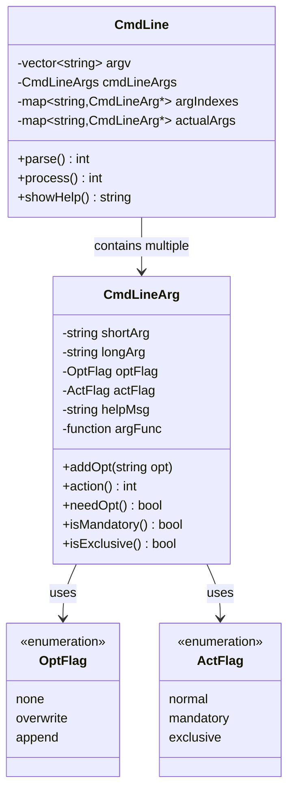
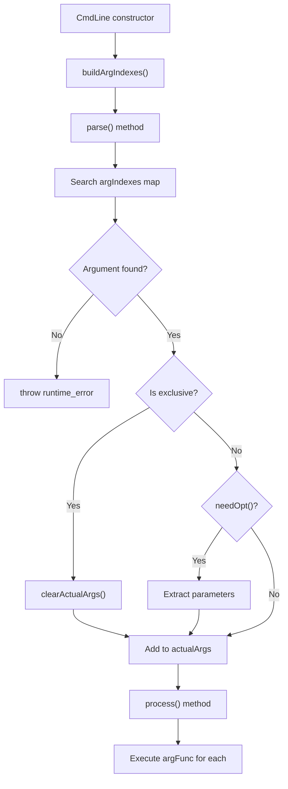
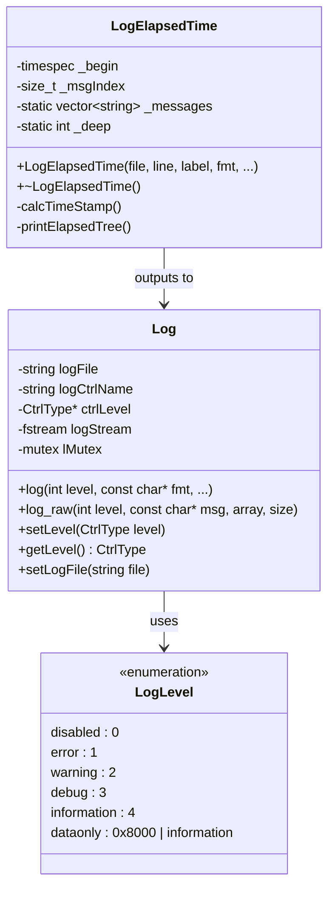
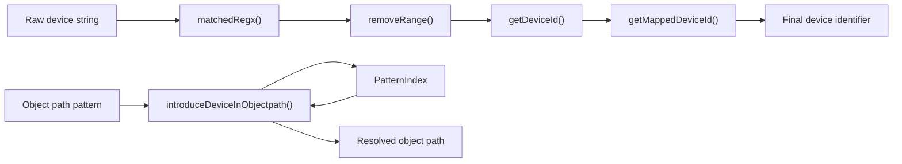
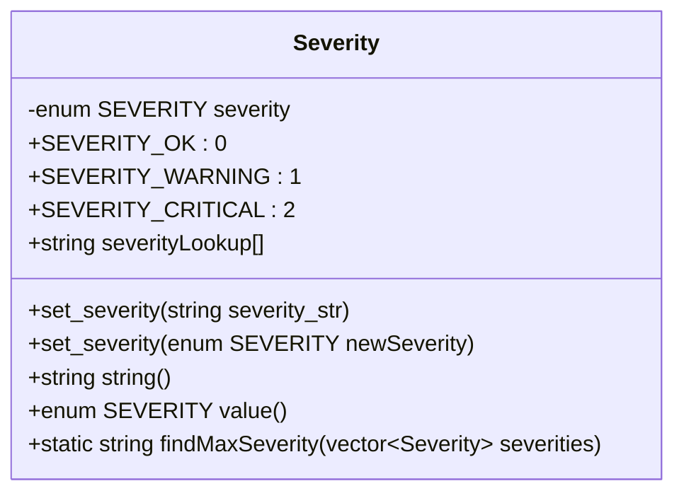
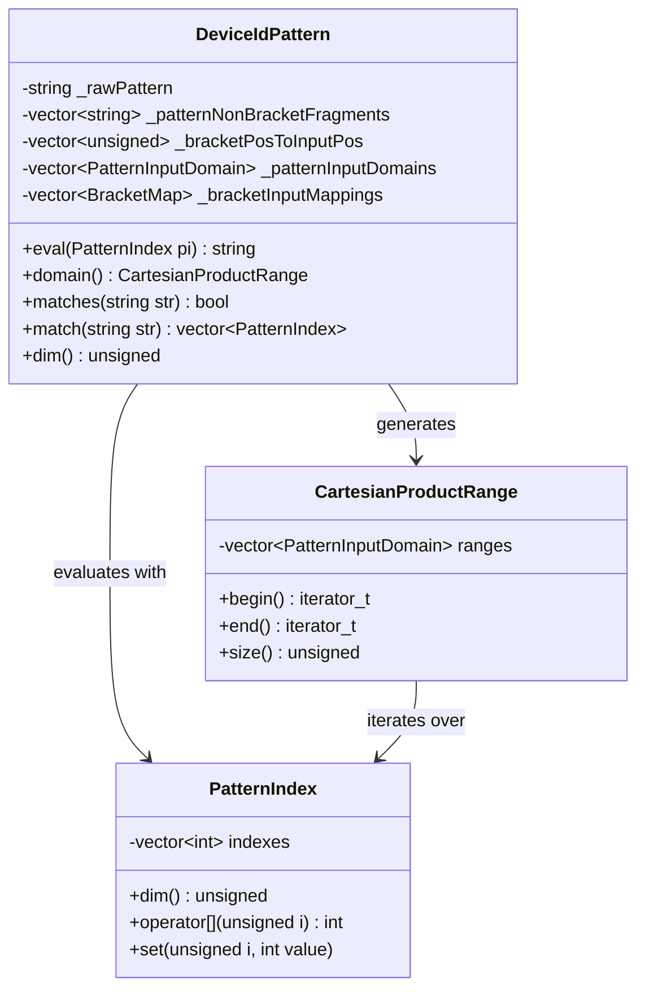
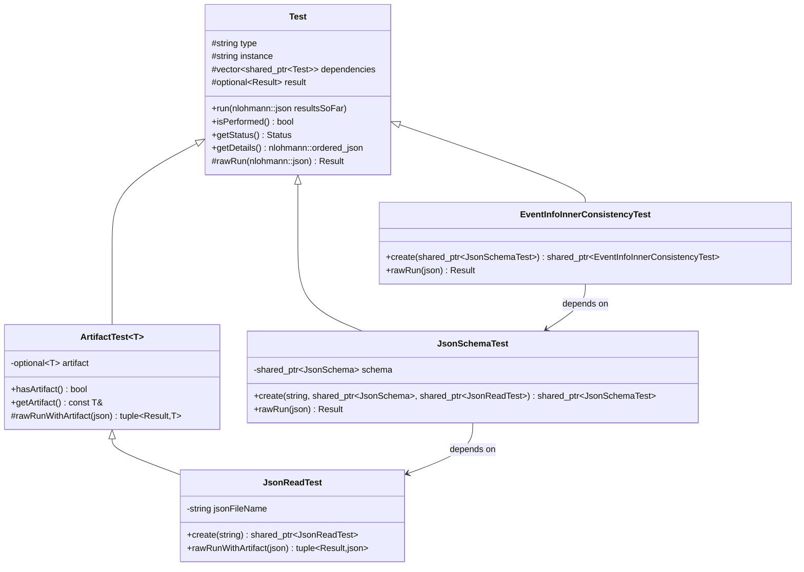
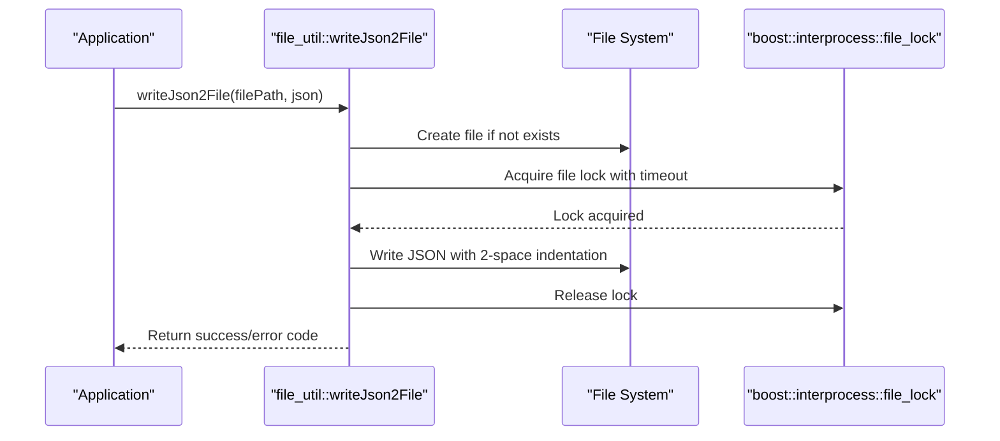
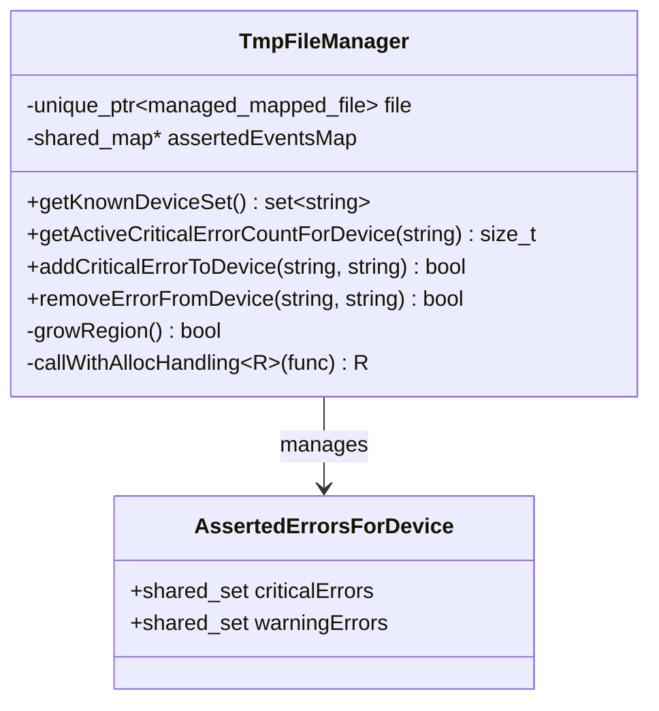
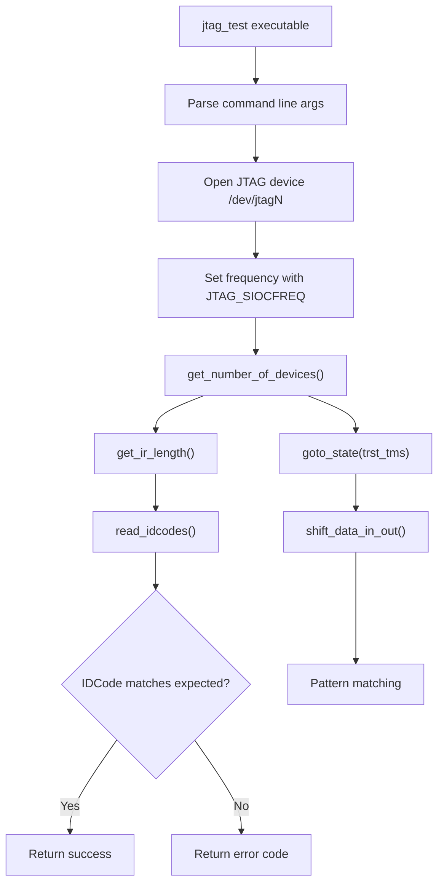

<!-- source: DeepWiki mcp.deepwiki.com · repo NVIDIA/nvidia-monitor-eventing · page 6.2 Development Utilities · fetched 2026-10-26 -->

# Development Utilities

Relevant source files

The following files were used as context for generating this wiki page:

- [config/meson.build](config/meson.build)
- [device-health-service/data_structures.hpp](device-health-service/data_structures.hpp)
- [device-health-service/meson.build](device-health-service/meson.build)
- [include/cmd_line.hpp](include/cmd_line.hpp)
- [include/device_id.hpp](include/device_id.hpp)
- [include/log.hpp](include/log.hpp)
- [include/util.hpp](include/util.hpp)
- [src/device_util.cpp](src/device_util.cpp)
- [src/diagnostics.cpp](src/diagnostics.cpp)
- [src/util.cpp](src/util.cpp)
- [test/util_test.cpp](test/util_test.cpp)
- [tools/jtag/jtag.h](tools/jtag/jtag.h)
- [tools/jtag/jtag_test.cpp](tools/jtag/jtag_test.cpp)

This document covers the development support utilities that facilitate the creation, debugging, and maintenance of the nvidia-monitor-eventing system. These utilities include command-line processing frameworks, logging systems, device pattern matching, diagnostic tools, and other development aids that support the core eventing functionality but are not part of the runtime event processing pipeline itself.

For information about converting specifications to configuration files, see [Spec2Code System](#6.1). For information about testing and validation tools, see [Testing and Validation](#5).

## Command-Line Processing Framework

The system provides a comprehensive command-line argument parsing framework through the `cmd_line` namespace. This framework enables consistent argument handling across all tools in the system.

### CmdLine Architecture

The framework supports three types of option behavior (`OptFlag`): arguments with no parameters (`none`), arguments that overwrite previous values (`overwrite`), and arguments that append to collections (`append`). Action flags (`ActFlag`) control execution flow with normal processing, mandatory requirement validation, and exclusive execution modes.

**Sources:** [include/cmd_line.hpp:34-46](), [include/cmd_line.hpp:55-170](), [include/cmd_line.hpp:174-394]()

### Command-Line Processing Flow

**Sources:** [include/cmd_line.hpp:228-295](), [include/cmd_line.hpp:190-226]()

## Logging System

The logging framework provides multi-level debug output with runtime control through shared memory mechanisms. The system supports both class-based logging (`log_*` macros) and static function logging (`logs_*` macros).

### Log Class Architecture

The logging system uses shared memory (`shm_open`) to enable runtime control of log levels across process boundaries. The `DBG_LOG_CTRL` macro defines the shared memory region name, defaulting to `"mon_evt_ctrl"`.

**Sources:** [include/log.hpp:178-187](), [include/log.hpp:198-510](), [include/log.hpp:125-152]()

### Logging Macros and Usage

The system provides structured logging macros that automatically include context information:

| Macro Pattern | Context Information | Usage |
|---------------|-------------------|-------|
| `log_*` | Class name, method name | Non-static member functions |
| `logs_*` | File name, line number, function name | Static and global functions |
| `log_elapsed` | Performance timing | Function execution timing |

**Sources:** [include/log.hpp:543-570](), [include/log.hpp:154-159]()

## General Utility Functions

The `util` namespace provides essential development utilities for device name processing, regular expression handling, and file operations.

### Device Name Processing Pipeline

Key utility functions include:
- `matchedRegx()`: Regular expression matching for device patterns
- `removeRange()`: Strip range specifications like `[0-7]` from device names
- `getDeviceId()`: Extract numeric device identifiers
- `introduceDeviceInObjectpath()`: Apply device indexes to object path templates

**Sources:** [src/util.cpp:90-109](), [src/util.cpp:117-142](), [src/util.cpp:144-159](), [src/util.cpp:459-485]()

### Severity Management

The `Severity` class provides standardized severity level handling with string conversion and comparison operations. The `findMaxSeverity()` static method enables severity aggregation across multiple device states.

**Sources:** [include/util.hpp:325-431]()

## Device ID Pattern System

The device ID pattern system enables flexible device addressing through pattern matching and expansion capabilities.

### DeviceIdPattern Core Classes

Pattern examples:
- `"GPU_SXM_[1-8]"` → Expands to GPU_SXM_1, GPU_SXM_2, ..., GPU_SXM_8
- `"NVSwitch_[0-3]/NVLink_[0-39]"` → 160 combinations (4 × 40)
- `"HGX_GPU_SXM_[0-3:5-8]"` → Maps input domain [0,1,2,3] to output domain [5,6,7,8]

**Sources:** [include/device_id.hpp:292-560](), [include/device_id.hpp:172-211](), [include/device_id.hpp:242-290]()

## Diagnostics Framework

The diagnostics framework provides a structured testing system for configuration validation and system health checks.

### Test Hierarchy Architecture

The framework supports dependency-based test execution with artifact passing between test stages. Test results include status codes (`passed`, `failed`, `skipped`, `done`) and detailed diagnostic information.

**Sources:** [src/diagnostics.cpp:242-371](), [src/diagnostics.cpp:206-241](), [src/diagnostics.cpp:375-401](), [src/diagnostics.cpp:495-564]()

## File and Data Management Utilities

### JSON File Operations

The `file_util` namespace provides thread-safe JSON file operations with file locking:

The `writeJson2File()` function uses `boost::interprocess::file_lock` with a configurable timeout (`FLOCK_TIMEOUT`) to prevent concurrent access issues.

**Sources:** [src/util.cpp:565-624](), [include/util.hpp:440-444]()

### Shared Memory Data Structures

The device health service uses boost::interprocess for shared memory management:

Memory management includes automatic region growth when allocation fails, with configurable size limits (`INITIAL_SHMEM_SIZE`, `MAXIMUM_SHMEM_SIZE`).

**Sources:** [device-health-service/data_structures.hpp:73-200](), [device-health-service/data_structures.hpp:59-71]()

## Hardware Testing Tools

### JTAG Testing Infrastructure

The JTAG testing tool provides low-level hardware validation:

The tool supports configurable JTAG frequency, verbose output modes, and sleep delays between clock cycles for debugging timing-sensitive operations.

**Sources:** [tools/jtag/jtag_test.cpp:311-402](), [tools/jtag/jtag_test.cpp:136-207](), [tools/jtag/jtag_test.cpp:259-309]()

**Sources:** [tools/jtag/jtag_test.cpp:48-59](), [tools/jtag/jtag.h:81-100](), [tools/jtag/jtag.h:231-241]()

---

