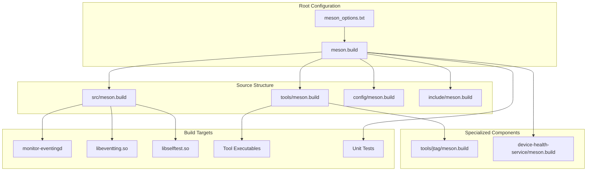
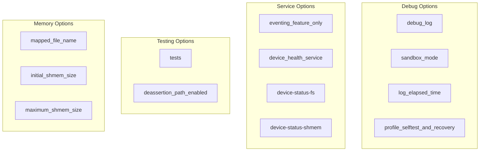
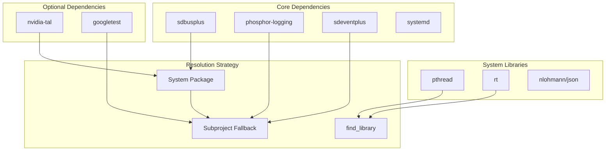
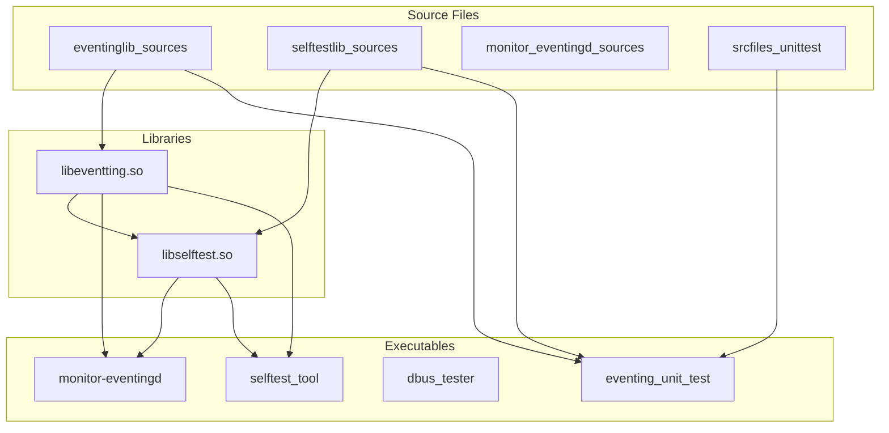
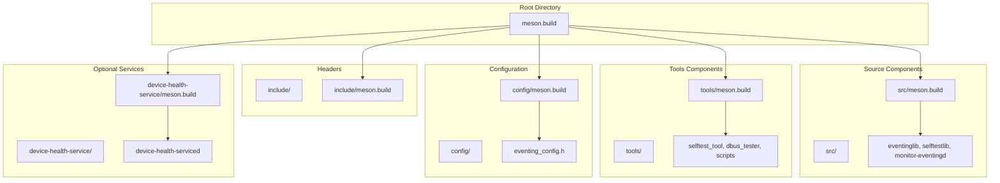
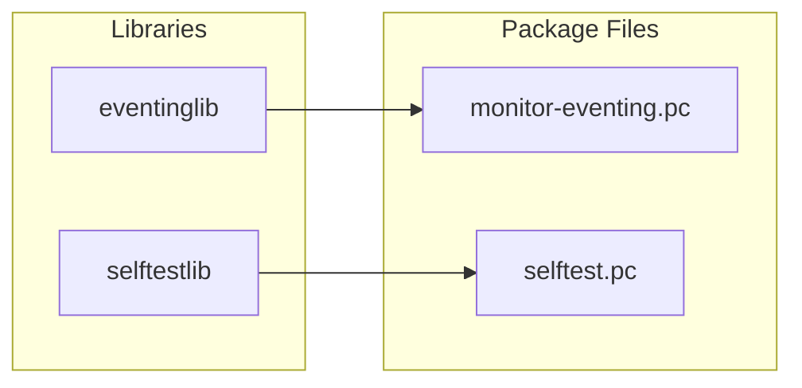

<!-- source: DeepWiki mcp.deepwiki.com · repo NVIDIA/nvidia-monitor-eventing · page 7 Build System · fetched 2026-10-26 -->

# Build System

Relevant source files

The following files were used as context for generating this wiki page:

- [config/meson.build](config/meson.build)
- [device-health-service/data_structures.hpp](device-health-service/data_structures.hpp)
- [device-health-service/meson.build](device-health-service/meson.build)
- [include/cmd_line.hpp](include/cmd_line.hpp)
- [include/device_id.hpp](include/device_id.hpp)
- [include/device_status_handler.hpp](include/device_status_handler.hpp)
- [include/meson.build](include/meson.build)
- [meson.build](meson.build)
- [meson_options.txt](meson_options.txt)
- [src/diagnostics.cpp](src/diagnostics.cpp)
- [src/eventing_main.cpp](src/eventing_main.cpp)
- [src/meson.build](src/meson.build)
- [tools/jtag/meson.build](tools/jtag/meson.build)
- [tools/meson.build](tools/meson.build)

## Purpose and Scope

This document covers the Meson build system configuration for the nvidia-monitor-eventing project, including project setup, dependencies, build targets, feature flags, and compilation options. The build system orchestrates the creation of the main `monitor-eventingd` daemon, supporting libraries, tools, and test executables.

For information about the main service executable, see [Main Service - monitor-eventingd](#4). For details about testing tools and frameworks, see [Testing and Validation](#5).

## Build System Overview

The nvidia-monitor-eventing project uses Meson as its build system, with a hierarchical structure of `meson.build` files that define targets, dependencies, and configuration options. The build system supports conditional compilation through feature flags and manages complex dependency relationships between internal libraries and external OpenBMC components.

**Build System Architecture**

Sources: [meson.build:1-253](), [meson_options.txt:1-130](), [src/meson.build:1-77](), [tools/meson.build:1-49]()

## Project Configuration

The project is configured with modern C++ requirements and strict compilation standards. The main project definition enforces C++23 as the language standard and sets up global compilation arguments.

**Core Project Settings**

| Setting | Value | Source |
|---------|--------|--------|
| Language | C++23 | [meson.build:7]() |
| Version | 0.1 | [meson.build:4]() |
| License | MIT | [meson.build:5]() |
| Minimum Meson | 1.1.1 | [meson.build:6]() |

Sources: [meson.build:1-28]()

## Build Options and Feature Flags

The build system provides extensive configurability through Meson options that control feature compilation, debugging capabilities, and service integration modes. These options enable conditional compilation of different system components.

**Feature Flag Categories**

| Option | Type | Default | Purpose |
|--------|------|---------|---------|
| `debug_log` | integer | 0 | Debug log level (0-4) |
| `eventing_feature_only` | feature | disabled | Disable selftest and health rollup |
| `device_health_service` | feature | disabled | Enable separate device health service |
| `device-status-fs` | feature | enabled | Update device status via filesystem |
| `device-status-shmem` | feature | enabled | Use NVIDIA shared memory IPC |
| `tests` | feature | enabled | Build unit tests |

Sources: [meson_options.txt:1-130](), [meson.build:29-72]()

## Dependencies

The build system manages complex dependencies on OpenBMC components and system libraries. Dependencies are resolved with fallback mechanisms for subproject builds when system packages are unavailable.

**Dependency Resolution**

**Key Dependency Configurations:**

- **sdbusplus**: D-Bus C++ bindings with subproject fallback [meson.build:91-108]()
- **phosphor-logging**: OpenBMC logging framework [meson.build:115-118]()
- **sdeventplus**: Event loop library [meson.build:110-113]()
- **nvidia-tal**: Shared memory IPC (conditional) [src/meson.build:65-68]()

Sources: [meson.build:89-133](), [src/meson.build:56-68]()

## Build Targets

The build system creates multiple libraries and executables with carefully managed dependencies and linking relationships.

**Target Dependencies**

**Primary Build Targets:**

| Target | Type | Sources | Dependencies |
|--------|------|---------|--------------|
| `eventinglib` | shared_library | 21 source files | sdbusplus, phosphor-logging |
| `selftestlib` | shared_library | selftest.cpp | eventinglib |
| `monitor-eventingd` | executable | eventing_main.cpp | eventinglib, selftestlib |
| `eventing_unit_test` | executable | 13 test files | gtest, gmock |

Sources: [src/meson.build:1-77](), [meson.build:205-253]()

## Subdirectory Organization

The build system is organized into specialized subdirectories, each with its own build configuration and target definitions.

**Build Directory Structure**

Sources: [meson.build:137-144](), [src/meson.build:1-77](), [tools/meson.build:1-49](), [config/meson.build:1-17]()

## Configuration Generation

The build system generates configuration headers with build-time settings and feature flag definitions.

**Configuration Processing:**
- `eventing_config.h.in` template processed with Meson configuration data
- Device status filesystem path configurable via `device-status-fs-path` option
- Configuration header becomes a dependency for other targets

Sources: [config/meson.build:1-17]()

## Conditional Compilation

The build system uses preprocessor definitions to enable/disable features based on build options. These definitions control major system behaviors and optional component compilation.

**Feature Flag Mapping:**

| Build Option | Preprocessor Definition | Purpose |
|-------------|------------------------|---------|
| `eventing_feature_only` | `EVENTING_FEATURE_ONLY` | Disable selftest and health rollup |
| `device_health_service` | `EVENTING_SERVICE_NO_DEVICE_HEALTH` | Use external device health service |
| `device-status-fs` | `EVENTING_SERVICE_DEVICE_STATUS_FS` | Enable filesystem status updates |
| `device-status-shmem` | `EVENTING_SERVICE_DEVICE_STATUS_NVIDIA_SHMEM` | Enable shared memory IPC |
| `sandbox_mode` | `SANDBOX_MODE` | Enable sandbox mode |
| `log_elapsed_time` | `LOG_ELAPSED_TIME` | Enable timing logs |

**Conditional Code Blocks:**
- Service feature toggles control major subsystem compilation [src/eventing_main.cpp:316-347](), [src/eventing_main.cpp:380-395]()
- Device health integration points [src/eventing_main.cpp:508-511](), [src/eventing_main.cpp:581-583]()
- Memory watcher service installation [meson.build:232-236]()

Sources: [meson.build:37-71](), [src/eventing_main.cpp:316-721]()

## Installation

The build system configures installation paths and file deployment for system integration.

**Installation Components:**
- Executables installed to configured `bindir`
- Shared libraries installed to `libdir` with version information
- Tool scripts installed as executable files
- Package config files generated for library consumers

**Pkg-config Generation:**

Sources: [meson.build:146-163](), [tools/meson.build:32-48](), [src/meson.build:24-47]()

## Testing

The build system includes comprehensive test configuration with optional GoogleTest integration and unit test execution.

**Test Configuration:**
- Unit tests built when `tests` option enabled
- GoogleTest dependency resolved with CMake subproject fallback
- Test executable includes all library sources for comprehensive testing
- Test execution integrated with Meson test runner

Sources: [meson.build:164-248]()