# Page: Overview

# Overview

<details>
<summary>Relevant source files</summary>

The following files were used as context for generating this wiki page:

- [examples/dat.json](examples/dat.json)
- [examples/event_info.json](examples/event_info.json)
- [include/device_status_handler.hpp](include/device_status_handler.hpp)
- [include/event_detection.hpp](include/event_detection.hpp)
- [include/meson.build](include/meson.build)
- [meson.build](meson.build)
- [meson_options.txt](meson_options.txt)
- [src/event_detection.cpp](src/event_detection.cpp)
- [src/eventing_main.cpp](src/eventing_main.cpp)
- [src/meson.build](src/meson.build)
- [test/dat_test.cpp](test/dat_test.cpp)
- [tools/mctp-error-detection](tools/mctp-error-detection)

</details>


The `nvidia-monitor-eventing` repository implements a comprehensive hardware monitoring and event detection system for NVIDIA server platforms. This system provides real-time monitoring of GPU, NVSwitch, FPGA, and other hardware components, automatically detecting fault conditions and generating structured logging events for the OpenBMC ecosystem.

The system serves as the foundation for hardware reliability, availability, and serviceability (RAS) capabilities in NVIDIA server deployments, integrating with phosphor-logging and Redfish APIs to provide enterprise-grade monitoring and alerting.

For information about specific event definitions and configuration, see [Event Definitions](#3.1). For details about the main service daemon, see [Main Service - monitor-eventingd](#4).

## Core System Architecture

The monitoring system is built around several key runtime components that work together to detect, process, and respond to hardware events:

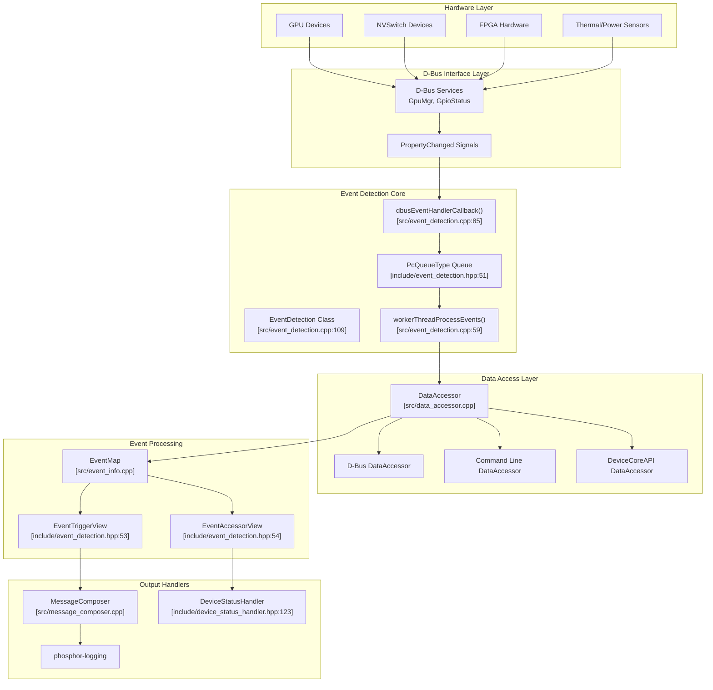

**Sources:** [src/event_detection.cpp:18-773](), [include/event_detection.hpp:18-773](), [src/eventing_main.cpp:18-755](), [meson.build:1-253]()

## Main Operational Flow

The system operates through a multi-threaded event-driven architecture that processes hardware state changes in real-time:

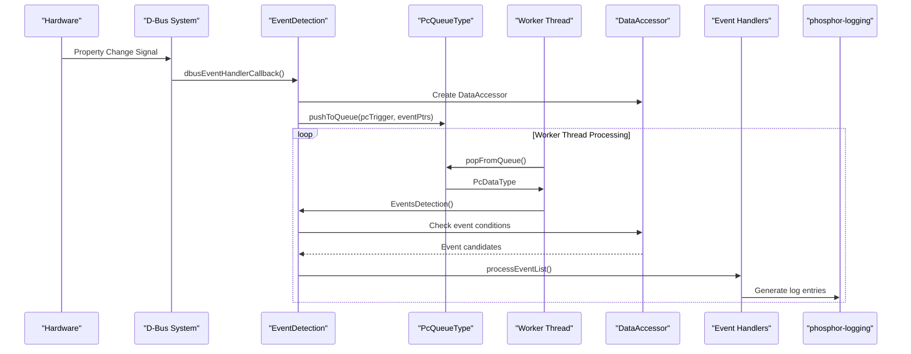

**Sources:** [src/event_detection.cpp:85-156](), [src/event_detection.cpp:215-264](), [src/event_detection.cpp:408-567]()

## Key Runtime Components

| Component | Class Name | Primary Function | Location |
|-----------|------------|------------------|----------|
| **Main Daemon** | `monitor-eventingd` | Service entry point and initialization | [src/eventing_main.cpp:373]() |
| **Event Detection Engine** | `EventDetection` | D-Bus signal processing and event discovery | [src/event_detection.cpp:109]() |
| **Data Access Layer** | `DataAccessor` | Unified interface to hardware data sources | [src/data_accessor.cpp]() |
| **Message Composition** | `MessageComposer` | Redfish-compliant log message generation | [src/message_composer.cpp]() |
| **Device Status Management** | `DeviceStatusHandler` | Health rollup and device status tracking | [include/device_status_handler.hpp:123]() |
| **Self-Test System** | `Selftest` | Boot-up hardware validation | [src/selftest.cpp]() |

## Configuration System

The system is driven by JSON configuration files that define device hierarchies and event specifications:

| Configuration File | Purpose | Key Content |
|-------------------|---------|-------------|
| `event_info.json` | Event definitions and triggers | Device types, D-Bus paths, Redfish message formats |
| `dat.json` | Device Association Tree | Hardware topology and health rollup relationships |

The configuration system supports device range patterns (e.g., `GPU[0-7]`, `NVSwitch[0-3]`) for scalable hardware deployments.

**Sources:** [examples/event_info.json:1-2857](), [examples/dat.json:1-4186](), [src/eventing_main.cpp:108-157]()

## Build System and Integration

The project uses Meson build system and generates the following primary outputs:

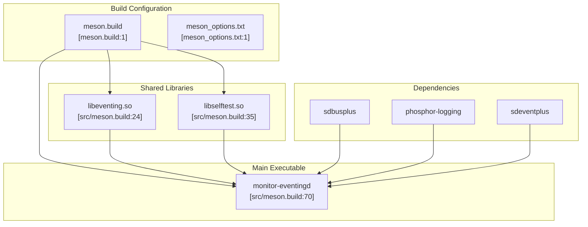

The main daemon `monitor-eventingd` integrates into the OpenBMC systemd environment and connects to the D-Bus system bus for real-time hardware monitoring.

**Sources:** [meson.build:1-253](), [src/meson.build:1-77](), [meson_options.txt:1-130]()

## Integration with OpenBMC Ecosystem

The system integrates tightly with the OpenBMC platform through several key interfaces:

- **D-Bus Services**: Subscribes to `PropertyChanged` signals from hardware management services
- **phosphor-logging**: Generates structured log entries with Redfish message registry compliance  
- **Device Health**: Updates device health properties and rollup status via D-Bus
- **systemd**: Runs as a system service with proper dependency management

This integration enables the monitoring system to participate in the broader BMC ecosystem while providing NVIDIA-specific hardware monitoring capabilities.

**Sources:** [src/eventing_main.cpp:373-755](), [include/device_status_handler.hpp:81-297]()

---

# Page: Core Runtime Architecture

# Core Runtime Architecture

<details>
<summary>Relevant source files</summary>

The following files were used as context for generating this wiki page:

- [include/data_accessor.hpp](include/data_accessor.hpp)
- [include/device_status_handler.hpp](include/device_status_handler.hpp)
- [include/event_detection.hpp](include/event_detection.hpp)
- [include/meson.build](include/meson.build)
- [meson.build](meson.build)
- [meson_options.txt](meson_options.txt)
- [src/data_accessor.cpp](src/data_accessor.cpp)
- [src/event_detection.cpp](src/event_detection.cpp)
- [src/eventing_main.cpp](src/eventing_main.cpp)
- [src/meson.build](src/meson.build)
- [test/accessor_test.cpp](test/accessor_test.cpp)

</details>


## Purpose and Scope

This document covers the main runtime components of the nvidia-monitor-eventing system and how they work together to detect, process, and respond to hardware events in real-time. The core runtime architecture provides the foundation for continuous monitoring of NVIDIA hardware components through D-Bus signals, command-line interfaces, and hardware APIs.

For detailed information about event definitions and configuration, see [Configuration System](#3). For testing and validation workflows, see [Testing and Validation](#5). For the main service executable configuration, see [Main Service - monitor-eventingd](#4).

## Runtime Architecture Overview

The runtime architecture centers around the `EventDetection` class which orchestrates event detection, data access, and event processing through a multi-threaded, queue-based design.

**Core Runtime Architecture**

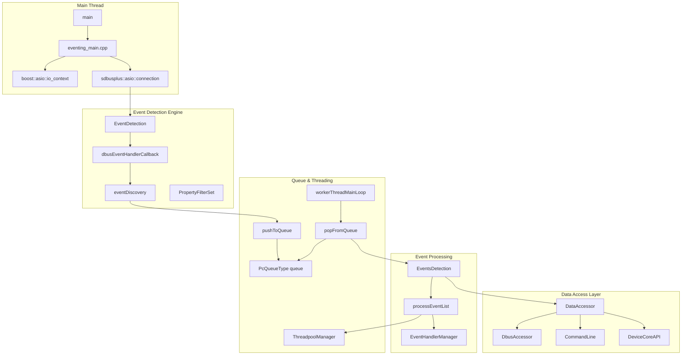

Sources: [src/eventing_main.cpp:302-314](), [src/event_detection.cpp:59-84](), [include/event_detection.hpp:105-180]()

## Key Runtime Components

### EventDetection Engine

The `EventDetection` class serves as the central orchestrator for the runtime system. It manages D-Bus signal subscriptions, processes incoming events, and coordinates with other subsystems.

**EventDetection Core Components**

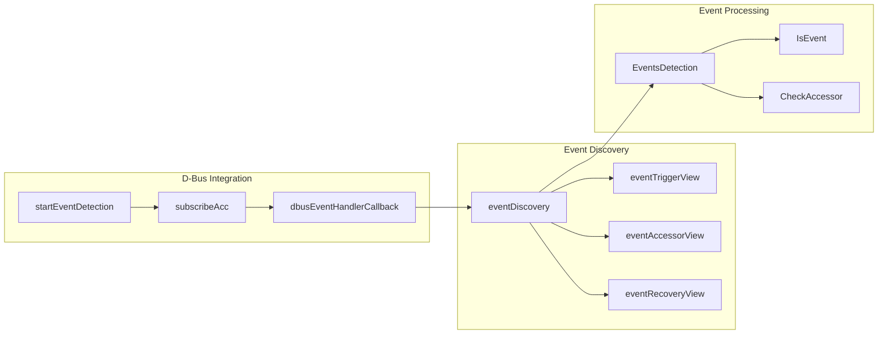

The `EventDetection` class implements several key methods:

- `startEventDetection()` - Initializes D-Bus subscriptions for all configured event triggers and accessors
- `dbusEventHandlerCallback()` - Processes incoming D-Bus PropertyChanged signals
- `eventDiscovery()` - Maps incoming signals to potential events using view containers
- `EventsDetection()` - Validates and processes candidate events

Sources: [include/event_detection.hpp:108-224](), [src/event_detection.cpp:158-181](), [src/event_detection.cpp:85-156]()

### DataAccessor System

The `DataAccessor` class provides a unified interface for accessing data from multiple sources including D-Bus properties, command-line tools, and hardware APIs.

| Accessor Type | Key Field | Usage |
|---------------|-----------|-------|
| `DBUS` | `object`, `interface`, `property` | D-Bus property access |
| `CMDLINE` | `executable`, `arguments` | Command execution |
| `DeviceCoreAPI` | `property` | Hardware API calls |
| `DEVICE` | `device_name` | Device name resolution |
| `CONSTANT` | `value` | Static values |

The `DataAccessor::read()` method routes to appropriate handlers:

- `readDbus()` - Reads D-Bus properties via `dbus::readDbusProperty()`
- `runCommandLine()` - Executes commands using `boost::process`
- `readDeviceCoreApi()` - Calls hardware APIs via `dbus::deviceGetCoreAPI()`

Sources: [include/data_accessor.hpp:83-421](), [src/data_accessor.cpp:85-110](), [src/data_accessor.cpp:112-217]()

## Threading and Queue Architecture

The runtime uses a producer-consumer pattern with separate threads for D-Bus signal handling and event processing.

**Threading Architecture**

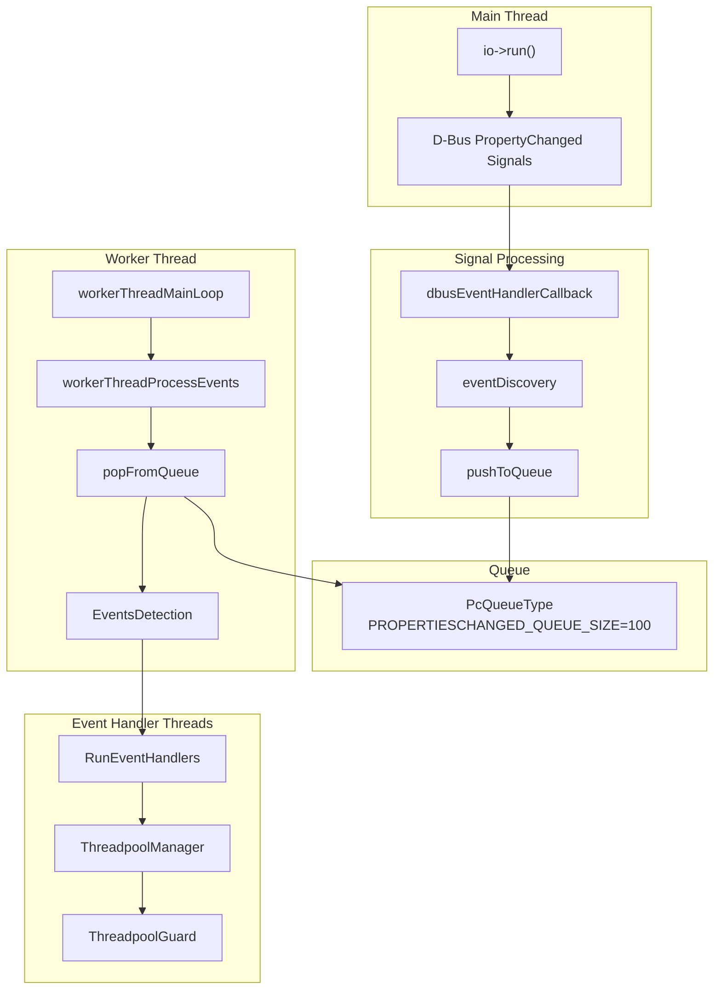

The threading model ensures:

1. **Non-blocking signal processing** - D-Bus signals are quickly queued without blocking
2. **Configurable concurrency** - `ThreadpoolManager` limits concurrent event processing
3. **Resource management** - `ThreadpoolGuard` prevents thread pool exhaustion

Key configuration constants:
- `PROPERTIESCHANGED_QUEUE_SIZE` = 100 (queue capacity)
- `DEFAULT_RUNNING_THREAD_LIMIT` = 3 (concurrent event handlers)
- `DEFAULT_TOTAL_THREAD_LIMIT` = 4 (total thread pool size)

Sources: [src/event_detection.cpp:59-84](), [include/event_detection.hpp:45-47](), [src/eventing_main.cpp:302-314]()

## Event Processing Flow

The event processing pipeline transforms D-Bus signals into actionable events through a multi-stage process.

**Event Processing Pipeline**

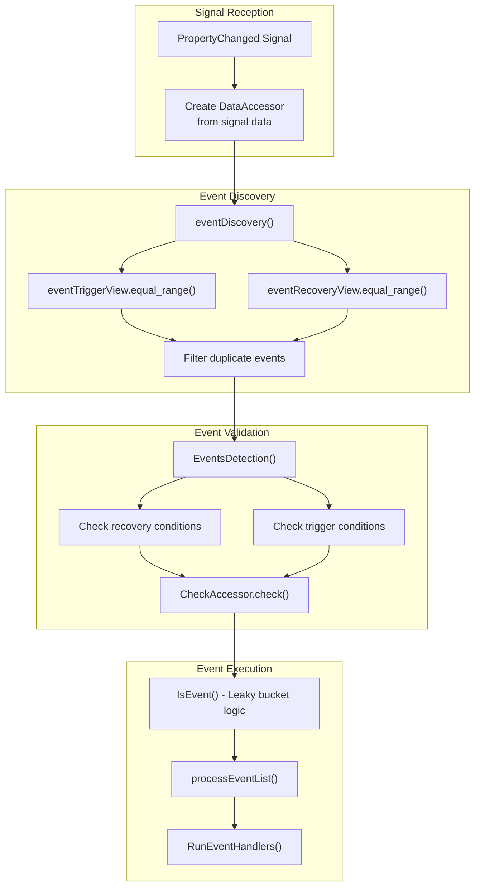

The pipeline implements sophisticated event filtering using view containers:

- `eventTriggerView` - Maps trigger accessors to events for real-time detection
- `eventAccessorView` - Maps main accessors to events for bootup validation
- `eventRecoveryView` - Maps recovery accessors to events for fault clearing

Sources: [src/event_detection.cpp:266-341](), [src/event_detection.cpp:408-567](), [src/event_detection.cpp:379-460]()

## Integration with OpenBMC Ecosystem

The runtime architecture integrates deeply with the OpenBMC ecosystem through standardized interfaces and protocols.

| Integration Point | Implementation | Purpose |
|-------------------|----------------|---------|
| **D-Bus System Bus** | `sdbusplus::asio::connection` | IPC with other BMC services |
| **phosphor-logging** | `MessageComposer` handler | Standard OpenBMC logging |
| **Device Health Properties** | `DeviceStatusHandler` | Hardware health reporting |
| **Redfish Events** | Message registry integration | REST API event exposure |

The main service daemon (`monitor-eventingd`) runs as a systemd service and registers the D-Bus service name `xyz.openbmc_project.nvidia_monitor_eventing` for integration with other BMC components.

Sources: [src/eventing_main.cpp:686-696](), [meson.build:89-98](), [include/device_status_handler.hpp:123-274]()

---

# Page: Event Detection System

# Event Detection System

<details>
<summary>Relevant source files</summary>

The following files were used as context for generating this wiki page:

- [include/check_accessor.hpp](include/check_accessor.hpp)
- [include/data_accessor.hpp](include/data_accessor.hpp)
- [include/event_detection.hpp](include/event_detection.hpp)
- [src/check_accessor.cpp](src/check_accessor.cpp)
- [src/data_accessor.cpp](src/data_accessor.cpp)
- [src/event_detection.cpp](src/event_detection.cpp)
- [test/accessor_test.cpp](test/accessor_test.cpp)

</details>


## Purpose and Scope

The Event Detection System is the core runtime component responsible for monitoring D-Bus property changes, discovering relevant hardware events, and coordinating their processing through the nvidia-monitor-eventing system. This system acts as the central dispatcher that bridges hardware state changes to event logging, device status management, and recovery actions.

This document covers the `EventDetection` class, its D-Bus signal processing pipeline, multi-threaded event handling, and integration with the Data Access Layer. For information about event definitions and configuration, see [Event Definitions](#3.1). For details about the broader runtime architecture, see [Core Runtime Architecture](#2).

## Core Architecture

The Event Detection System operates as a multi-layered architecture centered around the `EventDetection` class, which orchestrates D-Bus signal processing, event discovery, and multi-threaded event handling.

### EventDetection Class Structure

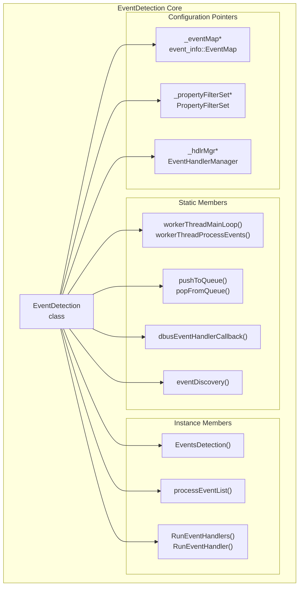

**Sources:** [include/event_detection.hpp:109-770](), [src/event_detection.cpp:44-516]()

### Event Processing Data Flow

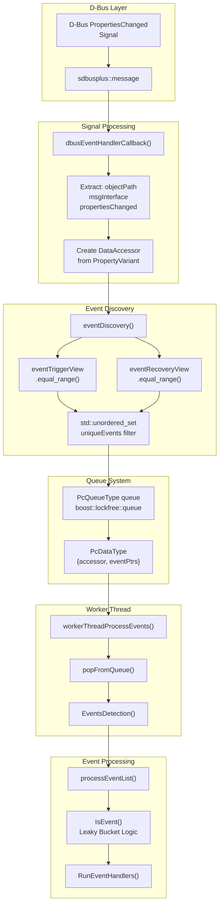

**Sources:** [src/event_detection.cpp:85-156](), [src/event_detection.cpp:215-240](), [src/event_detection.cpp:266-341]()

## D-Bus Signal Processing

The Event Detection System monitors D-Bus `PropertiesChanged` signals through the `dbusEventHandlerCallback()` function, which serves as the entry point for all hardware state change notifications.

### Signal Handler Implementation

The D-Bus callback processes incoming signals by extracting property information and creating `DataAccessor` instances:

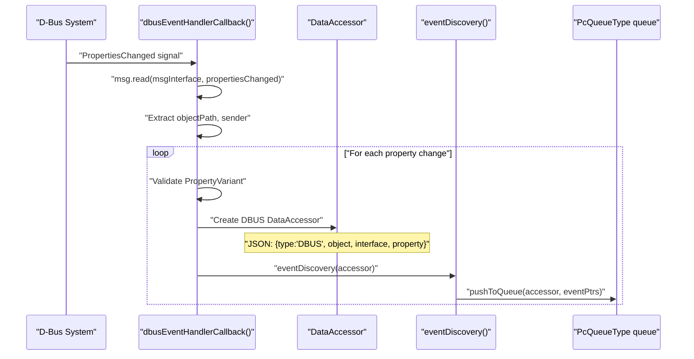

The handler creates a standardized `DataAccessor` representation:

| Field | Source | Purpose |
|-------|---------|---------|
| `type` | Hardcoded "DBUS" | Identifies accessor type |
| `object` | `msg.get_path()` | D-Bus object path |
| `interface` | Read from message | D-Bus interface name |  
| `property` | Property name from change | Changed property identifier |

**Sources:** [src/event_detection.cpp:85-156](), [include/data_accessor.hpp:136-145]()

### D-Bus Handler Registration

Event detection subscribes to relevant D-Bus interfaces through `startEventDetection()`, which creates property change matchers for each accessor in the event configuration:

```mermaid
graph LR
    subgraph "Event Configuration"
        EVENT_MAP["EventMap<br/>_eventMap"]
        EVENTS["EventNode list<br/>per device type"]
        ACCESSORS["trigger, accessor,<br/>recovery_accessor"]
    end
    
    subgraph "Registration Process"
        SUBSCRIBE["subscribeAcc()"]
        INTERFACE_MAP["getDbusInterfaceObjectsMap()"]
        UNIQUE_MAP["RegisteredObjectInterfaceMap<br/>prevent duplicate subscriptions"]
    end
    
    subgraph "D-Bus System"
        MATCHERS["sdbusplus::bus::match_t<br/>PropertyChanged handlers"]
        GENERIC_HANDLER["std::bind to<br/>dbusEventHandlerCallback"]
    end
    
    EVENT_MAP --> EVENTS
    EVENTS --> ACCESSORS  
    ACCESSORS --> SUBSCRIBE
    SUBSCRIBE --> INTERFACE_MAP
    INTERFACE_MAP --> UNIQUE_MAP
    UNIQUE_MAP --> MATCHERS
    MATCHERS --> GENERIC_HANDLER
```

**Sources:** [src/event_detection.cpp:157-213](), [include/event_detection.hpp:183-189]()

## Event Discovery and Matching

The `eventDiscovery()` function implements the core logic for matching incoming D-Bus signals to configured events using specialized view containers for efficient lookup.

### Event View System

The system maintains three specialized views for different event matching scenarios:

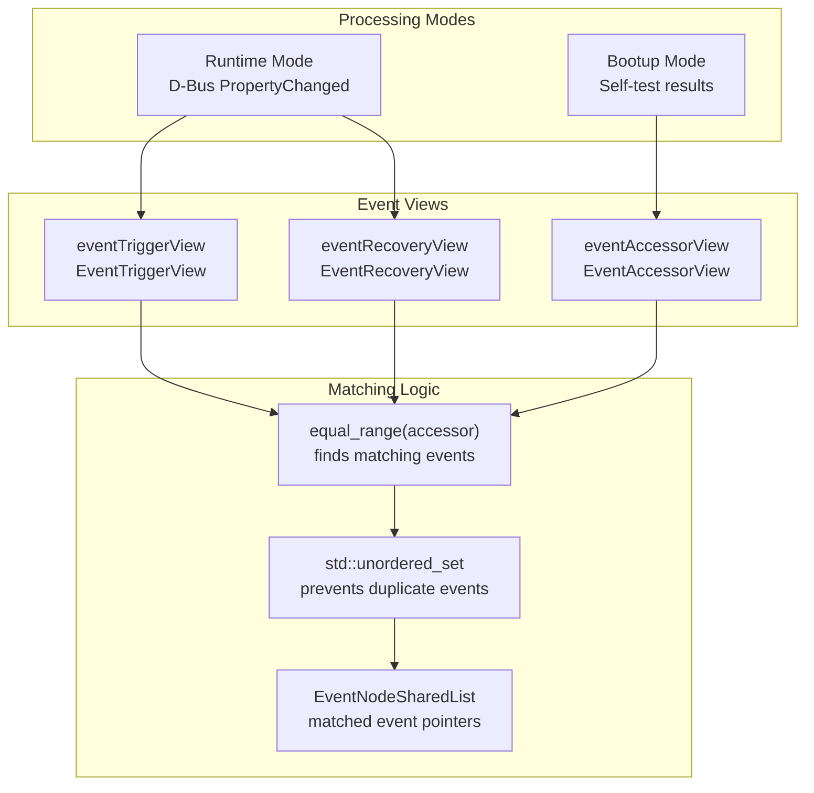

### Event Discovery Algorithm

The discovery process operates differently based on the operational mode:

**Runtime Mode (bootup = false):**
1. Search `eventTriggerView` for matching trigger accessors
2. Search `eventRecoveryView` for matching recovery accessors  
3. Use `std::unordered_set` to prevent duplicate event processing
4. Recovery events are processed before trigger events

**Bootup Mode (bootup = true):**
1. Search only `eventAccessorView` for matching accessors
2. Requires accessor to contain valid data from self-test results
3. Used for detecting events present at system startup

**Sources:** [src/event_detection.cpp:266-341](), [include/event_detection.hpp:53-55]()

## Multi-threaded Processing Pipeline

The Event Detection System uses a lock-free queue and dedicated worker thread to separate D-Bus signal handling from event processing, preventing D-Bus timeouts during complex event handling.

### Threading Architecture

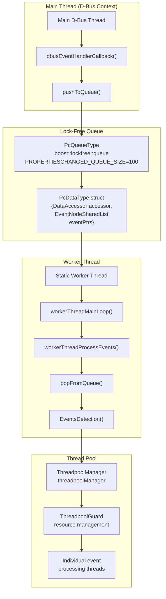

### Queue Management and Flow Control

The system implements queue monitoring and flow control to handle high-frequency D-Bus events:

| Component | Configuration | Purpose |
|-----------|---------------|---------|
| `PROPERTIESCHANGED_QUEUE_SIZE` | 100 elements | Maximum queue capacity |
| `queue->write_available()` | Runtime check | Available queue space monitoring |
| 50% threshold warning | 50 elements | Early congestion detection |
| 500ms worker loop | Sleep interval | Prevents excessive CPU usage |

The worker thread continuously polls the queue with a 500ms sleep interval, processing all available events in each iteration before sleeping again.

**Sources:** [src/event_detection.cpp:59-83](), [src/event_detection.cpp:241-264](), [include/event_detection.hpp:45-47]()

## Data Access Integration

The Event Detection System integrates tightly with the Data Access Layer through the `DataAccessor` abstraction, enabling unified access to multiple data sources during event processing.

### DataAccessor Integration Points

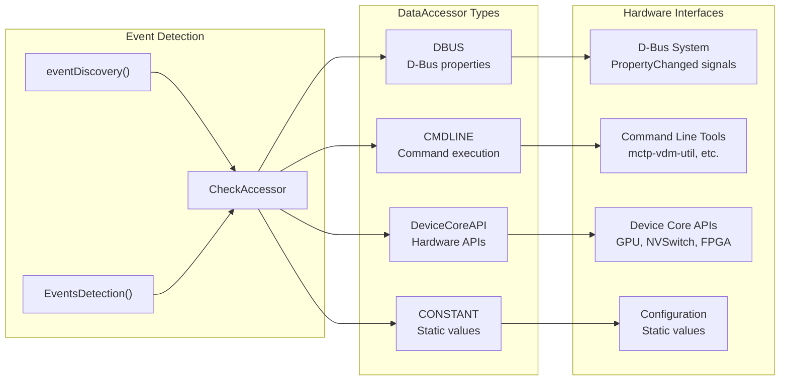

### Event Processing with Data Validation

The `EventsDetection()` method uses `CheckAccessor` instances to validate event conditions across different data sources:

1. **Trigger Validation**: Uses `CheckAccessor` to verify the triggering condition matches the incoming D-Bus signal
2. **Accessor Validation**: Validates additional data requirements using secondary data sources
3. **Recovery Processing**: Handles event recovery scenarios with specialized recovery accessors

The validation process supports multiple check types defined in the event configuration:

| Check Type | Purpose | Example |
|------------|---------|---------|
| `bitmap` | Bit field validation | GPU error register bits |
| `bitmask` | Single bit testing | Device status flags |
| `equal` | Exact value matching | Boolean state comparisons |
| `lookup` | String/pattern matching | Command output parsing |

**Sources:** [src/event_detection.cpp:408-567](), [include/check_accessor.hpp:88-114](), [src/check_accessor.cpp:88-144]()

## Event Validation System

The Event Detection System implements comprehensive validation logic through the `CheckAccessor` class, which performs multi-stage validation of event conditions against hardware data.

### Validation Pipeline

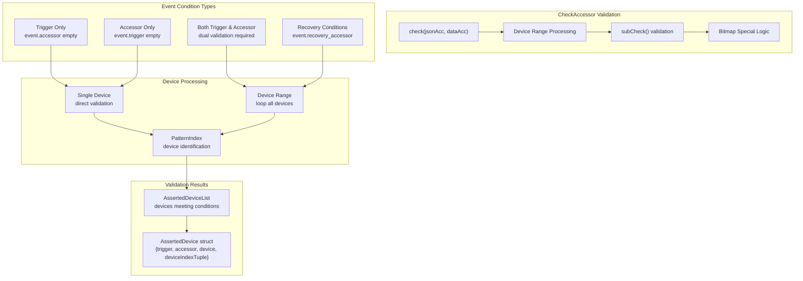

### Leaky Bucket Event Throttling

The system implements a leaky bucket algorithm in `IsEvent()` to prevent event flooding:

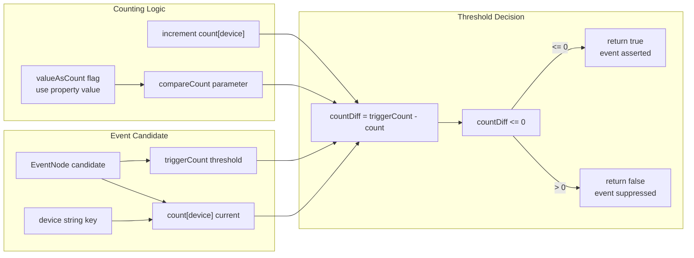

This prevents repeated assertion of the same event until the configured threshold is exceeded, implementing effective rate limiting for high-frequency hardware events.

**Sources:** [src/event_detection.cpp:576-607](), [include/check_accessor.hpp:47-151](), [src/check_accessor.cpp:23-332]()

---

# Page: Data Access Layer

# Data Access Layer

<details>
<summary>Relevant source files</summary>

The following files were used as context for generating this wiki page:

- [include/data_accessor.hpp](include/data_accessor.hpp)
- [include/dbus_accessor.hpp](include/dbus_accessor.hpp)
- [include/property_accessor.hpp](include/property_accessor.hpp)
- [include/property_variant.hpp](include/property_variant.hpp)
- [src/data_accessor.cpp](src/data_accessor.cpp)
- [src/dbus_accessor.cpp](src/dbus_accessor.cpp)
- [src/property_accessor.cpp](src/property_accessor.cpp)
- [test/accessor_test.cpp](test/accessor_test.cpp)
- [test/propertyvalue_string_test.cpp](test/propertyvalue_string_test.cpp)
- [test/propertyvalue_variant_test.cpp](test/propertyvalue_variant_test.cpp)

</details>


The Data Access Layer provides unified access to hardware monitoring data from multiple sources including D-Bus properties, command-line tools, device-specific APIs, and constant values. This abstraction enables the event detection system to query hardware state across different interface types using a consistent API.

For information about how this data is used in event processing, see [Event Processing Pipeline](#2.3). For details on the configuration that drives accessor definitions, see [Event Definitions](#3.1).

## Architecture Overview

The Data Access Layer implements a unified interface pattern where different data sources are accessed through a common `DataAccessor` abstraction. Each accessor type handles the specific details of its data source while presenting a consistent read/write interface.

### DataAccessor Type System

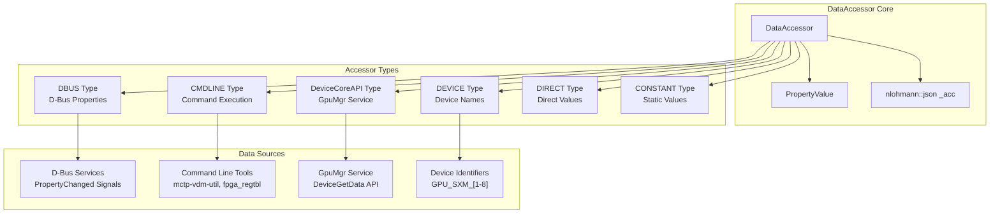

**Sources:** [include/data_accessor.hpp:71-77](), [include/data_accessor.hpp:83-108](), [src/data_accessor.cpp:30-67]()

### Data Flow Architecture

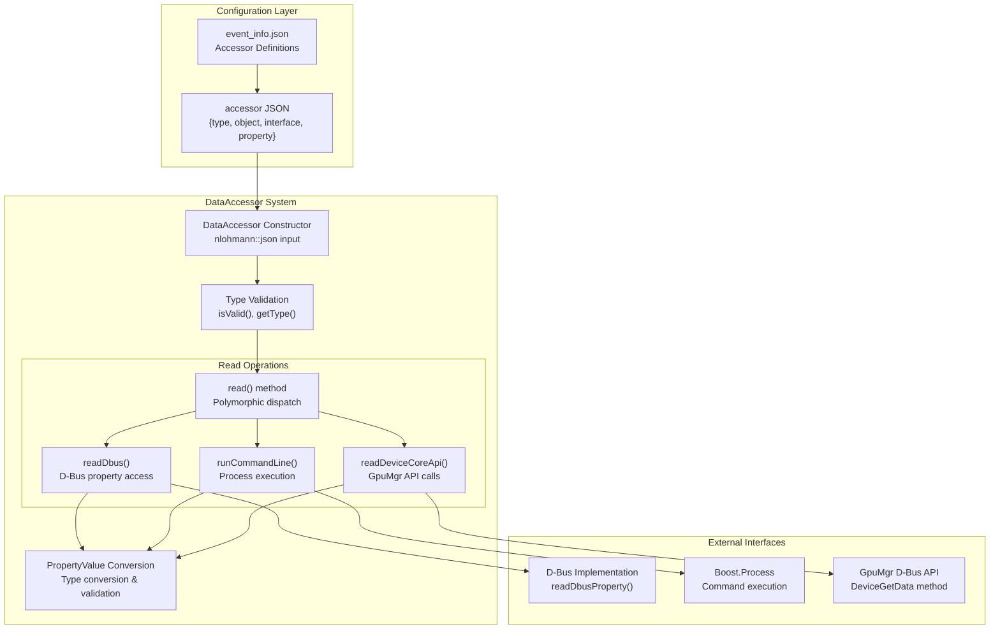

**Sources:** [src/data_accessor.cpp:85-110](), [src/data_accessor.cpp:112-217](), [src/data_accessor.cpp:230-264]()

## Core Components

### DataAccessor Class

The `DataAccessor` class serves as the primary interface for all data access operations. It encapsulates accessor configuration in JSON format and provides polymorphic data reading capabilities.

| Component | Purpose | Key Methods |
|-----------|---------|-------------|
| `_acc` | JSON configuration storage | Contains type, object path, interface, property |
| `_dataValue` | Cached data storage | Stores `PropertyValue` after successful read |
| Type checking | Accessor type validation | `isTypeDbus()`, `isTypeCmdline()`, `isTypeDeviceCoreApi()` |
| Read operations | Data retrieval | `read()`, `readDbus()`, `runCommandLine()`, `readDeviceCoreApi()` |

**Sources:** [include/data_accessor.hpp:83-108](), [include/data_accessor.hpp:370-420]()

### PropertyValue System

The `PropertyValue` class handles type conversion and validation for data retrieved from various sources. It supports both string and 64-bit integer representations with automatic conversion between types.

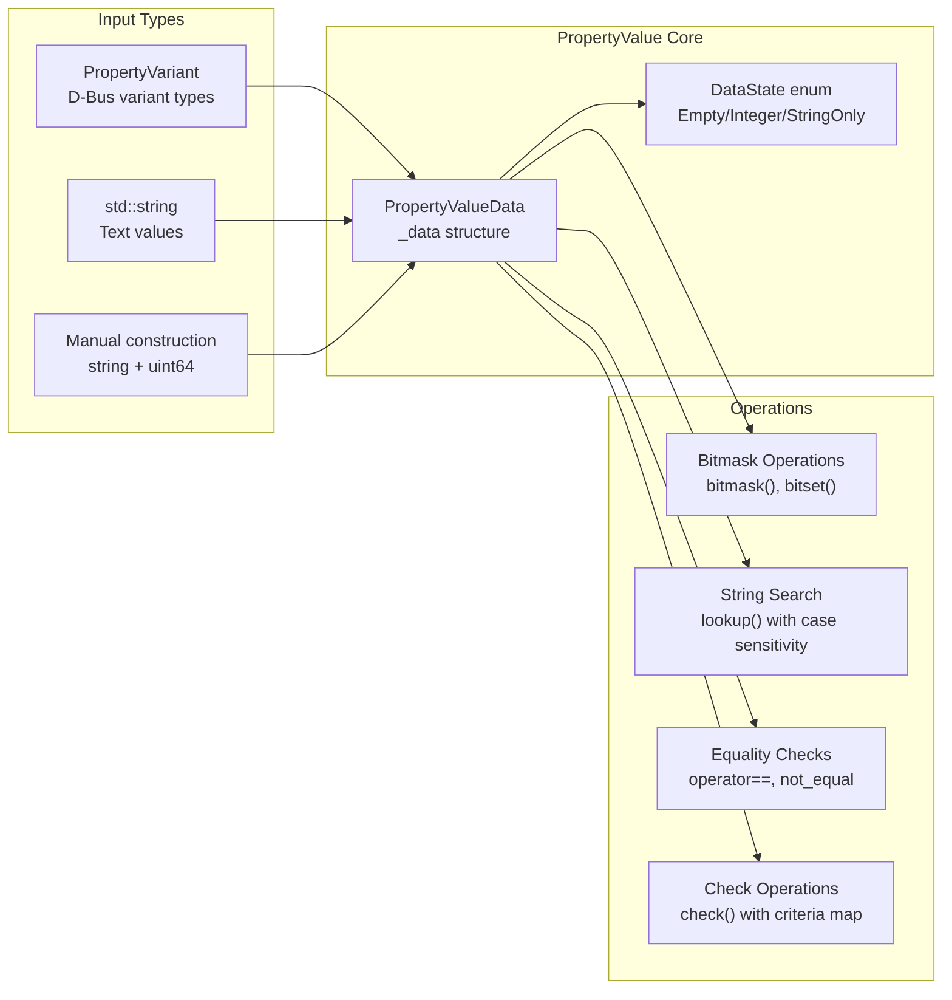

**Sources:** [include/property_accessor.hpp:271-295](), [include/property_accessor.hpp:49-73](), [src/property_accessor.cpp:84-134]()

## Accessor Type Implementations

### DBUS Accessor

D-Bus accessors read properties from OpenBMC D-Bus services using the standard `org.freedesktop.DBus.Properties` interface.

**Configuration Format:**
```json
{
  "type": "DBUS",
  "object": "/xyz/openbmc_project/inventory/system/chassis/GPU[0-7]", 
  "interface": "xyz.openbmc_project.Inventory.Decorator.Dimension",
  "property": "Depth"
}
```

**Implementation Flow:**
1. Service discovery via `ObjectMapper`
2. Property read via `org.freedesktop.DBus.Properties.Get`
3. Type conversion through `PropertyValue`
4. Range expansion for device patterns

**Sources:** [src/data_accessor.cpp:85-110](), [src/dbus_accessor.cpp:216-258](), [src/dbus_accessor.cpp:62-111]()

### CMDLINE Accessor

Command-line accessors execute external tools and parse their output for monitoring data.

**Configuration Format:**
```json
{
  "type": "CMDLINE",
  "executable": "mctp-vdm-util-wrapper",
  "arguments": "AP0_BOOTCOMPLETE_TIMEOUT GPU_SXM_[1-8]",
  "check": {"lookup": "00 02 40"}
}
```

**Implementation Details:**
- Uses `boost::process` for secure execution
- Timeout handling (10 seconds default)
- Process group termination for cleanup
- Device range substitution in arguments

**Sources:** [src/data_accessor.cpp:112-217](), [include/data_accessor.hpp:36-42]()

### DeviceCoreAPI Accessor

DeviceCoreAPI accessors interface with NVIDIA's device management APIs through the GpuMgr D-Bus service.

**Configuration Format:**
```json
{
  "type": "DeviceCoreAPI", 
  "property": "gpu.thermal.temperature.overTemperatureInfo",
  "check": {"bitmap": "1"}
}
```

**API Integration:**
- Calls `xyz.openbmc_project.GpuMgr.Server.DeviceGetData`
- Device ID mapping through `util::getMappedDeviceId()`
- Returns structured data: `(rc, string, uint64)`
- Supports both lookup and bitmap check modes

**Sources:** [src/data_accessor.cpp:230-264](), [src/dbus_accessor.cpp:113-172]()

## Device Range Expansion

The system supports device range patterns (e.g., `GPU[0-7]`, `NVLink_[0-39]`) that expand to individual device instances for iteration and specific device targeting.

### Range Pattern Processing

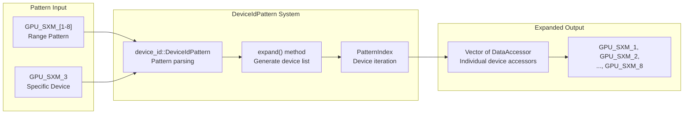

**Key Methods:**
- `expand()`: Creates individual `DataAccessor` instances for each device in range
- `isDeviceIdRange()`: Determines if accessor should iterate over devices
- `util::expandDeviceRange()`: Utility function for range processing

**Sources:** [src/data_accessor.cpp:317-341](), [include/data_accessor.hpp:365-369](), [test/accessor_test.cpp:697-813]()

## Property Validation and Checking

The Data Access Layer includes sophisticated property validation through the check system, supporting various comparison operations for event trigger evaluation.

### Check Operation Types

| Check Type | Purpose | Example Usage |
|------------|---------|---------------|
| `bitmask` | All specified bits set | `{"bitmask": "0x03"}` |
| `bitmap` | Alias for bitmask with shifting | `{"bitmap": "1"}` |
| `bitset` | Any specified bits set | `{"bitset": "0x03"}` |
| `lookup` | Substring search | `{"lookup": "00 02 40"}` |
| `equal` | Exact value match | `{"equal": "true"}` |
| `not_equal` | Value inequality | `{"not_equal": "0"}` |

### Check Implementation Architecture

```mermaid
graph TB
    subgraph "Check System"
        CHECK_MAP["CheckDefinitionMap<br/>std::map<string,string>"]
        CRITERIA["PropertyVariant<br/>Optional redefinition"]
        CHECK_METHOD["PropertyValue::check()<br/>Main validation method"]
    end
    
    subgraph "Check Operations"
        BITMASK_OP["bitmask(uint64)<br/>(value & mask) == mask"]
        BITSET_OP["bitset(uint64)<br/>(value & mask) != 0"]
        LOOKUP_OP["lookup(string)<br/>substring search"]
        EQUAL_OP["operator==<br/>value comparison"]
    end
    
    subgraph "Criteria Resolution"
        GET_VALUE["criteria::getValueFromCriteria<br/>Resolve check value"]
        GET_STRING["criteria::getStringFromCriteria<br/>Resolve string value"]
    end
    
    CHECK_MAP --> CHECK_METHOD
    CRITERIA --> GET_VALUE
    CRITERIA --> GET_STRING
    
    CHECK_METHOD --> BITMASK_OP
    CHECK_METHOD --> BITSET_OP  
    CHECK_METHOD --> LOOKUP_OP
    CHECK_METHOD --> EQUAL_OP
    
    GET_VALUE --> BITMASK_OP
    GET_VALUE --> EQUAL_OP
    GET_STRING --> LOOKUP_OP
```

**Sources:** [src/property_accessor.cpp:84-134](), [include/property_accessor.hpp:30-40](), [src/property_accessor.cpp:307-330]()

## Integration Points

### D-Bus Integration

The Data Access Layer integrates tightly with the OpenBMC D-Bus ecosystem through several mechanisms:

- **Service Discovery**: Uses `xyz.openbmc_project.ObjectMapper` for dynamic service resolution
- **Property Access**: Standard `org.freedesktop.DBus.Properties` interface for get/set operations  
- **Signal Handling**: Registers for `PropertiesChanged` signals for event detection
- **Caching**: Implements `CachingObjectMapper` for performance optimization

**Sources:** [src/dbus_accessor.cpp:62-111](), [src/dbus_accessor.cpp:260-291](), [src/dbus_accessor.cpp:330-412]()

### Event System Integration

The Data Access Layer serves as the foundation for the event detection system by providing:

1. **Trigger Evaluation**: Accessor data drives event trigger conditions
2. **Device Context**: Range expansion enables per-device event processing  
3. **Property Validation**: Check operations determine event assertion states
4. **Data Caching**: Cached values optimize repeated access during event processing

**Sources:** [src/data_accessor.cpp:343-374](), [include/data_accessor.hpp:422-423]()

---

# Page: Event Processing Pipeline

# Event Processing Pipeline

<details>
<summary>Relevant source files</summary>

The following files were used as context for generating this wiki page:

- [include/dat_traverse.hpp](include/dat_traverse.hpp)
- [include/device_status_handler.hpp](include/device_status_handler.hpp)
- [include/event_handler.hpp](include/event_handler.hpp)
- [include/meson.build](include/meson.build)
- [include/message_composer.hpp](include/message_composer.hpp)
- [meson.build](meson.build)
- [meson_options.txt](meson_options.txt)
- [src/dat_traverse.cpp](src/dat_traverse.cpp)
- [src/eventing_main.cpp](src/eventing_main.cpp)
- [src/meson.build](src/meson.build)
- [src/message_composer.cpp](src/message_composer.cpp)
- [test/dat_traverse_test.cpp](test/dat_traverse_test.cpp)
- [test/event_test.cpp](test/event_test.cpp)

</details>


## Overview

The Event Processing Pipeline is the core system responsible for transforming detected hardware events into actionable outputs such as phosphor logs, device status updates, and recovery actions. This pipeline coordinates multiple event handlers in a specific sequence to ensure comprehensive event processing and system health management.

For information about event detection and D-Bus signal processing, see [Event Detection System](#2.1). For details about data retrieval mechanisms, see [Data Access Layer](#2.2). For the main daemon configuration, see [Main Service - monitor-eventingd](#4).

## Pipeline Architecture

The event processing pipeline follows a handler chain pattern where each event flows through multiple specialized processors. The pipeline is orchestrated by the `EventHandlerManager` class and executed within the main daemon context.

### Event Processing Flow

```mermaid
flowchart TD
    subgraph "Event Detection"
        ED["EventDetection"]
        QUEUE["PcQueueType Queue"]
        WORKER["Worker Thread"]
    end
    
    subgraph "Handler Chain"
        EHM["EventHandlerManager"]
        RCT["RootCauseTracer"]
        MC["MessageComposer"]
        DSH["DeviceStatusHandler"]
        CE["ClearEvent"]
    end
    
    subgraph "Output Systems"
        PL["phosphor-logging"]
        FS["DevInfoFS"]
        DBUS["D-Bus Properties"]
        API["DeviceCoreAPI"]
    end
    
    ED --> QUEUE
    QUEUE --> WORKER
    WORKER --> EHM
    
    EHM --> RCT
    RCT --> MC
    MC --> DSH
    DSH --> CE
    
    MC --> PL
    DSH --> FS
    DSH --> DBUS
    CE --> API
```

**Sources:** [src/eventing_main.cpp:584-669](), [include/event_handler.hpp:103-184]()

### Handler Registration and Execution Order

The event handlers are registered in a specific order that ensures data dependencies are met. Each handler processes the event and may modify it for subsequent handlers.

```mermaid
sequenceDiagram
    participant ED as EventDetection
    participant EHM as EventHandlerManager
    participant RCT as RootCauseTracer
    participant MC as MessageComposer
    participant DSH as DeviceStatusHandler
    participant CE as ClearEvent
    
    ED->>EHM: process(EventNode)
    EHM->>RCT: process(EventNode)
    Note over RCT: Determines origin of condition
    RCT-->>EHM: RcCode::succ
    
    EHM->>MC: process(EventNode)
    Note over MC: Creates phosphor log entry
    MC-->>EHM: RcCode::succ
    
    EHM->>DSH: process(EventNode)
    Note over DSH: Updates device health status
    DSH-->>EHM: RcCode::succ
    
    EHM->>CE: process(EventNode)
    Note over CE: Clears event conditions
    CE-->>EHM: RcCode::succ
```

**Sources:** [src/eventing_main.cpp:661-669](), [include/event_handler.hpp:157-176]()

## Event Handler Components

### EventHandlerManager

The `EventHandlerManager` class coordinates the execution of all registered event handlers. It provides methods for individual and batch handler execution.

| Method | Purpose | Return Type |
|--------|---------|-------------|
| `RegisterHandler()` | Adds handler to execution chain | `void` |
| `RunHandler()` | Executes specific handler by name | `eventing::RcCode` |
| `RunAllHandlers()` | Executes all handlers in order | `eventing::RcCode` |

**Sources:** [include/event_handler.hpp:103-184]()

### MessageComposer

The `MessageComposer` class creates structured log entries in the phosphor-logging system. It transforms event data into OpenBMC-compatible log formats.

#### Key Processing Steps

```mermaid
flowchart LR
    subgraph "MessageComposer Process"
        EN["EventNode Input"]
        SEV["makeSeverity()"]
        MA["getStringMessageArgs()"]
        TD["collectDiagData()"]
        OOC["getOriginOfCondition()"]
        NS["getPhosphorLoggingNamespace()"]
        LOG["createLog()"]
    end
    
    EN --> SEV
    EN --> MA
    EN --> TD
    EN --> OOC
    EN --> NS
    
    SEV --> LOG
    MA --> LOG
    TD --> LOG
    OOC --> LOG
    NS --> LOG
    
    LOG --> PHOSPHOR["phosphor-logging D-Bus Call"]
```

The `createLog()` method constructs a D-Bus method call with the following properties:

| Property | Source Method | Purpose |
|----------|---------------|---------|
| `REDFISH_MESSAGE_ID` | `event.getMessageId()` | Redfish message identifier |
| `DEVICE_EVENT_DATA` | `collectDiagData()` | Telemetry and diagnostic data |
| `REDFISH_MESSAGE_ARGS` | `event.getStringMessageArgs()` | Message formatting arguments |
| `REDFISH_ORIGIN_OF_CONDITION` | `getOriginOfCondition()` | Device path causing condition |
| `namespace` | `getPhosphorLoggingNamespace()` | Logging namespace |

**Sources:** [src/message_composer.cpp:56-108](), [include/message_composer.hpp:42-233]()

### DeviceStatusHandler

The `DeviceStatusHandler` updates device health information in multiple output formats including filesystem and shared memory.

#### Device Status Update Flow

```mermaid
flowchart TD
    subgraph "Input Processing"
        EVENT["EventNode Input"]
        MANAGED{"Event Managed?"}
        LOOKUP["lookupRollupDeviceId()"]
    end
    
    subgraph "Status Cache"
        CACHE["DeviceStatus Cache"]
        DEVICE["Device Record"]
        SEVERITY{"Severity Check"}
    end
    
    subgraph "Output Generation"
        JSON["JSON Status Object"]
        CONDITION["Condition Record"]
        TIMESTAMP["getTimestamp()"]
    end
    
    subgraph "Output Systems"
        DEVINFOFS["DevInfoFS Write"]
        SHMEM["Shared Memory Update"]
    end
    
    EVENT --> MANAGED
    MANAGED -->|Yes| LOOKUP
    MANAGED -->|No| RETURN["Return Success"]
    
    LOOKUP --> CACHE
    CACHE --> DEVICE
    DEVICE --> SEVERITY
    SEVERITY -->|Higher/Equal| JSON
    SEVERITY -->|Lower| RETURN
    
    JSON --> CONDITION
    CONDITION --> TIMESTAMP
    TIMESTAMP --> DEVINFOFS
    TIMESTAMP --> SHMEM
```

The status update creates a JSON structure containing:
- `Status.Health` - Current device health
- `Status.HealthRollup` - Aggregated health status  
- `Status.Conditions[]` - Array of active conditions with metadata

**Sources:** [include/device_status_handler.hpp:123-295]()

### ClearEvent

The `ClearEvent` handler processes event clearance operations, particularly for DeviceCoreAPI-based events.

**Sources:** [include/event_handler.hpp:52-97]()

## Thread Safety and Concurrency

The event processing pipeline operates in a multi-threaded environment with the following concurrency controls:

### ThreadpoolManager Integration

```mermaid
flowchart LR
    subgraph "Thread Management"
        TPM["ThreadpoolManager"]
        GUARD["ThreadpoolGuard"]
        LIMIT["Thread Limits"]
    end
    
    subgraph "Event Processing"
        QUEUE["Event Queue"]
        WORKER["Worker Threads"]
        HANDLERS["Handler Chain"]
    end
    
    TPM --> GUARD
    LIMIT --> TPM
    GUARD --> WORKER
    QUEUE --> WORKER
    WORKER --> HANDLERS
```

Configuration parameters:
- `running_thread_limit` - Maximum concurrent processing threads
- `total_thread_limit` - Maximum total threads (running + queued)

**Sources:** [src/eventing_main.cpp:560-572](), [src/eventing_main.cpp:196-216]()

### Mutex Protection

Critical sections are protected by mutexes in:
- `DeviceStatus` cache operations [include/device_status_handler.hpp:70-78]()
- Device status file operations [include/device_status_handler.hpp:242-243]()

## Configuration and Initialization

The pipeline is initialized during daemon startup with handler registration occurring in dependency order:

```cpp
// Handler registration order from eventing_main.cpp
eventHdlrMgr.RegisterHandler(&rootCauseTracer);  // First - determines OOC
eventHdlrMgr.RegisterHandler(&msgComposer);      // Second - creates logs
eventHdlrMgr.RegisterHandler(&deviceStatus);     // Third - updates status
eventHdlrMgr.RegisterHandler(&clearEvent);       // Last - clears conditions
```

**Sources:** [src/eventing_main.cpp:588-669]()

## Error Handling and Recovery

Each handler returns an `eventing::RcCode` to indicate processing status. The pipeline continues processing even on handler failures to ensure event logging occurs.

Handler failure scenarios:
- D-Bus communication errors during log creation
- File system errors during status updates
- Invalid event data or missing configuration
- Thread pool exhaustion

**Sources:** [include/event_handler.hpp:164-174](), [src/message_composer.cpp:96-107]()

---

# Page: Configuration System

# Configuration System

<details>
<summary>Relevant source files</summary>

The following files were used as context for generating this wiki page:

- [examples/dat.json](examples/dat.json)
- [examples/event_info.json](examples/event_info.json)
- [include/dat_traverse.hpp](include/dat_traverse.hpp)
- [include/event_handler.hpp](include/event_handler.hpp)
- [include/event_info.hpp](include/event_info.hpp)
- [src/dat_traverse.cpp](src/dat_traverse.cpp)
- [src/event_info.cpp](src/event_info.cpp)
- [test/dat_test.cpp](test/dat_test.cpp)
- [test/dat_traverse_test.cpp](test/dat_traverse_test.cpp)
- [test/event_detection_test.cpp](test/event_detection_test.cpp)
- [tools/mctp-error-detection](tools/mctp-error-detection)

</details>


The Configuration System provides the foundational data structures and loading mechanisms that define how hardware events are detected, processed, and reported across NVIDIA server platforms. It consists of two primary JSON-based configuration files and their corresponding C++ classes that translate static configuration into runtime behavior.

For information about how events flow through the runtime system after configuration loading, see [Event Detection System](#2.1). For details on the main daemon that loads these configurations, see [Main Service - monitor-eventingd](#4).

## Configuration Architecture Overview

The configuration system operates through two complementary configuration files that work together to define the complete monitoring and eventing behavior:

```mermaid
graph TB
    subgraph "Configuration Files"
        EI["event_info.json<br/>Event Definitions"]
        DAT["dat.json<br/>Device Association Tree"]
    end
    
    subgraph "Configuration Classes"
        EN["EventNode<br/>Individual Event Definition"]
        EM["EventMap<br/>Device Type → Events"]
        DEV["dat_traverse::Device<br/>Device Hierarchy Node"]
        DEVMAP["Device Map<br/>Device Name → Device"]
    end
    
    subgraph "Runtime Integration"
        ED["EventDetection<br/>Runtime Event Processing"]
        DT["DATTraverse<br/>Device Health Management"]
        ST["Selftest<br/>Diagnostic Testing"]
    end
    
    EI --> EN
    EI --> EM
    DAT --> DEV
    DAT --> DEVMAP
    
    EM --> ED
    DEVMAP --> DT
    DEVMAP --> ST
    
    EN --> ED
    DEV --> DT
```

**Configuration System Flow**
Sources: [include/event_info.hpp:334-663](), [include/dat_traverse.hpp:100-224](), [src/event_info.cpp:144-196](), [src/dat_traverse.cpp:87-124]()

## Event Configuration (`event_info.json`)

The `event_info.json` file defines the comprehensive catalog of hardware events that can occur across different device types. Each event specifies detection criteria, message formatting, and response actions.

### Event Definition Structure

```mermaid
graph LR
    subgraph "EventNode Structure"
        EN["EventNode"]
        EN --> DT["deviceTypes<br/>vector&lt;string&gt;"]
        EN --> TR["trigger<br/>DataAccessor"]
        EN --> AC["accessor<br/>DataAccessor"] 
        EN --> RF["messageRegistry<br/>redfish"]
        EN --> TEL["telemetries<br/>vector&lt;DataAccessor&gt;"]
        EN --> ACT["action<br/>string"]
    end
    
    subgraph "DataAccessor Types"
        DB["DBUS<br/>D-Bus Properties"]
        CMD["CMDLINE<br/>Command Execution"]
        API["DeviceCoreAPI<br/>Hardware APIs"]
        FPGA["FPGA<br/>Register Access"]
    end
    
    TR --> DB
    AC --> CMD
    TEL --> API
    TEL --> FPGA
```

**Event Configuration Components**
Sources: [include/event_info.hpp:334-425](), [examples/event_info.json:1-57]()

The `EventNode` class represents individual events with the following key properties:

| Property | Type | Purpose |
|----------|------|---------|
| `event` | `string` | Human-readable event name |
| `device_type` | `vector<string>` | Device patterns this event applies to |
| `trigger` | `DataAccessor` | What condition triggers the event |
| `accessor` | `DataAccessor` | How to read event status/data |
| `severity` | `string` | Event severity level (Critical, Warning, OK) |
| `trigger_count` | `int` | Number of occurrences before triggering |
| `messageRegistry` | `redfish` | Redfish message formatting |
| `telemetries` | `vector<DataAccessor>` | Additional data to collect |

### Event Loading Process

```mermaid
sequenceDiagram
    participant Main as "monitor-eventingd"
    participant Loader as "loadFromFile()"
    participant Parser as "loadFromJson()"
    participant Node as "EventNode::loadFrom()"
    
    Main->>Loader: loadFromFile(eventMap, file)
    Loader->>Parser: loadFromJson(eventMap, j)
    
    loop For each device type
        Parser->>Node: eventNode->loadFrom(event)
        Node-->>Parser: Populated EventNode
        Parser->>Parser: Add to EventMap
        Parser->>Parser: Build PropertyFilterSet
        Parser->>Parser: Build EventTriggerView
    end
    
    Parser-->>Loader: Complete EventMap
    Loader-->>Main: Loaded configuration
```

**Event Configuration Loading**
Sources: [src/event_info.cpp:198-212](), [src/event_info.cpp:510-594](), [src/event_info.cpp:144-196]()

The loading process creates several indexed data structures:

- `EventMap`: Maps device types to their applicable events
- `PropertyFilterSet`: Optimized lookup for D-Bus property monitoring  
- `EventTriggerView`: Hash map for trigger-based event lookup
- `EventAccessorView`: Hash map for accessor-based event lookup

### Device Type Patterns

Event definitions use flexible device type patterns to specify which hardware components they apply to:

```json
{
  "event": "OverTemp",
  "device_type": "GPU[0-7]",
  "event_trigger": {
    "type": "DBUS",
    "object": "/xyz/openbmc_project/GpioStatusHandler",
    "interface": "xyz.openbmc_project.GpioStatus",
    "property": "THERM_OVERT"
  }
}
```

Sources: [examples/event_info.json:3-14](), [include/event_info.hpp:555-567](), [src/event_info.cpp:734-782]()

## Device Association Tree (`dat.json`)

The Device Association Tree defines the hierarchical relationships between hardware components and their associated test points for diagnostic purposes.

### DAT Structure and Device Hierarchy

```mermaid
graph TD
    subgraph "Device Hierarchy Example"
        BB["Baseboard"]
        BB --> GPU0["GPU0"]
        BB --> GPU1["GPU1"] 
        BB --> NVS0["NVSwitch0"]
        
        GPU0 --> HSC0["HSC0<br/>(Hot Swap Controller)"]
        GPU0 --> EROT0["ERoT_GPU0<br/>(Embedded Root of Trust)"]
        GPU0 --> DRAM0["GPUDRAM0"]
        GPU0 --> RET0["PCIeRetimer0"]
    end
    
    subgraph "Test Layers"
        PR["power_rail"]
        EC["erot_control"] 
        PS["pin_status"]
        IS["interface_status"]
        FS["firmware_status"]
        PRS["protocol_status"]
    end
    
    GPU0 -.-> PR
    GPU0 -.-> EC
    GPU0 -.-> PS
    GPU0 -.-> IS
    GPU0 -.-> FS
    GPU0 -.-> PRS
```

**Device Association Tree Structure**
Sources: [examples/dat.json:1-184](), [include/dat_traverse.hpp:100-224]()

### Device Test Layers

Each device in the DAT contains multiple test layers that define diagnostic test points:

| Layer | Purpose | Example Test Points |
|-------|---------|-------------------|
| `power_rail` | Power supply validation | HSC status, voltage levels |
| `erot_control` | Root of Trust security | ERoT authentication |
| `pin_status` | Hardware pin states | PGOOD signals, interrupts |
| `interface_status` | Communication interfaces | SPI flash, clock enablement |
| `protocol_status` | Protocol-level checks | MCTP, PCIe link status |
| `firmware_status` | Firmware integrity | Boot status, version checks |

Sources: [examples/dat.json:31-155](), [src/dat_traverse.cpp:239-280]()

### DAT Loading and Device Relationships

```mermaid
graph LR
    subgraph "DAT Loading Process"
        JSON["dat.json"]
        POP["Device::populateMap()"]
        DEV["Device objects"]
        PARENT["Parent relationship<br/>population"]
    end
    
    subgraph "Device Class Structure" 
        NAME["name<br/>string"]
        TYPE["type<br/>DeviceType"]
        ASSOC["association<br/>vector&lt;string&gt;"]
        PARENTS["parents<br/>vector&lt;string&gt;"]
        HEALTH["healthStatus<br/>Status"]
        TESTS["test<br/>map&lt;string, TestLayer&gt;"]
    end
    
    JSON --> POP
    POP --> DEV
    DEV --> PARENT
    
    DEV --> NAME
    DEV --> TYPE  
    DEV --> ASSOC
    DEV --> PARENTS
    DEV --> HEALTH
    DEV --> TESTS
```

**DAT Device Class Structure**
Sources: [include/dat_traverse.hpp:100-224](), [src/dat_traverse.cpp:87-124](), [src/dat_traverse.cpp:196-282]()

The `Device` class encapsulates each node in the device hierarchy:

```cpp
class Device {
    std::string name;                              // Device identifier
    DeviceType type;                               // Device category
    std::vector<std::string> association;         // Child devices  
    std::vector<std::string> parents;             // Parent devices
    Status healthStatus;                          // Current health state
    std::map<std::string, TestLayer> test;        // Test point layers
    std::optional<std::string> dbusPathPrimary;   // D-Bus object path
    std::optional<std::string> dbusPathOoc;       // Origin of condition path
};
```

## Configuration Integration with Runtime System

The configuration system provides the foundation for runtime event detection and device health management through several key integration points:

### Event Detection Integration

```mermaid
graph TB
    subgraph "Configuration Data"
        EM["EventMap<br/>Device Types → Events"]
        PFS["PropertyFilterSet<br/>D-Bus Property Filter"]
        ETV["EventTriggerView<br/>Trigger → Event Lookup"]
    end
    
    subgraph "Runtime Event Detection"
        ED["EventDetection<br/>Main Detection Engine"]
        DBUS["D-Bus PropertiesChanged<br/>Signal Processing"]
        WORKER["Worker Thread<br/>Event Processing Queue"]
    end
    
    subgraph "Event Processing"
        MC["MessageComposer<br/>Redfish Logging"]
        DS["DeviceStatusHandler<br/>Health Updates"]  
        ST["Selftest<br/>Diagnostic Testing"]
    end
    
    EM --> ED
    PFS --> ED
    ETV --> ED
    
    ED --> DBUS
    ED --> WORKER
    
    WORKER --> MC
    WORKER --> DS
    WORKER --> ST
```

**Runtime Integration Architecture**
Sources: [include/event_info.hpp:665-686](), [src/event_info.cpp:124-142](), [test/event_detection_test.cpp:142-186]()

### Health Management Integration

```mermaid
graph TB
    subgraph "DAT Configuration"
        DEVMAP["Device Map<br/>Device Name → Device"]
        TL["TestLayer<br/>Diagnostic Test Points"]
        HS["HealthStatus<br/>Device Health State"]
    end
    
    subgraph "Runtime Health Management"
        DT["DATTraverse<br/>Device Tree Walker"]
        PT["parentTraverse()<br/>Propagate Health Upward"]
        CT["childTraverse()<br/>Collect Associations"]
    end
    
    subgraph "Health State Updates"
        DBUS_HEALTH["D-Bus Health Properties"]
        ASSOC["D-Bus Associations"]
        OOC["Origin of Condition<br/>Problem Source Tracking"]
    end
    
    DEVMAP --> DT
    TL --> DT
    HS --> DT
    
    DT --> PT
    DT --> CT
    
    PT --> DBUS_HEALTH
    CT --> ASSOC
    DT --> OOC
```

**Device Health Management Integration**
Sources: [include/dat_traverse.hpp:235-603](), [src/dat_traverse.cpp:377-603](), [test/dat_traverse_test.cpp:31-147]()

### Configuration File Examples

**Event Definition Example:**
```json
{
  "event": "DRAM Uncontained ECC Error",
  "device_type": "GPUDRAM[0-7]", 
  "event_trigger": {
    "type": "DBUS",
    "object": "/xyz/openbmc_project/inventory/system/chassis/GPU[0-7]",
    "interface": "xyz.openbmc_project.com.nvidia.Events.PendingRegister",
    "property": "EventsPendingRegister",
    "check": { "bitmask": "4" }
  },
  "accessor": {
    "type": "DeviceCoreAPI", 
    "property": "gpu.xid.event",
    "check": { "lookup": "95" }
  },
  "severity": "Critical",
  "redfish": {
    "message_id": "ResourceEvent.1.0.ResourceErrorsDetected",
    "message_args": {
      "patterns": ["{GPUId} Memory", "Uncontained ECC Error"],
      "parameters": [
        { "type": "DIRECT", "field": "CurrentDeviceName" }
      ]
    }
  }
}
```

**DAT Device Definition Example:**
```json
{
  "GPU0": {
    "association": ["HSC0", "ERoT_GPU0", "GPUDRAM0", "PCIeRetimer0"],
    "pin_status": [
      {
        "name": "PGOOD Status",
        "accessor": {
          "type": "DBUS",
          "object": "/xyz/openbmc_project/inventory/system/chassis/GPU0",
          "interface": "xyz.openbmc_project.State.Chassis", 
          "property": "CurrentPowerState"
        },
        "expected_value": "xyz.openbmc_project.State.Chassis.PowerState.On"
      }
    ]
  }
}
```

Sources: [examples/event_info.json:140-183](), [examples/dat.json:24-184]()

## Configuration Validation and Error Handling

The configuration system includes robust validation mechanisms to ensure configuration integrity:

- **JSON Schema Validation**: Ensures proper structure and required fields
- **Device Type Pattern Validation**: Verifies device type patterns are well-formed
- **DataAccessor Validation**: Checks accessor configurations for completeness
- **Cross-Reference Validation**: Ensures DAT device references are consistent
- **Runtime Configuration Reload**: Supports dynamic configuration updates

The system gracefully handles configuration errors by logging detailed error messages and falling back to safe defaults where possible, ensuring system stability even with configuration issues.

Sources: [src/event_info.cpp:494-508](), [src/event_info.cpp:734-782](), [src/dat_traverse.cpp:42-82](), [test/event_detection_test.cpp:268-422]()

---

# Page: Event Definitions

# Event Definitions

<details>
<summary>Relevant source files</summary>

The following files were used as context for generating this wiki page:

- [examples/dat.json](examples/dat.json)
- [examples/event_info.json](examples/event_info.json)
- [include/event_info.hpp](include/event_info.hpp)
- [include/util.hpp](include/util.hpp)
- [src/event_info.cpp](src/event_info.cpp)
- [src/util.cpp](src/util.cpp)
- [test/dat_test.cpp](test/dat_test.cpp)
- [test/event_detection_test.cpp](test/event_detection_test.cpp)
- [test/util_test.cpp](test/util_test.cpp)
- [tools/mctp-error-detection](tools/mctp-error-detection)

</details>


This page explains how hardware monitoring events are defined and structured in the nvidia-monitor-eventing system. Event definitions specify what conditions constitute hardware events, how to detect them, what data to collect, and how to format alerts for external systems.

For information about how events are detected and processed at runtime, see [Event Detection System](#2.1). For details about the device association trees that define device hierarchies, see [Device Association Trees](#3.2).

## Overview

Events in the system are defined through JSON configuration files that specify monitoring conditions for various hardware devices. Each event definition includes trigger conditions, data accessors, severity levels, recovery actions, and Redfish message formatting. The primary event definitions are stored in `/usr/share/mon_evt/event_info.json` and loaded at runtime by the `EventNode` class.

## Event Definition Structure

Events are organized by device type in the JSON configuration, with each device type containing an array of event definitions. The system supports events for GPUs, NVSwitches, PCIe switches, retimers, and other hardware components.

```mermaid
graph TB
    subgraph "event_info.json Structure"
        JSON["event_info.json"]
        GPU["GPU[]"]
        NVS["NVSwitch[]"] 
        PCIE["PCIeSwitch0[]"]
        RET["Retimer[]"]
        
        GPU_E1["Event: OverTemp"]
        GPU_E2["Event: SRAM ECC Error"]
        GPU_E3["Event: VR Failure"]
        
        NVS_E1["Event: Over Temp"]
        NVS_E2["Event: Thermal Warning"]
        
        JSON --> GPU
        JSON --> NVS
        JSON --> PCIE
        JSON --> RET
        
        GPU --> GPU_E1
        GPU --> GPU_E2
        GPU --> GPU_E3
        
        NVS --> NVS_E1
        NVS --> NVS_E2
    end
```

Sources: [examples/event_info.json:1-458](), [include/event_info.hpp:334-663]()

## Event JSON Schema

Each event definition contains multiple components that define its behavior:

### Core Event Fields

| Field | Type | Description |
|-------|------|-------------|
| `event` | string | Human-readable event name |
| `error_id` | string | Unique error identifier (optional) |
| `device_type` | string/array | Device pattern (e.g., "GPU[0-7]") |
| `severity` | string | "Critical", "Warning", "OK" |
| `resolution` | string | Recommended resolution steps |
| `trigger_count` | integer | Number of occurrences before triggering |
| `value_as_count` | boolean | Use accessor value as trigger count |

### Access and Trigger Configuration

Events use three types of data accessors:

```mermaid
graph LR
    subgraph "Event Data Access Pattern"
        ET["event_trigger"]
        ACC["accessor"] 
        REC["recovery_accessor"]
        
        DBUS["DBUS Accessor"]
        API["DeviceCoreAPI"]
        CMD["CMDLINE"]
        DEVICE["DEVICE"]
        
        ET --> DBUS
        ACC --> API
        REC --> CMD
        
        DBUS --> |"object, interface, property"| DBUS_PROPS["D-Bus Properties"]
        API --> |"property path"| DEVICE_PROPS["Device Core API"]
        CMD --> |"executable, arguments"| CLI_TOOLS["Command Line Tools"]
    end
```

Sources: [examples/event_info.json:6-21](), [examples/event_info.json:286-293](), [src/event_info.cpp:553-576]()

### Accessor Types and Configuration

#### DBUS Accessor
```json
{
  "type": "DBUS",
  "object": "/xyz/openbmc_project/GpioStatusHandler",
  "interface": "xyz.openbmc_project.GpioStatus", 
  "property": "THERM_OVERT",
  "check": {
    "equal": "false"
  }
}
```

#### DeviceCoreAPI Accessor  
```json
{
  "type": "DeviceCoreAPI",
  "property": "gpu.thermal.temperature.overTemperatureInfo",
  "check": {
    "bitmap": "1"
  }
}
```

#### CMDLINE Accessor
```json
{
  "type": "CMDLINE", 
  "executable": "mctp-vdm-util-wrapper",
  "arguments": "AP0_BOOTCOMPLETE_TIMEOUT GPU[0-7]",
  "check": {
    "equal": "1"
  }
}
```

Sources: [examples/event_info.json:7-13](), [examples/event_info.json:16-21](), [examples/event_info.json:287-293]()

## Event Processing Classes

The C++ implementation uses several key classes to manage event definitions:

```mermaid
classDiagram
    class EventNode {
        +string event
        +string errorId  
        +vector~string~ deviceTypes
        +DataAccessor accessor
        +DataAccessor trigger
        +DataAccessor recovery_accessor
        +redfish messageRegistry
        +int triggerCount
        +bool valueAsCount
        +loadFrom(json j)
        +isEventNodeEvaluated() bool
        +getStringMessageArgs() string
    }
    
    class EventMap {
        <<map~string, vector~EventNode~~~>>
        +string deviceType
        +vector~EventNode~ events
    }
    
    class EventTriggerView {
        <<unordered_multimap>>
        +DataAccessor trigger_key
        +shared_ptr~EventNode~ event_ptr
    }
    
    class EventAccessorView {
        <<unordered_multimap>>
        +DataAccessor accessor_key  
        +shared_ptr~EventNode~ event_ptr
    }
    
    class PropertyFilterSet {
        <<set~PropertyFilterTuple~~~>>
        +string property
        +string interface
        +string objectPath
    }
    
    EventMap --> EventNode
    EventTriggerView --> EventNode
    EventAccessorView --> EventNode
    PropertyFilterSet --> EventNode : "filters D-Bus properties"
```

Sources: [include/event_info.hpp:330-663](), [include/event_info.hpp:665-685](), [src/event_info.cpp:144-196]()

## Redfish Message Formatting

Events include Redfish message formatting for standardized alerting:

### Message Structure

```mermaid
graph TB
    subgraph "Redfish Message Components"
        REDFISH["redfish"]
        MSG_ID["message_id"]
        MSG_ARGS["message_args"]
        
        PATTERNS["patterns[]"]
        PARAMS["parameters[]"]
        
        PAT1["{\"GPUId\"} Temperature"]
        PAT2["{\"UpperFatal Threshold\"}"]
        
        PARAM1["type: DIRECT<br/>field: CurrentDeviceName"]
        PARAM2["type: CONSTANT<br/>value: threshold_value"]
        
        REDFISH --> MSG_ID
        REDFISH --> MSG_ARGS
        
        MSG_ARGS --> PATTERNS
        MSG_ARGS --> PARAMS
        
        PATTERNS --> PAT1
        PATTERNS --> PAT2
        
        PARAMS --> PARAM1
        PARAMS --> PARAM2
    end
```

### Message Parameter Types

| Type | Description | Example |
|------|-------------|---------|
| `DIRECT` | Extract from event context | `CurrentDeviceName` → "GPU3" |
| `CONSTANT` | Static value | `value: "120°C"` |  
| `DBUS` | D-Bus property lookup | D-Bus call result |
| `DeviceCoreAPI` | Device API call | Device register value |

Sources: [examples/event_info.json:29-46](), [include/event_info.hpp:186-296](), [src/event_info.cpp:447-492]()

## Event Categories and Actions

Events can be categorized for different types of processing:

### Event Categories

```mermaid
graph LR
    subgraph "Event Category System"
        CATEGORIES["EventCategory"]
        
        POWER["power_rail"]
        EROT["erot_control"] 
        PIN["pin_status"]
        IFACE["interface_status"]
        PROTO["protocol_status"]
        FW["firmware_status"]
        
        CATEGORIES --> POWER
        CATEGORIES --> EROT
        CATEGORIES --> PIN
        CATEGORIES --> IFACE
        CATEGORIES --> PROTO
        CATEGORIES --> FW
    end
    
    subgraph "Actions"
        ACTION["action"]
        SELFTEST["SelfTest"]
        DEVICE_HEALTH["DeviceHealth"]
        NONE["(none)"]
        
        ACTION --> SELFTEST
        ACTION --> DEVICE_HEALTH  
        ACTION --> NONE
    end
```

### Common Event Actions

| Action | Description | Trigger |
|--------|-------------|---------|
| `SelfTest` | Run diagnostic selftest | Critical hardware events |
| `DeviceHealth` | Update device health status | Health state changes |
| `""` (empty) | Log only | Informational events |

Sources: [include/event_info.hpp:306-328](), [examples/event_info.json:55-56](), [src/event_info.cpp:523-525]()

## Event Loading and Processing Flow

The system loads and processes event definitions through a well-defined pipeline:

```mermaid
sequenceDiagram
    participant JSON as "event_info.json"
    participant Loader as "loadFromFile()"
    participant EventMap as "EventMap"
    participant FilterSet as "PropertyFilterSet" 
    participant Views as "EventTriggerView<br/>EventAccessorView"
    participant Detection as "EventDetection"
    
    JSON->>Loader: Read JSON file
    Loader->>EventMap: Create EventNode objects
    Loader->>FilterSet: Add D-Bus properties
    Loader->>Views: Build accessor indexes
    Views->>Detection: Enable event lookup
    Detection->>Detection: Monitor D-Bus signals
```

### Loading Functions

| Function | Purpose | File |
|----------|---------|------|
| `loadFromFile()` | Load from JSON file | [src/event_info.cpp:198-212]() |
| `loadFromJson()` | Parse JSON into structures | [src/event_info.cpp:144-196]() |
| `loadRawEventsFromFile()` | Standalone loading | [src/event_info.cpp:214-256]() |

Sources: [src/event_info.cpp:144-256](), [include/event_info.hpp:695-731]()

## Device Pattern Matching

Event definitions support flexible device pattern matching:

### Pattern Syntax Examples

| Pattern | Matches | Description |
|---------|---------|-------------|
| `GPU[0-7]` | GPU0, GPU1, ..., GPU7 | Single range |
| `NVSwitch[0-3]/NVLink[0-39]` | NVSwitch0/NVLink0, etc. | Hierarchical devices |
| `PCIeRetimer[0-7]` | PCIeRetimer0-7 | Component ranges |
| `GPU_SXM_[1-8]_DRAM_0` | GPU_SXM_1_DRAM_0, etc. | Complex patterns |

### Pattern Processing

```mermaid
graph TB
    subgraph "Pattern Resolution Flow"
        PATTERN["Device Pattern<br/>GPU[0-7]"]
        INDEX["PatternIndex<br/>(3)"]  
        EVAL["DeviceIdPattern.eval()"]
        RESULT["Concrete Device<br/>GPU3"]
        
        PATTERN --> EVAL
        INDEX --> EVAL
        EVAL --> RESULT
    end
    
    subgraph "Event Context"
        EVENT["EventNode"]
        DEVICE_INDEX["deviceIndexTuple"]
        EVALUATION["isEventNodeEvaluated()"]
        
        EVENT --> DEVICE_INDEX
        DEVICE_INDEX --> EVALUATION
    end
```

Sources: [src/event_info.cpp:640-649](), [include/event_info.hpp:364-366](), [src/event_info.cpp:809-833]()

---

# Page: Device Association Trees

# Device Association Trees

<details>
<summary>Relevant source files</summary>

The following files were used as context for generating this wiki page:

- [examples/dat.json](examples/dat.json)
- [examples/event_info.json](examples/event_info.json)
- [include/dat_traverse.hpp](include/dat_traverse.hpp)
- [include/event_handler.hpp](include/event_handler.hpp)
- [src/dat_traverse.cpp](src/dat_traverse.cpp)
- [src/event_handler.cpp](src/event_handler.cpp)
- [test/dat_test.cpp](test/dat_test.cpp)
- [test/dat_traverse_test.cpp](test/dat_traverse_test.cpp)
- [tools/mctp-error-detection](tools/mctp-error-detection)

</details>


The Device Association Tree (DAT) system defines hierarchical relationships between hardware devices and manages health status propagation throughout the device hierarchy. The DAT enables systematic root cause analysis and health rollup for complex hardware platforms by modeling parent-child relationships between devices like GPUs, NVSwitches, Hot Swap Controllers (HSCs), and other components.

For information about event definitions and triggers, see [Event Definitions](#3.1). For details about the self-test system that uses DAT traversal, see [Self-Test System](#5.2).

## Architecture Overview

The DAT system consists of device nodes organized in a tree structure, where each device can have multiple children and parents. The system supports health status propagation from failing child devices up to their parents, enabling comprehensive system health monitoring.

```mermaid
graph TB
    subgraph "DAT Configuration"
        DAT_JSON["dat.json<br/>Device Hierarchy Definition"]
    end
    
    subgraph "Core DAT Classes"
        DEVICE["Device<br/>Individual Hardware Component"]
        DEVICE_TYPE["DeviceType<br/>Component Classification"]
        TEST_LAYER["TestLayer<br/>Validation Categories"]
        TEST_POINT["TestPoint<br/>Specific Test Cases"]
    end
    
    subgraph "Traversal Engine"
        DAT_TRAVERSE["DATTraverse<br/>Tree Navigation & Health Propagation"]
        PARENT_TRAVERSE["parentTraverse()<br/>Upstream Health Rollup"]
        CHILD_TRAVERSE["childTraverse()<br/>Downstream Exploration"]
    end
    
    subgraph "Health Management"
        HEALTH_STATUS["Status<br/>Health State Tracking"]
        ORIGIN_CONDITION["Origin of Condition<br/>Root Cause Attribution"]
        HEALTH_ROLLUP["Health Rollup<br/>Hierarchical Status Aggregation"]
    end
    
    DAT_JSON --> DEVICE
    DEVICE --> DEVICE_TYPE
    DEVICE --> TEST_LAYER
    TEST_LAYER --> TEST_POINT
    
    DAT_TRAVERSE --> PARENT_TRAVERSE
    DAT_TRAVERSE --> CHILD_TRAVERSE
    
    DEVICE --> HEALTH_STATUS
    HEALTH_STATUS --> ORIGIN_CONDITION
    HEALTH_STATUS --> HEALTH_ROLLUP
    
    DAT_TRAVERSE --> HEALTH_MANAGEMENT
```

**Sources:** [include/dat_traverse.hpp:100-225](), [src/dat_traverse.cpp:41-347]()

## Device Structure and Types

Each device in the DAT is represented by the `dat_traverse::Device` class, which encapsulates device metadata, relationships, and health information.

### Device Types

The system supports multiple device classifications:

| Device Type | Purpose | Examples |
|-------------|---------|----------|
| `REGULAR` | Standard hardware components | GPUs, NVSwitches, HSCs |
| `SENSOR` | Monitoring and measurement devices | Temperature sensors, Power monitors |
| `PORT` | Communication interfaces | NVLink ports, PCIe connections |
| `SOFTWARE` | Firmware and software components | Boot firmware, InfoROM |
| `UNKNOWN_TYPE` | Unclassified devices | Default fallback |

```mermaid
graph LR
    subgraph "Device Classification System"
        DT["DeviceType"]
        
        subgraph "Supported Types"
            REGULAR["REGULAR<br/>Hardware Components"]
            SENSOR["SENSOR<br/>Monitoring Devices"]  
            PORT["PORT<br/>Communication Interfaces"]
            SOFTWARE["SOFTWARE<br/>Firmware Components"]
            UNKNOWN["UNKNOWN_TYPE<br/>Unclassified"]
        end
        
        DT --> REGULAR
        DT --> SENSOR
        DT --> PORT
        DT --> SOFTWARE
        DT --> UNKNOWN
    end
    
    subgraph "Device Properties"
        NAME["name<br/>Device Identifier"]
        ASSOC["association[]<br/>Child Device List"]
        PARENTS["parents[]<br/>Parent Device List"]
        HEALTH["healthStatus<br/>Current Health State"]
        TESTS["test<br/>Validation Layers"]
    end
    
    REGULAR --> NAME
    SENSOR --> ASSOC
    PORT --> PARENTS
    SOFTWARE --> HEALTH
    UNKNOWN --> TESTS
```

**Sources:** [include/dat_traverse.hpp:74-98](), [src/dat_traverse.cpp:42-82](), [include/dat_traverse.hpp:104-225]()

## Test Layers and Health Monitoring

The DAT system organizes device validation into structured test layers, each focusing on specific aspects of device functionality.

### Test Layer Categories

```mermaid
graph TB
    subgraph "Test Layer Architecture"
        DEVICE_NODE["Device Node"]
        
        subgraph "Validation Layers"
            POWER["power_rail<br/>Power Supply Validation"]
            EROT["erot_control<br/>Root of Trust Verification"]
            PIN["pin_status<br/>Hardware Pin States"]
            INTERFACE["interface_status<br/>Communication Interfaces"]
            PROTOCOL["protocol_status<br/>Protocol Compliance"]
            FIRMWARE["firmware_status<br/>Firmware Validation"]
            DATA_DUMP["data_dump<br/>Diagnostic Data Collection"]
        end
        
        subgraph "Test Points"
            TP1["TestPoint<br/>Individual Validation"]
            TP2["TestPoint<br/>Data Accessor"]
            TP3["TestPoint<br/>Expected Value"]
            SEVERITY["Severity<br/>Failure Impact Level"]
        end
    end
    
    DEVICE_NODE --> POWER
    DEVICE_NODE --> EROT
    DEVICE_NODE --> PIN
    DEVICE_NODE --> INTERFACE
    DEVICE_NODE --> PROTOCOL
    DEVICE_NODE --> FIRMWARE
    DEVICE_NODE --> DATA_DUMP
    
    POWER --> TP1
    INTERFACE --> TP2
    FIRMWARE --> TP3
    TP1 --> SEVERITY
    TP2 --> SEVERITY
    TP3 --> SEVERITY
```

### Health Status Propagation

The system implements hierarchical health rollup where device failures propagate upward to parent devices:

```mermaid
flowchart TD
    subgraph "Health Propagation Flow"
        FAILURE["Device Failure Detected"]
        
        subgraph "Status Update Process"
            SET_HEALTH["setHealthProperties()<br/>Update Health Status"]
            SET_OOC["setOriginOfCondition()<br/>Set Root Cause"]
            PARENT_TRAV["parentTraverse()<br/>Propagate to Parents"]
        end
        
        subgraph "Health States"
            OK["OK<br/>Normal Operation"]
            WARNING["Warning<br/>Non-Critical Issue"]
            CRITICAL["Critical<br/>Failure State"]
        end
        
        subgraph "Rollup Properties"
            HEALTH_PROP["health<br/>Current Device State"]
            ROLLUP_PROP["healthRollup<br/>Aggregated Child State"]
            OOC_PROP["originOfCondition<br/>Root Cause Device"]
            TRI_STATE["triState<br/>Operational Status"]
        end
    end
    
    FAILURE --> SET_HEALTH
    SET_HEALTH --> SET_OOC
    SET_OOC --> PARENT_TRAV
    
    OK --> HEALTH_PROP
    WARNING --> HEALTH_PROP
    CRITICAL --> HEALTH_PROP
    
    HEALTH_PROP --> ROLLUP_PROP
    ROLLUP_PROP --> OOC_PROP
    OOC_PROP --> TRI_STATE
```

**Sources:** [include/dat_traverse.hpp:41-68](), [src/dat_traverse.cpp:391-603](), [include/dat_traverse.hpp:487-514]()

## Traversal Algorithms

The DAT system provides multiple traversal methods for different use cases, implemented in the `event_handler::DATTraverse` class.

### Core Traversal Methods

| Method | Direction | Purpose | Key Use Case |
|--------|-----------|---------|--------------|
| `parentTraverse()` | Child → Parent | Health rollup propagation | Failure escalation |
| `childTraverse()` | Parent → Child | Downstream exploration | Impact assessment |
| `getSubAssociations()` | Parent → Child | Complete subtree discovery | Comprehensive analysis |
| `getTestLayerSubAssociations()` | Event-driven | Targeted device discovery | Root cause analysis |

```mermaid
graph TB
    subgraph "Traversal Algorithm Architecture"
        ROOT["Root Device<br/>Entry Point"]
        
        subgraph "Parent Traversal - parentTraverse()"
            PT_START["Current Device"]
            PT_PRED["hasParents()<br/>Traversal Predicate"]
            PT_ACTION["Health Propagation<br/>Status Updates"]
            PT_QUEUE["BFS Queue<br/>Parent Navigation"]
        end
        
        subgraph "Child Traversal - childTraverse()"
            CT_START["Starting Device"]
            CT_PRED["Custom Predicate<br/>Continuation Logic"]
            CT_ACTION["Custom Actions<br/>Device Processing"]
            CT_DFS["DFS Stack<br/>Child Navigation"]
        end
        
        subgraph "Association Discovery"
            ASSOC_START["Association Root"]
            ASSOC_EXPLICIT["Explicit Associations<br/>dat.json relationships"]
            ASSOC_TESTPOINT["Testpoint Associations<br/>DEVICE type accessors"]
        end
    end
    
    ROOT --> PT_START
    PT_START --> PT_PRED
    PT_PRED --> PT_ACTION
    PT_ACTION --> PT_QUEUE
    
    ROOT --> CT_START
    CT_START --> CT_PRED
    CT_PRED --> CT_ACTION
    CT_ACTION --> CT_DFS
    
    ROOT --> ASSOC_START
    ASSOC_START --> ASSOC_EXPLICIT
    ASSOC_START --> ASSOC_TESTPOINT
```

**Sources:** [src/dat_traverse.cpp:508-603](), [include/dat_traverse.hpp:449-478](), [src/dat_traverse.cpp:449-498]()

## Configuration Format

The DAT hierarchy is defined in `dat.json`, which specifies device relationships and test configurations.

### Basic Device Structure

```json
{
  "DeviceName": {
    "type": "regular|sensor|port|software",
    "association": ["ChildDevice1", "ChildDevice2"],
    "dbus_objects": {
      "primary": "/xyz/openbmc_project/inventory/system/...",
      "ooc_context": "/xyz/openbmc_project/inventory/..."
    },
    "dbus_set_health": true|false,
    "power_rail": [...],
    "erot_control": [...],
    "pin_status": [...],
    "interface_status": [...],
    "protocol_status": [...],
    "firmware_status": [...]
  }
}
```

### Example Hierarchy

```mermaid
graph TB
    subgraph "Example DAT Configuration"
        BASEBOARD["Baseboard<br/>Root Device"]
        
        subgraph "GPU Cluster"
            GPU0["GPU0<br/>Primary GPU"]
            GPU1["GPU1<br/>Secondary GPU"]
            GPUDRAM0["GPUDRAM0<br/>GPU Memory"]
            GPUDRAM1["GPUDRAM1<br/>GPU Memory"]
        end
        
        subgraph "Infrastructure"
            HSC0["HSC0<br/>Hot Swap Controller"]
            HSC1["HSC1<br/>Hot Swap Controller"]
            EROT0["ERoT_GPU0<br/>Root of Trust"]
            EROT1["ERoT_GPU1<br/>Root of Trust"]
            RETIMER0["PCIeRetimer0<br/>Signal Retimer"]
            RETIMER1["PCIeRetimer1<br/>Signal Retimer"]
        end
        
        subgraph "Network Fabric"
            NVSWITCH0["NVSwitch0<br/>Interconnect Switch"]
            NVSWITCH1["NVSwitch1<br/>Interconnect Switch"]
        end
    end
    
    BASEBOARD --> GPU0
    BASEBOARD --> GPU1
    BASEBOARD --> NVSWITCH0
    BASEBOARD --> NVSWITCH1
    
    GPU0 --> HSC0
    GPU0 --> EROT0
    GPU0 --> GPUDRAM0
    GPU0 --> RETIMER0
    
    GPU1 --> HSC1
    GPU1 --> EROT1
    GPU1 --> GPUDRAM1
    GPU1 --> RETIMER1
```

**Sources:** [examples/dat.json:1-100](), [src/dat_traverse.cpp:87-124](), [include/dat_traverse.hpp:156-159]()

## Integration with Event System

The DAT system integrates with the event detection framework to provide comprehensive failure analysis and health management.

```mermaid
sequenceDiagram
    participant ED as EventDetection
    participant EH as EventHandlerManager
    participant DT as DATTraverse
    participant DEV as Device
    
    ED->>EH: Event detected on device
    EH->>DT: process(EventNode)
    DT->>DT: Identify problem device
    DT->>DEV: Update device health status
    DT->>DT: parentTraverse(problemDevice)
    loop For each parent
        DT->>DEV: setHealthProperties()
        DT->>DEV: setOriginOfCondition()
    end
    DT->>EH: Return success
    EH->>ED: Health rollup complete
```

### D-Bus Association Management

The DAT system also manages D-Bus associations for OpenBMC integration:

```mermaid
graph LR
    subgraph "D-Bus Integration"
        DAT_DATA["DAT Device Tree"]
        MAPPER["ObjectMapper<br/>D-Bus Object Discovery"]
        ASSOC_DEF["Association.Definitions<br/>D-Bus Interface"]
        
        subgraph "Health Rollup Associations"
            HR_ASSOC["health_rollup<br/>Association Type"]
            DEVICE_PATHS["Device Object Paths"]
            MANAGER_SVC["Manager Service<br/>D-Bus Service Owner"]
        end
    end
    
    DAT_DATA --> MAPPER
    MAPPER --> ASSOC_DEF
    ASSOC_DEF --> HR_ASSOC
    HR_ASSOC --> DEVICE_PATHS
    DEVICE_PATHS --> MANAGER_SVC
```

**Sources:** [src/dat_traverse.cpp:642-782](), [include/dat_traverse.hpp:252-271](), [include/dat_traverse.hpp:304-328]()

## Key Implementation Classes

| Class | File | Purpose |
|-------|------|---------|
| `dat_traverse::Device` | [include/dat_traverse.hpp:104-225]() | Core device representation with associations and health |
| `dat_traverse::DeviceType` | [include/dat_traverse.hpp:74-98]() | Device type enumeration and validation |
| `dat_traverse::TestLayer` | [include/dat_traverse.hpp:56-68]() | Test point organization by functional layer |
| `dat_traverse::TestPoint` | [include/dat_traverse.hpp:49-54]() | Individual test case with accessor and expectations |
| `event_handler::DATTraverse` | [include/dat_traverse.hpp:236-527]() | Main traversal engine and health management |

The DAT system provides a robust foundation for modeling complex hardware relationships and automating failure analysis through systematic tree traversal and health status propagation.

---

# Page: Main Service - monitor-eventingd

# Main Service - monitor-eventingd

<details>
<summary>Relevant source files</summary>

The following files were used as context for generating this wiki page:

- [include/device_status_handler.hpp](include/device_status_handler.hpp)
- [include/event_detection.hpp](include/event_detection.hpp)
- [include/meson.build](include/meson.build)
- [include/selftest.hpp](include/selftest.hpp)
- [meson.build](meson.build)
- [meson_options.txt](meson_options.txt)
- [src/event_detection.cpp](src/event_detection.cpp)
- [src/eventing_main.cpp](src/eventing_main.cpp)
- [src/meson.build](src/meson.build)
- [src/selftest.cpp](src/selftest.cpp)
- [test/selftest_test.cpp](test/selftest_test.cpp)
- [tools/selftest_tool.cpp](tools/selftest_tool.cpp)

</details>


The `monitor-eventingd` daemon is the primary executable service that orchestrates hardware event detection, processing, and logging for NVIDIA server platforms. It serves as the central runtime that coordinates the Event Detection System ([2.1](#2.1)), Data Access Layer ([2.2](#2.2)), and Event Processing Pipeline ([2.3](#2.3)) to provide comprehensive hardware monitoring within the OpenBMC ecosystem.

For information about the core event detection algorithms, see [Event Detection System](#2.1). For details about configuration files and event definitions, see [Configuration System](#3).

## Service Architecture

The daemon operates as a multi-threaded service that integrates several key components through a centralized event handling framework:

```mermaid
graph TB
    subgraph "monitor-eventingd Process"
        MAIN["main()"]
        CONFIG["Configuration"]
        CMDLINE["Command Line Parser"]
        
        subgraph "Core Components"
            ED["EventDetection"]
            EHM["EventHandlerManager"]
            TPM["ThreadpoolManager"]
            QUEUE["PcQueueType Queue"]
        end
        
        subgraph "Event Handlers"
            MC["MessageComposer"]
            DS["DeviceStatusHandler"]
            CE["ClearEvent"]
            RCT["RootCauseTracer"]
        end
        
        subgraph "D-Bus Integration"
            SDBUS["sdbusplus::asio::connection"]
            OBJSRV["object_server"]
            IFACE["D-Bus Interface"]
        end
        
        subgraph "Worker Threads"
            WT["Worker Thread"]
            BT["Bootup Thread"]
            EHT["Event Handler Threads"]
        end
    end
    
    subgraph "External Systems"
        DBUS_SYS["OpenBMC D-Bus"]
        PHOSPHOR["phosphor-logging"]
        HW["Hardware"]
    end
    
    MAIN --> CONFIG
    MAIN --> CMDLINE
    MAIN --> ED
    MAIN --> EHM
    MAIN --> TPM
    
    CONFIG --> ED
    ED --> QUEUE
    ED --> SDBUS
    
    EHM --> MC
    EHM --> DS
    EHM --> CE
    EHM --> RCT
    
    TPM --> WT
    TPM --> BT
    TPM --> EHT
    
    SDBUS --> DBUS_SYS
    MC --> PHOSPHOR
    DS --> HW
    
    OBJSRV --> IFACE
    SDBUS --> OBJSRV
```

Sources: [src/eventing_main.cpp:373-733](), [src/meson.build:70-76](), [include/event_detection.hpp:109-770]()

## Command Line Interface and Configuration

The daemon supports extensive command-line configuration through a structured argument system:

```mermaid
graph LR
    subgraph "Command Line Arguments"
        HELP["-h/--help"]
        DAT["-d/--dat <file>"]
        EVENT["-e/--event-info <file>"]
        LOG["-l/--log-level <level>"]
        LOGFILE["-L/--debug-file <file>"]
        DBUS_SPACE["-s/--dbus-space <ms>"]
        THREADS["-t/--running-threads <num>"]
        TOTAL_THREADS["-T/--total-threads <num>"]
        DIAG["-D/--diagnostics-mode"]
        STANDALONE["-S/--standalone"]
        ERROR_ID["--error-id <id>"]
        DEVICE_ID["--device-id <id>"]
        MSG_ARG2["--msg-arg2 <msg>"]
    end
    
    subgraph "Configuration Structure"
        CONF_STRUCT["Configuration struct"]
        HELP_FLAG["helpOptSet"]
        DIAG_FLAG["diagnosticsModeOptSet"]
        DAT_PATH["dat"]
        EVENT_PATH["event"]
        THREAD_LIMITS["running_thread_limit\ntotal_thread_limit"]
        STANDALONE_FLAG["standaloneMode"]
        IDS["errorId\ndeviceId\nmsgArg2"]
    end
    
    subgraph "Operational Modes"
        NORMAL["Normal Daemon Mode"]
        DIAG_MODE["Diagnostics Mode"]
        STANDALONE_MODE["Standalone Mode"]
        HELP_MODE["Help Mode"]
    end
    
    HELP --> HELP_FLAG --> HELP_MODE
    DAT --> DAT_PATH --> NORMAL
    EVENT --> EVENT_PATH --> NORMAL
    LOG --> CONF_STRUCT --> NORMAL
    LOGFILE --> CONF_STRUCT --> NORMAL
    DBUS_SPACE --> CONF_STRUCT --> NORMAL
    THREADS --> THREAD_LIMITS --> NORMAL
    TOTAL_THREADS --> THREAD_LIMITS --> NORMAL
    DIAG --> DIAG_FLAG --> DIAG_MODE
    STANDALONE --> STANDALONE_FLAG --> STANDALONE_MODE
    ERROR_ID --> IDS --> STANDALONE_MODE
    DEVICE_ID --> IDS --> STANDALONE_MODE
    MSG_ARG2 --> IDS --> STANDALONE_MODE
```

Sources: [src/eventing_main.cpp:218-283](), [src/eventing_main.cpp:92-107](), [src/eventing_main.cpp:285-296]()

### Required Configuration Files

| Parameter | Description | Usage |
|-----------|-------------|-------|
| `-d/--dat` | Device Association Tree JSON file | Defines device hierarchies and relationships |
| `-e/--event-info` | Event definitions JSON file | Contains event patterns, triggers, and messages |

### Optional Runtime Parameters

| Parameter | Default | Description |
|-----------|---------|-------------|
| `-t/--running-threads` | 3 | Maximum concurrent event handler threads |
| `-T/--total-threads` | 4 | Maximum queued + running threads |
| `-s/--dbus-space` | 0 | Minimum milliseconds between D-Bus calls |
| `-l/--log-level` | 0 | Debug verbosity level (0-4) |

Sources: [src/eventing_main.cpp:65-75](), [src/eventing_main.cpp:196-216]()

## Operational Modes

### Normal Daemon Mode

The default operational mode where the daemon runs as a persistent service:

1. **Initialization Phase**:
   - Loads configuration files ([eventing_main.cpp:541-552]())
   - Creates thread pool ([eventing_main.cpp:562-572]())
   - Initializes event detection queue ([eventing_main.cpp:574-579]())
   
2. **Service Registration**:
   - Establishes D-Bus connection ([eventing_main.cpp:686-687]())
   - Requests service name `mon_evt::SERVICE_BUSNAME` ([eventing_main.cpp:689]())
   - Registers D-Bus interface ([eventing_main.cpp:691-692]())

3. **Runtime Operation**:
   - Spawns worker thread for event processing ([eventing_main.cpp:684]())
   - Performs bootup self-test if first boot ([eventing_main.cpp:614-649]())
   - Enters main event loop ([eventing_main.cpp:724]())

### Standalone Mode

Activated with `-S/--standalone`, processes a single event without daemon services:

```mermaid
graph TD
    START["Standalone Mode Entry"]
    LOAD["Load Specific Event by errorId"]
    VALIDATE["Validate Device Type Match"]
    SETUP["Configure Event Parameters"]
    INSTANTIATE["EventInstantiator.process()"]
    HANDLERS["Run Event Handlers"]
    EXIT["Exit"]
    
    START --> LOAD
    LOAD --> VALIDATE
    VALIDATE --> SETUP
    SETUP --> INSTANTIATE
    INSTANTIATE --> HANDLERS
    HANDLERS --> EXIT
    
    LOAD -.->|"event_info::EventNode::loadEventByErrorId()"| VALIDATE
    SETUP -.->|"setMessageArg2() if --msg-arg2"| INSTANTIATE
    HANDLERS -.->|"MessageComposer\nDeviceStatusHandler"| EXIT
```

Sources: [src/eventing_main.cpp:430-534](), [src/eventing_main.cpp:483-525]()

### Diagnostics Mode

Activated with `-D/--diagnostics-mode`, performs validation tests and outputs JSON results:

- Validates configuration file integrity
- Tests event pattern matching
- Reports system capabilities
- Outputs structured diagnostics to stdout

Sources: [src/eventing_main.cpp:414-427]()

## Thread Management Architecture

The daemon implements sophisticated thread management through the `ThreadpoolManager`:

```mermaid
graph TB
    subgraph "Thread Pool Management"
        TPM["ThreadpoolManager"]
        RUNNING["Running Threads"]
        QUEUED["Queued Tasks"]
        GUARD["ThreadpoolGuard"]
    end
    
    subgraph "Thread Types"
        MAIN["Main Thread"]
        WORKER["Worker Thread"]
        BOOTUP["Bootup Thread"]
        EVENT_THREADS["Event Handler Threads"]
    end
    
    subgraph "Thread Limits"
        RUNNING_LIMIT["running_thread_limit"]
        TOTAL_LIMIT["total_thread_limit"]
    end
    
    TPM --> RUNNING
    TPM --> QUEUED
    TPM --> GUARD
    
    RUNNING_LIMIT -.-> RUNNING
    TOTAL_LIMIT -.-> QUEUED
    
    MAIN --> WORKER
    MAIN --> BOOTUP
    WORKER --> EVENT_THREADS
    
    GUARD -.->|"Guards thread creation"| EVENT_THREADS
```

The thread limits prevent resource exhaustion:
- `running_thread_limit`: Maximum concurrent threads
- `total_thread_limit`: Maximum threads including queued

When limits are exceeded, new events are dropped with error messages.

Sources: [src/eventing_main.cpp:562-572](), [src/event_detection.cpp:631-656](), [include/event_detection.hpp:630-711]()

## OpenBMC Integration

### D-Bus Service Registration

The daemon integrates with OpenBMC through D-Bus service registration:

| Component | Value | Purpose |
|-----------|-------|---------|
| Service Name | `mon_evt::SERVICE_BUSNAME` | D-Bus service identifier |
| Object Path | `mon_evt::TOP_OBJPATH` | Primary object endpoint |
| Interface | `mon_evt::SERVICE_IFCNAME` | Service interface definition |

### Event Handler Integration

The daemon coordinates with OpenBMC services through registered event handlers:

1. **MessageComposer**: Integrates with `phosphor-logging`
2. **DeviceStatusHandler**: Updates device health status  
3. **ClearEvent**: Manages event lifecycle
4. **RootCauseTracer**: Performs diagnostic analysis

Sources: [src/eventing_main.cpp:689-696](), [src/eventing_main.cpp:557-669]()

## Build System Configuration

### Executable Definition

The `monitor-eventingd` executable is built through the Meson build system:

```meson
monitor_eventingd = executable(
    'monitor-eventingd',
    monitor_eventingd_sources,
    include_directories: inc,
    dependencies: deps,
    install: true,
)
```

### Dependencies

| Dependency | Purpose |
|------------|---------|
| `eventinglib` | Core event processing library |
| `selftestlib` | Hardware self-test capabilities |
| `sdbusplus_dep` | D-Bus communication |
| `phosphor_logging_dep` | OpenBMC logging integration |
| `pthread` | Thread management |

### Feature Flags

The build system supports multiple conditional compilation flags:

| Flag | Description |
|------|-------------|
| `EVENTING_FEATURE_ONLY` | Disables self-test and health rollup |
| `EVENTING_SERVICE_NO_DEVICE_HEALTH` | Delegates health to separate service |
| `EVENTING_SERVICE_DEVICE_STATUS_FS` | Enables filesystem status updates |
| `EVENTING_SERVICE_DEVICE_STATUS_NVIDIA_SHMEM` | Enables shared memory IPC |

Sources: [src/meson.build:70-76](), [meson.build:52-72](), [meson_options.txt:34-46]()

## Runtime Behavior

### Startup Sequence

1. **Command Line Processing**: Parse arguments and validate required files
2. **Configuration Loading**: Load DAT and event definition files
3. **Thread Pool Creation**: Initialize worker thread management
4. **D-Bus Connection**: Establish system bus connection and claim service name
5. **Event Handler Registration**: Register all event processing handlers
6. **Worker Thread Spawn**: Start background event processing thread
7. **Bootup Operations**: Perform initial self-test if first boot
8. **Main Event Loop**: Enter asynchronous I/O event loop

### Signal Handling and Event Processing

The daemon subscribes to D-Bus `PropertiesChanged` signals and processes them through:

1. **Signal Reception**: `dbusEventHandlerCallback` receives D-Bus signals
2. **Event Discovery**: `eventDiscovery` matches signals to event patterns  
3. **Queue Management**: Events are queued via `pushToQueue`/`popFromQueue`
4. **Event Detection**: `EventsDetection` validates event conditions
5. **Handler Execution**: `EventHandlerManager` coordinates response handlers

Sources: [src/eventing_main.cpp:373-733](), [src/event_detection.cpp:85-156](), [src/event_detection.cpp:266-341]()

---

# Page: Testing and Validation

# Testing and Validation

<details>
<summary>Relevant source files</summary>

The following files were used as context for generating this wiki page:

- [include/selftest.hpp](include/selftest.hpp)
- [src/selftest.cpp](src/selftest.cpp)
- [test/selftest_test.cpp](test/selftest_test.cpp)
- [tools/event_validation.py](tools/event_validation.py)
- [tools/jtag/meson.build](tools/jtag/meson.build)
- [tools/meson.build](tools/meson.build)
- [tools/modules/com.py](tools/modules/com.py)
- [tools/modules/event_accessor_script.py](tools/modules/event_accessor_script.py)
- [tools/modules/event_logging_script.py](tools/modules/event_logging_script.py)
- [tools/modules/injector_script_base.py](tools/modules/injector_script_base.py)
- [tools/modules/templates/event_accessor_script.bash](tools/modules/templates/event_accessor_script.bash)
- [tools/selftest_tool.cpp](tools/selftest_tool.cpp)

</details>


This document covers the comprehensive testing and validation ecosystem for the nvidia-monitor-eventing system. The testing framework ensures hardware monitoring events are properly detected, processed, and logged through multiple validation layers including end-to-end event injection, hardware self-tests, and interface validation tools.

For information about the core event detection system being tested, see [Event Detection System](#2.1). For configuration of events being validated, see [Event Definitions](#3.1).

## Overview

The testing ecosystem provides multiple validation approaches:

- **End-to-end Event Validation**: Complete event injection and verification workflow
- **Hardware Self-Testing**: Component-level validation and root cause analysis  
- **Interface Validation**: Hardware interface wrapper tools and JTAG testing
- **Configuration Validation**: Event definition and device association testing

The system supports both automated testing scenarios and manual diagnostic workflows, with comprehensive reporting and markdown documentation generation capabilities.

```mermaid
graph TB
    subgraph "Primary Testing Framework"
        EV["event_validation.py<br/>★78.56<br/>End-to-End Validation"]
        ELI["EventLogsInjectorScript<br/>Direct Event Logging"]
        EAI["EventAccessorInjectorScript<br/>Property-Based Injection"]
    end
    
    subgraph "Self-Test System"
        ST["Selftest Class<br/>Hardware Validation"]
        STT["selftest_tool<br/>Standalone Testing"]
        RCT["RootCauseTracer<br/>Failure Analysis"]
    end
    
    subgraph "Hardware Interface Tools"
        MCTP["mctp-error-detection"]
        FPGA["fpga_regtbl_wrapper"]
        PCIE["pcie_wrapper"]
        JTAG["jtag_test"]
    end
    
    subgraph "Target System"
        ED["EventDetection<br/>D-Bus Processing"]
        DA["DataAccessor<br/>Multi-Interface Access"]
        DAEMON["monitor-eventingd<br/>Main Service"]
    end
    
    EV --> ELI
    EV --> EAI
    ELI --> ED
    EAI --> DA
    ST --> RCT
    STT --> ST
    MCTP --> DA
    FPGA --> DA
    PCIE --> DA
    JTAG --> DAEMON
```

Sources: [tools/event_validation.py:1-866](), [src/selftest.cpp:1-673](), [tools/selftest_tool.cpp:1-279]()

## Event Validation Framework

The primary validation tool is `event_validation.py`, which provides comprehensive end-to-end testing of the event monitoring system. This framework injects events through multiple pathways and validates proper logging through the OpenBMC Redfish interface.

### Core Validation Architecture

```mermaid
graph LR
    subgraph "Test Controller"
        EV["event_validation.py<br/>InjectTest Class"]
        CONFIG["Configuration<br/>JSON + DAT Files"]
    end
    
    subgraph "Injection Methods"
        MODE1["Mode 1: Direct Logging<br/>EventLogsInjectorScript"]
        MODE2["Mode 2: Property Changes<br/>EventAccessorInjectorScript"]
    end
    
    subgraph "Target Environment"
        QEMU["QEMU SSH Connection<br/>BMC Environment"]
        BMCWEB["BMCWeb HTTP API<br/>Redfish Interface"]
    end
    
    subgraph "Validation Chain"
        INJECT["Event Injection<br/>Bash Script Generation"]
        MONITOR["Log Monitoring<br/>D-Bus + Redfish"]
        VERIFY["Response Validation<br/>Field Comparison"]
    end
    
    EV --> MODE1
    EV --> MODE2
    CONFIG --> MODE1
    CONFIG --> MODE2
    MODE1 --> INJECT
    MODE2 --> INJECT
    INJECT --> QEMU
    QEMU --> BMCWEB
    BMCWEB --> MONITOR
    MONITOR --> VERIFY
```

The framework operates in two primary modes controlled by the `--mode` parameter:

**Mode 1 (Direct Event Logging)**: Uses `EventLogsInjectorScript` to generate `busctl` commands that directly insert log entries into the phosphor-logging D-Bus service.

**Mode 2 (Property-Based Injection)**: Uses `EventAccessorInjectorScript` to modify D-Bus properties and trigger the monitor-eventing daemon's normal event detection flow.

Sources: [tools/event_validation.py:71-73](), [tools/event_validation.py:318-866]()

### Test Execution Flow

The `InjectTest` class coordinates the complete validation workflow:

1. **Environment Setup**: Establishes SSH connection to QEMU environment and HTTP connection to BMCWeb
2. **Baseline Capture**: Records initial log count before injection
3. **Script Generation**: Creates bash injection scripts from JSON configuration
4. **Event Injection**: Executes generated scripts on target system
5. **Validation**: Compares injected events against Redfish log entries
6. **Reporting**: Generates summary with injection success/failure metrics

```mermaid
sequenceDiagram
    participant EV as event_validation.py
    participant SSH as QEMU SSH
    participant SCRIPT as Generated Script
    participant DBUS as D-Bus Services
    participant BMCWEB as BMCWeb API
    
    EV->>SSH: establish connection
    EV->>BMCWEB: get initial log count
    EV->>SCRIPT: generate injection script
    EV->>SSH: upload and execute script
    SCRIPT->>DBUS: inject events/modify properties
    DBUS->>DBUS: process events
    EV->>BMCWEB: fetch new log entries
    EV->>EV: validate field matches
    EV->>EV: generate summary report
```

Key validation methods include field comparison for mandatory keys (`Severity`, `Resolution`, `MessageId`) and optional keys (`MessageArgs`), with special handling for D-Bus to Redfish severity mapping.

Sources: [tools/event_validation.py:346-815](), [tools/event_validation.py:817-866]()

## Self-Test System

The self-test system provides hardware component validation and root cause analysis capabilities through the `Selftest` class and associated tooling.

### Selftest Architecture

```mermaid
graph TB
    subgraph "Selftest Core"
        ST["Selftest Class<br/>Hardware Validation Engine"]
        TP["TestPointResult<br/>Individual Test Results"]
        DR["DeviceResult<br/>Aggregated Device Results"]
        RR["ReportResult<br/>Complete Test Report"]
    end
    
    subgraph "Test Execution"
        PERFORM["perform()<br/>Single Device Test"]
        TREE["performEntireTree()<br/>Full DAT Test"]
        EVAL["evaluateDevice()<br/>Result Analysis"]
    end
    
    subgraph "Data Sources"
        DAT["Device Association Tree<br/>Test Point Configuration"]
        ACC["DataAccessor<br/>Hardware Interface"]
        LAYERS["Test Layers<br/>power_rail, pin_status, etc."]
    end
    
    subgraph "Output Generation"
        REP["Report Class<br/>JSON Report Generation"]
        HEALTH["Device Health Updates<br/>D-Bus Properties"]
        LOGS["Log Resolution<br/>Phosphor Logging"]
    end
    
    ST --> TP
    TP --> DR
    DR --> RR
    ST --> PERFORM
    ST --> TREE
    PERFORM --> EVAL
    DAT --> ST
    ACC --> PERFORM
    LAYERS --> PERFORM
    RR --> REP
    ST --> HEALTH
    ST --> LOGS
```

The self-test system validates hardware components across multiple test layers including `power_rail`, `erot_control`, `pin_status`, `interface_status`, `firmware_status`, `protocol_status`, and `data_dump`.

Sources: [src/selftest.cpp:160-378](), [include/selftest.hpp:36-326]()

### Test Point Validation

Individual test points are validated through the `TestPointResult` structure, which captures:

- **Target Name**: Test point identifier (e.g., "PGOOD", "DEVICE_HSC0")
- **Expected Value**: DAT-configured expected result
- **Read Value**: Actual value from hardware accessor
- **Result**: Boolean comparison of expected vs actual
- **Severity**: Failure severity level for reporting

The system supports nested device testing where test points can reference other devices in the DAT, enabling hierarchical validation and dependency analysis.

```mermaid
graph LR
    subgraph "Test Point Types"
        HARDWARE["Hardware Test Points<br/>Direct Property Access"]
        DEVICE["Device Test Points<br/>Nested Device Validation"]
    end
    
    subgraph "Validation Logic"
        READ["Accessor Read<br/>getValue()"]
        COMPARE["Value Comparison<br/>expected vs actual"]
        SEVERITY["Severity Assignment<br/>OK/Warning/Critical"]
    end
    
    HARDWARE --> READ
    DEVICE --> READ
    READ --> COMPARE
    COMPARE --> SEVERITY
```

Sources: [src/selftest.cpp:230-344](), [include/selftest.hpp:39-88]()

### Root Cause Analysis

The `RootCauseTracer` class extends self-testing capabilities by performing failure analysis when events are detected:

1. **Problem Device Identification**: Extracts device name from incoming event
2. **Associated Device Testing**: Performs self-test on device and its DAT associations  
3. **Root Cause Detection**: Identifies the most nested device that failed testing
4. **Health Status Update**: Updates device health and origin of condition properties
5. **Report Generation**: Creates detailed self-test report attached to the event

This enables the system to not only detect failures but also trace them to their underlying hardware cause.

Sources: [src/selftest.cpp:607-672](), [include/selftest.hpp:407-471]()

## Hardware Interface Tools

The system includes specialized wrapper tools for accessing different hardware interfaces, enabling comprehensive hardware validation and event injection.

### Interface Wrapper Architecture  

```mermaid
graph TB
    subgraph "Wrapper Tools"
        MCTP["mctp-error-detection<br/>MCTP Device Access"]
        FPGA["fpga_regtbl_wrapper<br/>FPGA Register Access"]
        PCIE["pcie_wrapper<br/>PCIe Status Access"]  
        I2C["i2c_wrapper<br/>I2C Interface Access"]
        NVLINK["nvlink-wp-status-wrapper<br/>NVLink Status"]
    end
    
    subgraph "Hardware Interfaces"
        MCTPDEV["MCTP VDM Devices<br/>GPU, NVSwitch"]
        FPGAREG["FPGA Register Tables<br/>Configuration Data"]
        PCIESTAT["PCIe Link Status<br/>Connectivity Info"]
        I2CBUS["I2C Bus Devices<br/>Sensor Access"]
        NVLINKF["NVLink Fabric<br/>High-Speed Links"]
    end
    
    subgraph "Integration Points"
        DA["DataAccessor<br/>Unified Interface"]
        EV["Event Validation<br/>Test Scenarios"]
        ST["Self-Test System<br/>Hardware Validation"]
    end
    
    MCTP --> MCTPDEV
    FPGA --> FPGAREG  
    PCIE --> PCIESTAT
    I2C --> I2CBUS
    NVLINK --> NVLINKF
    
    MCTP --> DA
    FPGA --> DA
    PCIE --> DA
    I2C --> DA
    NVLINK --> DA
    
    DA --> EV
    DA --> ST
```

These wrappers standardize access to various hardware interfaces and enable consistent testing across different device types.

Sources: [tools/meson.build:33-46]()

### JTAG Testing

The `jtag_test` tool provides low-level hardware validation through JTAG interface access:

```mermaid
graph LR
    subgraph "JTAG Testing"
        JTAG["jtag_test<br/>Hardware Validation"]
        CONFIG["JTAG Configuration<br/>Device Chains"]
        TESTS["Test Scenarios<br/>Boundary Scan"]
    end
    
    subgraph "Hardware Under Test"
        DEVICES["NVIDIA Hardware<br/>GPU, NVSwitch, FPGA"]
        CHAINS["JTAG Chains<br/>Device Connectivity"]
        REGS["Test Registers<br/>Status/Control"]
    end
    
    JTAG --> CONFIG
    CONFIG --> TESTS
    TESTS --> DEVICES
    DEVICES --> CHAINS
    CHAINS --> REGS
```

This provides the lowest-level hardware validation capability, enabling detection of fundamental hardware connectivity and functionality issues.

Sources: [tools/jtag/meson.build:1-11]()

## Event Injection Scripts

The system uses two specialized script generators to create bash injection scripts for different testing scenarios.

### Script Generation Architecture

```mermaid
graph TB
    subgraph "Base Framework"
        BASE["InjectorScriptBase<br/>Abstract Script Generator"]
        JSON["JSON Configuration<br/>event_info.json"]
        TEMPLATE["Bash Templates<br/>Script Generation"]
    end
    
    subgraph "Concrete Generators"
        ELS["EventLogsInjectorScript<br/>Direct Logging Mode"]
        EAS["EventAccessorInjectorScript<br/>Property Change Mode"]
    end
    
    subgraph "Generated Output"
        SCRIPT["Bash Injection Script<br/>busctl Commands"]
        COMMANDS["Individual Commands<br/>Property Changes"]
        VALIDATION["Verification Logic<br/>Success Tracking"]
    end
    
    BASE --> ELS
    BASE --> EAS
    JSON --> BASE
    TEMPLATE --> BASE
    ELS --> SCRIPT
    EAS --> SCRIPT
    SCRIPT --> COMMANDS
    SCRIPT --> VALIDATION
```

### EventLogsInjectorScript

Generates scripts that directly insert log entries into the phosphor-logging system using `busctl call` commands to the `xyz.openbmc_project.Logging.Create` interface.

Key features:
- **Direct Log Creation**: Bypasses normal event detection flow
- **Field Validation**: Tests specific log entry fields and severity levels  
- **Success Tracking**: Counts successful vs failed injections
- **Dry Run Support**: Command preview without execution

The generated scripts include error handling, progress reporting, and temporary file management for reliable test execution.

Sources: [tools/modules/event_logging_script.py:1-156]()

### EventAccessorInjectorScript  

Generates scripts that modify D-Bus properties to trigger normal event detection, providing more realistic testing of the complete monitoring pipeline.

Key capabilities:
- **Property Modification**: Changes D-Bus properties using various methods (equal, not_equal, bitmask, lookup)
- **Multi-Interface Support**: Handles DBUS, DeviceCoreAPI, and CMDLINE accessor types
- **Range Expansion**: Supports device ranges like `GPU[0-7]` for bulk testing
- **State Management**: Includes failure state setup and cleanup logic

The script template provides sophisticated property manipulation logic with support for boolean, numeric, and string property types.

Sources: [tools/modules/event_accessor_script.py:1-429](), [tools/modules/templates/event_accessor_script.bash:1-1300]()

## Integration Testing Flow

The complete testing workflow integrates all validation components into a comprehensive testing pipeline.

### End-to-End Testing Process

```mermaid
sequenceDiagram
    participant USER as Test User
    participant EV as event_validation.py
    participant GEN as Script Generators
    participant TARGET as Target System
    participant MONITOR as Event Monitor
    participant VALIDATE as Validation
    
    USER->>EV: execute with parameters
    EV->>TARGET: establish connections
    EV->>GEN: generate injection scripts
    GEN->>GEN: parse JSON configuration
    GEN->>GEN: create bash commands
    EV->>TARGET: upload and execute scripts
    TARGET->>TARGET: modify properties/inject logs
    TARGET->>MONITOR: trigger event detection
    MONITOR->>MONITOR: process events and log
    EV->>TARGET: fetch log entries via Redfish
    EV->>VALIDATE: compare injected vs logged
    VALIDATE->>USER: generate test report
```

### Configuration-Driven Testing

The system supports flexible testing scenarios through command-line parameters:

- **Device Filtering**: `--device GPU` tests only GPU-related events
- **Event Filtering**: `--event "PCIe Error"` tests specific event types
- **Index Filtering**: `--device-index 0,1` tests specific device instances
- **Property Filtering**: `--property I2C3_ALERT` tests events using specific D-Bus properties
- **Execution Modes**: `--dry-run`, `--unique-event`, `--markdown` for different testing needs

This enables both comprehensive validation and targeted debugging scenarios.

Sources: [tools/event_validation.py:84-225](), [tools/modules/templates/event_accessor_script.bash:89-132]()

### Reporting and Documentation

The validation framework provides multiple output formats:

- **Console Output**: Real-time progress and debug information
- **Summary Reports**: Success/failure counts and error details
- **Markdown Generation**: Formatted documentation for test procedures
- **JSON Reports**: Structured self-test results with detailed metrics
- **Log Integration**: Redfish log entry analysis and additional data extraction

This comprehensive reporting enables both automated CI/CD integration and manual diagnostic workflows.

Sources: [tools/event_validation.py:792-815](), [src/selftest.cpp:384-531]()

---

# Page: Event Validation Framework

# Event Validation Framework

<details>
<summary>Relevant source files</summary>

The following files were used as context for generating this wiki page:

- [examples/dat.json](examples/dat.json)
- [examples/event_info.json](examples/event_info.json)
- [test/dat_test.cpp](test/dat_test.cpp)
- [tools/dev_evts.tsv](tools/dev_evts.tsv)
- [tools/event_injector](tools/event_injector)
- [tools/event_validation.py](tools/event_validation.py)
- [tools/mctp-error-detection](tools/mctp-error-detection)
- [tools/modules/com.py](tools/modules/com.py)
- [tools/modules/event_accessor_script.py](tools/modules/event_accessor_script.py)
- [tools/modules/event_logging_script.py](tools/modules/event_logging_script.py)
- [tools/modules/injector_script_base.py](tools/modules/injector_script_base.py)
- [tools/modules/templates/event_accessor_script.bash](tools/modules/templates/event_accessor_script.bash)

</details>


## Purpose and Scope

The Event Validation Framework provides comprehensive end-to-end testing capabilities for the hardware monitoring and event detection system. It enables automated injection of hardware events, validates proper event propagation through the system, and verifies correct log generation in phosphor-logging and Redfish interfaces.

This framework validates that events defined in configuration files are properly detected, processed, and logged by the monitor-eventingd daemon. For information about the core event detection system, see [Event Detection System](#2.1). For details about event configuration, see [Event Definitions](#3.1).

## Architecture Overview

The Event Validation Framework operates as a multi-layered testing system that orchestrates event injection, monitors system responses, and validates outcomes against expected results.

```mermaid
graph TB
    subgraph "Test Orchestration Layer"
        EVP[event_validation.py<br/>InjectTest Class]
    end
    
    subgraph "Script Generation Layer" 
        ELS[EventLogsInjectorScript<br/>Direct Log Injection]
        EAS[EventAccessorInjectorScript<br/>Property-Based Injection]
        ISB[InjectorScriptBase<br/>Abstract Base Class]
    end
    
    subgraph "Execution Layer"
        BASH["Generated Bash Scripts<br/>event_accessor_script.bash"]
        EI[event_injector<br/>Legacy TSV Support]
    end
    
    subgraph "Target System Under Test"
        QEMU["QEMU/OpenBMC Instance"]
        DBUS["D-Bus Services"]
        DAEMON["monitor-eventingd"]
        PLOG["phosphor-logging"]
    end
    
    subgraph "Validation Layer"
        BMCWEB["BMCWeb REST API"]
        REDFISH["Redfish LogServices"]
    end
    
    EVP --> ELS
    EVP --> EAS
    ELS --> ISB
    EAS --> ISB
    ISB --> BASH
    EVP --> EI
    
    EVP --> QEMU
    BASH --> DBUS
    EI --> PLOG
    DBUS --> DAEMON
    DAEMON --> PLOG
    
    EVP --> BMCWEB
    BMCWEB --> REDFISH
    PLOG --> REDFISH
```

**Sources:** [tools/event_validation.py:1-866](), [tools/modules/event_accessor_script.py:1-429](), [tools/modules/event_logging_script.py:1-156](), [tools/modules/injector_script_base.py:1-233]()

## Core Components

### InjectTest Class

The `InjectTest` class serves as the primary test orchestration engine, managing the complete validation workflow from event injection to result verification.

```mermaid
classDiagram
    class InjectTest {
        +initial_log_count: int
        +total_events: int
        +events_injected_count: int
        +events_injected: dict
        +final_log_count: int
        +unverified_events: int
        
        +clear_logs()
        +generate_script_from_json()
        +inject_events(event_logs_script)
        +collect_logs_after_injection_and_verify()
        +current_log_count(cache: bool)
        +get_asserted_device(entryId)
        +print_summary()
    }
    
    class EventLogsInjectorScript {
        +generate_script_from_json()
        +create_script_file()
        +generate_busctl_command_from_json_dict()
    }
    
    class EventAccessorInjectorScript {
        +generate_script_from_json()
        +store_busctl_commands_as_dbus_accessor()
        +get_accessor_dbus_expected_events_list()
    }
    
    InjectTest --> EventLogsInjectorScript
    InjectTest --> EventAccessorInjectorScript
```

**Sources:** [tools/event_validation.py:318-814](), [tools/modules/event_logging_script.py:17-156](), [tools/modules/event_accessor_script.py:21-429]()

### Script Generation Subsystem

The framework generates bash scripts dynamically based on JSON event configurations, supporting two distinct injection methodologies:

| Component | Purpose | Output |
|-----------|---------|---------|
| `EventLogsInjectorScript` | Direct phosphor-logging injection | busctl commands targeting logging service |
| `EventAccessorInjectorScript` | Property-based event simulation | D-Bus property changes triggering monitor-eventingd |
| `InjectorScriptBase` | Common script generation infrastructure | Template processing and file management |

**Sources:** [tools/modules/event_logging_script.py:17-31](), [tools/modules/event_accessor_script.py:21-42](), [tools/modules/injector_script_base.py:22-76]()

## Test Modes and Operational Workflows

The framework supports two primary testing modes, each validating different aspects of the event processing pipeline:

### Mode 1: Direct Event Logging Injection

```mermaid
sequenceDiagram
    participant EV as "event_validation.py"
    participant ELS as "EventLogsInjectorScript" 
    participant BASH as "Generated Script"
    participant PLOG as "phosphor-logging"
    participant BWS as "BMCWeb/Redfish"
    
    EV->>ELS: generate_script_from_json()
    ELS->>BASH: Create busctl commands
    EV->>BASH: Execute via SSH
    BASH->>PLOG: busctl call Create
    PLOG->>BWS: Log entries available
    EV->>BWS: Validate log entries
    BWS-->>EV: Redfish log data
```

This mode directly injects log entries into phosphor-logging using `busctl call xyz.openbmc_project.Logging.Create` commands, bypassing the monitor-eventingd daemon.

**Sources:** [tools/event_validation.py:71-73](), [tools/modules/event_logging_script.py:88-111]()

### Mode 2: Property-Based Event Simulation

```mermaid
sequenceDiagram
    participant EV as "event_validation.py"
    participant EAS as "EventAccessorInjectorScript"
    participant BASH as "Generated Script" 
    participant DBUS as "D-Bus Properties"
    participant DAEMON as "monitor-eventingd"
    participant PLOG as "phosphor-logging"
    participant BWS as "BMCWeb/Redfish"
    
    EV->>EAS: generate_script_from_json()
    EAS->>BASH: Create property_change commands
    EV->>BASH: Execute via SSH
    BASH->>DBUS: Set property values
    DBUS->>DAEMON: PropertyChanged signals
    DAEMON->>PLOG: Create log entries
    PLOG->>BWS: Log entries available
    EV->>BWS: Validate log entries
    BWS-->>EV: Redfish log data
```

This mode simulates actual hardware conditions by modifying D-Bus properties, testing the complete event detection and processing pipeline through monitor-eventingd.

**Sources:** [tools/event_validation.py:72](), [tools/modules/event_accessor_script.py:254-298]()

## Configuration and Input Processing

### Event Configuration Processing

The framework processes JSON event definitions to generate appropriate injection commands:

```mermaid
graph LR
    subgraph "Input Configuration"
        EI["event_info.json<br/>Event Definitions"]
        DAT["dat.json<br/>Device Association Tree"]
    end
    
    subgraph "Processing Pipeline"
        JL["JSON Loading<br/>__load_json_file()"]
        PD["Parse Device Data<br/>parse_json_dict_data()"]
        ER["Range Expansion<br/>expand_range()"]
        CG["Command Generation<br/>generate_busctl_command()"]
    end
    
    subgraph "Generated Output"
        BC["Busctl Commands"]
        PS["Property Settings"]
        VM["Validation Metadata"]
    end
    
    EI --> JL
    DAT --> JL
    JL --> PD
    PD --> ER
    ER --> CG
    CG --> BC
    CG --> PS
    CG --> VM
```

**Sources:** [tools/modules/injector_script_base.py:46-59](), [tools/modules/injector_script_base.py:142-158](), [tools/modules/com.py:228-296]()

### Device Range Expansion

The framework supports complex device naming patterns with range specifications:

| Pattern | Expansion | Usage |
|---------|-----------|-------|
| `GPU[0-7]` | `GPU0, GPU1, ..., GPU7` | Basic numeric ranges |
| `NVSwitch[0-3]/Ports/NVLink[0-39]` | 160 combinations | Nested range expansion |
| `PCIeRetimer[0,2,4-6]` | `PCIeRetimer0, PCIeRetimer2, PCIeRetimer4, PCIeRetimer5, PCIeRetimer6` | Mixed discrete and range values |

**Sources:** [tools/modules/com.py:228-296](), [tools/modules/event_accessor_script.py:96-115]()

## Validation Process and Verification

### Log Entry Validation Workflow

```mermaid
graph TD
    subgraph "Pre-Injection Phase"
        CL["clear_logs()<br/>Clear existing logs"]
        ILC["current_log_count()<br/>Get initial count"]
    end
    
    subgraph "Injection Phase"
        IE["inject_events()<br/>Execute injection scripts"]
        ME["Monitor execution<br/>Parse command output"]
    end
    
    subgraph "Validation Phase"
        FLC["current_log_count(cache=True)<br/>Get final count with caching"]
        VL["Validate log entries<br/>Compare mandatory/optional fields"]
        CR["Compare Redfish data<br/>Against expected events"]
    end
    
    subgraph "Reporting Phase"
        PS["print_summary()<br/>Generate test results"]
    end
    
    CL --> ILC
    ILC --> IE
    IE --> ME
    ME --> FLC
    FLC --> VL
    VL --> CR
    CR --> PS
```

**Sources:** [tools/event_validation.py:725-789](), [tools/event_validation.py:409-444](), [tools/event_validation.py:792-814]()

### Field Validation Methodology

The framework validates both mandatory and optional fields in generated log entries:

| Validation Type | Fields Validated | Comparison Logic |
|----------------|------------------|------------------|
| Mandatory | `Severity`, `Resolution`, `MessageId` | Must match exactly |
| Optional | `MessageArgs` | List comparison with comma parsing |
| Severity | OpenBMC severity levels | Maps to Redfish severity categories |

**Sources:** [tools/modules/com.py:337-400](), [tools/modules/com.py:117-128]()

## Integration Points and System Interfaces

### Remote System Access

The framework connects to target systems via SSH and REST APIs:

```mermaid
graph LR
    subgraph "Test Controller"
        EVF["event_validation.py"]
    end
    
    subgraph "Target System Access"
        SSH["SSH Client<br/>paramiko"]
        SFTP["SFTP Transfer<br/>Script deployment"]
        REST["REST Client<br/>BMCWeb API"]
    end
    
    subgraph "Target OpenBMC System" 
        SHELL["Bash Shell<br/>Script execution"]
        DBUS_SYS["D-Bus System"]
        BMCWEB_SYS["BMCWeb Service"]
    end
    
    EVF --> SSH
    EVF --> REST
    SSH --> SHELL
    SSH --> SFTP
    SFTP --> SHELL
    REST --> BMCWEB_SYS
    SHELL --> DBUS_SYS
```

**Sources:** [tools/event_validation.py:467-482](), [tools/event_validation.py:484-503](), [tools/event_validation.py:409-444]()

### Command Line Interface

The framework provides extensive command-line options for flexible testing scenarios:

| Option | Purpose | Impact |
|--------|---------|--------|
| `--mode 1/2` | Select injection mode | Direct logging vs. property simulation |
| `--device <name>` | Filter by device type | Test specific device classes |
| `--event <name>` | Filter by event name | Test individual event types |
| `--device-index <idx>` | Target specific device instances | Precise device targeting |
| `--unique-event` | Test only first occurrence | Skip range expansions |
| `--dry-run` | Simulation mode | Generate without execution |

**Sources:** [tools/event_validation.py:84-225](), [tools/event_validation.py:249-315]()

---

# Page: Self-Test System

# Self-Test System

<details>
<summary>Relevant source files</summary>

The following files were used as context for generating this wiki page:

- [include/dat_traverse.hpp](include/dat_traverse.hpp)
- [include/event_handler.hpp](include/event_handler.hpp)
- [include/selftest.hpp](include/selftest.hpp)
- [src/dat_traverse.cpp](src/dat_traverse.cpp)
- [src/selftest.cpp](src/selftest.cpp)
- [test/dat_traverse_test.cpp](test/dat_traverse_test.cpp)
- [test/selftest_test.cpp](test/selftest_test.cpp)
- [tools/jtag/meson.build](tools/jtag/meson.build)
- [tools/meson.build](tools/meson.build)
- [tools/selftest_tool.cpp](tools/selftest_tool.cpp)

</details>


## Purpose and Scope

The Self-Test System provides hardware validation capabilities, root cause analysis, and diagnostic reporting for NVIDIA server platforms. It performs automated tests on devices defined in the Device Association Tree (DAT), generates detailed JSON reports, and integrates with the event detection pipeline to identify failing components.

For information about event detection and processing, see [Event Detection System](#2.1). For details about device association trees and health relationships, see [Device Association Trees](#3.2). For validation frameworks and testing tools, see [Event Validation Framework](#5.1).

## System Architecture

The self-test system consists of three main components working together to provide comprehensive hardware validation:

### Core Self-Test Architecture

```mermaid
graph TB
    subgraph "Self-Test Core"
        ST[Selftest Class]
        RCT[RootCauseTracer Class]
        RPT[Report Class]
    end
    
    subgraph "Data Structures"
        TPR[TestPointResult]
        DR[DeviceResult]
        RR[ReportResult]
    end
    
    subgraph "External Systems"
        DAT[Device Association Tree]
        DBUS[D-Bus System]
        ED[Event Detection]
        DA[Data Accessors]
    end
    
    subgraph "Test Execution Flow"
        PERFORM[perform Method]
        EVAL[evaluateDevice Method]
        HEALTH[updateDeviceHealth Method]
    end
    
    DAT --> ST
    ST --> PERFORM
    PERFORM --> DA
    DA --> TPR
    TPR --> DR
    DR --> RR
    RR --> EVAL
    EVAL --> HEALTH
    HEALTH --> DBUS
    
    ED --> RCT
    RCT --> ST
    ST --> RPT
    RPT --> JSON[JSON Report]
```

Sources: [src/selftest.cpp:40-385](), [include/selftest.hpp:33-327]()

### Test Point Execution Pipeline

```mermaid
sequenceDiagram
    participant C as "Caller"
    participant ST as "Selftest::perform"
    participant DA as "DataAccessor"
    participant TP as "TestPoint"
    participant ED as "EventDetection"
    
    C->>ST: perform(device, reportRes)
    ST->>ST: Check if device cached
    ST->>TP: Iterate test layers
    
    loop For each TestPoint
        ST->>DA: accessor.read(device)
        DA-->>ST: PropertyValue
        ST->>ST: fillTpRes(result, expected, actual)
        ST->>ST: Compare expected vs actual
        
        alt Test Failed & doEventDetermination
            ST->>ED: EventDetection::eventDiscovery
        end
    end
    
    ST->>ST: Store results in ReportResult
    ST-->>C: eventing::RcCode::succ
```

Sources: [src/selftest.cpp:230-344]()

## Core Classes and Data Structures

### Selftest Class

The `Selftest` class is the primary interface for hardware validation, inheriting from `EventHandler` to integrate with the event processing pipeline.

**Key Methods:**
- `perform()` - Executes self-tests on a specific device
- `performEntireTree()` - Tests all devices in the DAT
- `evaluateDevice()` - Determines pass/fail status for device results
- `getDeviceTestResult()` - Calculates severity based on failed test points

```mermaid
classDiagram
    class Selftest {
        -_dat: map~string,Device~
        +perform(device, reportRes, layersToIgnore, doEventDetermination) RcCode
        +performEntireTree(reportRes, layersToIgnore, doEventDetermination) RcCode
        +evaluateDevice(deviceResult) bool
        +getDeviceTestResult(deviceResult) string
        +updateDeviceHealth(device, health)
        +resolveLogEntry(device, result)
        +isDeviceCached(devName, reportRes) bool
    }
    
    class TestPointResult {
        +isTypeDevice: bool
        +severity: Severity
        +targetName: string
        +valRead: string
        +valExpected: string
        +result: bool
    }
    
    class DeviceResult {
        +layer: map~string,vector~TestPointResult~~
    }
    
    Selftest --> TestPointResult
    TestPointResult --> DeviceResult
```

Sources: [include/selftest.hpp:183-327](), [src/selftest.cpp:230-344]()

### Report Generation System

The `Report` class generates structured JSON reports from self-test results, including summary statistics and detailed test point information.

**Report Structure:**
- Header with firmware version and timestamps
- Summary with pass/fail counts  
- Detailed test results organized by device and layer
- Support for multiple test layers (power_rail, pin_status, etc.)

```mermaid
graph LR
    RR[ReportResult] --> RPT[Report Class]
    RPT --> JSON{JSON Structure}
    
    JSON --> HEADER[Header Section]
    JSON --> TESTS[Tests Array]
    
    HEADER --> VERSION[Version Info]
    HEADER --> TIMESTAMP[Timestamp]
    HEADER --> SUMMARY[Summary Stats]
    
    TESTS --> DEV1[Device 1]
    TESTS --> DEV2[Device 2]
    
    DEV1 --> POWER[power-rail-status]
    DEV1 --> PIN[pin-status]
    DEV1 --> INTF[interface-status]
    
    POWER --> TP1[Test Point 1]
    POWER --> TP2[Test Point 2]
```

Sources: [src/selftest.cpp:384-531](), [include/selftest.hpp:92-178]()

## Root Cause Analysis

### RootCauseTracer Class

The `RootCauseTracer` performs comprehensive failure analysis by executing self-tests on a problematic device and its associated components to identify the actual source of failure.

**Root Cause Algorithm:**
1. Perform self-test on triggering device and sub-associations
2. Traverse results from most nested to least nested devices
3. First failed device becomes the root cause
4. Update health properties and origin of condition
5. Generate complete diagnostic report

```mermaid
flowchart TD
    EVENT[Event Detected] --> RCT[RootCauseTracer::process]
    RCT --> SELFTEST[Perform Selftest on Device Tree]
    
    SELFTEST --> TRAVERSE[Traverse Results<br/>Most Nested First]
    TRAVERSE --> CHECK{Device Failed?}
    
    CHECK -->|Yes| ROOT[Set as Root Cause]
    CHECK -->|No| NEXT[Check Next Device]
    NEXT --> CHECK
    
    ROOT --> UPDATE[Update Health Properties]
    UPDATE --> OOC[Set Origin of Condition]
    OOC --> REPORT[Generate Selftest Report]
    
    REPORT --> COMPLETE[Complete Event Processing]
```

Sources: [src/selftest.cpp:542-672](), [include/selftest.hpp:407-472]()

### Health Rollup Integration

The system integrates with DAT health rollup by updating device health properties and resolving log entries based on self-test results.

| Health State | Condition | Action |
|--------------|-----------|---------|
| OK | All test points pass | Clear health properties |
| Warning | Warning severity failures only | Set health to Warning |
| Critical | Any critical severity failure | Set health to Critical |

Sources: [src/selftest.cpp:147-204]()

## Test Layer Categories

The system supports multiple test layers, each focusing on different aspects of device validation:

```mermaid
graph TB
    DEV[Device Under Test] --> LAYERS{Test Layers}
    
    LAYERS --> PR[power_rail]
    LAYERS --> EC[erot_control] 
    LAYERS --> PS[pin_status]
    LAYERS --> IS[interface_status]
    LAYERS --> FS[firmware_status]
    LAYERS --> PROT[protocol_status]
    LAYERS --> DD[data_dump]
    
    PR --> PR_TP[Power Rail Test Points]
    EC --> EC_TP[ERoT Control Test Points]
    PS --> PS_TP[Pin Status Test Points]
    IS --> IS_TP[Interface Test Points]
    FS --> FS_TP[Firmware Test Points]
    PROT --> PROT_TP[Protocol Test Points]
    DD --> DD_TP[Data Dump Test Points]
```

Sources: [src/selftest.cpp:386-393](), [src/dat_traverse.cpp:239-281]()

## Command-Line Tool

### selftest_tool

The standalone `selftest_tool` provides command-line access to self-test functionality for development and debugging.

**Usage Pattern:**
```bash
selftest_tool -d <dat_file> [-D <device>] [-r <report_file>] [-l <log_level>]
```

**Key Features:**
- Single device or full DAT tree testing
- Configurable output reporting  
- Health property updates via D-Bus
- Debug logging support

```mermaid
flowchart LR
    CMD[selftest_tool] --> PARSE[Parse Arguments]
    PARSE --> LOAD[Load DAT Configuration]
    
    LOAD --> CHOICE{Test Target}
    CHOICE -->|Single Device| SINGLE[Test Specific Device]
    CHOICE -->|Full Tree| TREE[Test Entire DAT]
    
    SINGLE --> EXECUTE[Execute Selftest]
    TREE --> EXECUTE
    
    EXECUTE --> UPDATE[Update Device Health]
    UPDATE --> GENERATE[Generate Report]
    GENERATE --> WRITE[Write JSON File]
```

Sources: [tools/selftest_tool.cpp:1-279]()

## Integration Points

### Event Detection Integration

Self-tests integrate with the event detection system through the `doEventDetermination` parameter, enabling automatic event discovery for failed test points.

**Integration Flow:**
1. Event detection triggers self-test via RootCauseTracer
2. Self-test performs validation on device and associations  
3. Failed test points trigger `EventDetection::eventDiscovery`
4. Log entries are resolved for devices that pass subsequent tests

Sources: [src/selftest.cpp:235-249](), [src/selftest.cpp:335-339](), [src/selftest.cpp:354-368]()

### D-Bus Integration

The system integrates with OpenBMC D-Bus services for:
- Reading device properties via DataAccessors
- Updating device health properties
- Resolving phosphor logging entries
- Reading firmware version information

Sources: [src/selftest.cpp:52-140](), [include/selftest.hpp:107-120]()

### Build Integration

Self-test components are built as part of the main eventing library and tools:

```mermaid
graph LR
    MESON[Meson Build] --> SELFTESTLIB[selftestlib]
    MESON --> SELFTESTTOOL[selftest_tool executable]
    
    SELFTESTLIB --> EVENTINGLIB[eventinglib dependency]
    SELFTESTTOOL --> SELFTESTLIB
    SELFTESTTOOL --> PHOSPHOR[phosphor_logging_dep]
```

Sources: [tools/meson.build:3-15]()

## Performance Considerations

The system includes optional profiling support for performance analysis:

**Profiling Features:**
- Timing measurements for self-test operations
- Per-device and per-operation breakdowns
- Root cause tracing performance metrics

Sources: [include/selftest.hpp:328-383](), [src/selftest.cpp:276](), [src/selftest.cpp:618]()

---

# Page: Hardware Interface Tools

# Hardware Interface Tools

<details>
<summary>Relevant source files</summary>

The following files were used as context for generating this wiki page:

- [examples/device_mctp_eid.csv](examples/device_mctp_eid.csv)
- [tools/jtag/meson.build](tools/jtag/meson.build)
- [tools/mctp-vdm-util-wrapper](tools/mctp-vdm-util-wrapper)
- [tools/meson.build](tools/meson.build)
- [tools/wrapper_fpga_register_table/fpga_regtbl_wrapper](tools/wrapper_fpga_register_table/fpga_regtbl_wrapper)
- [tools/wrapper_fpga_register_table/fpga_regtbl_wrapper_test.sh](tools/wrapper_fpga_register_table/fpga_regtbl_wrapper_test.sh)
- [tools/wrapper_fpga_register_table/selftest_fpga_regtbl_profile.csv](tools/wrapper_fpga_register_table/selftest_fpga_regtbl_profile.csv)
- [tools/wrapper_pcie_status/pcie_wrapper](tools/wrapper_pcie_status/pcie_wrapper)

</details>


This document covers the wrapper tools and utilities for accessing various hardware interfaces in the nvidia-monitor-eventing system. These tools provide abstracted, user-friendly interfaces for interacting with MCTP devices, FPGA registers, PCIe status, and other low-level hardware components used in testing and validation workflows.

For information about the overall testing framework that uses these tools, see [Event Validation Framework](#5.1). For details about self-test capabilities, see [Self-Test System](#5.2). For specialized diagnostic tools, see [Specialized Testing Tools](#5.4).

## Hardware Interface Architecture

The hardware interface tools form an abstraction layer between high-level testing scripts and low-level hardware access mechanisms. This architecture allows test scripts to use consistent, device-agnostic commands while the wrappers handle the complexity of different hardware interfaces.

```mermaid
flowchart TD
    subgraph "Test Scripts & Validation"
        EV["Event Validation Scripts"]
        ST["Self-Test System"] 
        CUSTOM["Custom Test Scripts"]
    end
    
    subgraph "Hardware Interface Tools"
        MCTP_W["mctp-vdm-util-wrapper"]
        FPGA_W["fpga_regtbl_wrapper"] 
        PCIE_W["pcie_wrapper"]
        I2C_W["i2c_wrapper"]
        NVLINK_W["nvlink-wp-status-wrapper"]
        DEV_MAP["device-id-norm.sh"]
        JTAG["jtag_test"]
    end
    
    subgraph "Hardware Access Layer"
        MCTP_CMD["mctp-vdm-util"]
        I2C_CMD["i2ctransfer"]
        DBUS_CMD["busctl (GpuMgr)"]
        JTAG_HW["JTAG Hardware"]
    end
    
    subgraph "Physical Hardware"
        GPU_HW["GPU Devices"]
        FPGA_HW["FPGA Registers"]
        EROT_HW["ERoT Devices"]
        PCIE_HW["PCIe Links"]
        NVLINK_HW["NVLink Interfaces"]
    end
    
    EV --> MCTP_W
    EV --> FPGA_W
    EV --> PCIE_W
    ST --> MCTP_W
    ST --> FPGA_W
    CUSTOM --> DEV_MAP
    
    MCTP_W --> MCTP_CMD
    FPGA_W --> I2C_CMD
    PCIE_W --> DBUS_CMD
    I2C_W --> I2C_CMD
    NVLINK_W --> DBUS_CMD
    JTAG --> JTAG_HW
    
    MCTP_CMD --> EROT_HW
    I2C_CMD --> FPGA_HW
    DBUS_CMD --> GPU_HW
    DBUS_CMD --> PCIE_HW
    DBUS_CMD --> NVLINK_HW
    JTAG_HW --> GPU_HW
```

Sources: [tools/meson.build:33-46](), [tools/mctp-vdm-util-wrapper:1-470](), [tools/wrapper_fpga_register_table/fpga_regtbl_wrapper:1-285](), [tools/wrapper_pcie_status/pcie_wrapper:1-300]()

## MCTP Device Access Wrapper

The `mctp-vdm-util-wrapper` provides a high-level interface to MCTP (Management Component Transport Protocol) devices, particularly for accessing ERoT (Embedded Root of Trust) functionality.

### MCTP Command Mapping

```mermaid
flowchart LR
    subgraph "User Interface"
        PRETTY_CMDS["Pretty Commands<br/>EC_TAG0_AUTH_ERROR<br/>AP0_PRIMARY_FW_AUTH<br/>active_auth_status"]
    end
    
    subgraph "mctp-vdm-util-wrapper"
        CMD_LOOKUP["mctp_cmd_lookup()"]
        DEV_EID["getDeviceEid()"]
        MCTP_ACCESS["mctp_access()"]
        CACHE_MGR["Cache Manager"]
    end
    
    subgraph "Device Mapping"
        EID_CSV["device_mctp_eid.csv<br/>FPGA,13<br/>GPU0,15<br/>NVSwitch0,23"]
    end
    
    subgraph "Hardware Access"
        MCTP_CMD["mctp-vdm-util -c query_boot_status -t {eid}"]
        OUTPUT_PARSER["Output Parser<br/>TX/RX Hex Processing<br/>Bit Extraction"]
    end
    
    PRETTY_CMDS --> CMD_LOOKUP
    CMD_LOOKUP --> DEV_EID
    DEV_EID --> EID_CSV
    DEV_EID --> MCTP_ACCESS
    MCTP_ACCESS --> CACHE_MGR
    MCTP_ACCESS --> MCTP_CMD
    MCTP_CMD --> OUTPUT_PARSER
```

Sources: [tools/mctp-vdm-util-wrapper:43-60](), [tools/mctp-vdm-util-wrapper:104-121](), [tools/mctp-vdm-util-wrapper:227-363](), [examples/device_mctp_eid.csv:1-17]()

### Key Features

| Feature | Description | Implementation |
|---------|-------------|----------------|
| Device Name Mapping | Maps friendly device names to MCTP EIDs | `getDeviceEid()` function with CSV lookup |
| Command Abstraction | Pretty command names mapped to MCTP operations | `MCTP_CMD_LIST` with bit field specifications |
| Response Caching | Caches `query_boot_status` responses to avoid repeated hardware queries | File-based cache in `/tmp/erot_cache` with staleness tracking |
| Special Handlers | Custom processing for specific commands like `selftest` and `download_log` | `cmd_requires_special_output_handling()` |
| Bit Field Extraction | Extracts specific bit ranges from MCTP response data | Configurable bit ranges in command definitions |

The wrapper supports commands like:
- `EC_TAG0_AUTH_ERROR` - Query boot status bit 0
- `AP0_PRIMARY_FW_AUTHENTICATION_STATUS` - Query boot status bits 8-11  
- `active_auth_status` - Get active authentication status with slot detection
- `selftest` - Execute ERoT self-test with special TX/RX processing
- `download_log` - Download and parse glacier log files

Sources: [tools/mctp-vdm-util-wrapper:66-91](), [tools/mctp-vdm-util-wrapper:267-318](), [tools/mctp-vdm-util-wrapper:169-225]()

## FPGA Register Access Wrapper

The `fpga_regtbl_wrapper` provides bit-level access to FPGA registers via I2C interface, using a comprehensive CSV profile for register mapping.

### FPGA Register Mapping Architecture

```mermaid
flowchart TD
    subgraph "User Commands"
        CMD_DEV["Command + Device<br/>FPGA_SXM0_PWR_EN GPU_SXM_1<br/>GPU1_PWRGD GPU_SXM_1<br/>NVSW_1_HVDD_PG NVSwitch_0"]
    end
    
    subgraph "Profile Processing"
        CSV_PROFILE["selftest_fpga_regtbl_profile.csv"]
        LINE_MATCH["initialLineMatch()"]
        PARSE_LINES["parseLines()"]
        BIT_CALC["Bit Index Calculation<br/>bitidx = 7 - i/2"]
    end
    
    subgraph "I2C Access"
        I2C_CMD["i2ctransfer -y {bus} w{size}@{addr} {reg} r1"]
        BIT_EXTRACT["Bit Extraction<br/>(val >> bitidx) & 0x01"]
    end
    
    subgraph "Profile Structure"
        ADDR_COL["I2C Address<br/>0x0b"]
        REG_COL["Register<br/>0x3C, 0x14"]
        BIT_COLS["Bit Columns<br/>B7,B7_dev,...,B0,B0_dev"]
    end
    
    CMD_DEV --> LINE_MATCH
    LINE_MATCH --> CSV_PROFILE
    CSV_PROFILE --> PARSE_LINES
    PARSE_LINES --> ADDR_COL
    PARSE_LINES --> REG_COL  
    PARSE_LINES --> BIT_COLS
    BIT_COLS --> BIT_CALC
    BIT_CALC --> I2C_CMD
    I2C_CMD --> BIT_EXTRACT
```

Sources: [tools/wrapper_fpga_register_table/fpga_regtbl_wrapper:129-176](), [tools/wrapper_fpga_register_table/fpga_regtbl_wrapper:254-284](), [tools/wrapper_fpga_register_table/selftest_fpga_regtbl_profile.csv:1-10]()

### Profile Structure

The FPGA register profile maps hardware signals to specific I2C register bits. Each row contains:

| Column | Purpose | Example |
|--------|---------|---------|
| I2C Slave Address | 7-bit I2C device address | `0x0b` |
| Register Address | Register offset in hex | `0x3C` |
| B7,B7_dev...B0,B0_dev | Bit signal names and associated devices | `FPGA_SXM0_PWR_EN,GPU0` |

Example profile entries:
- Register `0x3C`: GPU power enable signals (`FPGA_SXM0_PWR_EN` through `FPGA_SXM7_PWR_EN`)
- Register `0x14`: GPU power good signals (`GPU1_PWRGD` through `GPU8_PWRGD`)  
- Register `0x1C`: NVSwitch voltage rail status (`NVSW_1_VDD_PG`, `NVSW_2_HVDD_PG`, etc.)

The wrapper automatically handles ERoT recovery invalidation - if a `*_EROT_RECOV_L` signal is asserted (active low), it invalidates the corresponding MCTP QueryBootStatus cache.

Sources: [tools/wrapper_fpga_register_table/selftest_fpga_regtbl_profile.csv:4-8](), [tools/wrapper_fpga_register_table/fpga_regtbl_wrapper:281-283]()

## PCIe Status Wrapper

The `pcie_wrapper` queries PCIe link status through the GpuMgr D-Bus service, providing access to link state, speed, and LTSSM information.

### PCIe Query Architecture

```mermaid
flowchart LR
    subgraph "User Interface"
        PCIE_CMDS["PCIe Commands<br/>pcie_link_speed<br/>pcie_link_status<br/>pcie_LTSSM_state"]
        DEV_NAMES["Device Names<br/>GPU_SXM_4<br/>NVSwitch_2"]
    end
    
    subgraph "Device Mapping"
        NAME_MAPPER["device-id-norm.sh"]
        MAPPED_DEV["Mapped Device<br/>deviceStem: GPU<br/>deviceIndex: 4"]
    end
    
    subgraph "Profile Lookup"
        PCIE_PROFILE["selftest_pcie_profile.csv"]
        PROFILE_MATCH["Profile Matching<br/>dev,cmd -> parameters"]
        DBUS_PARAMS["D-Bus Parameters<br/>queryType,opcode,arg1,arg2"]
    end
    
    subgraph "D-Bus Access"
        BUSCTL["busctl call xyz.openbmc_project.GpuMgr<br/>/xyz/openbmc_project/GpuMgr<br/>xyz.openbmc_project.GpuMgr.Server"]
        RESPONSE["Response Processing<br/>outStatus,outData,outExtendedData<br/>Bit Field Extraction"]
    end
    
    PCIE_CMDS --> NAME_MAPPER
    DEV_NAMES --> NAME_MAPPER
    NAME_MAPPER --> MAPPED_DEV
    MAPPED_DEV --> PROFILE_MATCH
    PROFILE_MATCH --> PCIE_PROFILE
    PCIE_PROFILE --> DBUS_PARAMS
    DBUS_PARAMS --> BUSCTL
    BUSCTL --> RESPONSE
```

Sources: [tools/wrapper_pcie_status/pcie_wrapper:122-202](), [tools/wrapper_pcie_status/pcie_wrapper:204-224](), [tools/wrapper_pcie_status/pcie_wrapper:259-296]()

### PCIe Command Processing

The wrapper handles special cases:
- `pcie_link_status` is internally converted to `pcie_LTSSM_state` and post-processed
- LTSSM state 16 is mapped to "link-down", all others to "link-up"
- Device IDs can be placed in either the command ID field or arg2 based on profile configuration
- Bit extraction supports both data register and extended data register sources

The D-Bus response format: `(iau) status byteCount statusRegister commandRegister dataRegister extendedDataRegister`

Sources: [tools/wrapper_pcie_status/pcie_wrapper:116-119](), [tools/wrapper_pcie_status/pcie_wrapper:287-293](), [tools/wrapper_pcie_status/pcie_wrapper:233-256]()

## Device ID Mapping

The `device-id-norm.sh` tool provides standardized device name mapping across all wrapper tools, converting platform-specific device identifiers to normalized forms.

### Device Mapping Flow

```mermaid
flowchart TD
    subgraph "Input Device IDs"
        PLATFORM_IDS["Platform Device IDs<br/>GPU_SXM_5<br/>NVSwitch_2<br/>PCIeRetimer_7"]
    end
    
    subgraph "device-id-norm.sh"
        MAP_CSV["device_id_map.csv<br/>Mapping Rules"]
        NORMALIZE["ID Normalization<br/>deviceFullId<br/>deviceStem<br/>deviceIndex"]
    end
    
    subgraph "Normalized Output"
        FULL_ID["deviceFullId: GPU_SXM_5"]
        STEM["deviceStem: GPU"] 
        INDEX["deviceIndex: 5"]
    end
    
    subgraph "Usage by Wrappers"
        FPGA_USE["FPGA Wrapper<br/>Uses stem for profile lookup"]
        PCIE_USE["PCIe Wrapper<br/>Uses stem + index for queries"]
        MCTP_USE["MCTP Wrapper<br/>Direct device name mapping"]
    end
    
    PLATFORM_IDS --> MAP_CSV
    MAP_CSV --> NORMALIZE
    NORMALIZE --> FULL_ID
    NORMALIZE --> STEM
    NORMALIZE --> INDEX
    
    FULL_ID --> FPGA_USE
    STEM --> PCIE_USE
    INDEX --> PCIE_USE
    FULL_ID --> MCTP_USE
```

Sources: [tools/wrapper_fpga_register_table/fpga_regtbl_wrapper:32-33](), [tools/wrapper_pcie_status/pcie_wrapper:122-137](), [tools/meson.build:39]()

## JTAG Test Interface

The `jtag_test` executable provides low-level JTAG interface testing capabilities for hardware validation.

```mermaid
flowchart LR
    subgraph "JTAG Test Tool"
        JTAG_TEST["jtag_test executable"]
        JTAG_SRC["jtag_test.cpp"]
    end
    
    subgraph "Hardware Interface"
        JTAG_HW["JTAG Hardware"]
        TARGET_DEV["Target Devices<br/>GPUs, NVSwitches<br/>Other JTAG-enabled components"]
    end
    
    JTAG_TEST --> JTAG_HW
    JTAG_HW --> TARGET_DEV
    JTAG_SRC -.-> JTAG_TEST
```

Sources: [tools/jtag/meson.build:1-11](), [tools/meson.build:30]()

## Tool Integration and Testing

The hardware interface tools include comprehensive testing infrastructure to validate functionality and profile configurations.

### Testing Framework

| Tool | Test Script | Purpose |
|------|-------------|---------|
| FPGA Wrapper | `fpga_regtbl_wrapper_test.sh` | Validates profile parsing and bit extraction |
| MCTP Wrapper | Built-in dry-run mode | Tests command mapping and caching |  
| PCIe Wrapper | Built-in test-run mode | Validates D-Bus parameter generation |

The test scripts use the `device-id-norm.sh` mapper and validate end-to-end functionality including:
- Profile file parsing accuracy
- Device name to hardware address mapping  
- Bit extraction and command processing
- Error handling and edge cases

Sources: [tools/wrapper_fpga_register_table/fpga_regtbl_wrapper_test.sh:20-152](), [tools/wrapper_fpga_register_table/fpga_regtbl_wrapper:189-232](), [tools/wrapper_pcie_status/pcie_wrapper:88-113]()

## Installation and Build Integration  

All hardware interface tools are managed through the Meson build system and installed to the system binary directory.

```mermaid
flowchart TD
    subgraph "Build Configuration"
        MESON_BUILD["tools/meson.build"]
        SCRIPT_LIST["scripts = [<br/>  'mctp-error-detection',<br/>  'fpga_regtbl_wrapper',<br/>  'pcie_wrapper',<br/>  'device-id-norm.sh',<br/>  ...]"]
    end
    
    subgraph "Installation"
        BIN_DIR["get_option('bindir')"]
        INSTALL_DATA["install_data(scripts, install_dir: bindir)"]
    end
    
    subgraph "Compiled Tools"
        JTAG_BUILD["jtag/meson.build"]
        JTAG_EXE["jtag_test executable"]
    end
    
    MESON_BUILD --> SCRIPT_LIST
    SCRIPT_LIST --> INSTALL_DATA
    INSTALL_DATA --> BIN_DIR
    
    JTAG_BUILD --> JTAG_EXE
    JTAG_EXE --> BIN_DIR
```

The build system ensures all wrapper scripts and compiled tools are available system-wide for use by validation frameworks and manual testing procedures.

Sources: [tools/meson.build:32-49](), [tools/jtag/meson.build:4-10]()

---

# Page: Specialized Testing Tools

# Specialized Testing Tools

<details>
<summary>Relevant source files</summary>

The following files were used as context for generating this wiki page:

- [include/log.hpp](include/log.hpp)
- [spec2code/glacier_spec2code](spec2code/glacier_spec2code)
- [src/device_util.cpp](src/device_util.cpp)
- [tools/gb200_pwrfail_parser](tools/gb200_pwrfail_parser)
- [tools/glacier_boot_status_parser](tools/glacier_boot_status_parser)
- [tools/jtag/jtag.h](tools/jtag/jtag.h)
- [tools/jtag/jtag_test.cpp](tools/jtag/jtag_test.cpp)
- [tools/ocp_recovery_status_parser](tools/ocp_recovery_status_parser)

</details>


This document covers specialized diagnostic and testing tools that provide low-level hardware validation, boot status analysis, power failure diagnostics, and JTAG testing capabilities. These tools complement the primary event validation framework covered in [Event Validation Framework](#5.1) and [Self-Test System](#5.2), focusing on specialized hardware diagnostics and parser generation from specifications.

For hardware interface wrapper tools, see [Hardware Interface Tools](#5.3). For the primary end-to-end testing system, see [Event Validation Framework](#5.1).

## Boot Status Analysis Tools

The system provides specialized parsers for analyzing boot status codes from different hardware platforms, converting raw register values into human-readable diagnostic information.

### Glacier Boot Status Parser

The `glacier_boot_status_parser` tool interprets boot status codes from Glacier firmware according to the Glacier Firmware Design Document specification.

```mermaid
graph TB
    subgraph "Boot Status Analysis Flow"
        SPEC[Glacier Firmware Design Document] --> GLACIER_SPEC2CODE[glacier_spec2code]
        CSV_INPUT[Boot Status Table CSV] --> GLACIER_SPEC2CODE
        GLACIER_SPEC2CODE --> PARSER_CODE[glacier_boot_status_parser Variables]
        
        subgraph "Runtime Analysis"
            DBUS_CALL["busctl get-property<br/>com.Nvidia.FWStatus<br/>/xyz/openbmc_project/inventory/system/chassis/HGX_ERoT_${device}<br/>com.nvidia.RoT.BootStatus<br/>BootStatus"]
            BOOT_STATUS[Boot Status Array] --> FIELD_CHECK[check_boot_status_field]
            PARSER_CODE --> FIELD_CHECK
            FIELD_CHECK --> ERROR_RESULT["0=No Error<br/>1=Error Detected"]
        end
        
        DBUS_CALL --> BOOT_STATUS
    end
    
    subgraph "Error Field Definitions"
        EC_ERRORS["EC_TAG0_AUTH_ERROR<br/>EC_TAG1_COPY_ERROR<br/>EC_OTP_MISMATCH_ERROR<br/>EC_STRAP_MISMATCH"]
        AP_ERRORS["AP0_PRIMARY_ValidatePublicKeyError<br/>AP0_SECONDARY_AuthenticateError<br/>AP0_RECOVERY_RollbackProtectionCheckError"]
        FATAL_ERRORS["FATAL_ERROR_CODE_ErrorAuthApFw<br/>FATAL_ERROR_CODE_ErrorInitResetEvent<br/>FATAL_ERROR_CODE_ErrorSetupSpimon"]
    end
```

The parser defines error detection patterns with bitmask, bit offset, and error value triplets for each potential failure condition. The `get_boot_status()` function retrieves the boot status via D-Bus, while `check_boot_status_field()` performs the actual error detection logic.

**Sources:** [tools/glacier_boot_status_parser:18-133](), [spec2code/glacier_spec2code:19-30]()

### OCP Recovery Status Parser

The `ocp_recovery_status_parser` interprets OCP (Open Compute Project) Recovery device status codes according to the OCP Recovery specification.

```mermaid
graph TB
    subgraph "OCP Status Analysis"
        OCP_SPEC[OCP Recovery Specification] --> STATUS_CODES[Device Status Definitions]
        STATUS_CODES --> DEVICE_STATUS_MAP["DeviceStatus_0x2: Device Error<br/>DeviceStatus_0x3: Recovery Mode<br/>DeviceStatus_0xE: Boot Failure<br/>DeviceStatus_0xF: Fatal Error"]
        STATUS_CODES --> RECOVERY_REASON_MAP["RecoveryReason_0x1: Generic hardware error<br/>RecoveryReason_0x3: Self-test failure<br/>RecoveryReason_0x8: Missing/corrupt boot loader<br/>RecoveryReason_0xC: Authentication Failure"]
        
        subgraph "Runtime Processing"
            DBUS_GET["get_ocp_status()<br/>D-Bus: com.Nvidia.FWStatus<br/>Object: HGX_IRoT_${device}"]
            BYTE_ARRAY[4-byte Status Array] --> STATUS_DECODE[get_device_status]
            DEVICE_STATUS_MAP --> STATUS_DECODE
            RECOVERY_REASON_MAP --> STATUS_DECODE
            STATUS_DECODE --> HUMAN_READABLE["Status - Reason Message"]
        end
        
        DBUS_GET --> BYTE_ARRAY
    end
```

The tool uses a two-level mapping system where byte 0 indicates the device status type, and bytes 2-3 provide the recovery reason code when applicable.

**Sources:** [tools/ocp_recovery_status_parser:21-47](), [tools/ocp_recovery_status_parser:99-132]()

## Power Failure Analysis

The `gb200_pwrfail_parser` provides comprehensive analysis of GB200 power failure registers by parsing FPGA register tables to identify specific power rail failures.

```mermaid
graph TB
    subgraph "GB200 Power Failure Analysis"
        FPGA_REGTBL[GB200 FPGA Register Table Spreadsheet] --> PF_REG_ARRAY["pf_reg[] Array<br/>Format: reg_name,byte_off,byte_len,bit_mask,byte_range,bit_range"]
        
        subgraph "Register Reading"
            I2C_READ["i2ctransfer -y 0x01 w2@0x11<br/>Read 4 pages × 256 bytes<br/>from FPGA register table"]
            REGTBL_DATA[Combined Register Data] --> REG_PARSING[get_reg_data]
            PF_REG_ARRAY --> REG_PARSING
        end
        
        subgraph "Power Rail Categories"
            CPU_RAILS["PWR_FAIL_CPU_DVDD_0<br/>PWR_FAIL_CPUVDD_0<br/>PWR_FAIL_SOCVDD_0<br/>PWR_FAIL_CPU_THERM_OVERT_0"]
            GPU_RAILS["PWR_FAIL_HBMVDD_GPU_0<br/>PWR_FAIL_NVVDD_GPU_0<br/>PWR_FAIL_PEXDVDD_GPU_0"]
            SYS_RAILS["PWR_FAIL_12V_0<br/>PWR_FAIL_5V1_ALWAYS_ON<br/>PWR_FAIL_3V3_ALWAYS_ON"]
        end
        
        I2C_READ --> REGTBL_DATA
        REG_PARSING --> FAILURE_LIST["reg_name{hex_value} pairs<br/>separated by semicolons"]
    end
    
    subgraph "Error Injection Testing"
        EINJ_START[einj_start] --> DUMMY_REGTBL[Create dummy register table]
        EINJ_ERROR[einj_error] --> INJECT_BITS[Set specific failure bits]
        EINJ_CLEAR[einj_clear] --> CLEAR_BITS[Clear failure bits]
        EINJ_STOP[einj_stop] --> CLEANUP[Remove injection files]
    end
```

The parser supports both runtime analysis and error injection testing capabilities. The error injection framework creates dummy register tables in `/tmp` for testing purposes.

**Sources:** [tools/gb200_pwrfail_parser:24-129](), [tools/gb200_pwrfail_parser:152-231](), [tools/gb200_pwrfail_parser:267-393]()

## JTAG Hardware Testing

The JTAG testing system provides low-level hardware validation by reading device IDCODE values over JTAG interface, enabling verification of hardware chain integrity.

### JTAG Test Architecture

```mermaid
graph TB
    subgraph "JTAG Hardware Testing Flow"
        JTAG_DEV["/dev/jtag0 Device"] --> JTAG_INIT["jtag_test initialization<br/>Set frequency with JTAG_SIOCFREQ"]
        
        subgraph "Chain Discovery"
            JTAG_INIT --> GET_NUM_DEV[get_number_of_devices]
            GET_NUM_DEV --> SHIFT_IR["goto_state(shiftir_tms)<br/>shift_data_in_out(all_ones)"]
            SHIFT_IR --> PATTERN_SEARCH["find_bitset_pattern()<br/>Search for 0xDECAFBAD pattern"]
            PATTERN_SEARCH --> DEVICE_COUNT[Determine device count from pattern position]
        end
        
        subgraph "IR Length Detection"
            DEVICE_COUNT --> GET_IR_LEN[get_ir_length]
            GET_IR_LEN --> IR_PATTERN["Shift 0xDECAFBAD pattern<br/>through instruction register"]
            IR_PATTERN --> IR_LENGTH[Calculate IR length from pattern position]
        end
        
        subgraph "IDCODE Reading"
            IR_LENGTH --> READ_IDCODES[read_idcodes]
            READ_IDCODES --> SHIFT_DR["goto_state(shiftdr_tms)<br/>shift_data_in_out(zeros)"]
            SHIFT_DR --> IDCODE_EXTRACT["Extract 32-bit IDCODE<br/>per device"]
            IDCODE_EXTRACT --> COMPARE["Compare with expected<br/>IDCODE value"]
        end
    end
    
    subgraph "JTAG State Machine Operations"
        TMS_SEQUENCES["trst_tms: {1,1,1,1,1,1,1,1,1,1}<br/>shiftdr_tms: {0,1,0,0}<br/>shiftir_tms: {0,1,1,0,0}<br/>rti_from_exit1_tms: {0,1,1,0}"]
        BITBANG_IOCTL["JTAG_IOCBITBANG ioctl<br/>struct bitbang_packet<br/>struct tck_bitbang array"]
    end
```

The JTAG test system uses a multi-phase approach: device discovery through pattern injection, IR length determination, and finally IDCODE verification against expected values.

**Sources:** [tools/jtag/jtag_test.cpp:136-207](), [tools/jtag/jtag_test.cpp:259-309](), [tools/jtag/jtag.h:184-195]()

### JTAG Protocol Implementation

The implementation uses Linux JTAG subsystem ioctls for low-level bit manipulation:

| JTAG Operation | Implementation | Purpose |
|----------------|----------------|----------|
| State Transitions | `goto_state()` with TMS sequences | Navigate JTAG TAP state machine |
| Data Shifting | `shift_data_in_out()` with TDI/TDO | Exchange data with device registers |
| Frequency Control | `JTAG_SIOCFREQ` ioctl | Set JTAG clock frequency |
| Bitbang Operations | `JTAG_IOCBITBANG` ioctl | Low-level TMS/TDI/TDO control |

**Sources:** [tools/jtag/jtag_test.cpp:61-88](), [tools/jtag/jtag_test.cpp:90-119](), [tools/jtag/jtag.h:232-241]()

## Specification-to-Code Generation

The `glacier_spec2code` tool automates the generation of parser constants from CSV specification files, ensuring consistency between hardware specifications and diagnostic code.

```mermaid
graph TB
    subgraph "Spec2Code Generation Pipeline"
        EXCEL_SPEC[Excel Specifications<br/>RAS Catalog, Boot Status Tables] --> CSV_EXPORT[CSV Export with columns:<br/>Field, Bitmask, Bitoffset, Error Value, Is Error?]
        CSV_EXPORT --> GLACIER_SPEC2CODE["glacier_spec2code.py<br/>to_glacier_boot_status_parser()"]
        
        subgraph "Code Generation Logic"
            GLACIER_SPEC2CODE --> CSV_READER["csv.DictReader()<br/>encoding='iso-8859-1'"]
            CSV_READER --> ERROR_FILTER["Filter rows where<br/>Is Error? == 'yes'"]
            ERROR_FILTER --> VAR_GEN["Generate variable definitions:<br/>FIELD_bitmask=0xVALUE<br/>FIELD_bitoffset=OFFSET<br/>FIELD_value=ERROR_VALUE"]
        end
        
        VAR_GEN --> PARSER_VARS["Variables for glacier_boot_status_parser<br/>Ready for shell script inclusion"]
    end
    
    subgraph "Generated Variable Examples"
        EXAMPLES["EC_TAG0_AUTH_ERROR_bitmask=0x1<br/>EC_TAG0_AUTH_ERROR_bitoffset=0<br/>EC_TAG0_AUTH_ERROR_value=1<br/>AP0_PRIMARY_ValidatePublicKeyError_bitmask=0xF00<br/>AP0_PRIMARY_ValidatePublicKeyError_bitoffset=8<br/>AP0_PRIMARY_ValidatePublicKeyError_value=2"]
    end
```

This automated approach ensures that changes to hardware specifications are automatically reflected in diagnostic tools without manual code updates.

**Sources:** [spec2code/glacier_spec2code:19-30](), [spec2code/glacier_spec2code:32-42]()

## Supporting Utilities

### Advanced Logging System

The logging framework in `log.hpp` provides comprehensive debugging capabilities including performance timing and multi-level log filtering.

```mermaid
graph TB
    subgraph "Logging System Architecture"
        LOG_INIT["log_init Log logger<br/>Shared memory initialization"] --> LOG_LEVELS["LogLevel enum:<br/>disabled=0, error=1, warning=2<br/>debug=3, information=4"]
        
        subgraph "Runtime Logging"
            LOG_MACROS["log_err(), log_wrn()<br/>log_dbg(), log_info()<br/>logs_err(), logs_wrn()"] --> LOG_METHOD["logger.log(desiredLevel, fmt, args)"]
            LOG_METHOD --> LEVEL_CHECK["getLogLevel() < desiredLevel<br/>Skip if log level too low"]
            LEVEL_CHECK --> FORMAT["Timestamp + Severity + Message<br/>timestampString() formatting"]
            FORMAT --> OUTPUT["outputLog() to file or stdout"]
        end
        
        subgraph "Performance Timing"
            LOG_ELAPSED_MACRO["log_elapsed() macro"] --> LOGELAPSEDTIME_CLASS["LogElapsedTime class<br/>RAII-based timing"]
            LOGELAPSEDTIME_CLASS --> TIME_TRACKING["_begin timespec<br/>calcTimeStamp() on destruction"]
            TIME_TRACKING --> TREE_OUTPUT["printElapsedTree() with<br/>hierarchical timing display"]
        end
    end
    
    subgraph "Shared Memory Control"
        SM_INIT[smInit] --> SHM_OPEN["shm_open(DBG_LOG_CTRL)<br/>Create or open control segment"]
        SHM_OPEN --> MMAP_CTRL["mmap() for runtime<br/>log level control"]
    end
```

The logging system supports runtime log level changes through shared memory, allowing dynamic debugging control across processes.

**Sources:** [include/log.hpp:198-225](), [include/log.hpp:125-152](), [include/log.hpp:442-489]()

### Device Identification Utilities

The device utilities provide pattern matching and range expansion for device identification across the hardware monitoring system.

```mermaid
graph TB
    subgraph "Device ID Pattern Processing"
        DEVICE_PATTERN["device_id::DeviceIdPattern<br/>Pattern string input"] --> PATTERN_PARSE["patternObj.domainVec()<br/>patternObj.valuesVec()"]
        PATTERN_PARSE --> RANGE_EXPAND["expandDeviceRange()<br/>DeviceIdMap generation"]
        
        subgraph "Pattern Matching"
            OBJ_PATH[D-Bus Object Path] --> DETERMINE_INDEX["determineDeviceIndex()<br/>objPathPattern.match(objPath)"]
            DETERMINE_INDEX --> PATTERN_INDEX["device_id::PatternIndex<br/>Matched index values"]
            PATTERN_INDEX --> DEVICE_NAME["determineDeviceName()<br/>deviceTypePattern.eval(index)"]
        end
        
        subgraph "Range Expansion Logic"
            RANGE_EXPAND --> MAP_GENERATION["DeviceIdMap deviceIdMap<br/>key-value mapping"]
            MAP_GENERATION --> SIZE_CHECK["DEVICEID_MAP_MAX_SIZE=512<br/>Overflow protection"]
            SIZE_CHECK --> KEY_INCREMENT["initial_key++ iteration<br/>Sequential key assignment"]
        end
    end
```

This system enables flexible device identification patterns that can match multiple devices and expand ranges for bulk operations.

**Sources:** [src/device_util.cpp:45-77](), [src/device_util.cpp:79-104](), [src/device_util.cpp:131-146]()

## Integration with Main System

These specialized testing tools integrate with the main monitor-eventing system through several mechanisms:

1. **D-Bus Integration**: Boot status parsers retrieve data from the same D-Bus services used by the main event detection system
2. **Error Injection**: Power failure parser supports EINJ (Error Injection) testing that can trigger events in the main system
3. **Logging Integration**: All tools use the common logging framework for consistent debugging output
4. **Device Identification**: Common device utilities support both specialized tools and main system device management

The tools can be used standalone for diagnostic purposes or integrated into automated test suites that validate the end-to-end event processing pipeline.

**Sources:** [tools/glacier_boot_status_parser:163-170](), [tools/gb200_pwrfail_parser:267-284](), [src/device_util.cpp:106-122]()

---

# Page: Development Tools

# Development Tools

<details>
<summary>Relevant source files</summary>

The following files were used as context for generating this wiki page:

- [include/util.hpp](include/util.hpp)
- [spec2code/fpga_alert_spec2code](spec2code/fpga_alert_spec2code)
- [spec2code/rascat_spec2code](spec2code/rascat_spec2code)
- [spec2code/rascat_spec2code.md](spec2code/rascat_spec2code.md)
- [spec2code/redfish_eventing_recipe_validator](spec2code/redfish_eventing_recipe_validator)
- [src/util.cpp](src/util.cpp)
- [test/util_test.cpp](test/util_test.cpp)

</details>


The Development Tools subsystem provides code generation, configuration validation, and development support utilities for the nvidia-monitor-eventing system. These tools primarily convert Excel-based specifications into JSON configuration files and provide validation frameworks for ensuring proper system configuration across different platforms.

For information about testing and validation of the runtime system, see [Testing and Validation](#5). For build system configuration, see [Build System](#7).

## Overview

The development tools ecosystem consists of three main categories: specification-to-code conversion tools, recipe validation systems, and general development utilities. These tools enable automated generation of configuration files from hardware specifications and provide validation mechanisms for deployment recipes.

```mermaid
graph TB
    subgraph "Input Sources"
        ExcelSpecs["Excel Specifications<br/>RAS Catalog, FPGA Register Tables"]
        RecipeFiles["Recipe Files<br/>BitBake Configuration"]
    end
    
    subgraph "Spec2Code Tools"
        RascatTool[rascat_spec2code]
        FpgaTool[fpga_alert_spec2code]
    end
    
    subgraph "Validation Tools" 
        RecipeValidator[redfish_eventing_recipe_validator]
    end
    
    subgraph "Development Utilities"
        UtilCpp[util.cpp]
        DeviceUtil[device_util.hpp]
        TestFramework[util_test.cpp]
    end
    
    subgraph "Generated Outputs"
        EventInfo[event_info.json]
        PlatformConf[fpga_regtbl_platform.conf]
        ValidationReport[Recipe Validation Report]
    end
    
    ExcelSpecs --> RascatTool
    ExcelSpecs --> FpgaTool
    RecipeFiles --> RecipeValidator
    
    RascatTool --> EventInfo
    FpgaTool --> PlatformConf
    RecipeValidator --> ValidationReport
    
    RascatTool -.-> UtilCpp
    FpgaTool -.-> UtilCpp
    UtilCpp --> TestFramework
```

**Sources**: [spec2code/rascat_spec2code:1-859](), [spec2code/fpga_alert_spec2code:1-572](), [spec2code/redfish_eventing_recipe_validator:1-212](), [src/util.cpp:1-628](), [include/util.hpp:1-448](), [test/util_test.cpp:1-433]()

## Spec2Code Processing Pipeline

The core specification processing workflow converts Excel-based hardware specifications into JSON configuration files used by the runtime monitoring system. The pipeline handles device pattern expansion, platform-specific configuration, and validation of generated outputs.

```mermaid
flowchart TD
    subgraph "Input Processing"
        XlsxInput["Excel Input Files<br/>.xlsx format"]
        CsvConversion[convert_xlsx_to_csv]
        TempCsv["Temporary CSV Files<br/>/tmp/*.csv"]
    end
    
    subgraph "Core Processing Classes"
        ErrorCatalog["ErrorCatalog class<br/>rascat_spec2code:117-456"]
        FpgaRegtbl["FpgaRegtbl class<br/>fpga_alert_spec2code:135-446"]
    end
    
    subgraph "Conversion Methods"
        ToEventInfo[to_event_info_json]
        ToRasCatalog[to_ras_catalog]
        FpgaAlertRascat[fpga_alert_rascat]
        ToRegtblConf[to_regtbl_platform_conf]
    end
    
    subgraph "Pattern Processing"
        PatternConverter[pattern2device]
        AccessorConverter[accessor_pattern_converter]
        DeviceMapping["Device Pattern Mapping<br/>devicePattern dictionary"]
    end
    
    subgraph "Output Generation"
        EventInfoJson["event_info.json<br/>Runtime Configuration"]
        RasCatalogCsv["RAS Catalog CSV<br/>Error Definitions"]
        PlatformConf["fpga_regtbl_platform.conf<br/>FPGA Configuration"]
    end
    
    XlsxInput --> CsvConversion
    CsvConversion --> TempCsv
    TempCsv --> ErrorCatalog
    TempCsv --> FpgaRegtbl
    
    ErrorCatalog --> ToEventInfo
    ErrorCatalog --> ToRasCatalog
    FpgaRegtbl --> FpgaAlertRascat
    FpgaRegtbl --> ToRegtblConf
    
    ToEventInfo --> PatternConverter
    ToEventInfo --> AccessorConverter
    PatternConverter --> DeviceMapping
    AccessorConverter --> DeviceMapping
    
    ToEventInfo --> EventInfoJson
    ToRasCatalog --> RasCatalogCsv
    FpgaAlertRascat --> RasCatalogCsv
    ToRegtblConf --> PlatformConf
```

**Sources**: [spec2code/rascat_spec2code:302-455](), [spec2code/fpga_alert_spec2code:135-446](), [spec2code/rascat_spec2code:719-731]()

## Configuration Field Mapping

The specification conversion process relies on field-to-field mapping between Excel columns and JSON configuration structures. The mapping system handles complex transformations including device pattern expansion and accessor configuration conversion.

| Excel Field | JSON Target | Transformation Function |
|-------------|-------------|------------------------|
| Error ID | error_id | Direct copy |
| Error Name | event | Direct copy |
| Device Type | device_type | `json_dev_name()` |
| Hardware/GPIO Signal | event_trigger | `fc_get_hw_signal()` |
| Trigger data config | event_trigger | `fc_expr_to_json_acc()` |
| Accessor data config | accessor | `fc_expr_to_json_acc()` |
| Recovery data config | recovery | `fc_expr_to_json_acc()` |
| RF Log Message Args | redfish.message_args.patterns | `fc_expr_to_json_list()` |
| MessageArgs Parameters | redfish.message_args.parameters | `json_acc_list_to_fc_expr()` |

The `ErrorCatalog` class provides the core field transformation methods:

- `json_acc_to_fc_expr()` - Converts JSON accessor format to field catalog expression
- `fc_expr_to_json_acc()` - Converts field catalog expression to JSON accessor format  
- `json_dev_name()` - Extracts device name from device type pattern
- `fc_get_hw_signal()` - Extracts hardware GPIO signal name from D-Bus accessor configuration

**Sources**: [spec2code/rascat_spec2code:64-115](), [spec2code/rascat_spec2code:142-214]()

## Device Pattern Processing

Device pattern expansion is critical for supporting multi-device configurations. The system processes device range specifications like `GPU_SXM_[1-8]` and expands them to concrete device instances with proper ID mapping.

```mermaid
graph LR
    subgraph "Pattern Input"
        DevicePattern["Device Pattern<br/>{GPUDeviceID}"]
        RangeSpec["Range Specification<br/>GPU_SXM_[1-8]"]
    end
    
    subgraph "Processing Functions"
        PatternExpand[pattern2device<br/>rascat_spec2code:317-332]
        DeviceMapping[get_device_list<br/>rascat_spec2code:263-279]
        AccessorConvert[accessor_pattern_converter<br/>rascat_spec2code:363-374]
    end
    
    subgraph "Utility Functions"
        GetDeviceId[getDeviceId<br/>util.cpp:161-188]
        ExpandRange[expandDeviceRange<br/>device_util.hpp]
        MatchRegex[matchRegexString<br/>util.cpp:398-419]
    end
    
    subgraph "Device Mapping Tables"
        DeviceNameMap[deviceNameMap<br/>util.cpp:48-74]
        PlatformMap["Platform-specific Device List<br/>CSV Configuration"]
    end
    
    subgraph "Pattern Output"
        ConcreteDevice["Concrete Device Name<br/>GPU_SXM_3"]
        DeviceIndex["Device Index<br/>PatternIndex(3)"]
        ObjectPath["Object Path<br/>/xyz/.../HGX_GPU_SXM_3/..."]
    end
    
    DevicePattern --> PatternExpand
    RangeSpec --> DeviceMapping
    PatternExpand --> AccessorConvert
    
    DeviceMapping --> GetDeviceId
    AccessorConvert --> ExpandRange
    ExpandRange --> MatchRegex
    
    GetDeviceId --> DeviceNameMap
    DeviceMapping --> PlatformMap
    
    AccessorConvert --> ConcreteDevice
    GetDeviceId --> DeviceIndex
    MatchRegex --> ObjectPath
```

The device ID mapping system provides translation between different device naming schemes:

- `deviceNameMap` - Static mapping for GPU SXM slot naming (e.g., "GPU_SXM_1" → "GPU0")
- `getMappedDeviceId()` - Retrieves mapped device ID for known device patterns
- `getDeviceId()` - Extracts numeric device ID from device name patterns
- `introduceDeviceInObjectpath()` - Applies device index to object path patterns

**Sources**: [src/util.cpp:42-75](), [src/util.cpp:144-188](), [src/util.cpp:459-485](), [spec2code/rascat_spec2code:317-332]()

## Recipe Validation System

The `redfish_eventing_recipe_validator` provides automated validation of OpenBMC recipe configurations to ensure proper integration of eventing components. It validates build-time configurations, file installations, and feature flags across multiple recipes.

```mermaid
graph TB
    subgraph "Input Sources"
        BitbakeRecipes["BitBake Recipe Files<br/>*.bb files"]
        ChecklistDef["Validation Checklist<br/>redfish_eventing_recipe_validator:66-139"]
    end
    
    subgraph "Validation Categories"
        GeneralChecks["GENERAL<br/>bmcweb, phosphor-logging"]
        PldmChecks["PLDMT2<br/>pldm configuration"] 
        CperChecks["CPER<br/>phosphor-debug-collector"]
        XidChecks["XID_SMBPBI, XID_NSM<br/>nvidia-xid-event-handler"]
        FpgaChecks["FPGA_ALERT<br/>nvidia-monitor-eventing"]
        TelemetryChecks["TELM_BASED<br/>monitor-eventing config"]
        HealthChecks["DEVICE_HEALTH<br/>bmcweb health features"]
    end
    
    subgraph "Validation Logic"
        RecipeCaching["Recipe Content Caching<br/>bitbake -e output"]
        FieldChecking["Field Value Checking<br/>grep-based validation"]
        FileChecking["File Existence Checking<br/>find-based validation"]
        InstallChecking["Installation Checking<br/>SRC_URI and install validation"]
    end
    
    subgraph "Validation Results"
        PassResults["Pass Results<br/>Green colored output"]
        FailResults["Fail Results<br/>Red colored output"]
        ValidationReport["Complete Validation Report"]
    end
    
    BitbakeRecipes --> RecipeCaching
    ChecklistDef --> FieldChecking
    RecipeCaching --> FieldChecking
    RecipeCaching --> FileChecking
    RecipeCaching --> InstallChecking
    
    GeneralChecks --> FieldChecking
    PldmChecks --> FieldChecking  
    CperChecks --> FileChecking
    XidChecks --> InstallChecking
    FpgaChecks --> FileChecking
    TelemetryChecks --> FieldChecking
    HealthChecks --> FieldChecking
    
    FieldChecking --> PassResults
    FieldChecking --> FailResults
    FileChecking --> PassResults
    FileChecking --> FailResults
    InstallChecking --> PassResults
    InstallChecking --> FailResults
    
    PassResults --> ValidationReport
    FailResults --> ValidationReport
```

The validation checklist defines requirements for each eventing feature:

| Feature Category | Recipe | Validation Type | Example Check |
|-----------------|--------|----------------|---------------|
| GENERAL | bmcweb | EXTRA_OEMESON | nvidia-oem-properties=enabled |
| FPGA_ALERT | nvidia-monitor-eventing | [file] | event_info.json |
| FPGA_ALERT | nvidia-monitor-eventing | [install] | fpga_regtbl |
| CPER | phosphor-debug-collector | RDEPENDS | nvidia-cperdecoder |
| XID_SMBPBI | nvidia-xid-event-handler | [file] | xid_devices.csv |
| DEVICE_HEALTH | bmcweb | EXTRA_OEMESON | health-rollup-alternative=disabled |

**Sources**: [spec2code/redfish_eventing_recipe_validator:66-139](), [spec2code/redfish_eventing_recipe_validator:164-206]()

## Development Utilities

The development utilities provide common functionality used across the monitoring system, including device ID manipulation, range processing, regular expression matching, and file operations.

### Device ID and Range Utilities

The `util.cpp` and `util.hpp` files provide comprehensive device ID handling:

```mermaid
graph TD
    subgraph "Device ID Processing"
        DeviceString["Device String<br/>GPU_SXM_3"]
        GetDeviceId[getDeviceId]
        DeviceIdNum["Device ID Number<br/>3"]
    end
    
    subgraph "Range Processing"
        RangeString["Range String<br/>GPU_SXM_[1-8]"]
        ExpandRange[expandDeviceRange]
        DeviceMap["Device Map<br/>{1: GPU_SXM_1, 2: GPU_SXM_2, ...}"]
    end
    
    subgraph "Pattern Matching"
        RegexPattern["Regex Pattern<br/>GPU_SXM_[0-9]+"]
        MatchRegex[matchRegexString]
        MatchResult["Boolean Result<br/>true/false"]
    end
    
    subgraph "Object Path Processing"
        ObjectPattern["Object Path Pattern<br/>/xyz/.../GPU_SXM_[1-8]/..."]
        IntroduceDevice[introduceDeviceInObjectpath]
        ConcreteObject["Concrete Object Path<br/>/xyz/.../GPU_SXM_3/..."]
    end
    
    DeviceString --> GetDeviceId
    GetDeviceId --> DeviceIdNum
    
    RangeString --> ExpandRange
    ExpandRange --> DeviceMap
    
    RegexPattern --> MatchRegex
    MatchRegex --> MatchResult
    
    ObjectPattern --> IntroduceDevice
    IntroduceDevice --> ConcreteObject
```

Key utility functions include:

- `getDeviceId()` - Extracts numeric ID from device names (e.g., "GPU5" → 5)
- `removeRange()` - Removes range specifications from device patterns
- `getMinMaxRange()` - Parses range specifications like "[1-8]" into min/max values
- `matchRegexString()` - Compares device patterns using regular expressions
- `introduceDeviceInObjectpath()` - Applies device index to object path templates

**Sources**: [src/util.cpp:161-188](), [src/util.cpp:117-142](), [src/util.cpp:190-214](), [src/util.cpp:398-419](), [src/util.cpp:459-485]()

### File Operations and JSON Handling

The utilities include thread-safe file operations for JSON configuration management:

```cpp
// Thread-safe JSON file writing with file locking
int writeJson2File(const std::string& filePath, const nlohmann::json& j)
```

This function provides file locking mechanisms using `boost::interprocess::file_lock` to prevent concurrent access issues when multiple processes write configuration files.

**Sources**: [src/util.cpp:565-624](), [include/util.hpp:436-444]()

## Testing Framework

The development tools include comprehensive unit tests covering device ID processing, range expansion, pattern matching, and utility functions. The test suite validates critical functionality used throughout the monitoring system.

Key test categories include:

- **Device ID Tests** - Validation of `getDeviceId()` function with various device name formats
- **Range Processing Tests** - Testing of `expandDeviceRange()` with single and double range specifications  
- **Pattern Matching Tests** - Verification of `matchRegexString()` with complex device patterns
- **Object Path Tests** - Testing of `introduceDeviceInObjectpath()` with device indices
- **File Operation Tests** - Validation of JSON file writing with proper locking

**Sources**: [test/util_test.cpp:25-433]()

---

# Page: Spec2Code System

# Spec2Code System

<details>
<summary>Relevant source files</summary>

The following files were used as context for generating this wiki page:

- [examples/dat.json](examples/dat.json)
- [examples/event_info.json](examples/event_info.json)
- [spec2code/fpga_alert_spec2code](spec2code/fpga_alert_spec2code)
- [spec2code/glacier_spec2code](spec2code/glacier_spec2code)
- [spec2code/rascat_spec2code](spec2code/rascat_spec2code)
- [spec2code/rascat_spec2code.md](spec2code/rascat_spec2code.md)
- [test/dat_test.cpp](test/dat_test.cpp)
- [tools/glacier_boot_status_parser](tools/glacier_boot_status_parser)
- [tools/mctp-error-detection](tools/mctp-error-detection)
- [tools/ocp_recovery_status_parser](tools/ocp_recovery_status_parser)

</details>


## Purpose and Scope

The Spec2Code System converts external hardware specifications and register tables into machine-readable configuration files and wrapper tools for the nvidia-monitor-eventing system. This system bridges the gap between human-readable hardware documentation (Excel spreadsheets, CSV files) and the JSON configurations required by the runtime event detection system.

For information about the runtime event detection system that consumes these generated configurations, see [Event Detection System](#2.1). For details on the configuration files themselves, see [Event Definitions](#3.1) and [Device Association Trees](#3.2).

## System Architecture

The Spec2Code System consists of multiple conversion tools that transform different types of specifications into standardized formats:

### Conversion Flow Overview

```mermaid
flowchart TD
    subgraph "External Specifications"
        RASCAT["Server RAS Catalog<br/>(Excel)"]
        FPGA_REG["FPGA Register Tables<br/>(Excel)"] 
        GLACIER_CSV["Glacier Boot Status<br/>(CSV)"]
        OCP_SPEC["OCP Recovery Specs"]
    end
    
    subgraph "Spec2Code Tools"
        RASCAT_TOOL["rascat_spec2code"]
        FPGA_TOOL["fpga_alert_spec2code"] 
        GLACIER_TOOL["glacier_spec2code"]
    end
    
    subgraph "Generated Outputs"
        EVENT_JSON["event_info.json"]
        DAT_JSON["dat.json"]
        PARSERS["Boot Status Parsers"]
        PLATFORM_CONF["Platform Configs"]
    end
    
    subgraph "Runtime System"
        EVENT_DETECTION["EventDetection"]
        DATA_ACCESSOR["DataAccessor"]
        SELFTEST["Self-Test System"]
    end
    
    RASCAT --> RASCAT_TOOL
    FPGA_REG --> RASCAT_TOOL
    FPGA_REG --> FPGA_TOOL
    GLACIER_CSV --> GLACIER_TOOL
    
    RASCAT_TOOL --> EVENT_JSON
    RASCAT_TOOL --> DAT_JSON
    FPGA_TOOL --> PLATFORM_CONF
    GLACIER_TOOL --> PARSERS
    
    EVENT_JSON --> EVENT_DETECTION
    DAT_JSON --> SELFTEST
    PARSERS --> DATA_ACCESSOR
    PLATFORM_CONF --> DATA_ACCESSOR
```

Sources: [spec2code/rascat_spec2code:1-50](), [spec2code/fpga_alert_spec2code:1-50](), [spec2code/glacier_spec2code:1-50]()

### Core Conversion Tools

| Tool | Input Format | Primary Output | Purpose |
|------|-------------|----------------|---------|
| `rascat_spec2code` | Server RAS Catalog (Excel) | `event_info.json` | Convert error catalog to event definitions |
| `fpga_alert_spec2code` | FPGA Register Table (Excel) | Platform configs | Generate FPGA register access tools |
| `glacier_spec2code` | Boot Status CSV | Parser code | Generate boot status field parsers |

Sources: [spec2code/rascat_spec2code:11-13](), [spec2code/fpga_alert_spec2code:11-13](), [spec2code/glacier_spec2code:11-13]()

## RAS Catalog Conversion System

The `rascat_spec2code` tool is the primary conversion engine that processes Server RAS Catalog specifications into runtime configurations.

### RAS Catalog Architecture

```mermaid
flowchart TD
    subgraph "ErrorCatalog Class"
        EC_INIT["__init__()"]
        EC_PLATFORMS["get_platforms()"]
        EC_DEVICES["get_device_list()"]
        EC_TO_JSON["to_event_info_json()"]
        EC_TO_RASCAT["to_ras_catalog()"]
    end
    
    subgraph "Field Conversion Functions"
        JSON_ACC["json_acc_to_fc_expr()"]
        FC_ACC["fc_expr_to_json_acc()"]
        PATTERN2DEV["pattern2device()"]
        DEV_NAME["json_dev_name()"]
    end
    
    subgraph "Data Processing"
        SPEC2CODE_DICT["spec2code_dict"]
        DEVICE_PATTERN["device_pattern"]
        PLATFORM_COL["platform_column"]
    end
    
    subgraph "Output Generation"
        EVENT_ENTRY["event_entry_json"]
        EVENT_INFO["event_info_json"]
    end
    
    EC_TO_JSON --> JSON_ACC
    EC_TO_JSON --> PATTERN2DEV
    EC_TO_JSON --> DEVICE_PATTERN
    
    JSON_ACC --> EVENT_ENTRY
    FC_ACC --> EVENT_ENTRY
    PATTERN2DEV --> EVENT_ENTRY
    
    EVENT_ENTRY --> EVENT_INFO
    
    SPEC2CODE_DICT --> EC_TO_RASCAT
    EC_TO_RASCAT --> JSON_ACC
```

Sources: [spec2code/rascat_spec2code:117-456]()

### Platform-Specific Processing

The conversion system supports multiple hardware platforms with platform-specific device mappings:

```mermaid
flowchart LR
    subgraph "Platform Selection"
        PLATFORM_PREFIX["platform_column_prefix<br/>'Applicable for '"]
        PLATFORM_COL["Platform Column<br/>'Applicable for Blackwell-HGX-8-GPU'"]
    end
    
    subgraph "Device Pattern Mapping"
        DEVICE_CSV["Device CSV<br/>DevicePattern -> Device Mapping"]
        PATTERN_FUNC["pattern2device()<br/>Template Substitution"]
        DEVICE_RF["device_rf_pattern<br/>Redfish URI Mapping"]
    end
    
    subgraph "Field Processing"
        FIELD_MAP["spec2code_dict<br/>Column -> JSON Field Mapping"]
        ACCESSOR_CONV["Accessor Conversion<br/>fc_expr_to_json_acc()"]
        PATTERN_SUB["Pattern Substitution<br/>accessor_pattern_converter()"]
    end
    
    PLATFORM_PREFIX --> PLATFORM_COL
    PLATFORM_COL --> DEVICE_CSV
    DEVICE_CSV --> PATTERN_FUNC
    PATTERN_FUNC --> DEVICE_RF
    
    DEVICE_RF --> FIELD_MAP
    FIELD_MAP --> ACCESSOR_CONV
    ACCESSOR_CONV --> PATTERN_SUB
```

Sources: [spec2code/rascat_spec2code:25-26](), [spec2code/rascat_spec2code:308-456](), [spec2code/rascat_spec2code:263-301]()

## FPGA Register Table Processing

The FPGA alert conversion system processes hardware register specifications into monitoring configurations:

### FPGA Alert Processing Pipeline

```mermaid
flowchart TD
    subgraph "Input Processing"
        LOAD_FRTL["load_fpga_register_table()<br/>Load Excel Register Table"]
        FILTER_INT["Filter Interrupt Registers<br/>Int for HMC != empty"]
        CHECK_MASK["Check Mask Registers<br/>Find *_MASK counterparts"]
    end
    
    subgraph "Register Analysis"
        PARSE_BITS["Parse Bit Ranges<br/>convert_bit_range()"]
        GET_DEV_NAME["get_device_name()<br/>Extract Device from Register"]
        GET_PATTERN["get_device_pattern()<br/>Generate Device Pattern"]
        GET_ROLLUP["get_rollup_device()<br/>Determine Health Rollup"]
    end
    
    subgraph "Entry Generation"
        CREATE_ENTRY["Create RAS Entry<br/>Populate All Fields"]
        HW_SIGNAL["get_hardware_signal()<br/>Map Int to GPIO"]
        LAYER_DETECT["get_layer()<br/>Categorize Alert Type"]
        CSV_OUTPUT["CSV Writer<br/>Output to stdout"]
    end
    
    LOAD_FRTL --> FILTER_INT
    FILTER_INT --> CHECK_MASK
    CHECK_MASK --> PARSE_BITS
    
    PARSE_BITS --> GET_DEV_NAME
    GET_DEV_NAME --> GET_PATTERN
    GET_PATTERN --> GET_ROLLUP
    
    GET_ROLLUP --> CREATE_ENTRY
    CREATE_ENTRY --> HW_SIGNAL
    HW_SIGNAL --> LAYER_DETECT
    LAYER_DETECT --> CSV_OUTPUT
```

Sources: [spec2code/rascat_spec2code:538-718](), [spec2code/rascat_spec2code:472-536]()

### Hardware Signal Mapping

The system translates register interrupt specifications into GPIO signal names used by the runtime system:

| FPGA Interrupt | GPIO Signal | Usage |
|----------------|-------------|--------|
| `T` | `THERM_OVERT` | Thermal protection |
| `PF` | `PS_RUN_PWR_FAULT` | Power fault detection |
| `<number>` | `I2C<number>_ALERT` | I2C bus alerts |

Sources: [spec2code/rascat_spec2code:472-480]()

## Boot Status Parser Generation

The system generates platform-specific boot status parsers from hardware specifications:

### Glacier Boot Status Processing

```mermaid
flowchart LR
    subgraph "Glacier Specification"
        GLACIER_CSV["Boot Status CSV<br/>Field, Bitmask, Error Value"]
        FIELD_DEF["Field Definitions<br/>Error conditions and masks"]
    end
    
    subgraph "Code Generation"
        GLACIER_TOOL["glacier_spec2code<br/>to_glacier_boot_status_parser()"]
        BASH_VARS["Bash Variables<br/>fieldname_bitmask, _bitoffset, _value"]
    end
    
    subgraph "Runtime Parser"
        PARSER_TOOL["glacier_boot_status_parser"]
        GET_STATUS["get_boot_status()<br/>D-Bus BootStatus property"]
        CHECK_FIELD["check_boot_status_field()<br/>Bit field evaluation"]
    end
    
    GLACIER_CSV --> GLACIER_TOOL
    FIELD_DEF --> GLACIER_TOOL
    GLACIER_TOOL --> BASH_VARS
    
    BASH_VARS --> PARSER_TOOL
    PARSER_TOOL --> GET_STATUS
    GET_STATUS --> CHECK_FIELD
```

Sources: [spec2code/glacier_spec2code:19-42](), [tools/glacier_boot_status_parser:18-134](), [tools/glacier_boot_status_parser:189-212]()

## Configuration Output Formats

### Event Information JSON Structure

The primary output of the spec2code system is the `event_info.json` file consumed by the runtime monitoring system:

```json
{
  "Device": [
    {
      "event": "GPU OverTemp",
      "device_type": "GPU[0-7]",
      "error_id": "GPU-OVERTEMP-001",
      "event_trigger": {
        "type": "DBUS",
        "object": "/xyz/openbmc_project/GpioStatusHandler",
        "interface": "xyz.openbmc_project.GpioStatus", 
        "property": "THERM_OVERT",
        "check": {"equal": "false"}
      },
      "accessor": {
        "type": "DeviceCoreAPI",
        "property": "gpu.thermal.temperature.overTemperatureInfo",
        "check": {"bitmap": "1"}
      },
      "severity": "Critical",
      "redfish": {
        "message_id": "ResourceEvent.1.0.ResourceErrorThresholdExceeded",
        "message_args": {
          "patterns": ["{GPUId} Temperature", "{UpperFatal Threshold}"],
          "parameters": [
            {"type": "DIRECT", "field": "CurrentDeviceName"}
          ]
        }
      }
    }
  ]
}
```

Sources: [examples/event_info.json:1-57](), [spec2code/rascat_spec2code:31-62]()

### Device Association Tree Structure

The Device Association Tree (DAT) defines hierarchical relationships and health rollup behavior:

```json
{
  "GPU0": {
    "association": ["HSC0", "ERoT_GPU0", "GPUDRAM0"],
    "power_rail": [{
      "name": "HSC0",
      "accessor": {"type": "DEVICE", "device_name": "HSC0"},
      "expected_value": "PASS"
    }],
    "firmware_status": [{
      "name": "Authentication Status", 
      "accessor": {
        "type": "CMDLINE",
        "executable": "mctp-vdm-util-wrapper",
        "arguments": "AP0_PRIMARY_FW_AUTHENTICATION_STATUS GPU0"
      },
      "expected_value": "1"
    }]
  }
}
```

Sources: [examples/dat.json:24-183]()

## Hardware Interface Tools

The spec2code system generates wrapper tools for accessing hardware interfaces:

### MCTP Error Detection

```mermaid
flowchart LR
    subgraph "MCTP Wrapper"
        MCTP_TOOL["mctp-error-detection"]
        BUSCTL_CMD["busctl call<br/>PassthroughFpga"]
        BIT_MASK["Device-Specific<br/>Bit Masking"]
    end
    
    subgraph "Device Types"
        GPU_BITS["GPU: Bits 0-7<br/>bitmask=0xff"]
        NVS_BITS["NVSwitch: Bits 8-11<br/>bitmask=0xf, shift>>8"]
        PCIE_BITS["PCIeSwitch: Bit 12<br/>bitmask=0x01, shift>>12"]
    end
    
    MCTP_TOOL --> BUSCTL_CMD
    BUSCTL_CMD --> BIT_MASK
    
    BIT_MASK --> GPU_BITS
    BIT_MASK --> NVS_BITS
    BIT_MASK --> PCIE_BITS
```

Sources: [tools/mctp-error-detection:46-109]()

### OCP Recovery Status Parser

The OCP (Open Compute Project) recovery status parser translates device status codes into human-readable messages:

| Status Code | Status | Includes Reason |
|-------------|--------|----------------|
| `0x2` | Device Error | No |
| `0x3` | Recovery Mode | Yes |
| `0xE` | Boot Failure | Yes |
| `0xF` | Fatal Error | No |

Sources: [tools/ocp_recovery_status_parser:20-48](), [tools/ocp_recovery_status_parser:99-133]()

## Integration with Runtime System

The generated configurations integrate with the main monitoring system components:

### Configuration Consumption

```mermaid
flowchart TD
    subgraph "Generated Configs"
        EVENT_JSON["event_info.json"]
        DAT_JSON["dat.json"] 
        PARSERS["Hardware Parsers"]
    end
    
    subgraph "Runtime Components"
        EVENT_INFO["EventInfo Class<br/>Load event_info.json"]
        DAT_TRAVERSE["DAT Traverse<br/>Load dat.json"]
        DATA_ACC["DataAccessor<br/>Use hardware parsers"]
    end
    
    subgraph "Core Services"
        EVENT_DETECT["EventDetection<br/>Process events using EventInfo"]
        SELFTEST["Self-Test System<br/>Traverse DAT for health checks"]
        MSG_COMPOSER["MessageComposer<br/>Format Redfish messages"]
    end
    
    EVENT_JSON --> EVENT_INFO
    DAT_JSON --> DAT_TRAVERSE
    PARSERS --> DATA_ACC
    
    EVENT_INFO --> EVENT_DETECT
    DAT_TRAVERSE --> SELFTEST
    DATA_ACC --> EVENT_DETECT
    
    EVENT_DETECT --> MSG_COMPOSER
```

Sources: [spec2code/rascat_spec2code:302-456](), [examples/event_info.json:1-50](), [examples/dat.json:1-50]()

---

# Page: Development Utilities

# Development Utilities

<details>
<summary>Relevant source files</summary>

The following files were used as context for generating this wiki page:

- [config/meson.build](config/meson.build)
- [device-health-service/data_structures.hpp](device-health-service/data_structures.hpp)
- [device-health-service/meson.build](device-health-service/meson.build)
- [include/cmd_line.hpp](include/cmd_line.hpp)
- [include/device_id.hpp](include/device_id.hpp)
- [include/log.hpp](include/log.hpp)
- [include/util.hpp](include/util.hpp)
- [src/device_util.cpp](src/device_util.cpp)
- [src/diagnostics.cpp](src/diagnostics.cpp)
- [src/util.cpp](src/util.cpp)
- [test/util_test.cpp](test/util_test.cpp)
- [tools/jtag/jtag.h](tools/jtag/jtag.h)
- [tools/jtag/jtag_test.cpp](tools/jtag/jtag_test.cpp)

</details>


This document covers the development support utilities that facilitate the creation, debugging, and maintenance of the nvidia-monitor-eventing system. These utilities include command-line processing frameworks, logging systems, device pattern matching, diagnostic tools, and other development aids that support the core eventing functionality but are not part of the runtime event processing pipeline itself.

For information about converting specifications to configuration files, see [Spec2Code System](#6.1). For information about testing and validation tools, see [Testing and Validation](#5).

## Command-Line Processing Framework

The system provides a comprehensive command-line argument parsing framework through the `cmd_line` namespace. This framework enables consistent argument handling across all tools in the system.

### CmdLine Architecture

```mermaid
classDiagram
    class CmdLineArg {
        -string shortArg
        -string longArg
        -OptFlag optFlag
        -ActFlag actFlag
        -string helpMsg
        -function argFunc
        +addOpt(string opt)
        +action() int
        +needOpt() bool
        +isMandatory() bool
        +isExclusive() bool
    }
    
    class CmdLine {
        -vector~string~ argv
        -CmdLineArgs cmdLineArgs
        -map~string,CmdLineArg*~ argIndexes
        -map~string,CmdLineArg*~ actualArgs
        +parse() int
        +process() int
        +showHelp() string
    }
    
    class OptFlag {
        <<enumeration>>
        none
        overwrite
        append
    }
    
    class ActFlag {
        <<enumeration>>
        normal
        mandatory
        exclusive
    }
    
    CmdLine --> CmdLineArg : contains multiple
    CmdLineArg --> OptFlag : uses
    CmdLineArg --> ActFlag : uses
```

The framework supports three types of option behavior (`OptFlag`): arguments with no parameters (`none`), arguments that overwrite previous values (`overwrite`), and arguments that append to collections (`append`). Action flags (`ActFlag`) control execution flow with normal processing, mandatory requirement validation, and exclusive execution modes.

**Sources:** [include/cmd_line.hpp:34-46](), [include/cmd_line.hpp:55-170](), [include/cmd_line.hpp:174-394]()

### Command-Line Processing Flow

```mermaid
flowchart TD
    A["CmdLine constructor"] --> B["buildArgIndexes()"]
    B --> C["parse() method"]
    C --> D["Search argIndexes map"]
    D --> E{"Argument found?"}
    E -->|No| F["throw runtime_error"]
    E -->|Yes| G{"Is exclusive?"}
    G -->|Yes| H["clearActualArgs()"]
    H --> I["Add to actualArgs"]
    G -->|No| J{"needOpt()?"}
    J -->|Yes| K["Extract parameters"]
    K --> I
    J -->|No| I
    I --> L["process() method"]
    L --> M["Execute argFunc for each"]
```

**Sources:** [include/cmd_line.hpp:228-295](), [include/cmd_line.hpp:190-226]()

## Logging System

The logging framework provides multi-level debug output with runtime control through shared memory mechanisms. The system supports both class-based logging (`log_*` macros) and static function logging (`logs_*` macros).

### Log Class Architecture

```mermaid
classDiagram
    class Log {
        -string logFile
        -string logCtrlName
        -CtrlType* ctrlLevel
        -fstream logStream
        -mutex lMutex
        +log(int level, const char* fmt, ...)
        +log_raw(int level, const char* msg, array, size)
        +setLevel(CtrlType level)
        +getLevel() CtrlType
        +setLogFile(string file)
    }
    
    class LogLevel {
        <<enumeration>>
        disabled : 0
        error : 1
        warning : 2
        debug : 3
        information : 4
        dataonly : 0x8000 | information
    }
    
    class LogElapsedTime {
        -timespec _begin
        -size_t _msgIndex
        -static vector~string~ _messages
        -static int _deep
        +LogElapsedTime(file, line, label, fmt, ...)
        +~LogElapsedTime()
        -calcTimeStamp()
        -printElapsedTree()
    }
    
    Log --> LogLevel : uses
    LogElapsedTime --> Log : outputs to
```

The logging system uses shared memory (`shm_open`) to enable runtime control of log levels across process boundaries. The `DBG_LOG_CTRL` macro defines the shared memory region name, defaulting to `"mon_evt_ctrl"`.

**Sources:** [include/log.hpp:178-187](), [include/log.hpp:198-510](), [include/log.hpp:125-152]()

### Logging Macros and Usage

The system provides structured logging macros that automatically include context information:

| Macro Pattern | Context Information | Usage |
|---------------|-------------------|-------|
| `log_*` | Class name, method name | Non-static member functions |
| `logs_*` | File name, line number, function name | Static and global functions |
| `log_elapsed` | Performance timing | Function execution timing |

**Sources:** [include/log.hpp:543-570](), [include/log.hpp:154-159]()

## General Utility Functions

The `util` namespace provides essential development utilities for device name processing, regular expression handling, and file operations.

### Device Name Processing Pipeline

```mermaid
flowchart LR
    A["Raw device string"] --> B["matchedRegx()"]
    B --> C["removeRange()"]
    C --> D["getDeviceId()"]
    D --> E["getMappedDeviceId()"]
    E --> F["Final device identifier"]
    
    G["Object path pattern"] --> H["introduceDeviceInObjectpath()"]
    H --> I["PatternIndex"]
    I --> H
    H --> J["Resolved object path"]
```

Key utility functions include:
- `matchedRegx()`: Regular expression matching for device patterns
- `removeRange()`: Strip range specifications like `[0-7]` from device names
- `getDeviceId()`: Extract numeric device identifiers
- `introduceDeviceInObjectpath()`: Apply device indexes to object path templates

**Sources:** [src/util.cpp:90-109](), [src/util.cpp:117-142](), [src/util.cpp:144-159](), [src/util.cpp:459-485]()

### Severity Management

```mermaid
classDiagram
    class Severity {
        -enum SEVERITY severity
        +SEVERITY_OK : 0
        +SEVERITY_WARNING : 1  
        +SEVERITY_CRITICAL : 2
        +string severityLookup[]
        +set_severity(string severity_str)
        +set_severity(enum SEVERITY newSeverity)
        +string string()
        +enum SEVERITY value()
        +static string findMaxSeverity(vector~Severity~ severities)
    }
```

The `Severity` class provides standardized severity level handling with string conversion and comparison operations. The `findMaxSeverity()` static method enables severity aggregation across multiple device states.

**Sources:** [include/util.hpp:325-431]()

## Device ID Pattern System

The device ID pattern system enables flexible device addressing through pattern matching and expansion capabilities.

### DeviceIdPattern Core Classes

```mermaid
classDiagram
    class DeviceIdPattern {
        -string _rawPattern
        -vector~string~ _patternNonBracketFragments
        -vector~unsigned~ _bracketPosToInputPos
        -vector~PatternInputDomain~ _patternInputDomains
        -vector~BracketMap~ _bracketInputMappings
        +eval(PatternIndex pi) string
        +domain() CartesianProductRange
        +matches(string str) bool
        +match(string str) vector~PatternIndex~
        +dim() unsigned
    }
    
    class PatternIndex {
        -vector~int~ indexes
        +dim() unsigned
        +operator[](unsigned i) int
        +set(unsigned i, int value)
    }
    
    class CartesianProductRange {
        -vector~PatternInputDomain~ ranges
        +begin() iterator_t
        +end() iterator_t
        +size() unsigned
    }
    
    DeviceIdPattern --> PatternIndex : evaluates with
    DeviceIdPattern --> CartesianProductRange : generates
    CartesianProductRange --> PatternIndex : iterates over
```

Pattern examples:
- `"GPU_SXM_[1-8]"` → Expands to GPU_SXM_1, GPU_SXM_2, ..., GPU_SXM_8
- `"NVSwitch_[0-3]/NVLink_[0-39]"` → 160 combinations (4 × 40)
- `"HGX_GPU_SXM_[0-3:5-8]"` → Maps input domain [0,1,2,3] to output domain [5,6,7,8]

**Sources:** [include/device_id.hpp:292-560](), [include/device_id.hpp:172-211](), [include/device_id.hpp:242-290]()

## Diagnostics Framework

The diagnostics framework provides a structured testing system for configuration validation and system health checks.

### Test Hierarchy Architecture

```mermaid
classDiagram
    class Test {
        #string type
        #string instance
        #vector~shared_ptr~Test~~ dependencies
        #optional~Result~ result
        +run(nlohmann::json resultsSoFar)
        +isPerformed() bool
        +getStatus() Status
        +getDetails() nlohmann::ordered_json
        #rawRun(nlohmann::json) Result
    }
    
    class ArtifactTest~T~ {
        -optional~T~ artifact
        +hasArtifact() bool
        +getArtifact() const T&
        #rawRunWithArtifact(json) tuple~Result,T~
    }
    
    class JsonReadTest {
        -string jsonFileName
        +create(string) shared_ptr~JsonReadTest~
        +rawRunWithArtifact(json) tuple~Result,json~
    }
    
    class JsonSchemaTest {
        -shared_ptr~JsonSchema~ schema
        +create(string, shared_ptr~JsonSchema~, shared_ptr~JsonReadTest~) shared_ptr~JsonSchemaTest~
        +rawRun(json) Result
    }
    
    class EventInfoInnerConsistencyTest {
        +create(shared_ptr~JsonSchemaTest~) shared_ptr~EventInfoInnerConsistencyTest~
        +rawRun(json) Result
    }
    
    Test <|-- ArtifactTest
    ArtifactTest <|-- JsonReadTest
    Test <|-- JsonSchemaTest
    Test <|-- EventInfoInnerConsistencyTest
    JsonSchemaTest --> JsonReadTest : depends on
    EventInfoInnerConsistencyTest --> JsonSchemaTest : depends on
```

The framework supports dependency-based test execution with artifact passing between test stages. Test results include status codes (`passed`, `failed`, `skipped`, `done`) and detailed diagnostic information.

**Sources:** [src/diagnostics.cpp:242-371](), [src/diagnostics.cpp:206-241](), [src/diagnostics.cpp:375-401](), [src/diagnostics.cpp:495-564]()

## File and Data Management Utilities

### JSON File Operations

The `file_util` namespace provides thread-safe JSON file operations with file locking:

```mermaid
sequenceDiagram
    participant App as "Application"
    participant FU as "file_util::writeJson2File"
    participant FS as "File System"
    participant Lock as "boost::interprocess::file_lock"
    
    App->>FU: writeJson2File(filePath, json)
    FU->>FS: Create file if not exists
    FU->>Lock: Acquire file lock with timeout
    Lock-->>FU: Lock acquired
    FU->>FS: Write JSON with 2-space indentation
    FU->>Lock: Release lock
    FU-->>App: Return success/error code
```

The `writeJson2File()` function uses `boost::interprocess::file_lock` with a configurable timeout (`FLOCK_TIMEOUT`) to prevent concurrent access issues.

**Sources:** [src/util.cpp:565-624](), [include/util.hpp:440-444]()

### Shared Memory Data Structures

The device health service uses boost::interprocess for shared memory management:

```mermaid
classDiagram
    class TmpFileManager {
        -unique_ptr~managed_mapped_file~ file
        -shared_map* assertedEventsMap
        +getKnownDeviceSet() set~string~
        +getActiveCriticalErrorCountForDevice(string) size_t
        +addCriticalErrorToDevice(string, string) bool
        +removeErrorFromDevice(string, string) bool
        -growRegion() bool
        -callWithAllocHandling~R~(func) R
    }
    
    class AssertedErrorsForDevice {
        +shared_set criticalErrors
        +shared_set warningErrors
    }
    
    TmpFileManager --> AssertedErrorsForDevice : manages
```

Memory management includes automatic region growth when allocation fails, with configurable size limits (`INITIAL_SHMEM_SIZE`, `MAXIMUM_SHMEM_SIZE`).

**Sources:** [device-health-service/data_structures.hpp:73-200](), [device-health-service/data_structures.hpp:59-71]()

## Hardware Testing Tools

### JTAG Testing Infrastructure

The JTAG testing tool provides low-level hardware validation:

```mermaid
flowchart TD
    A["jtag_test executable"] --> B["Parse command line args"]
    B --> C["Open JTAG device /dev/jtagN"]
    C --> D["Set frequency with JTAG_SIOCFREQ"]
    D --> E["get_number_of_devices()"]
    E --> F["get_ir_length()"]
    F --> G["read_idcodes()"]
    G --> H{"IDCode matches expected?"}
    H -->|Yes| I["Return success"]
    H -->|No| J["Return error code"]
    
    E --> K["goto_state(trst_tms)"]
    K --> L["shift_data_in_out()"]
    L --> M["Pattern matching"]
```

The tool supports configurable JTAG frequency, verbose output modes, and sleep delays between clock cycles for debugging timing-sensitive operations.

**Sources:** [tools/jtag/jtag_test.cpp:311-402](), [tools/jtag/jtag_test.cpp:136-207](), [tools/jtag/jtag_test.cpp:259-309]()

**Sources:** [tools/jtag/jtag_test.cpp:48-59](), [tools/jtag/jtag.h:81-100](), [tools/jtag/jtag.h:231-241]()

---

# Page: Build System

# Build System

<details>
<summary>Relevant source files</summary>

The following files were used as context for generating this wiki page:

- [config/meson.build](config/meson.build)
- [device-health-service/data_structures.hpp](device-health-service/data_structures.hpp)
- [device-health-service/meson.build](device-health-service/meson.build)
- [include/cmd_line.hpp](include/cmd_line.hpp)
- [include/device_id.hpp](include/device_id.hpp)
- [include/device_status_handler.hpp](include/device_status_handler.hpp)
- [include/meson.build](include/meson.build)
- [meson.build](meson.build)
- [meson_options.txt](meson_options.txt)
- [src/diagnostics.cpp](src/diagnostics.cpp)
- [src/eventing_main.cpp](src/eventing_main.cpp)
- [src/meson.build](src/meson.build)
- [tools/jtag/meson.build](tools/jtag/meson.build)
- [tools/meson.build](tools/meson.build)

</details>


## Purpose and Scope

This document covers the Meson build system configuration for the nvidia-monitor-eventing project, including project setup, dependencies, build targets, feature flags, and compilation options. The build system orchestrates the creation of the main `monitor-eventingd` daemon, supporting libraries, tools, and test executables.

For information about the main service executable, see [Main Service - monitor-eventingd](#4). For details about testing tools and frameworks, see [Testing and Validation](#5).

## Build System Overview

The nvidia-monitor-eventing project uses Meson as its build system, with a hierarchical structure of `meson.build` files that define targets, dependencies, and configuration options. The build system supports conditional compilation through feature flags and manages complex dependency relationships between internal libraries and external OpenBMC components.

**Build System Architecture**
```mermaid
graph TB
    subgraph "Root Configuration"
        ROOT[meson.build]
        OPTIONS[meson_options.txt]
    end
    
    subgraph "Source Structure"
        SRC[src/meson.build]
        TOOLS[tools/meson.build]
        CONFIG[config/meson.build]
        INCLUDE[include/meson.build]
    end
    
    subgraph "Specialized Components"
        JTAG[tools/jtag/meson.build]
        DEVICE_HEALTH[device-health-service/meson.build]
    end
    
    subgraph "Build Targets"
        DAEMON[monitor-eventingd]
        EVENTINGLIB[libeventting.so]
        SELFTESTLIB[libselftest.so]
        TOOLS_BINS[Tool Executables]
        TESTS[Unit Tests]
    end
    
    ROOT --> SRC
    ROOT --> TOOLS
    ROOT --> CONFIG
    ROOT --> INCLUDE
    OPTIONS --> ROOT
    
    TOOLS --> JTAG
    ROOT --> DEVICE_HEALTH
    
    SRC --> DAEMON
    SRC --> EVENTINGLIB
    SRC --> SELFTESTLIB
    TOOLS --> TOOLS_BINS
    ROOT --> TESTS
```

Sources: [meson.build:1-253](), [meson_options.txt:1-130](), [src/meson.build:1-77](), [tools/meson.build:1-49]()

## Project Configuration

The project is configured with modern C++ requirements and strict compilation standards. The main project definition enforces C++23 as the language standard and sets up global compilation arguments.

**Core Project Settings**
```mermaid
graph LR
    subgraph "Project Definition"
        NAME[nvidia-monitor-eventing]
        LANG[C++23]
        VERSION[0.1]
        LICENSE[MIT]
    end
    
    subgraph "Global Arguments"
        TOKEN["-DSOME_TOKEN=value"]
        DEBUG["-DDEF_DBG_LEVEL=N"]
        FEATURES["Feature Flags"]
    end
    
    NAME --> LANG
    LANG --> VERSION
    VERSION --> LICENSE
    LICENSE --> TOKEN
    TOKEN --> DEBUG
    DEBUG --> FEATURES
```

| Setting | Value | Source |
|---------|--------|--------|
| Language | C++23 | [meson.build:7]() |
| Version | 0.1 | [meson.build:4]() |
| License | MIT | [meson.build:5]() |
| Minimum Meson | 1.1.1 | [meson.build:6]() |

Sources: [meson.build:1-28]()

## Build Options and Feature Flags

The build system provides extensive configurability through Meson options that control feature compilation, debugging capabilities, and service integration modes. These options enable conditional compilation of different system components.

**Feature Flag Categories**
```mermaid
graph TB
    subgraph "Debug Options"
        DEBUG_LOG[debug_log]
        SANDBOX[sandbox_mode]
        ELAPSED_TIME[log_elapsed_time]
        PROFILE[profile_selftest_and_recovery]
    end
    
    subgraph "Service Options"
        EVENTING_ONLY[eventing_feature_only]
        DEVICE_HEALTH[device_health_service]
        DEVICE_FS[device-status-fs]
        DEVICE_SHMEM[device-status-shmem]
    end
    
    subgraph "Testing Options"
        TESTS[tests]
        DEASSERTION[deassertion_path_enabled]
    end
    
    subgraph "Memory Options"
        MAPPED_FILE[mapped_file_name]
        INITIAL_SIZE[initial_shmem_size]
        MAX_SIZE[maximum_shmem_size]
    end
```

| Option | Type | Default | Purpose |
|--------|------|---------|---------|
| `debug_log` | integer | 0 | Debug log level (0-4) |
| `eventing_feature_only` | feature | disabled | Disable selftest and health rollup |
| `device_health_service` | feature | disabled | Enable separate device health service |
| `device-status-fs` | feature | enabled | Update device status via filesystem |
| `device-status-shmem` | feature | enabled | Use NVIDIA shared memory IPC |
| `tests` | feature | enabled | Build unit tests |

Sources: [meson_options.txt:1-130](), [meson.build:29-72]()

## Dependencies

The build system manages complex dependencies on OpenBMC components and system libraries. Dependencies are resolved with fallback mechanisms for subproject builds when system packages are unavailable.

**Dependency Resolution**
```mermaid
graph TD
    subgraph "Core Dependencies"
        SDBUSPLUS[sdbusplus]
        PHOSPHOR[phosphor-logging]
        SDEVENT[sdeventplus]
        SYSTEMD[systemd]
    end
    
    subgraph "System Libraries"
        PTHREAD[pthread]
        RT[rt]
        JSON[nlohmann/json]
    end
    
    subgraph "Optional Dependencies"
        NVIDIA_TAL[nvidia-tal]
        GTEST[googletest]
    end
    
    subgraph "Resolution Strategy"
        SYSTEM[System Package]
        SUBPROJECT[Subproject Fallback]
        FIND_LIB[find_library]
    end
    
    SDBUSPLUS --> SYSTEM
    SYSTEM --> SUBPROJECT
    PHOSPHOR --> SUBPROJECT
    SDEVENT --> SUBPROJECT
    
    PTHREAD --> FIND_LIB
    RT --> FIND_LIB
    
    NVIDIA_TAL --> SYSTEM
    GTEST --> SUBPROJECT
```

**Key Dependency Configurations:**

- **sdbusplus**: D-Bus C++ bindings with subproject fallback [meson.build:91-108]()
- **phosphor-logging**: OpenBMC logging framework [meson.build:115-118]()
- **sdeventplus**: Event loop library [meson.build:110-113]()
- **nvidia-tal**: Shared memory IPC (conditional) [src/meson.build:65-68]()

Sources: [meson.build:89-133](), [src/meson.build:56-68]()

## Build Targets

The build system creates multiple libraries and executables with carefully managed dependencies and linking relationships.

**Target Dependencies**
```mermaid
graph TB
    subgraph "Source Files"
        EVENTING_SRC[eventinglib_sources]
        SELFTEST_SRC[selftestlib_sources]
        DAEMON_SRC[monitor_eventingd_sources]
        TEST_SRC[srcfiles_unittest]
    end
    
    subgraph "Libraries"
        EVENTINGLIB[libeventting.so]
        SELFTESTLIB[libselftest.so]
    end
    
    subgraph "Executables"
        DAEMON[monitor-eventingd]
        SELFTEST_TOOL[selftest_tool]
        DBUS_TESTER[dbus_tester]
        UNIT_TESTS[eventing_unit_test]
    end
    
    EVENTING_SRC --> EVENTINGLIB
    SELFTEST_SRC --> SELFTESTLIB
    
    EVENTINGLIB --> SELFTESTLIB
    EVENTINGLIB --> DAEMON
    SELFTESTLIB --> DAEMON
    
    EVENTINGLIB --> SELFTEST_TOOL
    SELFTESTLIB --> SELFTEST_TOOL
    
    TEST_SRC --> UNIT_TESTS
    EVENTING_SRC --> UNIT_TESTS
    SELFTEST_SRC --> UNIT_TESTS
```

**Primary Build Targets:**

| Target | Type | Sources | Dependencies |
|--------|------|---------|--------------|
| `eventinglib` | shared_library | 21 source files | sdbusplus, phosphor-logging |
| `selftestlib` | shared_library | selftest.cpp | eventinglib |
| `monitor-eventingd` | executable | eventing_main.cpp | eventinglib, selftestlib |
| `eventing_unit_test` | executable | 13 test files | gtest, gmock |

Sources: [src/meson.build:1-77](), [meson.build:205-253]()

## Subdirectory Organization

The build system is organized into specialized subdirectories, each with its own build configuration and target definitions.

**Build Directory Structure**
```mermaid
graph TB
    subgraph "Root Directory"
        ROOT_MESON[meson.build]
    end
    
    subgraph "Source Components"
        SRC_DIR[src/]
        SRC_MESON[src/meson.build]
        SRC_TARGETS[eventinglib, selftestlib, monitor-eventingd]
    end
    
    subgraph "Tools Components"  
        TOOLS_DIR[tools/]
        TOOLS_MESON[tools/meson.build]
        TOOLS_TARGETS[selftest_tool, dbus_tester, scripts]
    end
    
    subgraph "Configuration"
        CONFIG_DIR[config/]
        CONFIG_MESON[config/meson.build]
        CONFIG_TARGETS[eventing_config.h]
    end
    
    subgraph "Headers"
        INCLUDE_DIR[include/]
        INCLUDE_MESON[include/meson.build]
    end
    
    subgraph "Optional Services"
        DEVICE_HEALTH_DIR[device-health-service/]
        DEVICE_HEALTH_MESON[device-health-service/meson.build]
        DEVICE_HEALTH_TARGETS[device-health-serviced]
    end
    
    ROOT_MESON --> SRC_MESON
    ROOT_MESON --> TOOLS_MESON  
    ROOT_MESON --> CONFIG_MESON
    ROOT_MESON --> INCLUDE_MESON
    ROOT_MESON --> DEVICE_HEALTH_MESON
    
    SRC_MESON --> SRC_TARGETS
    TOOLS_MESON --> TOOLS_TARGETS
    CONFIG_MESON --> CONFIG_TARGETS
    DEVICE_HEALTH_MESON --> DEVICE_HEALTH_TARGETS
```

Sources: [meson.build:137-144](), [src/meson.build:1-77](), [tools/meson.build:1-49](), [config/meson.build:1-17]()

## Configuration Generation

The build system generates configuration headers with build-time settings and feature flag definitions.

**Configuration Processing:**
- `eventing_config.h.in` template processed with Meson configuration data
- Device status filesystem path configurable via `device-status-fs-path` option
- Configuration header becomes a dependency for other targets

Sources: [config/meson.build:1-17]()

## Conditional Compilation

The build system uses preprocessor definitions to enable/disable features based on build options. These definitions control major system behaviors and optional component compilation.

**Feature Flag Mapping:**

| Build Option | Preprocessor Definition | Purpose |
|-------------|------------------------|---------|
| `eventing_feature_only` | `EVENTING_FEATURE_ONLY` | Disable selftest and health rollup |
| `device_health_service` | `EVENTING_SERVICE_NO_DEVICE_HEALTH` | Use external device health service |
| `device-status-fs` | `EVENTING_SERVICE_DEVICE_STATUS_FS` | Enable filesystem status updates |
| `device-status-shmem` | `EVENTING_SERVICE_DEVICE_STATUS_NVIDIA_SHMEM` | Enable shared memory IPC |
| `sandbox_mode` | `SANDBOX_MODE` | Enable sandbox mode |
| `log_elapsed_time` | `LOG_ELAPSED_TIME` | Enable timing logs |

**Conditional Code Blocks:**
- Service feature toggles control major subsystem compilation [src/eventing_main.cpp:316-347](), [src/eventing_main.cpp:380-395]()
- Device health integration points [src/eventing_main.cpp:508-511](), [src/eventing_main.cpp:581-583]()
- Memory watcher service installation [meson.build:232-236]()

Sources: [meson.build:37-71](), [src/eventing_main.cpp:316-721]()

## Installation

The build system configures installation paths and file deployment for system integration.

**Installation Components:**
- Executables installed to configured `bindir`
- Shared libraries installed to `libdir` with version information
- Tool scripts installed as executable files
- Package config files generated for library consumers

**Pkg-config Generation:**
```mermaid
graph LR
    subgraph "Libraries"
        EVENTINGLIB[eventinglib]
        SELFTESTLIB[selftestlib]
    end
    
    subgraph "Package Files"
        MONITOR_PC[monitor-eventing.pc]
        SELFTEST_PC[selftest.pc]
    end
    
    EVENTINGLIB --> MONITOR_PC
    SELFTESTLIB --> SELFTEST_PC
```

Sources: [meson.build:146-163](), [tools/meson.build:32-48](), [src/meson.build:24-47]()

## Testing

The build system includes comprehensive test configuration with optional GoogleTest integration and unit test execution.

**Test Configuration:**
- Unit tests built when `tests` option enabled
- GoogleTest dependency resolved with CMake subproject fallback
- Test executable includes all library sources for comprehensive testing
- Test execution integrated with Meson test runner

Sources: [meson.build:164-248]()