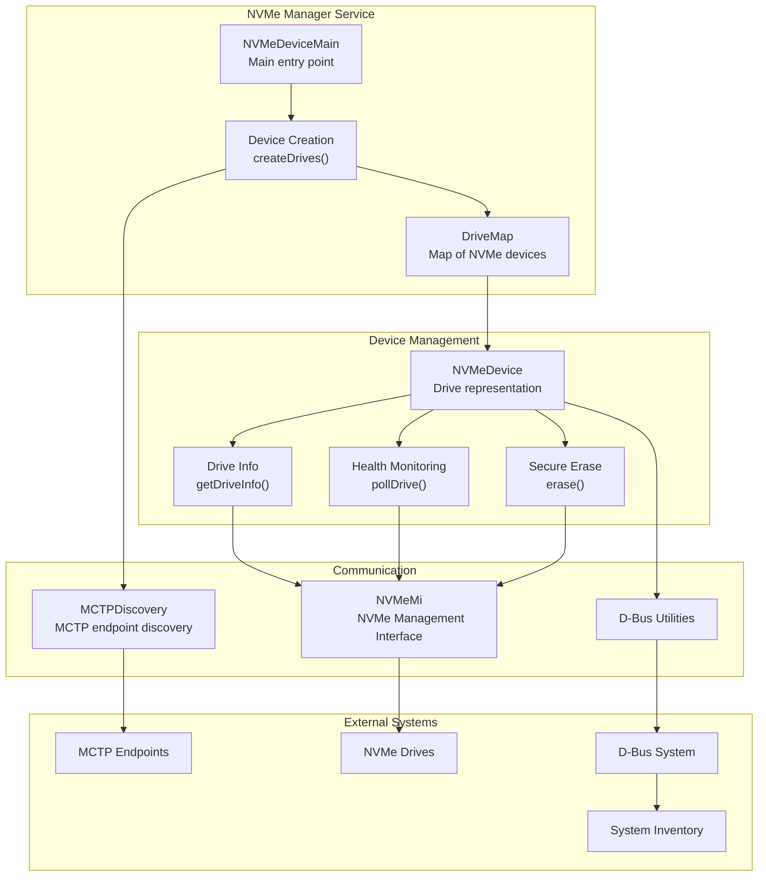
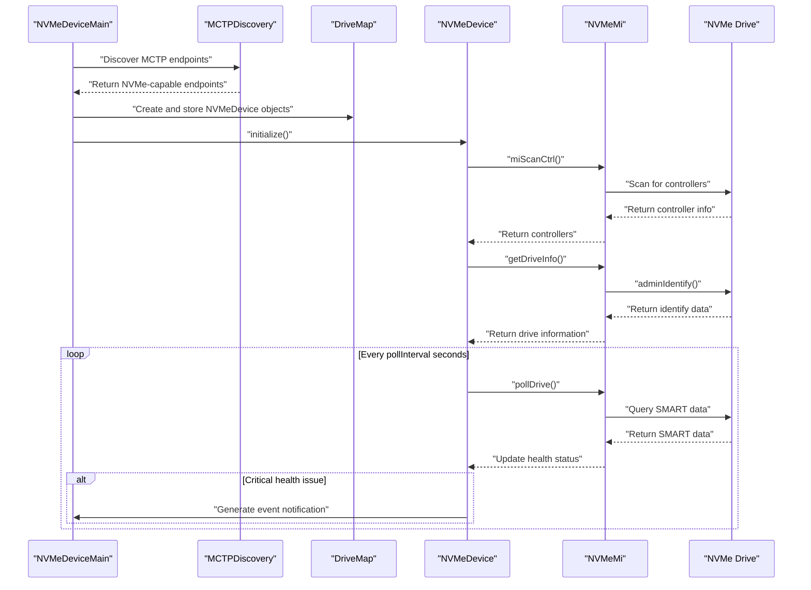
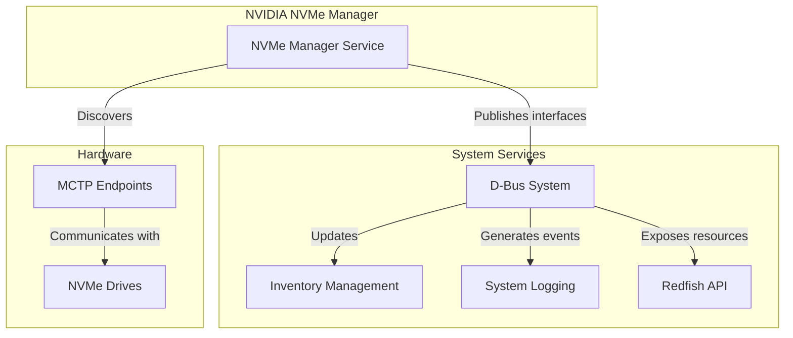

<!-- source: DeepWiki mcp.deepwiki.com · repo NVIDIA/nvidia-nvme-manager · page 1 Overview · fetched 2026-10-26 -->

# Overview

Relevant source files

The following files were used as context for generating this wiki page:

- [LICENSE](LICENSE)
- [include/NVMeDevice.hpp](include/NVMeDevice.hpp)
- [meson.build](meson.build)
- [src/NVMeDevice.cpp](src/NVMeDevice.cpp)
- [src/NVMeDeviceMain.cpp](src/NVMeDeviceMain.cpp)

The NVIDIA NVMe Manager is a system service that provides discovery, monitoring, and management capabilities for NVMe storage devices in server environments. It serves as a bridge between the server's management infrastructure and NVMe drives, enabling health monitoring, secure erase operations, and drive inventory management.

This document provides an introduction to the NVIDIA NVMe Manager system, its key components, and high-level architecture. For detailed information about specific components, please refer to their respective sections in the documentation:

- For detailed system architecture, see [System Architecture](#2)
- For NVMe device management, see [NVMe Device Management](#2.1)
- For MCTP endpoint discovery, see [MCTP Endpoint Discovery](#2.2)
- For information about secure erase operations, see [Secure Erase Operations](#4.2)

Sources: [LICENSE:1-8](), [meson.build:1-8]()

## System Purpose and Capabilities

The NVIDIA NVMe Manager provides the following key capabilities:

1. **NVMe Drive Discovery**: Automatically discovers NVMe drives via MCTP endpoints
2. **Health Monitoring**: Polls NVMe SMART data to detect potential drive failures
3. **Secure Erase Operations**: Implements sanitize commands with multiple erase methods
4. **Event Generation**: Creates system events for drive status changes
5. **D-Bus Interface**: Exposes drive properties and operations to other system services

The manager operates as a daemon service and integrates with the system's D-Bus infrastructure to provide standardized interfaces for NVMe drive management.

Sources: [src/NVMeDevice.cpp:10-26](), [src/NVMeDeviceMain.cpp:1-12]()

## System Architecture

The NVIDIA NVMe Manager follows a modular architecture with clear separation between device management, communication protocols, and system integration components.

### High-Level Architecture

Sources: [src/NVMeDeviceMain.cpp:213-211](), [src/NVMeDevice.cpp:31-53]()

### Key Components and Their Roles

| Component | File | Description |
|-----------|------|-------------|
| `NVMeDeviceMain` | `src/NVMeDeviceMain.cpp` | Main application entry point that initializes the service and handles MCTP endpoint discovery |
| `NVMeDevice` | `src/NVMeDevice.cpp` | Class representing an individual NVMe device with health monitoring and erase capabilities |
| `NVMeMi` | Included in `NVMeDevice.hpp` | NVMe Management Interface that handles low-level communication with NVMe drives |
| `MCTPDiscovery` | Referenced in `NVMeDeviceMain.cpp` | Discovers MCTP endpoints that support NVMe Management Interface |
| `DriveMap` | Used in `NVMeDeviceMain.cpp` | A global map that maintains all active NVMe drive objects |

Sources: [include/NVMeDevice.hpp:1-25](), [src/NVMeDeviceMain.cpp:14-18]()

## Operational Flow

The following sequence diagram illustrates the typical operational flow of the NVIDIA NVMe Manager:

Sources: [src/NVMeDevice.cpp:472-672](), [src/NVMeDeviceMain.cpp:258-353]()

## Drive Discovery Process

The NVMe Manager discovers drives through the following process:

1. The main service starts and monitors D-Bus for MCTP endpoint announcements
2. When an endpoint with NVMe-MI capability is found, it creates an `NVMeDevice` object
3. The `NVMeDevice` initializes and scans for NVMe controllers via the management interface
4. Drive information is retrieved and the device is added to the inventory
5. Regular health polling begins for the discovered drive

Sources: [src/NVMeDeviceMain.cpp:124-211](), [src/NVMeDevice.cpp:310-342]()

## Health Monitoring

The NVMe Manager continuously monitors drive health through:

1. Polling SMART data from NVMe drives at regular intervals
2. Checking critical warning flags in SMART data
3. Updating drive status properties on D-Bus
4. Generating events for detected issues

The polling interval is defined as a constant in [src/NVMeDevice.cpp:28]().

### Monitored Health Indicators

| Health Indicator | Description | Event Generated |
|------------------|-------------|-----------------|
| Backup Device Fault | Volatile memory backup device failure | Warning event |
| Capacity Fault | Available spare capacity below threshold | Warning event |
| Temperature Fault | Temperature over/under threshold | Warning event |
| Degrades Fault | NVM subsystem reliability degraded | Warning event |
| Media Fault | Media in read-only mode | Warning event |
| Drive Failure | Drive is not functional | Critical event |

Sources: [src/NVMeDevice.cpp:400-448](), [src/NVMeDevice.cpp:576-672]()

## Secure Erase Operations

The NVMe Manager supports multiple secure erase methods for NVMe drives:

1. **Crypto Erase**: Cryptographic erase using the drive's internal encryption
2. **Block Erase**: Low-level block erasure of all data
3. **Overwrite**: Overwriting all data with patterns

The erase operations are implemented via the NVMe sanitize command and progress is tracked and reported via D-Bus properties.

Sources: [src/NVMeDevice.cpp:674-751](), [include/NVMeDevice.hpp:95-120]()

## System Integration

The NVIDIA NVMe Manager integrates with the larger system through:

1. **D-Bus Interfaces**: Exposing drive properties and operations
2. **Event Generation**: Creating system log entries for drive issues
3. **Inventory Management**: Adding drives to the system inventory
4. **Redfish Integration**: Supporting Redfish API for management standardization

Sources: [src/NVMeDevice.cpp:19-26](), [src/NVMeDeviceMain.cpp:295-308]()

## Key Classes and Interfaces

The NVMe Manager implements multiple D-Bus interfaces for drive management:

| Interface | Purpose |
|-----------|---------|
| `xyz.openbmc_project.Inventory.Item.Drive` | Basic drive properties like capacity and form factor |
| `xyz.openbmc_project.State.Decorator.Health` | Health status of the drive |
| `xyz.openbmc_project.State.Decorator.OperationalStatus` | Operational state (functional/non-functional) |
| `xyz.openbmc_project.Nvme.Status` | NVMe-specific status information |
| `xyz.openbmc_project.Nvme.SecureErase` | Secure erase capabilities and operations |
| `xyz.openbmc_project.Common.Progress` | Progress tracking for operations |

The key class `NVMeDevice` implements all these interfaces as shown in [include/NVMeDevice.hpp:54-56]().

Sources: [include/NVMeDevice.hpp:26-56](), [src/NVMeDevice.cpp:33-53]()

## Conclusion

The NVIDIA NVMe Manager provides a comprehensive solution for managing NVMe drives in server environments. With its modular architecture, it enables discovery, monitoring, and management of NVMe drives through standardized interfaces. For more detailed information about specific components and functionalities, please refer to the more specific documentation pages listed at the beginning of this overview.

---

