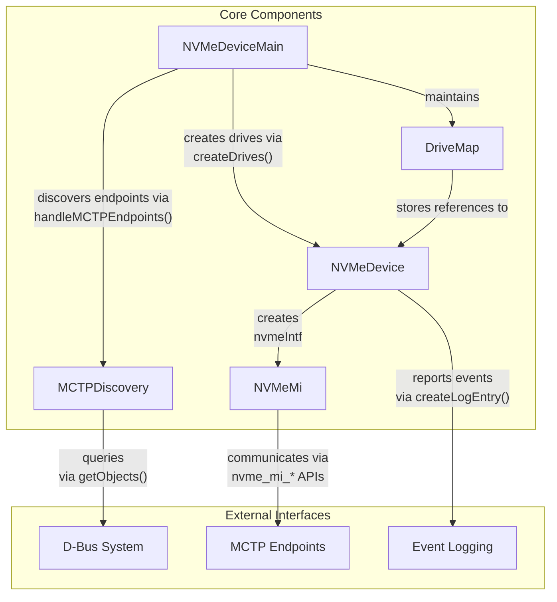
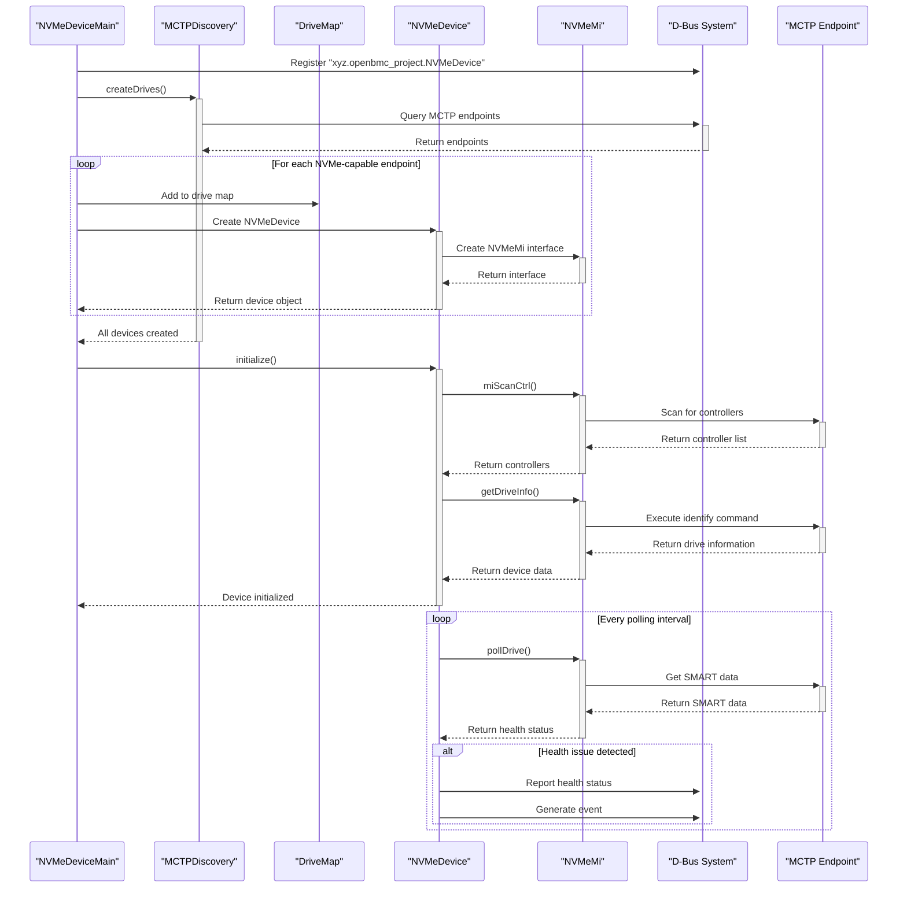
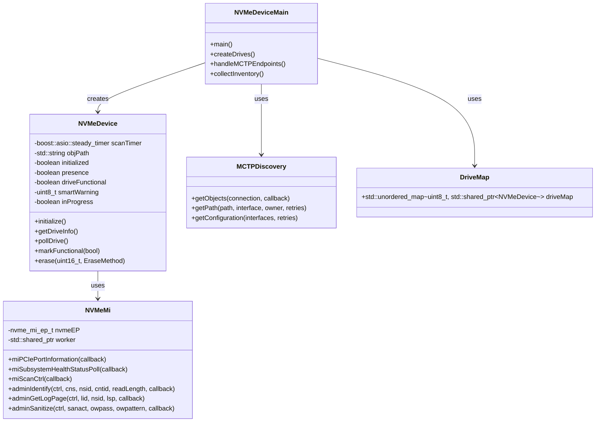

<!-- source: DeepWiki mcp.deepwiki.com · repo NVIDIA/nvidia-nvme-manager · page 2 System Architecture · fetched 2026-10-26 -->

# System Architecture

<details>
<summary>Relevant source files</summary>

The following files were used as context for generating this wiki page:

- [include/NVMeDevice.hpp](include/NVMeDevice.hpp)
- [src/NVMeDevice.cpp](src/NVMeDevice.cpp)
- [src/NVMeDeviceMain.cpp](src/NVMeDeviceMain.cpp)
- [src/NVMeMi.cpp](src/NVMeMi.cpp)

</details>


This page provides a detailed overview of the NVIDIA NVMe Manager system architecture, including component relationships and data flows. For information about specific components, refer to [NVMe Device Management](#2.1), [MCTP Endpoint Discovery](#2.2), and [NVMe Management Interface](#2.3).

## System Overview

The NVIDIA NVMe Manager is designed to discover, monitor, and manage NVMe (Non-Volatile Memory Express) storage devices in server environments. It leverages the following key technologies:

- **D-Bus**: For system-level inter-process communication
- **MCTP** (Management Component Transport Protocol): For communication with NVMe devices
- **NVMe-MI**: NVMe Management Interface protocol for device control

The system follows a modular architecture separating device management, communication protocols, and system integration components.

## Component Architecture

The following diagram shows the primary components of the NVIDIA NVMe Manager system and their relationships:



Sources: [src/NVMeDeviceMain.cpp:213-226](). [src/NVMeDevice.cpp:33-52](). [src/NVMeMi.cpp:28-72]().

## System Operation Flow

This sequence diagram illustrates the typical operational flow within the NVIDIA NVMe Manager system, from startup through device monitoring and management:



Sources: [src/NVMeDeviceMain.cpp:258-353](). [src/NVMeDevice.cpp:314-342](). [src/NVMeDevice.cpp:472-673]().

## Class Relationships

This diagram shows the key classes in the system and their relationships:



Sources: [include/NVMeDevice.hpp:62-207](). [src/NVMeMi.cpp:28-72]().

## Key Architectural Components

### 1. NVMeDeviceMain

The `NVMeDeviceMain` component serves as the application entry point and manages the overall system lifecycle:

- Initializes the system and creates a D-Bus object server
- Discovers MCTP endpoints capable of NVMe-MI communication
- Creates and manages `NVMeDevice` objects
- Handles D-Bus signals for device hotplug events
- Maintains the drive map for tracking all NVMe devices

Sources: [src/NVMeDeviceMain.cpp:258-365]().

### 2. NVMeDevice

The `NVMeDevice` class represents individual NVMe drives in the system:

- Implements multiple D-Bus interfaces for device management
- Manages device lifecycle (initialization, monitoring, shutdown)
- Polls device health status and SMART data periodically
- Executes secure erase operations when requested
- Reports device status changes via D-Bus events

The class inherits from multiple interface classes:

```
NVMeDevice
├── Item
├── StorageController
├── PortInfo
├── Drive
├── Health
├── OperationalStatus
├── Asset
├── Version
├── NVMeStatus
├── Associations
├── Progress
├── SecureErase
└── Operation
```

Sources: [include/NVMeDevice.hpp:62-207](). [src/NVMeDevice.cpp:33-751]().

### 3. NVMeMi

The `NVMeMi` class provides the low-level interface to communicate with NVMe devices:

- Establishes communication with MCTP endpoints
- Executes NVMe-MI and NVMe Admin commands
- Provides asynchronous worker thread for non-blocking operations
- Handles command execution and response processing
- Implements specialized interfaces for common operations:
  - Device identification
  - Health monitoring
  - Secure erase
  - Log page retrieval

Sources: [src/NVMeMi.cpp:28-1208]().

### 4. MCTPDiscovery

The `MCTPDiscovery` component provides utilities for discovering MCTP endpoints:

- Queries D-Bus for MCTP endpoint information
- Filters endpoints that support NVMe-MI
- Retrieves endpoint connection details (EID, socket address)
- Returns discovered endpoints to the main application

Sources: [src/NVMeDeviceMain.cpp:124-211]().

## Asynchronous Architecture

The NVIDIA NVMe Manager uses an asynchronous architecture based on Boost.Asio for event-driven, non-blocking operations:

| Component | Asynchronous Mechanism |
|-----------|------------------------|
| NVMeDeviceMain | Uses Boost.Asio io_service for the main event loop |
| NVMeDevice | Uses steady_timer for periodic polling |
| NVMeMi | Uses a dedicated worker thread for command execution |
| D-Bus Communication | Uses asynchronous signal handlers and method calls |

This approach enables the system to:
- Handle multiple devices simultaneously
- Respond to events without blocking
- Process long-running operations (like secure erase) efficiently
- Maintain responsiveness to management requests

Sources: [src/NVMeDeviceMain.cpp:258-265](). [src/NVMeDevice.cpp:472-487](). [src/NVMeMi.cpp:75-99]().

## Communication Patterns

### D-Bus Communication

The system exposes and consumes several D-Bus interfaces:

1. **Exposed Interfaces**:
   - Drive status and properties
   - Health monitoring
   - Operational controls
   - Event generation

2. **Consumed Interfaces**:
   - MCTP endpoint discovery
   - System inventory information
   - Logging service

### MCTP Communication

NVMe-MI commands are transported over MCTP:

1. Commands are constructed in the `NVMeMi` class
2. The `nvme_mi_*` API is used to send commands through MCTP
3. Responses are processed asynchronously
4. Results are passed back via callbacks

Sources: [src/NVMeMi.cpp:381-556](). [src/NVMeMi.cpp:686-952]().

## Fault Handling and Resilience

The system implements several mechanisms for fault tolerance:

1. **Device Monitoring**:
   - Regular polling detects device failures
   - SMART data analysis identifies potential issues
   - Secure isolation of failing devices

2. **Error Recovery**:
   - Command retries for transient failures
   - Automatic reconnection attempts
   - Graceful degradation for non-critical components

3. **Event Reporting**:
   - Structured event logging
   - Health status notifications
   - Integration with system monitoring

Sources: [src/NVMeDevice.cpp:374-398](). [src/NVMeDevice.cpp:400-448]().

## Integration Points

The NVIDIA NVMe Manager integrates with several external systems:

1. **System Bus (D-Bus)**:
   - For component discovery and registration
   - For system-wide event propagation
   - For management operations

2. **Redfish API**:
   - Standard interface for drive management
   - Event generation using Redfish event schema
   - Consistent resource model for drives

3. **MCTP Service**:
   - Transport for NVMe-MI commands
   - Endpoint discovery and binding
   - Communication channel management

Sources: [src/NVMeDevice.cpp:21-22](). [src/NVMeDevice.cpp:385-388]().

---

