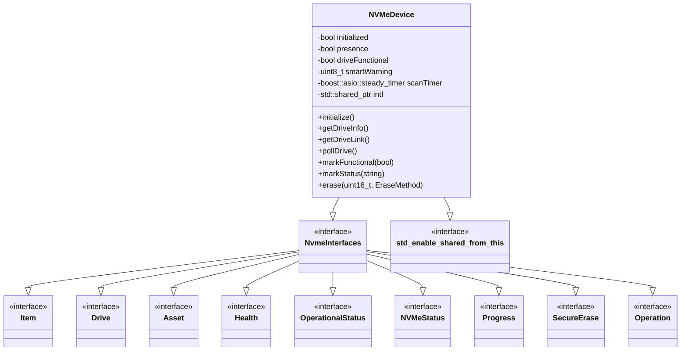
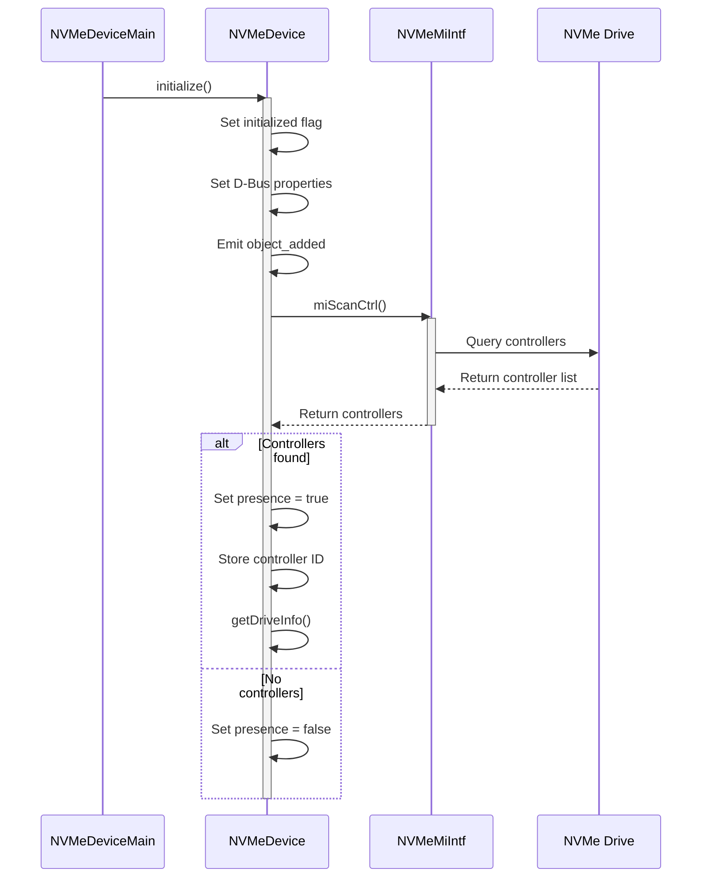
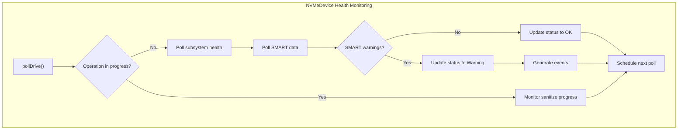
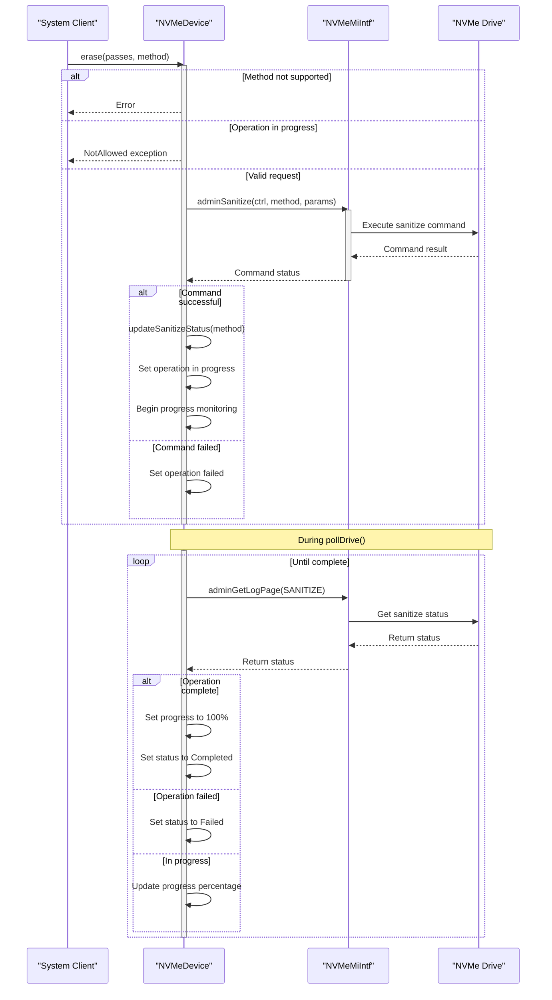
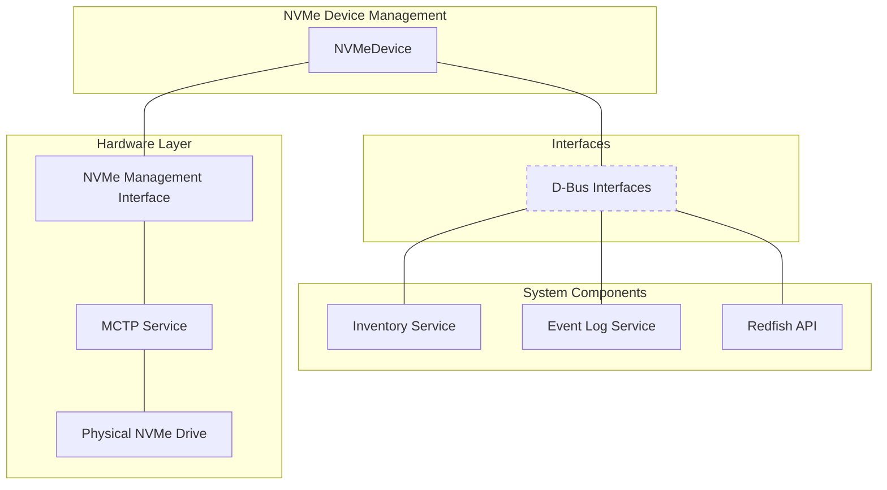

<!-- source: DeepWiki mcp.deepwiki.com · repo NVIDIA/nvidia-nvme-manager · page 2.1 NVMe Device Management · fetched 2026-10-26 -->

# NVMe Device Management

<details>
<summary>Relevant source files</summary>

The following files were used as context for generating this wiki page:

- [include/NVMeDevice.hpp](include/NVMeDevice.hpp)
- [src/NVMeDevice.cpp](src/NVMeDevice.cpp)

</details>


This page describes how the NVIDIA NVMe Manager represents, discovers, monitors, and manages NVMe storage devices within the system. It covers the NVMeDevice class architecture, device discovery process, health monitoring, and secure erase operations. For information about the lower-level NVMe Management Interface (NVMe-MI), see [NVMe Management Interface](#2.3). For details about MCTP endpoint discovery, see [MCTP Endpoint Discovery](#2.2).

## NVMeDevice Class Architecture

The `NVMeDevice` class is the central component for managing NVMe devices in the system. It implements multiple interfaces to provide a comprehensive representation of NVMe devices.



Sources: [include/NVMeDevice.hpp:54-65](), [include/NVMeDevice.hpp:26-53]()

The `NVMeDevice` class implements multiple D-Bus interfaces to represent various aspects of NVMe drives:

| Interface | Purpose |
|-----------|---------|
| Item | Basic inventory item functionality |
| Drive | Drive-specific properties (capacity, type, etc.) |
| Asset | Asset information (manufacturer, model, serial number) |
| Health | Drive health status representation |
| OperationalStatus | Drive operational state |
| NVMeStatus | NVMe-specific status information |
| Progress | Progress tracking for operations |
| SecureErase | Secure erase functionality |
| Operation | Drive operation management |

Sources: [include/NVMeDevice.hpp:26-53]()

## Device Lifecycle Management

The NVMeDevice class manages the complete lifecycle of NVMe devices, from discovery to monitoring and operation execution.

```mermaid
stateDiagram-v2
    [*] --> "Discovery" : System Start
    "Discovery" --> "Initialization" : Device Found
    "Discovery" --> "Missing" : No Device
    "Missing" --> "Discovery" : Scan Timer
    "Initialization" --> "Ready" : getDriveInfo Complete
    "Ready" --> "Health Monitoring" : Poll Timer
    "Health Monitoring" --> "Ready" : Update Status
    "Ready" --> "Sanitize Operation" : erase() Called
    "Sanitize Operation" --> "Monitoring Progress" : Operation Started
    "Monitoring Progress" --> "Ready" : Operation Complete
    "Health Monitoring" --> "Warning State" : SMART Warnings
    "Health Monitoring" --> "Critical State" : Drive Failure
    "Warning State" --> "Health Monitoring" : Poll Timer
    "Critical State" --> "Health Monitoring" : Poll Timer
```

Sources: [src/NVMeDevice.cpp:310-342](), [src/NVMeDevice.cpp:472-673](), [src/NVMeDevice.cpp:684-751]()

## Device Initialization and Discovery

The NVMeDevice initialization process follows these steps:

1. The `NVMeDevice` constructor sets up the object and prepares for initialization
2. The `initialize()` method is called to begin device discovery
3. The MCTP endpoint scan identifies NVMe controllers
4. Device information is retrieved via NVMe Management Interface commands
5. Regular polling is established for health monitoring

The `initialize()` method triggers the device discovery process:



Sources: [src/NVMeDevice.cpp:310-342]()

## Device Information Collection

After initialization, the NVMeDevice collects detailed information about the drive using NVMe Admin commands:

1. `getDriveInfo()` - Retrieves basic device identification information
2. `getDriveLink()` - Retrieves PCIe link information

The device information process executes NVMe Identify commands through the Management Interface to collect:

- Manufacturer information
- Model number
- Serial number
- Firmware version
- Drive capacity
- Sanitize capabilities

Sources: [src/NVMeDevice.cpp:214-283](), [src/NVMeDevice.cpp:285-308]()

## Health Monitoring and Status Management

The NVMeDevice implements a robust health monitoring system through regular polling of the NVMe device's SMART data and health status.



Sources: [src/NVMeDevice.cpp:472-673]()

The health monitoring system:

1. Uses a timer to regularly poll drive health (every 5 seconds by default)
2. Collects NVMe subsystem health status
3. Retrieves SMART log data
4. Analyzes critical warning fields
5. Updates drive health status based on detected issues
6. Generates appropriate events for detected issues

When issues are detected, the device status is updated through:

- `markFunctional()` - Updates the drive's functional status
- `markStatus()` - Updates the drive's health status
- `generateRedfishEventbySmart()` - Generates events for specific SMART warnings

Sources: [src/NVMeDevice.cpp:374-398](), [src/NVMeDevice.cpp:344-372](), [src/NVMeDevice.cpp:400-448]()

## Secure Erase Operations

The NVMeDevice supports NVMe sanitize operations for secure data erasure through several methods:



Sources: [src/NVMeDevice.cpp:684-751](), [src/NVMeDevice.cpp:450-469]()

The secure erase functionality supports three methods:
1. **Crypto Erase** - Invalidates the encryption key
2. **Block Erase** - Erases physical blocks
3. **Overwrite** - Overwrites data with patterns

The sanitize operation progress is monitored through:
1. Regular polling of sanitize log page
2. Tracking estimated completion time
3. Updating operation progress percentage
4. Reporting completion or failure status

Sources: [src/NVMeDevice.cpp:684-751](), [src/NVMeDevice.cpp:450-469](), [src/NVMeDevice.cpp:675-682]()

## System Integration

The NVMeDevice integrates with other system components through D-Bus interfaces:



Sources: [include/NVMeDevice.hpp:54-65](), [src/NVMeDevice.cpp:400-448]()

Key integration points include:

1. **Inventory Integration**
   - Exposes drive information via standardized inventory interfaces
   - Updates drive properties and status

2. **Event Generation**
   - Creates log entries for drive failures and warnings
   - Generates Redfish events for critical conditions

3. **Operational Status Management**
   - Reports drive functional state
   - Updates health status for system monitoring

Sources: [src/NVMeDevice.cpp:344-372](), [src/NVMeDevice.cpp:400-448](), [src/NVMeDevice.cpp:374-398]()

---

