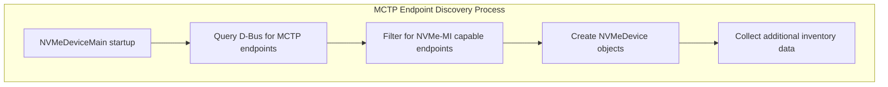
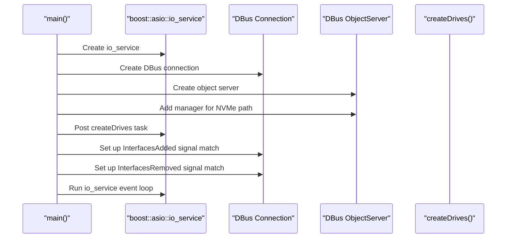
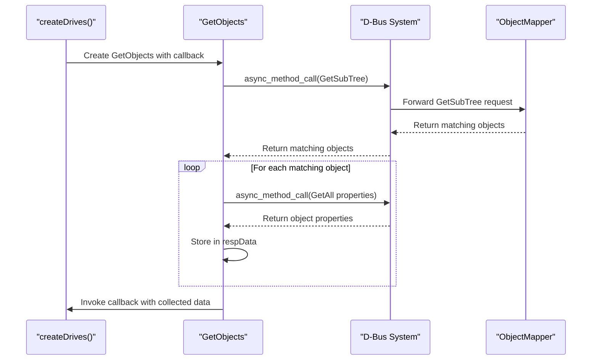
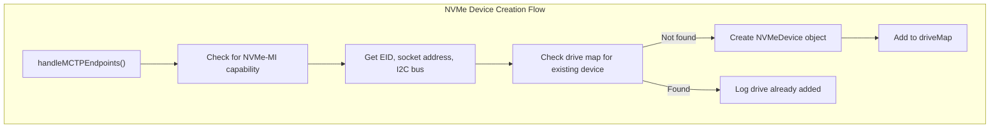
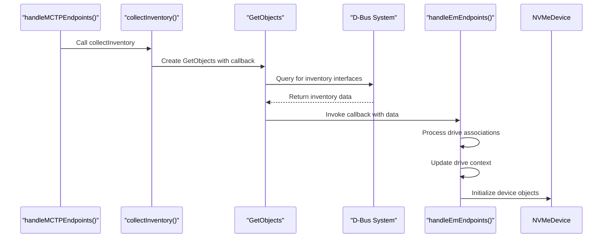
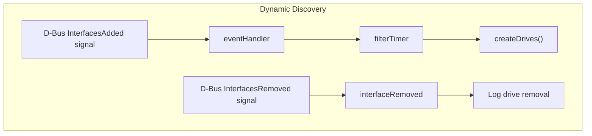

<!-- source: DeepWiki mcp.deepwiki.com · repo NVIDIA/nvidia-nvme-manager · page 2.2 MCTP Endpoint Discovery · fetched 2026-10-26 -->

# MCTP Endpoint Discovery

<details>
<summary>Relevant source files</summary>

The following files were used as context for generating this wiki page:

- [include/MCTPDiscovery.hpp](include/MCTPDiscovery.hpp)
- [src/NVMeDeviceMain.cpp](src/NVMeDeviceMain.cpp)

</details>


## Purpose and Scope

This document details the MCTP (Management Component Transport Protocol) Endpoint Discovery process in the NVIDIA NVMe Manager system. It covers how the system identifies NVMe storage devices by discovering MCTP endpoints that support NVMe Management Interface (NVMe-MI) communication. For information about the NVMe Management Interface itself, see [NVMe Management Interface](#2.3).

## Overview

MCTP Endpoint Discovery is a critical first step in the NVIDIA NVMe Manager's operation. The system must identify which MCTP endpoints in the platform represent NVMe drives before it can manage them. This discovery process leverages D-Bus communication to find endpoints that support the NVMe-MI message type and then creates appropriate device objects for them.



Sources: [src/NVMeDeviceMain.cpp:213-226](), [src/NVMeDeviceMain.cpp:124-211]()

## Discovery Components

The MCTP Endpoint Discovery subsystem consists of the following key components:

```mermaid
classDiagram
    class "GetObjects" {
        +shared_ptr~connection~ dbusConnection
        +function callback
        +ManagedObjectType respData
        +getPath()
        +getConfiguration()
    }
    
    class "handleMCTPEndpoints()" {
        Process discovered endpoints
        Create NVMeDevice objects
    }
    
    class "createDrives()" {
        Initiate MCTP endpoint discovery
    }
    
    class "NVMeDeviceMain" {
        Main application entry point
    }
    
    "NVMeDeviceMain" --> "createDrives()"
    "createDrives()" --> "GetObjects"
    "GetObjects" --> "handleMCTPEndpoints()"
    "handleMCTPEndpoints()" --> "NVMeDevice"
```

Sources: [include/MCTPDiscovery.hpp:71-212](), [src/NVMeDeviceMain.cpp:124-211](), [src/NVMeDeviceMain.cpp:213-226]()

## Discovery Process

### 1. Initialization and D-Bus Setup

The discovery process begins in the `main()` function, which initializes the D-Bus connection and sets up signal handlers for detecting when MCTP endpoints are added or removed.



Sources: [src/NVMeDeviceMain.cpp:258-365]()

### 2. MCTP Endpoint Query

The `createDrives()` function initiates the discovery by creating a `GetObjects` instance that queries D-Bus for objects implementing specific interfaces related to MCTP endpoints.



Sources: [include/MCTPDiscovery.hpp:127-202](), [src/NVMeDeviceMain.cpp:213-226]()

### 3. NVMe-Capable Endpoint Filtering

Once MCTP endpoints are discovered, the system filters for those that support the NVMe-MI message type through the `handleMCTPEndpoints()` function.

| Interface | Property | Purpose |
|-----------|----------|---------|
| xyz.openbmc_project.MCTP.Endpoint | EID | Endpoint Identifier |
| xyz.openbmc_project.MCTP.Endpoint | SupportedMessageTypes | Lists supported message types |
| xyz.openbmc_project.Common.UnixSocket | Address | Socket address for communication |
| xyz.openbmc_project.Inventory.Decorator.I2CDevice | Bus | I2C bus number |

Sources: [src/NVMeDeviceMain.cpp:124-169]()

### 4. NVMe Device Creation

For each endpoint that supports NVMe-MI, the system creates an `NVMeDevice` object and adds it to the drive map.



Sources: [src/NVMeDeviceMain.cpp:189-210]()

### 5. Inventory Collection

After creating NVMe device objects, the system collects additional inventory data through the `collectInventory()` function.



Sources: [src/NVMeDeviceMain.cpp:107-122](), [src/NVMeDeviceMain.cpp:20-105]()

## Key Data Structures

### ManagedObjectType

The core data structure used throughout the discovery process is `ManagedObjectType`, which stores D-Bus object paths mapped to their interfaces and properties.

```
ManagedObjectType = boost::container::flat_map<
    sdbusplus::message::object_path,      // Object path
    boost::container::flat_map<           // DbusObject
        std::string,                      // Interface name
        boost::container::flat_map<       // Properties
            std::string,                  // Property name
            BasicVariantType              // Property value
        >
    >
>
```

Sources: [include/MCTPDiscovery.hpp:32-34]()

## Dynamic Discovery and Monitoring

The NVIDIA NVMe Manager continues to monitor for new MCTP endpoints after initialization by setting up signal handlers for D-Bus `InterfacesAdded` and `InterfacesRemoved` events.



Sources: [src/NVMeDeviceMain.cpp:312-350]()

## Error Handling

The discovery process includes retry mechanisms for D-Bus operations that might fail temporarily. If an operation fails, the system will retry up to 5 times with a 10-second delay between attempts.

Sources: [include/MCTPDiscovery.hpp:85-126](), [include/MCTPDiscovery.hpp:127-202]()

## Integration with NVMe Device Management

Once MCTP endpoints are discovered and NVMeDevice objects are created, the system initializes them and begins monitoring their health status. For more details on NVMe device management, see [NVMe Device Management](#2.1).

Sources: [src/NVMeDeviceMain.cpp:190-202]()

---

