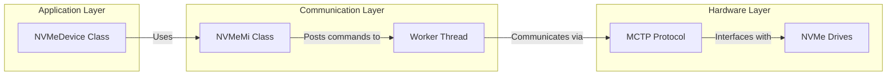
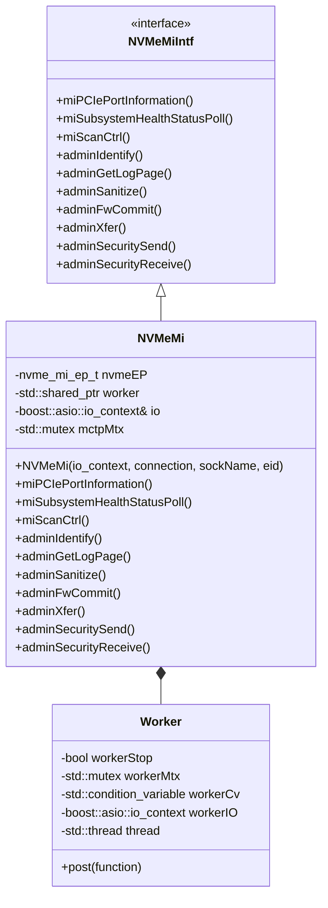
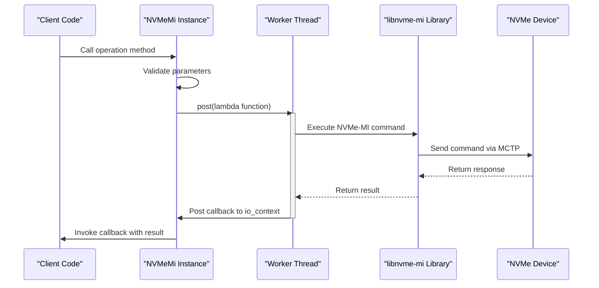
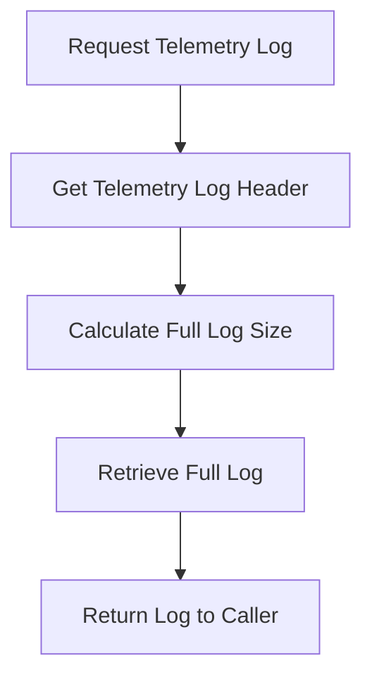

<!-- source: DeepWiki mcp.deepwiki.com · repo NVIDIA/nvidia-nvme-manager · page 2.3 NVMe Management Interface · fetched 2026-10-26 -->

# NVMe Management Interface

<details>
<summary>Relevant source files</summary>

The following files were used as context for generating this wiki page:

- [include/NVMeIntf.hpp](include/NVMeIntf.hpp)
- [include/NVMeMi.hpp](include/NVMeMi.hpp)
- [src/NVMeMi.cpp](src/NVMeMi.cpp)

</details>


The NVMe Management Interface (NVMeMi) provides a low-level communication channel between the NVIDIA NVMe Manager and physical NVMe storage devices. It implements the NVMe Management Interface protocol for executing administrative commands, monitoring drive health, performing secure operations, and other management functions through the MCTP (Management Component Transport Protocol).

For information about higher-level NVMe device management, see [NVMe Device Management](#2.1). For MCTP endpoint discovery, see [MCTP Endpoint Discovery](#2.2).

## Overview and Purpose

The NVMe Management Interface component encapsulates all the functionality required for direct interaction with NVMe drives using the NVMe-MI protocol specification. This interface acts as a bridge between the higher-level drive management logic and the physical storage hardware.



Sources: [include/NVMeMi.hpp:9-134](), [src/NVMeMi.cpp:28-111]()

## Architecture

The NVMe Management Interface is implemented through the `NVMeMi` class which inherits from `NVMeMiIntf`. It uses an asynchronous execution model with a dedicated worker thread to prevent blocking the main application while waiting for device responses.



Sources: [include/NVMeMi.hpp:9-134](), [include/NVMeIntf.hpp:116-256]()

### Worker Thread Implementation

The NVMe Management Interface uses a dedicated worker thread to execute commands without blocking the main application thread. This worker thread is implemented as an inner class (`Worker`) within the `NVMeMi` class.

Key characteristics of the worker thread implementation:

1. Each `NVMeMi` instance uses a shared worker to handle all commands for that endpoint
2. The worker thread runs in a loop, processing commands posted to its queue
3. Thread synchronization is handled via mutex and condition variable
4. The system avoids creating redundant workers for endpoints on the same bus

Sources: [src/NVMeMi.cpp:75-110](), [src/NVMeMi.cpp:113-126](), [include/NVMeMi.hpp:90-108]()

## Command Execution Flow

All NVMe-MI operations follow a similar asynchronous execution pattern:

1. Client code calls a method on the `NVMeMi` instance
2. The method validates parameters and endpoint availability
3. Command execution is posted to the worker thread
4. Worker thread executes the command via libnvme-mi library
5. Results are posted back to the main I/O context
6. Client-provided callback is invoked with results



Sources: [src/NVMeMi.cpp:127-150](), [src/NVMeMi.cpp:382-409]()

## Key Interface Operations

The NVMe Management Interface provides several categories of operations for interacting with NVMe devices:

### Management Interface Commands

These commands interact directly with the NVMe Management Interface rather than with specific controllers:

| Method | Description | Source |
|--------|-------------|--------|
| `miPCIePortInformation` | Retrieves PCIe port information for the device | [src/NVMeMi.cpp:152-253]() |
| `miSubsystemHealthStatusPoll` | Polls the subsystem health status | [src/NVMeMi.cpp:255-316]() |
| `miScanCtrl` | Scans for available NVMe controllers | [src/NVMeMi.cpp:318-380]() |

Sources: [include/NVMeMi.hpp:25-33]()

### Administrative Commands

These commands are passed to a specific NVMe controller for execution:

| Method | Description | Source |
|--------|-------------|--------|
| `adminIdentify` | Retrieves identification information | [src/NVMeMi.cpp:382-556]() |
| `adminGetLogPage` | Retrieves various log pages (SMART, firmware, etc.) | [src/NVMeMi.cpp:687-952]() |
| `adminSanitize` | Initiates secure erase operations | [src/NVMeMi.cpp:612-685]() |
| `adminFwCommit` | Commits firmware updates | [src/NVMeMi.cpp:1043-1116]() |
| `adminSecuritySend` | Sends security protocol commands | [src/NVMeMi.cpp:1118-1150]() |
| `adminSecurityReceive` | Receives security protocol data | [src/NVMeMi.cpp:1152-1208]() |
| `adminXfer` | Raw NVMe admin command transfer interface | [src/NVMeMi.cpp:954-1041]() |

Sources: [include/NVMeMi.hpp:34-68](), [include/NVMeIntf.hpp:179-244]()

### Special Case: Telemetry Logs

The interface provides special handling for telemetry logs which can be large and require specific processing:



Sources: [src/NVMeMi.cpp:558-610](), [src/NVMeMi.cpp:826-861]()

## Error Handling and Status Reporting

The NVMe Management Interface handles errors at multiple levels:

1. **Protocol Errors**: Communication failures with the MCTP endpoint
2. **NVMe-MI Protocol Errors**: Standard response status codes from the NVMe-MI protocol
3. **NVMe Admin Command Errors**: Status codes returned by specific admin commands

Errors are propagated back to callers through the callback mechanism using standard C++ `std::error_code` objects.

The interface provides a helper function `statusToString` that translates numeric NVMe-MI response status codes into human-readable error messages.

Sources: [include/NVMeIntf.hpp:119-165](), [src/NVMeMi.cpp:907-934]()

## Initialization and Endpoint Management

When initialized, the NVMe Management Interface:

1. Creates or reuses a worker thread
2. Opens an MCTP endpoint using the specified socket and EID
3. Establishes communication with the NVMe device

```mermaid
flowchart LR
    init["NVMeMi Constructor"]
    getRoot["Get NVMe Root"]
    checkWorker["Check for Existing Worker"]
    createWorker["Create New Worker"]
    reuseWorker["Reuse Existing Worker"]
    openEP["Open MCTP Endpoint"]
    end["NVMeMi Ready"]
    
    init --> getRoot
    getRoot --> checkWorker
    checkWorker -->|"Not Found/Expired"| createWorker
    checkWorker -->|"Found"| reuseWorker
    createWorker --> openEP
    reuseWorker --> openEP
    openEP --> end
```

Sources: [src/NVMeMi.cpp:28-73](), [src/NVMeMi.cpp:14-26]()

## Performance Considerations

The NVMe Management Interface is designed with several performance considerations:

1. **Worker Thread Pooling**: The interface reuses worker threads for multiple endpoints on the same bus, avoiding thread proliferation
2. **Asynchronous I/O**: All operations are non-blocking and use callbacks
3. **Request Batching**: For operations like telemetry log retrieval, the interface intelligently batches requests to minimize round trips
4. **Timeouts**: Commands can specify timeouts to prevent hangs on unresponsive devices

Sources: [include/NVMeMi.hpp:110-118](), [src/NVMeMi.cpp:996-1003]()

## Integration with NVMeDevice

The NVMe Management Interface is typically used by the `NVMeDevice` class to perform management operations on specific drives. The `NVMeDevice` class maintains a higher-level abstraction of the drive while delegating low-level commands to the NVMeMi interface.

For detailed information about how the NVMeDevice class integrates with the NVMeMi interface, see [NVMeDevice Class](#3.1).

---

