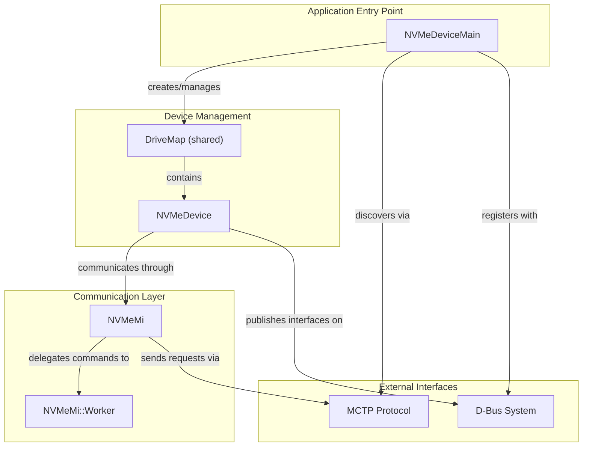
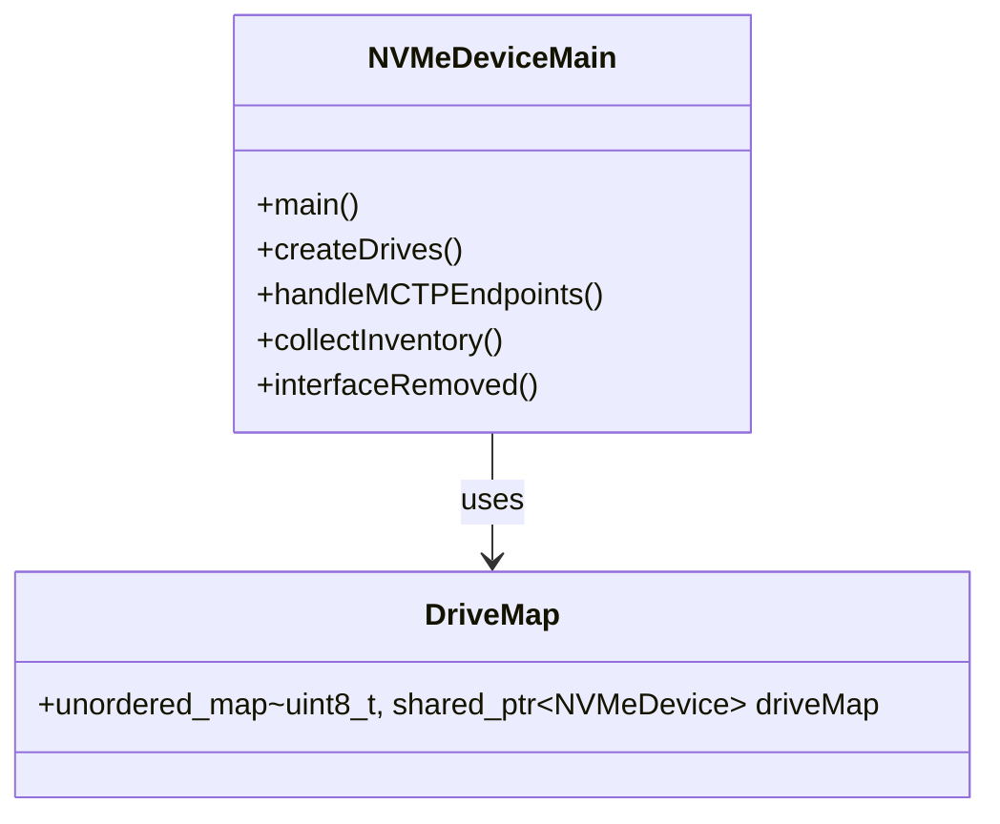
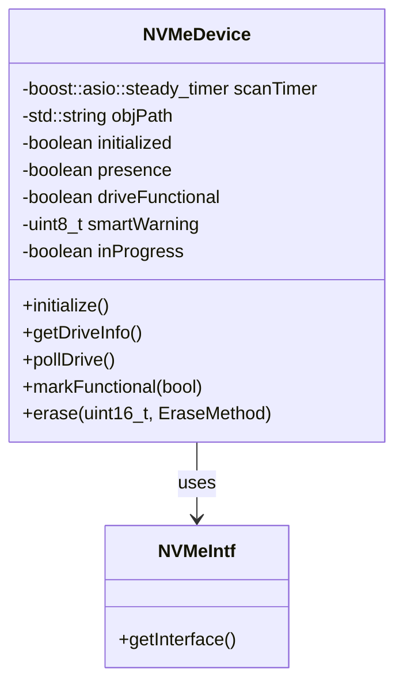
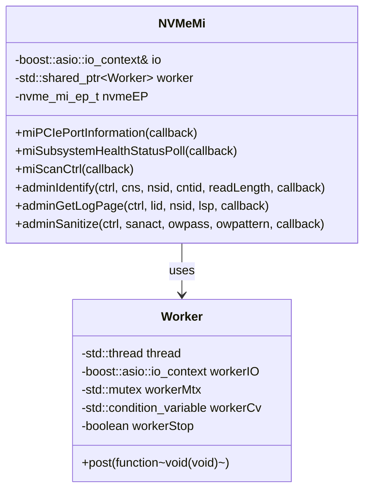
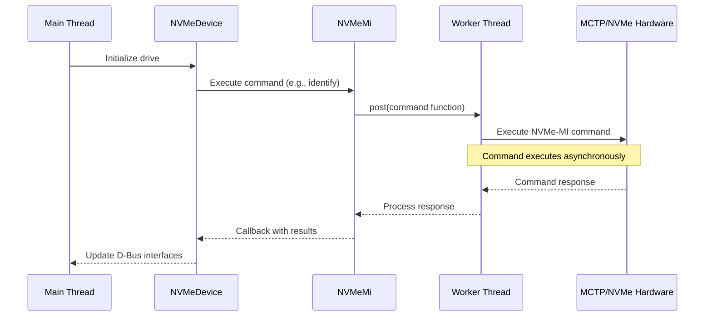
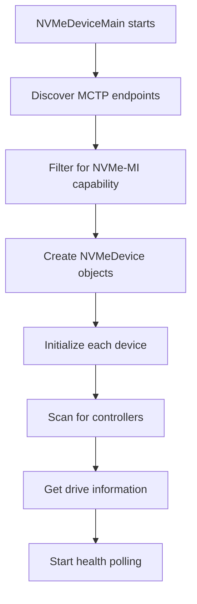

<!-- source: DeepWiki mcp.deepwiki.com · repo NVIDIA/nvidia-nvme-manager · page 3 Key Components · fetched 2026-10-26 -->

# Key Components

Relevant source files

The following files were used as context for generating this wiki page:

- [src/NVMeDevice.cpp](src/NVMeDevice.cpp)
- [src/NVMeDeviceMain.cpp](src/NVMeDeviceMain.cpp)
- [src/NVMeMi.cpp](src/NVMeMi.cpp)

This page provides an overview of the major software components that make up the NVIDIA NVMe Manager system. It covers the primary classes, their responsibilities, and how they interact to provide NVMe drive management capabilities. For detailed information about the overall system architecture, see [System Architecture](#2).

## Component Overview

The NVIDIA NVMe Manager consists of several key components that work together to discover, monitor, and manage NVMe drives within a system. These components handle tasks such as:

- Discovering NVMe devices through MCTP endpoints
- Monitoring drive health status
- Managing drive lifecycle events
- Providing interfaces for drive operations (e.g., secure erase)
- Communicating with other system services via D-Bus

### Component Relationship Diagram

Sources: [src/NVMeDeviceMain.cpp:125-212](), [src/NVMeDevice.cpp:31-53](), [src/NVMeMi.cpp:14-73]()

## Key Classes

The system is built around several key classes, each with specific responsibilities in the NVMe drive management ecosystem.

### NVMeDeviceMain

The NVMeDeviceMain class serves as the application entry point and central coordinator. It is responsible for:

- Initializing the D-Bus connection and object server
- Discovering MCTP endpoints that support NVMe-MI
- Creating and managing NVMeDevice instances
- Setting up event handlers for device addition/removal

This component maintains a global drive map (accessible via `getDriveMap()`) that tracks all NVMe devices in the system.

Sources: [src/NVMeDeviceMain.cpp:258-365](), [src/NVMeDeviceMain.cpp:14-18]()

### NVMeDevice

The NVMeDevice class represents a single NVMe drive in the system. It handles:

- Initialization and discovery of drive properties
- Monitoring of drive health and status
- Execution of drive operations (e.g., secure erase)
- Updating D-Bus interfaces with drive information
- Event generation for critical conditions

Each NVMeDevice instance is created when a compatible MCTP endpoint is discovered and is responsible for the complete lifecycle management of that specific drive.

Sources: [src/NVMeDevice.cpp:31-53](), [src/NVMeDevice.cpp:310-342](), [src/NVMeDevice.cpp:472-673]()

### NVMeMi

The NVMeMi class provides the low-level NVMe Management Interface functionality. It:

- Establishes communication with NVMe devices via MCTP
- Executes NVMe-MI and Admin commands
- Manages asynchronous command execution
- Handles errors and retry logic

NVMeMi uses a worker thread model to execute commands asynchronously, preventing blocking of the main application thread.

Sources: [src/NVMeMi.cpp:28-73](), [src/NVMeMi.cpp:75-126](), [src/NVMeMi.cpp:152-1208]()

## Asynchronous Operation Model

The NVIDIA NVMe Manager uses an asynchronous operation model to handle NVMe commands without blocking the main application thread. This is particularly important for operations that might take a long time to complete, such as drive identification, health polling, and secure erase operations.

### Worker Thread Architecture

Sources: [src/NVMeMi.cpp:75-126](), [src/NVMeMi.cpp:128-150]()

The worker thread model ensures that:
- Long-running NVMe operations don't block the main application
- Multiple commands can be processed concurrently
- The system remains responsive during intensive operations

## Key Operations

### Drive Discovery and Initialization

When the application starts, it performs the following sequence to discover and initialize NVMe drives:

1. NVMeDeviceMain discovers MCTP endpoints through D-Bus
2. For each endpoint that supports NVMe-MI, an NVMeDevice object is created
3. The NVMeDevice initializes itself by:
   - Creating an NVMeMi interface to communicate with the hardware
   - Scanning for controllers on the device
   - Retrieving drive information (model, serial number, etc.)
   - Setting up periodic health monitoring

Sources: [src/NVMeDeviceMain.cpp:213-226](), [src/NVMeDeviceMain.cpp:125-211](), [src/NVMeDevice.cpp:310-342]()

### Drive Health Monitoring

NVMeDevice objects continuously monitor the health of their associated drives:

1. A timer triggers periodic health checks via `pollDrive()`
2. The device queries health status through NVMeMi
3. SMART attributes and subsystem health status are analyzed
4. Critical conditions trigger status updates and event generation
5. Health information is published through D-Bus interfaces

The health monitoring cycle identifies issues such as:
- Drive failure
- Spare capacity warnings
- Temperature problems
- Media errors
- Backup device failures

Sources: [src/NVMeDevice.cpp:472-673](), [src/NVMeDevice.cpp:400-448]()

### Secure Erase Operations

The NVMe Manager provides secure erase capability through the following sequence:

1. An erase request is received through D-Bus
2. The NVMeDevice validates the request and supported erase methods
3. An appropriate sanitize command is sent via NVMeMi
4. The operation progress is monitored through periodic status checks
5. Status updates are published through D-Bus interfaces

Three sanitize operations are supported:
- Crypto Erase - Fast, cryptographically erases the drive
- Block Erase - Performs a low-level block erase
- Overwrite - Overwrites the entire drive with a pattern

Sources: [src/NVMeDevice.cpp:674-751](), [src/NVMeMi.cpp:612-685]()

## Summary Table of Component Responsibilities

| Component | Primary Responsibilities |
|-----------|--------------------------|
| NVMeDeviceMain | Application entry point, MCTP endpoint discovery, NVMeDevice creation and management |
| NVMeDevice | Drive representation, health monitoring, drive operations, D-Bus interface management |
| NVMeMi | Low-level NVMe-MI command execution, asynchronous operation handling |
| Worker | Asynchronous command processing, thread management |
| DriveMap | Central repository of NVMeDevice objects |

Sources: [src/NVMeDeviceMain.cpp](), [src/NVMeDevice.cpp](), [src/NVMeMi.cpp]()

---

