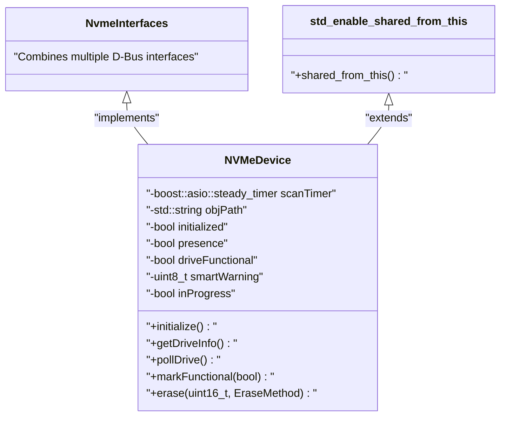
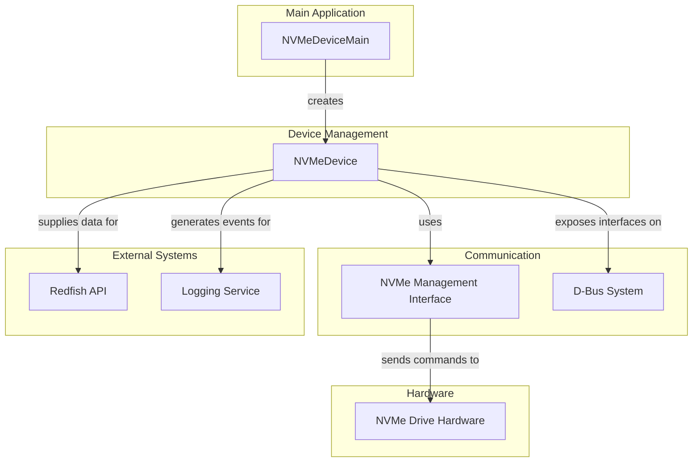
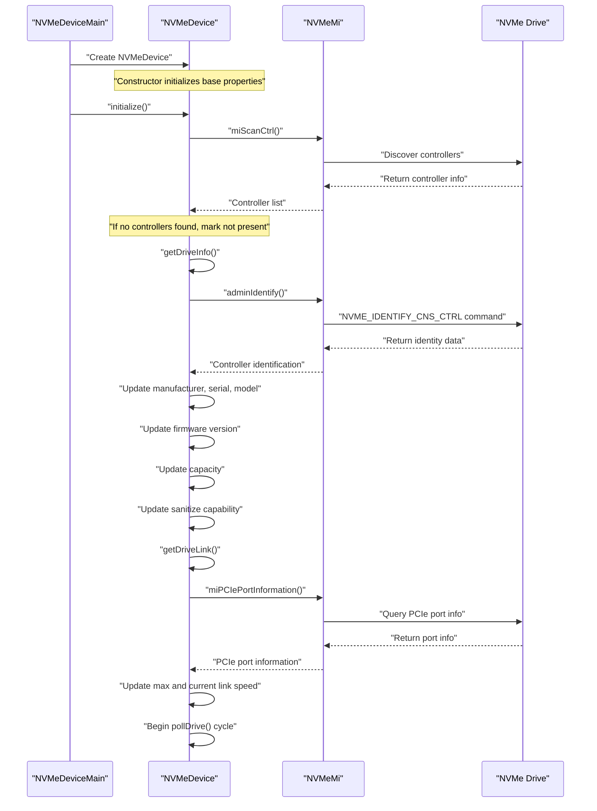
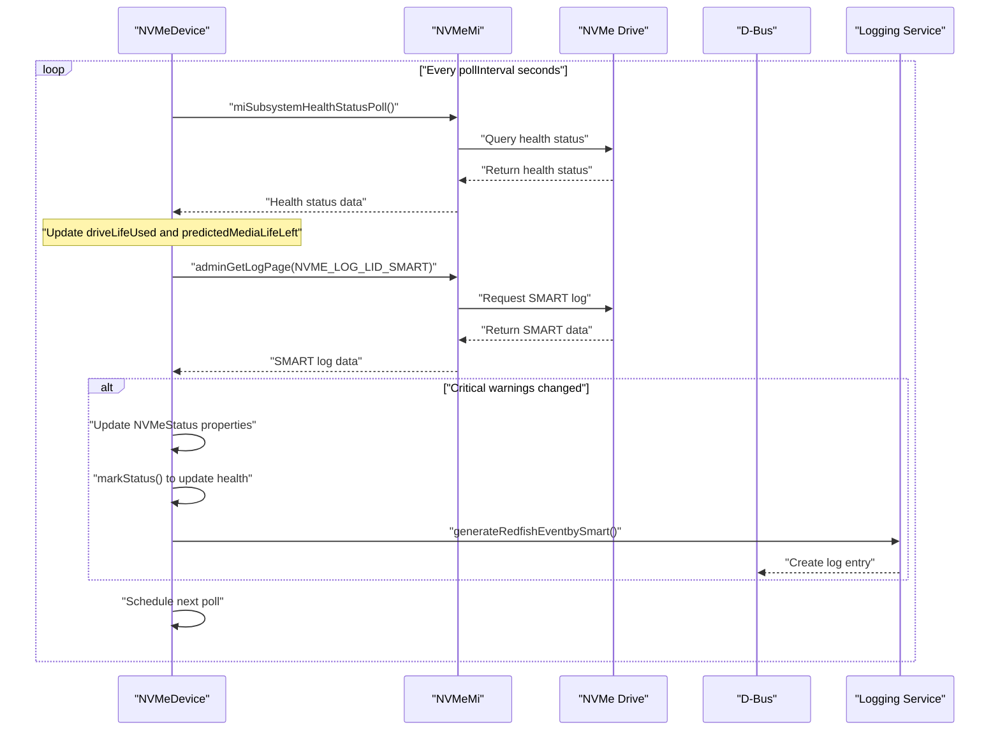
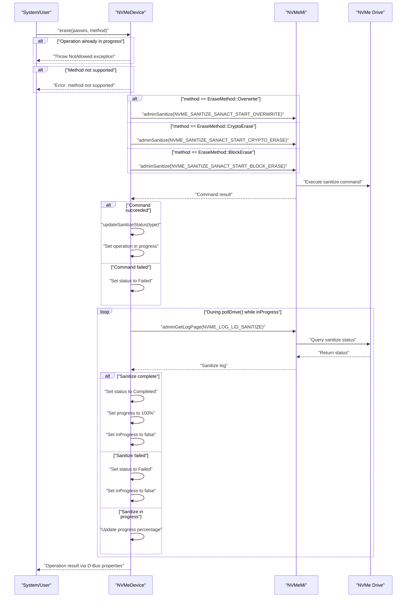

<!-- source: DeepWiki mcp.deepwiki.com · repo NVIDIA/nvidia-nvme-manager · page 3.1 NVMeDevice Class · fetched 2026-10-26 -->

# NVMeDevice Class

Relevant source files

The following files were used as context for generating this wiki page:

- [include/NVMeDevice.hpp](include/NVMeDevice.hpp)
- [src/NVMeDevice.cpp](src/NVMeDevice.cpp)

The NVMeDevice class is the core component responsible for managing individual NVMe storage devices within the NVIDIA NVMe Manager system. It provides functionality for device initialization, health monitoring, secure erase operations, and status reporting through D-Bus interfaces.

For information about the overall system architecture, see [System Architecture](#2). For details about the NVMe Management Interface implementation, see [NVMe Management Interface](#2.3).

## Class Overview and Position in Architecture

The NVMeDevice class represents a single NVMe drive in the system. It communicates with the physical device using the NVMeMi (NVMe Management Interface) and exposes device information and capabilities through D-Bus interfaces.

Sources: [include/NVMeDevice.hpp:54-65](), [src/NVMeDevice.cpp:31-53]()

## Implemented Interfaces

NVMeDevice implements multiple D-Bus interfaces to provide functionality and report status:

| Interface | Purpose |
|-----------|---------|
| Item | Basic inventory item attributes |
| StorageController | Storage controller specific attributes |
| PortInfo | PCIe port information |
| Drive | Drive-specific attributes like capacity and type |
| Health | Drive health status |
| OperationalStatus | Functional status information |
| Asset | Manufacturer, model, and serial number |
| Version | Firmware version |
| NVMeStatus | NVMe-specific status like drive life and SMART warnings |
| Associations | Associations with other objects |
| Progress | Operation progress tracking |
| SecureErase | Secure erase capabilities and operations |
| Operation | Drive operation status |

Sources: [include/NVMeDevice.hpp:54-56](), [include/NVMeDevice.hpp:26-52]()

## Component Interactions

NVMeDevice interacts with multiple system components to provide NVMe drive management:

Sources: [src/NVMeDevice.cpp:31-53](), [src/NVMeDevice.cpp:674-751]()

## Key Properties and Fields

The NVMeDevice class maintains state information for each drive:

| Field | Type | Purpose |
|-------|------|---------|
| initialized | bool | Indicates if the device has been initialized |
| presence | bool | Indicates physical presence of the drive |
| driveFunctional | bool | Indicates if the drive is functioning correctly |
| smartWarning | uint8_t | Stores SMART warning flags |
| inProgress | bool | Indicates if an operation is in progress |
| eid | uint8_t | MCTP Endpoint ID |
| bus | uint32_t | I2C bus number |
| ctrl | nvme_mi_ctrl_t | NVMe controller handle |

Sources: [include/NVMeDevice.hpp:180-195]()

## Initialization Flow

When a new NVMe device is detected, it undergoes the following initialization process:

Sources: [src/NVMeDevice.cpp:310-342](), [src/NVMeDevice.cpp:214-283](), [src/NVMeDevice.cpp:285-308]()

## Health Monitoring

A key function of NVMeDevice is to monitor drive health through regular polling:

Sources: [src/NVMeDevice.cpp:472-673](), [src/NVMeDevice.cpp:400-448]()

## Secure Erase Operations

NVMeDevice supports secure erase operations using the NVMe sanitize command:

Sources: [src/NVMeDevice.cpp:674-751](), [src/NVMeDevice.cpp:450-470](), [src/NVMeDevice.cpp:497-572]()

## Status Reporting and Event Generation

NVMeDevice reports status changes and generates events through D-Bus:

| Function | Purpose |
|----------|---------|
| markFunctional() | Updates the functional status of the drive and generates events for drive failures |
| markStatus() | Updates the health status and associations |
| generateRedfishEventbySmart() | Creates Redfish events for specific SMART warnings |

When critical errors are detected, the NVMeDevice generates events through the logging service with appropriate resolution information.

Sources: [src/NVMeDevice.cpp:344-372](), [src/NVMeDevice.cpp:374-398](), [src/NVMeDevice.cpp:400-448]()

## Key Methods

| Method | Description |
|--------|-------------|
| initialize() | Initializes the device, discovers controllers, and begins health monitoring |
| getDriveInfo() | Retrieves drive identification information using NVMe Admin commands |
| getDriveLink() | Retrieves PCIe link information |
| pollDrive() | Periodically polls device health and handles ongoing sanitize operations |
| erase() | Initiates a secure erase operation with specified method |
| markFunctional() | Updates the functional status and generates appropriate events |
| markStatus() | Updates the health status and associations |

Sources: [include/NVMeDevice.hpp:83-147](), [src/NVMeDevice.cpp:310-751]()

---

