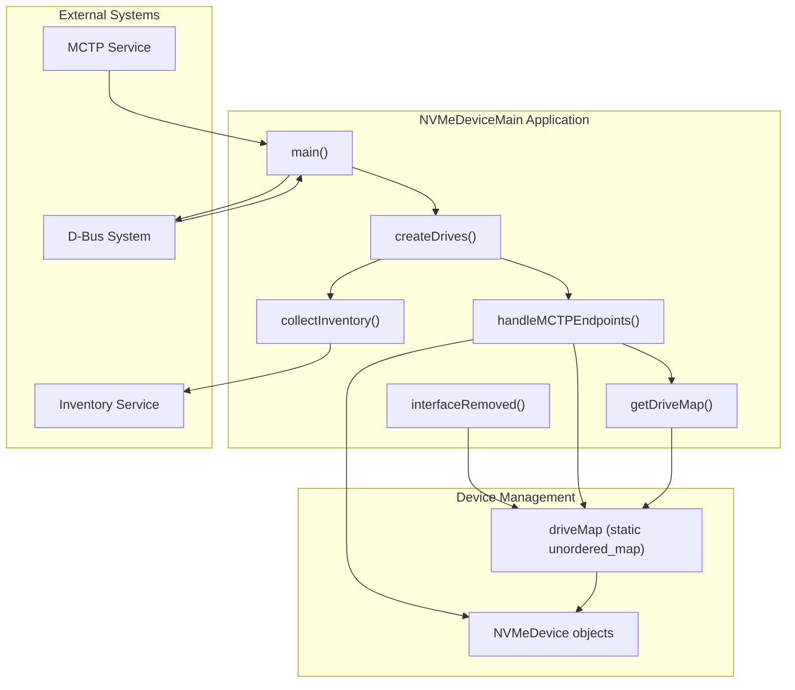
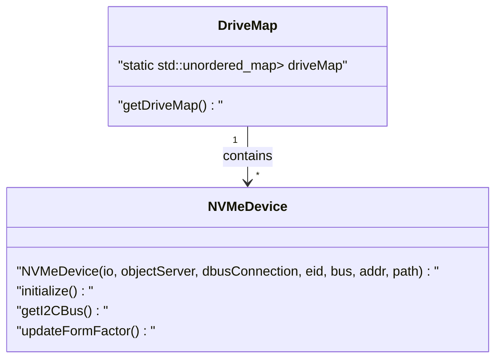
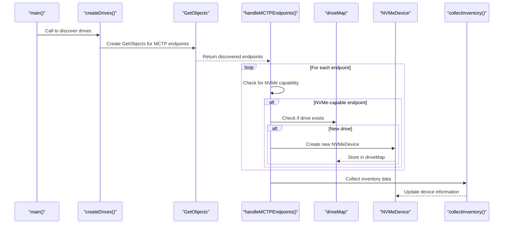
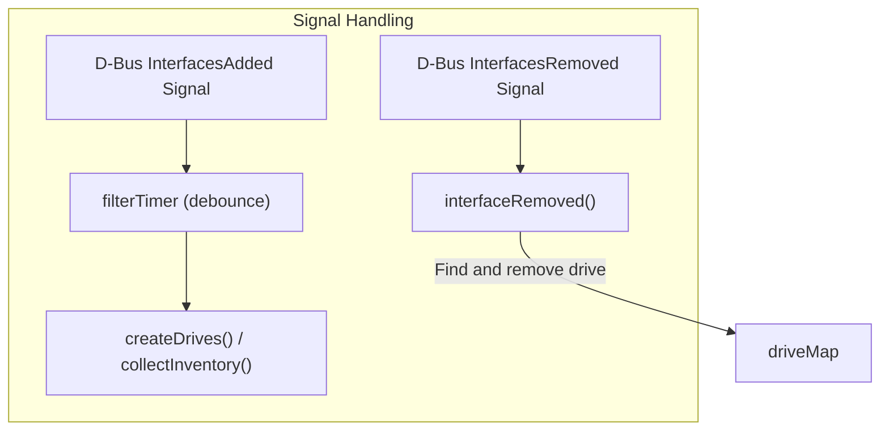
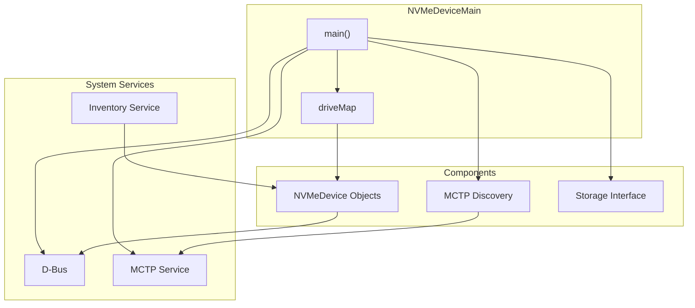

<!-- source: DeepWiki mcp.deepwiki.com · repo NVIDIA/nvidia-nvme-manager · page 3.2 NVMeDeviceMain · fetched 2026-10-26 -->

# NVMeDeviceMain

Relevant source files

The following files were used as context for generating this wiki page:

- [src/NVMeDeviceMain.cpp](src/NVMeDeviceMain.cpp)

## Purpose and Overview

The `NVMeDeviceMain` component serves as the main application entry point and central coordinator for the NVIDIA NVMe Manager system. It is responsible for discovering NVMe devices via MCTP (Management Component Transport Protocol) endpoints, creating and managing device objects for each discovered drive, and handling device lifecycle events.

This document focuses specifically on the main application structure and MCTP endpoint management. For information about the NVMe device representation, see [NVMeDevice Class](#3.1), and for details on the low-level NVMe communication, see [NVMe Management Interface](#3.3).

Sources: [src/NVMeDeviceMain.cpp:258-365]()

## Component Architecture

The `NVMeDeviceMain` component orchestrates the discovery and management of NVMe devices by connecting various subsystems together. It acts as the central hub that initializes the system, discovers and monitors devices, and manages their lifecycle.

### Architecture Diagram

Sources: [src/NVMeDeviceMain.cpp:14-18](), [src/NVMeDeviceMain.cpp:124-211](), [src/NVMeDeviceMain.cpp:258-365]()

## Core Data Structures

The primary data structure in `NVMeDeviceMain` is the drive map, which maintains a collection of all active NVMe device objects keyed by their Endpoint ID (EID).

Sources: [src/NVMeDeviceMain.cpp:14-18]()

## Key Functions

### Main Application Flow

The `main()` function initializes the application environment and sets up the necessary event handlers and signal matchers for device discovery and management.

Key responsibilities include:
- Setting up the Boost ASIO IO service
- Creating a D-Bus connection
- Configuring signal handlers for MCTP endpoint discovery
- Initializing the drive discovery process
- Setting up event handlers for interface additions and removals
- Running the main event loop

Sources: [src/NVMeDeviceMain.cpp:258-365]()

### Drive Discovery and Management

Sources: [src/NVMeDeviceMain.cpp:213-226](), [src/NVMeDeviceMain.cpp:124-211]()

### MCTP Endpoint Handling

The `handleMCTPEndpoints()` function processes discovered MCTP endpoints to identify NVMe-capable devices and create corresponding `NVMeDevice` objects. It:

1. Examines each endpoint for NVMe Management Interface (NVMe-MI) capability
2. Extracts the endpoint ID (EID) and communication address
3. Retrieves I2C bus information if available
4. Creates new `NVMeDevice` objects for previously undiscovered endpoints
5. Stores new devices in the drive map for lifecycle management

Sources: [src/NVMeDeviceMain.cpp:124-211]()

### Inventory Collection

The `collectInventory()` function retrieves inventory data from the system to enhance drive information:

1. Creates a `GetObjects` instance to query the system inventory service
2. Requests inventory items with specific interfaces related to drives, NVMe, I2C devices, and location information
3. Processes the retrieved data in `handleEmEndpoints()` to update drive properties
4. Initializes drives with the collected information

Sources: [src/NVMeDeviceMain.cpp:107-122](), [src/NVMeDeviceMain.cpp:20-105]()

## Event Handling

`NVMeDeviceMain` employs an event-driven architecture to respond to changes in the system, such as:

### Interface Addition
When a new MCTP endpoint or NVMe drive is added to the system, the application receives a D-Bus signal and triggers the drive discovery process after a short debounce period.

### Interface Removal
When an MCTP endpoint is removed, the `interfaceRemoved()` function is called to handle the cleanup of the corresponding NVMe device object.

Sources: [src/NVMeDeviceMain.cpp:312-332](), [src/NVMeDeviceMain.cpp:228-256]()

## System Integration

`NVMeDeviceMain` integrates with several other system components:

1. **D-Bus System**: Used for inter-process communication and signal handling
2. **MCTP Service**: Provides endpoint discovery and communication channel to NVMe devices
3. **Inventory Service**: Supplies detailed information about NVMe drives
4. **Storage Interface**: Exposes drive information through a standardized interface

Sources: [src/NVMeDeviceMain.cpp:297-301](), [src/NVMeDeviceMain.cpp:267-271]()

## Error Handling

The main function includes robust error handling to catch and log any exceptions that occur during operation. This ensures that unexpected errors don't crash the application without proper logging.

Sources: [src/NVMeDeviceMain.cpp:354-364]()

---

