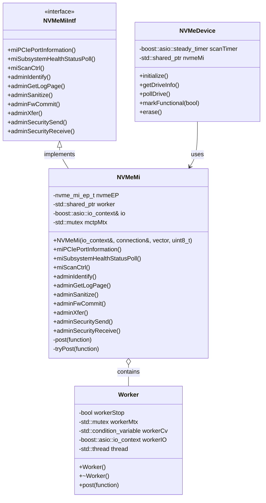
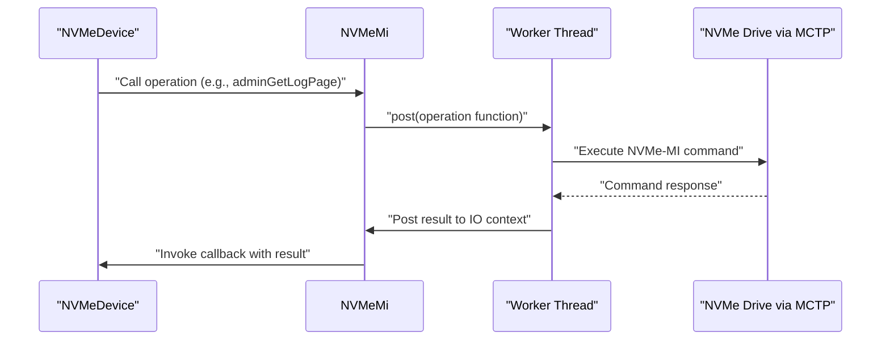
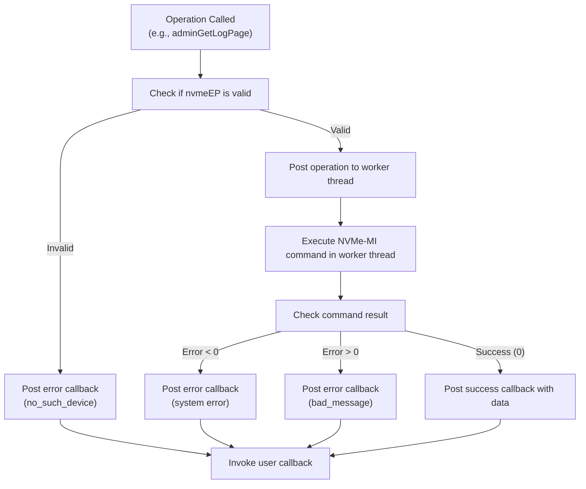

<!-- source: DeepWiki mcp.deepwiki.com · repo NVIDIA/nvidia-nvme-manager · page 3.3 NVMeMi Class · fetched 2026-10-26 -->

# NVMeMi Class

<details>
<summary>Relevant source files</summary>

The following files were used as context for generating this wiki page:

- [include/NVMeMi.hpp](include/NVMeMi.hpp)
- [src/NVMeMi.cpp](src/NVMeMi.cpp)

</details>


## Purpose

The NVMeMi class provides the low-level interface for communicating with NVMe storage devices using the NVMe Management Interface (NVMe-MI) protocol over MCTP (Management Component Transport Protocol). It implements operations for drive health monitoring, controller scanning, device identification, log page retrieval, and administrative commands like secure erase operations. This class serves as the critical bridge between the NVMe Manager and the physical NVMe devices.

For information about the high-level NVMe device management, see [NVMeDevice Class](#3.1).

Sources: [include/NVMeMi.hpp:9-10](), [src/NVMeMi.cpp:28-73]()

## Class Architecture

NVMeMi inherits from NVMeMiIntf interface and uses std::enable_shared_from_this for proper lifecycle management. It implements a worker thread model for executing NVMe-MI commands asynchronously to avoid blocking the main application thread.

### Class Relationship Diagram



Sources: [include/NVMeMi.hpp:9-10](), [include/NVMeMi.hpp:90-108](), [src/NVMeMi.cpp:75-110]()

## Worker Thread Model

The NVMeMi class uses a dedicated worker thread model to handle asynchronous operations without blocking the main application thread. The worker thread executes NVMe-MI commands and posts results back to the main IO context upon completion.

### Key features of the worker thread model:

1. **Thread pooling**: Worker threads are shared among NVMe-MI endpoints that use the same underlying bus, preventing unnecessary thread creation
2. **Asynchronous execution**: All NVMe-MI operations are executed in the worker thread and results are posted back to the main IO context
3. **Thread safety**: Operations are serialized using mutexes to ensure thread safety

### Worker Execution Flow



Sources: [include/NVMeMi.hpp:90-108](), [src/NVMeMi.cpp:75-126](), [src/NVMeMi.cpp:14-18]()

## Core Operations

The NVMeMi class provides several categories of operations for interacting with NVMe devices. All operations follow an asynchronous callback pattern, where results are delivered through a provided callback function.

### Management Interface Operations

| Method | Description | Parameters |
|--------|-------------|------------|
| miPCIePortInformation | Retrieves PCIe port information | Callback for port info |
| miSubsystemHealthStatusPoll | Polls health status of the NVMe subsystem | Callback for health status |
| miScanCtrl | Scans for NVMe controllers on the endpoint | Callback for controller list |

### Admin Commands

| Method | Description | Parameters |
|--------|-------------|------------|
| adminIdentify | Retrieves identification data from an NVMe controller | Controller, CNS, NSID, CNTID, readLength, callback |
| adminGetLogPage | Retrieves log pages (SMART, errors, etc.) | Controller, LID, NSID, LSP, callback |
| adminSanitize | Executes sanitize operations (secure erase) | Controller, sanitize action, overwrite parameters, callback |
| adminFwCommit | Commits firmware images | Controller, action, slot, BPID, callback |
| adminXfer | Low-level interface for arbitrary admin commands | Controller, request header, data, timeout, callback |

### Security Operations

| Method | Description | Parameters |
|--------|-------------|------------|
| adminSecuritySend | Sends security protocol data | Controller, protocol, protocol specific, data, callback |
| adminSecurityReceive | Receives security protocol data | Controller, protocol, protocol specific, transfer length, callback |

Sources: [include/NVMeMi.hpp:25-68](), [src/NVMeMi.cpp:152-1208]()

## Command Execution Flow

All NVMeMi operations follow a similar pattern for execution and error handling:



Sources: [src/NVMeMi.cpp:687-952]()

## Error Handling

NVMeMi uses `std::error_code` for error reporting, which is passed to callback functions along with any data retrieved from the device:

| Error Code | Description | When Used |
|------------|-------------|-----------|
| std::errc::no_such_device | NVMe endpoint is invalid or inaccessible | When nvmeEP is null or worker thread has stopped |
| std::errc::bad_message | NVMe-MI protocol error | When command returns positive error code |
| std::errc::invalid_argument | Invalid parameters | When parameters like transfer length exceed limits |
| System error codes | Underlying system errors | When commands return negative error codes |

In addition to the error code, most operations also return NVMe-specific status information to provide more detailed error information to the caller.

Sources: [src/NVMeMi.cpp:135-150](), [src/NVMeMi.cpp:242-252]()

## Implementation Details

### Key Class Members

| Member | Type | Description |
|--------|------|-------------|
| nvmeEP | nvme_mi_ep_t | NVMe-MI endpoint handle from libnvme-mi |
| worker | std::shared_ptr\<Worker\> | Worker thread for asynchronous operations |
| io | boost::asio::io_context& | Reference to main IO context |
| mctpMtx | std::mutex | Mutex for thread-safe MCTP operations |
| nvme_mi_xfer_size | constexpr int | Maximum transfer size for NVMe-MI messages |

### Special NVMe-MI Commands

The class implements specialized handling for certain complex operations:

1. **Telemetry Log Retrieval**: Handles both host and controller telemetry logs with special create/retain options
2. **Identify Command**: Provides both full and partial data retrieval options for efficiency
3. **Secure Erase**: Implements the sanitize command with various erase methods

Sources: [include/NVMeMi.hpp:71-133](), [src/NVMeMi.cpp:558-610](), [src/NVMeMi.cpp:411-556]()

## Usage Example

When the NVMeDevice class needs to retrieve SMART data for health monitoring, it would use the NVMeMi interface like this:

```
NVMeDevice calls:
  nvmeMi->adminGetLogPage(controller, NVME_LOG_LID_SMART, 0, 0, [callback])

NVMeMi:
  1. Posts the operation to worker thread
  2. Worker thread executes nvme_mi_admin_get_nsid_log()
  3. Result is posted back to IO context
  4. Callback is invoked with SMART data

NVMeDevice then:
  - Processes SMART data
  - Updates health status
  - Generates events if needed
```

Sources: [src/NVMeMi.cpp:687-940]()

---

