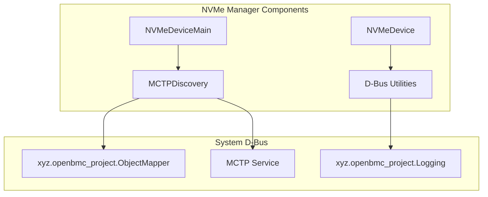
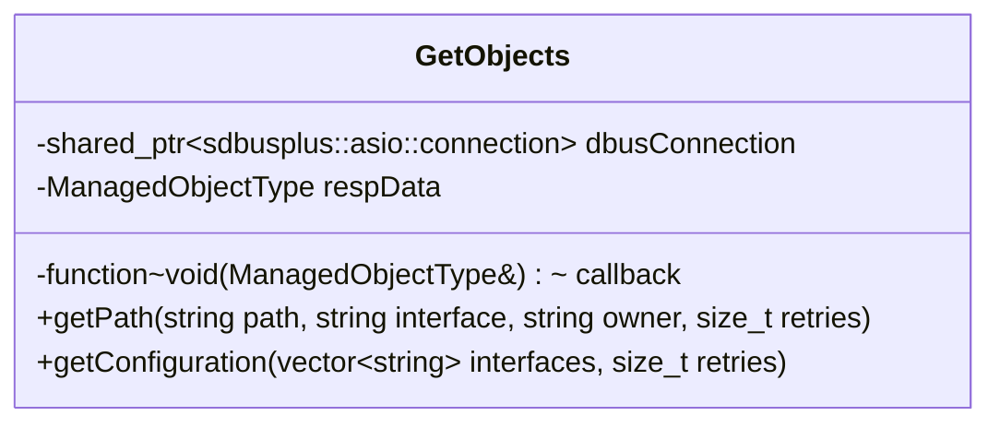
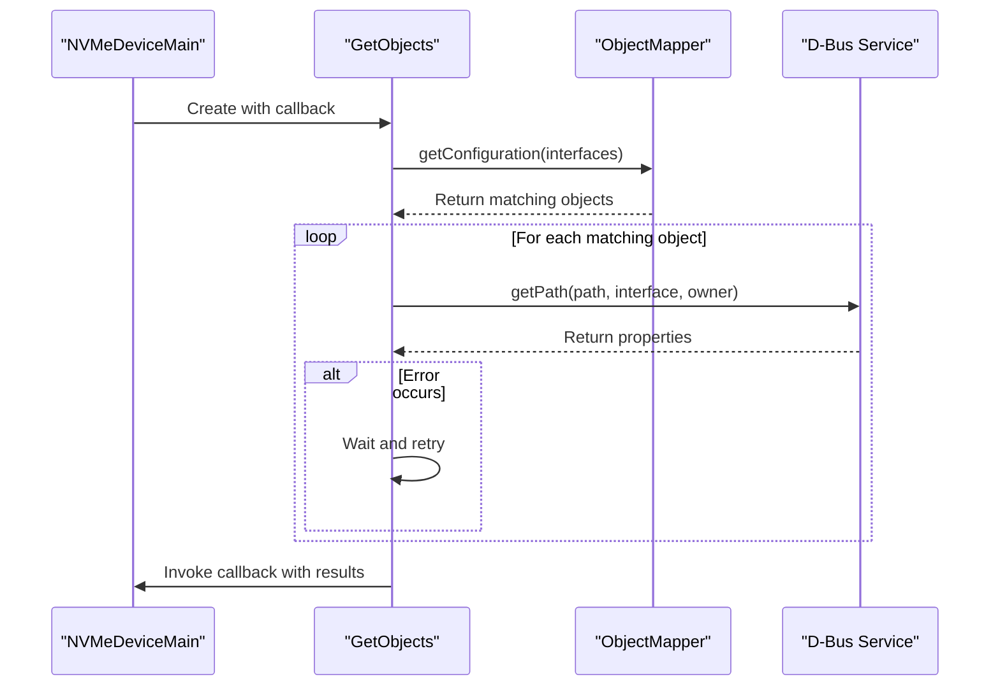
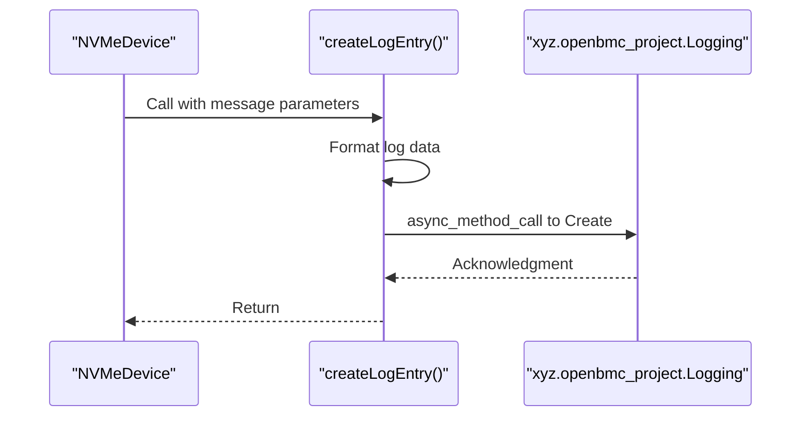
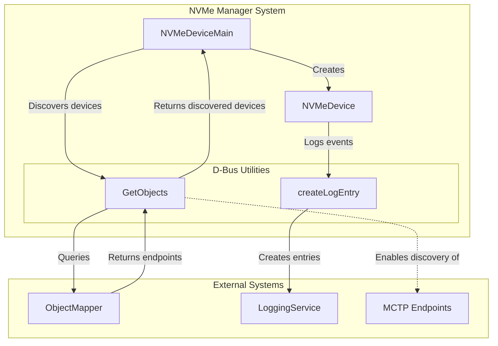

<!-- source: DeepWiki mcp.deepwiki.com · repo NVIDIA/nvidia-nvme-manager · page 3.4 D-Bus Utilities · fetched 2026-10-26 -->

# D-Bus Utilities

<details>
<summary>Relevant source files</summary>

The following files were used as context for generating this wiki page:

- [include/MCTPDiscovery.hpp](include/MCTPDiscovery.hpp)
- [include/dbusutil.hpp](include/dbusutil.hpp)

</details>


## Purpose and Scope

This document details the D-Bus utilities used within the NVIDIA NVMe Manager. These utilities facilitate communication with the D-Bus system, enabling device discovery, property retrieval, and system logging. The D-Bus utilities serve as a critical bridge between the NVMe Manager and other system components, providing standardized interfaces for inter-process communication.

For information about the NVMe Management Interface implementation, see [NVMeMi Class](#3.3). For details about how MCTP endpoints are discovered, see [MCTP Endpoint Discovery](#2.2).

## Overview of D-Bus in NVIDIA NVMe Manager

The NVIDIA NVMe Manager uses D-Bus for two primary purposes:

1. **Device Discovery** - Finding MCTP endpoints and NVMe devices through D-Bus object queries
2. **System Logging** - Creating structured log entries for system events and errors



Sources: [include/MCTPDiscovery.hpp](include/MCTPDiscovery.hpp), [include/dbusutil.hpp](include/dbusutil.hpp)

## D-Bus Discovery Utilities

The D-Bus discovery utilities provide mechanisms to find and interact with objects on the D-Bus system. These utilities are primarily implemented in the `GetObjects` class.

### GetObjects Class

The `GetObjects` class is designed to asynchronously discover D-Bus objects that match specific interfaces. It provides methods to query object paths, retrieve their properties, and handle the discovery process with retry capabilities.



Sources: [include/MCTPDiscovery.hpp:71-212](include/MCTPDiscovery.hpp:71-212)

### Key Methods

#### getPath

The `getPath` method retrieves properties for a specific D-Bus path and interface, owned by a particular service:

```
void getPath(const std::string& path, const std::string& interface, 
             const std::string& owner, size_t retries = 5)
```

This method:
- Makes an asynchronous D-Bus method call to the specified owner
- Requests property data via the `org.freedesktop.DBus.Properties.GetAll` interface
- Stores retrieved data in the `respData` member
- Implements retry logic with exponential backoff in case of failures

Sources: [include/MCTPDiscovery.hpp:85-126](include/MCTPDiscovery.hpp:85-126)

#### getConfiguration

The `getConfiguration` method discovers D-Bus objects that implement specific interfaces:

```
void getConfiguration(const std::vector<std::string>& interfaces, size_t retries = 0)
```

This method:
- Queries the D-Bus Object Mapper for objects implementing specified interfaces
- For matching objects, calls `getPath` to retrieve their properties
- Implements retry logic if the mapper call fails

Sources: [include/MCTPDiscovery.hpp:128-202](include/MCTPDiscovery.hpp:128-202)

### Discovery Process Flow

The following diagram illustrates the process flow for discovering D-Bus objects:



Sources: [include/MCTPDiscovery.hpp:71-212](include/MCTPDiscovery.hpp:71-212)

## D-Bus Logging Utilities

The D-Bus logging utilities provide a standardized way to create log entries in the system journal via D-Bus. These utilities are implemented in the `dbusutil.hpp` file.

### createLogEntry Function

The `createLogEntry` function creates structured log entries through the D-Bus logging service:

```
void createLogEntry(std::shared_ptr<sdbusplus::asio::connection>& conn,
                   const std::string& messageID, const Level& level,
                   const std::string& arg0, const std::string& arg1,
                   const std::string& resolution,
                   const std::string& ooc,
                   const std::string& logNamespace = "StorageDevice")
```

This function:
- Creates a log entry with Redfish-compatible message formatting
- Specifies severity levels and additional metadata
- Sends the log entry to the system logging service via D-Bus

Sources: [include/dbusutil.hpp:20-69](include/dbusutil.hpp:20-69)

### Logging Data Flow

The following diagram illustrates the flow of logging data through the D-Bus interfaces:



Sources: [include/dbusutil.hpp:20-69](include/dbusutil.hpp:20-69)

## D-Bus Message Structure

The D-Bus utilities use specific message structures for different operations. The table below summarizes the main message types:

| Operation | D-Bus Interface | Method | Parameters | Return Type |
|-----------|----------------|--------|------------|-------------|
| Object Discovery | xyz.openbmc_project.ObjectMapper | GetSubTree | path, depth, interfaces | GetSubTreeType |
| Property Retrieval | org.freedesktop.DBus.Properties | GetAll | interface | Properties map |
| Log Creation | xyz.openbmc_project.Logging.Create | Create | messageID, severity, additionalData | None |

Sources: [include/MCTPDiscovery.hpp:45-58](include/MCTPDiscovery.hpp:45-58), [include/dbusutil.hpp:57-68](include/dbusutil.hpp:57-68)

## Integration with NVMe Manager

The D-Bus utilities integrate with the NVMe Manager system in several key areas:



Sources: [include/MCTPDiscovery.hpp](include/MCTPDiscovery.hpp), [include/dbusutil.hpp](include/dbusutil.hpp)

## Type Definitions

The D-Bus utilities use several custom type definitions to handle D-Bus messages and objects:

| Type | Definition | Purpose |
|------|------------|---------|
| BasicVariantType | std::variant<...> | Represents various D-Bus property value types |
| Properties | boost::container::flat_map<std::string, BasicVariantType> | Map of property names to values |
| DbusObject | boost::container::flat_map<std::string, Properties> | Map of interface names to properties |
| ManagedObjectType | boost::container::flat_map<object_path, DbusObject> | Map of object paths to objects |
| GetSubTreeType | std::vector<std::pair<...>> | Result type for GetSubTree operations |

Sources: [include/MCTPDiscovery.hpp:27-38](include/MCTPDiscovery.hpp:27-38)

## Error Handling

The D-Bus utilities implement robust error handling to deal with transient failures in D-Bus communication:

1. **Retry Mechanism** - Both `getPath` and `getConfiguration` methods support retrying failed operations
2. **Timeout Handling** - Asynchronous timers are used to implement backoff between retries
3. **Error Logging** - Errors are logged to the system journal via the `lg2` logging facility

For example, if an endpoint is temporarily unavailable, the discovery process will retry up to 5 times with a 10-second delay between attempts.

Sources: [include/MCTPDiscovery.hpp:97-120](include/MCTPDiscovery.hpp:97-120), [include/MCTPDiscovery.hpp:138-161](include/MCTPDiscovery.hpp:138-161)

## Summary

The D-Bus utilities in the NVIDIA NVMe Manager provide essential functionality for:

1. Discovering MCTP endpoints and NVMe devices
2. Retrieving property information from D-Bus objects
3. Creating structured log entries for system events
4. Handling communication errors with robust retry mechanisms

These utilities abstract the complexity of D-Bus communication, allowing the rest of the system to interact with D-Bus services through a simplified interface.

---

