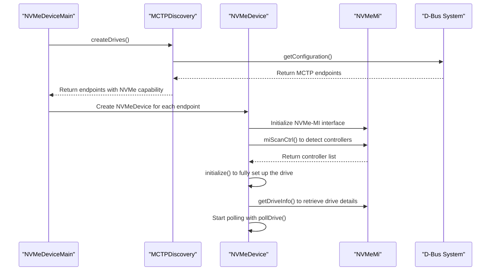
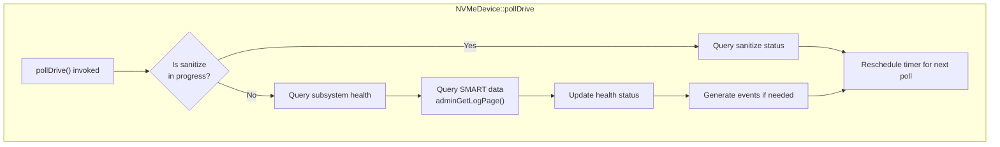
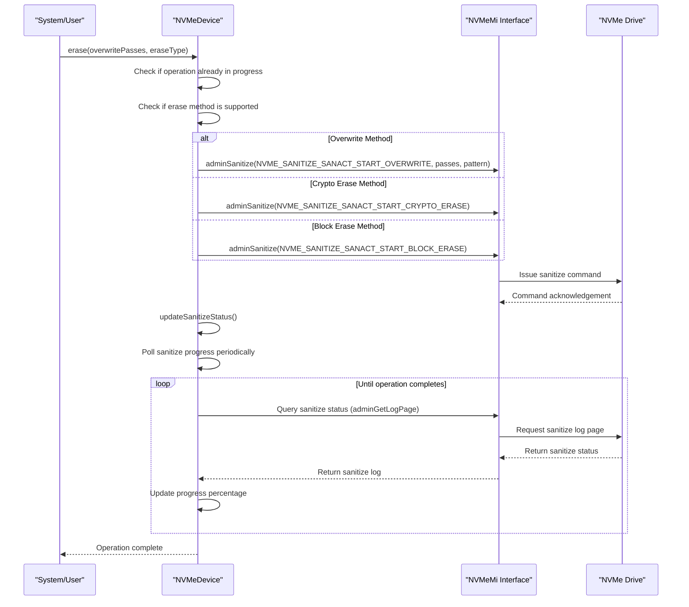
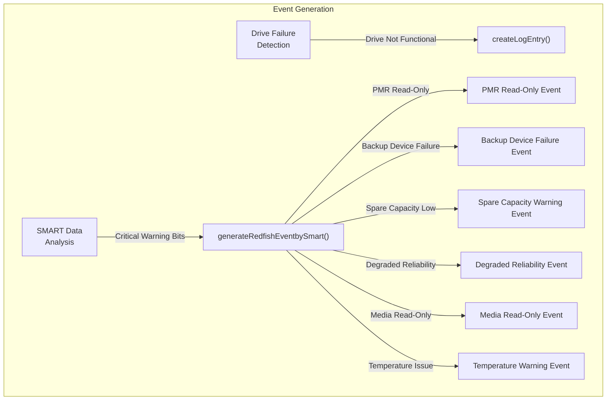
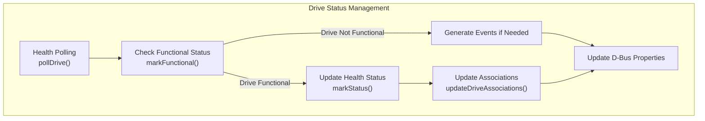

<!-- source: DeepWiki mcp.deepwiki.com · repo NVIDIA/nvidia-nvme-manager · page 4 Features and Operations · fetched 2026-10-26 -->

# Features and Operations

Relevant source files

The following files were used as context for generating this wiki page:

- [include/NVMeDevice.hpp](include/NVMeDevice.hpp)
- [src/NVMeDevice.cpp](src/NVMeDevice.cpp)
- [src/NVMeDeviceMain.cpp](src/NVMeDeviceMain.cpp)

This document provides an overview of the key features and operational capabilities of the NVIDIA NVMe Manager. This component is responsible for managing NVMe storage devices within a server environment, providing health monitoring, secure erase operations, and event generation for NVMe drives discovered through MCTP endpoints.

For detailed information about the system architecture, see [System Architecture](#2), and for information about the specific components, see [Key Components](#3).

## Drive Discovery and Management

The NVIDIA NVMe Manager discovers and manages NVMe drives connected to the system through the MCTP (Management Component Transport Protocol) interface. It creates and manages NVMeDevice objects that represent physical NVMe drives.

Sources: [src/NVMeDeviceMain.cpp:213-226](), [src/NVMeDeviceMain.cpp:124-211](), [src/NVMeDevice.cpp:310-342]()

## Drive Health Monitoring

The NVMe Manager continuously monitors the health status of connected NVMe drives by periodically polling them for SMART (Self-Monitoring, Analysis, and Reporting Technology) data and subsystem health information.

### Health Monitoring Process

The NVMeDevice polls each drive at regular intervals (defined by `pollInterval` which is set to 5 seconds) to check:

1. Overall subsystem health status through `miSubsystemHealthStatusPoll()`
2. SMART data through `adminGetLogPage()` with the `NVME_LOG_LID_SMART` parameter
3. During sanitize operations, it polls the sanitize progress instead of health data

The system monitors several critical health indicators:

| Health Indicator | Description | Source Field |
|------------------|-------------|--------------|
| Drive Life Used | Percentage of drive life that has been used | `pdlu` from subsystem health status |
| Backup Device Fault | Volatile memory backup device failure | `NVME_SMART_CRIT_VOLATILE_MEMORY` flag |
| Capacity Fault | Available spare capacity below threshold | `NVME_SMART_CRIT_SPARE` flag |
| Temperature Fault | Drive temperature exceeds thresholds | `NVME_SMART_CRIT_TEMPERATURE` flag |
| Degraded Reliability | NVMe subsystem reliability degradation | `NVME_SMART_CRIT_DEGRADED` flag |
| Media Fault | Media has been placed in read-only mode | `NVME_SMART_CRIT_MEDIA` flag |
| PMR Read-Only | Persistent Memory Region is read-only | `NVME_SMART_CRIT_PMR_RO` flag |

When health issues are detected, the system updates the drive's health status and generates appropriate events.

Sources: [src/NVMeDevice.cpp:472-673](), [src/NVMeDevice.cpp:373-398](), [src/NVMeDevice.cpp:400-448]()

## Secure Erase Operations

The NVIDIA NVMe Manager supports secure erase operations for NVMe drives, allowing for the secure deletion of data on the drives. These operations use the NVMe sanitize command to ensure data is properly cleared.

### Supported Erase Methods

The system determines the supported erase methods for each drive during initialization by examining the drive's sanitize capability (`sanicap`) field. It supports three methods:

| Erase Method | Description | Capability Flag |
|--------------|-------------|----------------|
| Crypto Erase | Uses cryptographic erasure for quick secure erase | `NVME_CTRL_SANICAP_CES` |
| Block Erase | Erases blocks of data on the physical media | `NVME_CTRL_SANICAP_BES` |
| Overwrite | Overwrites data with a predefined pattern | `NVME_CTRL_SANICAP_OWS` |

### Erase Operation Flow

During sanitize operations, the system:
1. Initiates the appropriate sanitize command based on the selected method
2. Sets the operation status to InProgress
3. Periodically polls the sanitize status log to check progress
4. Updates the progress percentage based on estimated completion time
5. Finalizes the operation when complete

The sanitize progress is tracked and can be monitored through the D-Bus interface.

Sources: [src/NVMeDevice.cpp:674-751](), [src/NVMeDevice.cpp:450-470](), [include/NVMeDevice.hpp:120-138]()

## Event Generation

The NVIDIA NVMe Manager generates events for various drive conditions to notify system administrators and management software of potential issues or status changes.

### Event Types and Conditions

The system generates Redfish events for the following conditions:

1. Drive Failure Events
   - Generated when a drive becomes non-functional
   - Uses critical severity level
   - Includes resolution guidance for drive replacement

2. SMART Warning Events
   - Generated when specific SMART warning bits are set
   - Uses warning severity level
   - Includes specific details about the warning condition
   - Provides guidance appropriate for the condition (typically PFA - Predictive Failure Analysis)

3. Temperature Events
   - Generated when temperature exceeds or falls below thresholds
   - Includes guidance to check the resource condition

All events include:
- Event type (typically ResourceEvent.1.0.ResourceErrorsDetected)
- Severity level (Warning or Critical)
- Drive identifier
- Description of the issue
- Resolution guidance
- Redfish resource path for the affected drive

Events are generated through the D-Bus logging interface and can be accessed through the system's event log and Redfish API.

Sources: [src/NVMeDevice.cpp:400-448](), [src/NVMeDevice.cpp:373-398](), [src/NVMeDevice.cpp:600-665]()

## Drive Status Management

The NVIDIA NVMe Manager maintains and updates the status of each NVMe drive based on health information and drive presence.

### Drive Status States

The system tracks various status states for each drive:

| Status Type | Description | D-Bus Interface |
|-------------|-------------|-----------------|
| Functional Status | Whether the drive is operational | OperationalStatus |
| Health Status | OK, Warning, or Critical based on SMART data | Health |
| Presence Status | Whether the drive is physically present | Item |
| Progress Status | Status and percentage of ongoing operations | Progress |

### Status Update Flow

When drive health or status changes, the system:
1. Updates the internal status flags
2. Updates the corresponding D-Bus properties
3. Modifies the drive's associations to reflect the new status
4. Generates appropriate events if needed

The status information is exposed through the D-Bus interface, allowing other system components to monitor and respond to drive status changes.

Sources: [src/NVMeDevice.cpp:373-398](), [src/NVMeDevice.cpp:343-372](), [src/NVMeDevice.cpp:138-157]()

## Inventory Integration

The NVMe Manager integrates with the system inventory to provide comprehensive information about the NVMe drives.

### Drive Information

During drive initialization, the system collects detailed information about each drive, including:

| Information | Description | Source |
|-------------|-------------|--------|
| Manufacturer | Drive manufacturer, determined from vendor ID | From identify data |
| Serial Number | Drive serial number | From identify data |
| Model | Drive model name | From identify data |
| Firmware Version | Drive firmware version | From identify data |
| Capacity | Drive storage capacity | From identify data |
| Form Factor | Physical form factor of the drive | From inventory data |
| PCIe Link Speed | Current and maximum PCIe link speed | From PCIe port information |

This information is published through the D-Bus interface, making it available to other system components. The data is collected primarily through the NVMe Identify command and PCIe port information queries.

Sources: [src/NVMeDevice.cpp:214-283](), [src/NVMeDevice.cpp:284-308](), [src/NVMeDeviceMain.cpp:20-105]()

---

